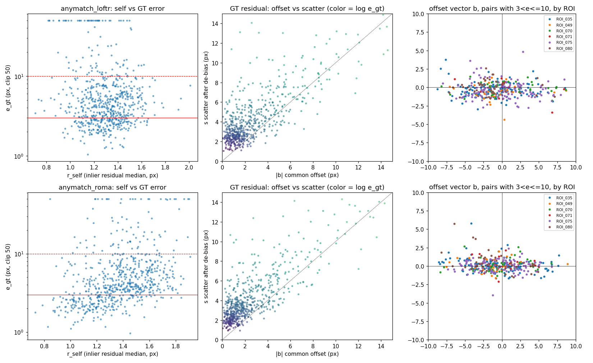

本实验在本数据集上 zero-shot 运行现有的多模态匹配方法与通用匹配方法，作为后续所有实验的比较起点。之后又用其中两个方法的结果，诊断 3 px 以内的失败来自哪里。

## zero-shot 基线

**实验目的**

本工作的出发点是：现有多模态匹配器在月球光学–SAR 影像上 zero-shot 效果不够好，但能提供一个好的起点。为了把「不够好」落到数字上，并为选择底座提供依据，把近年的方法在本数据集上统一重跑一遍，看各自的失败是什么样子。方法按三条标准挑选：优先最近、效果最好的方法；优先跨模态方法；也包括近年效果好的传统跨模态方法。

**实验方法**

所有方法都不训练，使用官方权重、官方默认分辨率和官方预处理，匹配结果统一用 RANSAC（3 px）估计仿射。方法分三类：

- 在多模态数据上微调过的匹配器：MatchAnything、MINIMA、AnyMatch 三篇数据引擎论文放出的全部权重，即 MatchAnything 的 ELoFTR、RoMa，MINIMA 的 SuperPoint + LightGlue、LoFTR、RoMa、ELoFTR、XoFTR，AnyMatch 的 LoFTR、EDM、RoMa；
- 原版匹配器：LoFTR、XoFTR、SuperPoint + SuperGlue、GeoFormer；
- 跨模态专用方法：RIFT2（传统方法，基于相位一致性）、RMSO-ConvNeXt（模板匹配网络）、CoMIR（对比学习得到两种模态的共享表示，再在表示上做 SIFT 匹配）。

「未配准」直接取恒等变换，作为下限。

输入统一处理：光学除以 255；SAR 取前两个波段之和转成 dB，截断到 −25 dB，再按每个 patch 自身的 2% 和 98% 分位数拉伸到 [0, 1]。两者都保持浮点，不量化。

有三个方法的接入需要说明。RMSO-ConvNeXt 官方只在 512 px 的光学图中找一个 256 px 的 SAR 模板；这里在 SAR 上按步长 32 取 9 × 9 个模板，每个模板的中心与它在光学图上找到的位置作为一对对应点。CoMIR 用官方在航拍 RGB–近红外数据上训练的模型，取官方刚体 RANSAC 之前的 SIFT 匹配。MINIMA 的 ELoFTR 没有官方推理代码，用 ELoFTR 的官方代码加载，配置是推断的。

每个方法接入后，先用光学图与它自身平移 (7, −5) px 的副本做自检，确认坐标换算正确。RMSO-ConvNeXt 的两个分支权重不同，不适用这个自检。

**实验结果**

各方法的失败方式分为四类。

| 类别 | 方法 | 每对匹配数中位 |
|---|---|---|
| 能粗配准 | AnyMatch-RoMa、MatchAnything-RoMa、AnyMatch-LoFTR、MINIMA-RoMa | 859–10000 |
| 中档 | GeoFormer、RMSO-ConvNeXt | 306、81 个模板 |
| 总能估出仿射，但几乎全错 | LoFTR、MatchAnything-ELoFTR、MINIMA-LoFTR、RIFT2、CoMIR | 68–2100 |
| 几乎不出匹配 | XoFTR、MINIMA-XoFTR、SuperPoint + SuperGlue、MINIMA-SuperPoint + LightGlue、AnyMatch-EDM、MINIMA-ELoFTR | 0–11 |

几乎不出匹配的六个方法在光学自检上都正常，换用另外两种 SAR 输入映射后仍然不出匹配（另一个实验）。

总能估出仿射的五个方法里，LoFTR、MatchAnything-ELoFTR、MINIMA-LoFTR 在 Val 上 56%–79% 的对误差超过 20 px，原版 LoFTR 的 AUC@10 甚至低于未配准。RIFT2 每对约 2100 个匹配，全部对的误差都超过 20 px；它的平移自检通过，不是接入问题。CoMIR 每对约 80 个匹配，RANSAC 内点只有 4 个左右，基本是随机匹配；分别换用表示的三个通道，结果相同。

中档的两个方法受精度限制。GeoFormer 的精匹配是离散的，在 480 px 的网格上以 2 px 为步长，自检就有约 1 px 的误差。RMSO-ConvNeXt 每个模板只估一个整像素的局部平移，81 个模板中位只有 10 个成为内点。

另有两处固有误差：MINIMA-ELoFTR 自检有 0.5–1 px 的误差，MatchAnything-ELoFTR 两侧有约 0.3 px 的不对称偏差。

SOMA（AAAI 2026）开源了代码，但没有发布权重，没有跑。

**实验结论**

只有在多模态数据上微调过的三个 RoMa 和 AnyMatch-LoFTR 可用：Val 上 10 px 内的成功率为 77%–87%，3 px 内只有 26%–30%。它们能粗配准，但精度不够，与本工作的出发点一致，可以作为训练的起点。其余方法要么几乎不出匹配，要么匹配几乎全错。不出匹配的方法换了输入映射也不出匹配，说明问题在模型本身认不出月球 SAR。

CoMIR 的结果只说明它不能 zero-shot 迁移到月球光学–SAR，不说明它在本数据上训练后的能力。

## 3 px 以内的失败来自哪里

**实验目的**

在设计不用标注的训练信号时，调研发现内点数、残差、匹配之间的一致性这类信号，只检查匹配自身是否自洽；整套匹配一起偏移时，它们全都满足。头部方法 10 px 内的成功率已有 85% 左右，3 px 内却只有 30% 左右。如果 3 px 以内的失败主要是这种整体偏移，这类信号就碰不到瓶颈。本诊断看这部分失败是整体偏移还是随机噪声。

**实验方法**

取 AnyMatch-LoFTR 和 AnyMatch-RoMa 在 Val 652 对上的结果，逐对计算四个量：

- 自洽残差：RANSAC 内点在估计仿射下的残差中位数；
- 真值误差：评价协议的误差，即人工检查点经估计仿射映射后的平均距离；
- 标注下限：只用这一对自己的 8 个检查点，最小二乘拟合一个仿射后的残差。任何仿射在这一对上的误差都不会低于它；
- 共同偏移：检查点残差的均值向量，即估计仿射相对检查点整体偏了多少。

按真值误差分档统计。

**实验结果**

AnyMatch-LoFTR 各档的中位数（px）：

| 真值误差档 | 对数 | 真值误差 | 自洽残差 | 标注下限 | 共同偏移 |
|---|---|---|---|---|---|
| 0–3 | 191 | 2.48 | 1.29 | 1.71 | 1.08 |
| 3–5 | 190 | 3.82 | 1.31 | 2.65 | 1.75 |
| 5–10 | 175 | 6.39 | 1.36 | 3.31 | 4.45 |
| 10–20 | 45 | 12.82 | 1.27 | 4.77 | 10.08 |
| 20 以上 | 51 | 104.21 | 1.18 | 2.92 | 103.56 |

AnyMatch-RoMa 的规律相同，自洽残差在各档都是 1.2–1.5 px。

在 3–10 px 档里，自洽残差与真值误差的 Spearman 秩相关只有 0.08（LoFTR）和 0.13（RoMa）。

全部对中，标注下限的中位数为 2.55 px，35% 的对超过 3 px；3–10 px 档里这一比例为 46%–47%。用其中 7 个检查点拟合仿射、预测第 8 个点，误差中位数为 3.8 px。去掉每对中残差最大的一个检查点后，超过 3 px 的比例降到 13%。

3–10 px 档的共同偏移集中在 x 方向：x 分量的标准差为 3.5 / 3.3 px（LoFTR / RoMa），y 分量只有 1.1 / 1.0 px；x 分量超过 2 px 的对占 56%–57%，y 分量超过 2 px 的只占 4%–7%。偏移的正负逐对变化，同一区域内也不同向。两个方法在同一对上的偏移部分一致（秩相关约 0.45）。

**实验结论**

3 px 以内的失败不是随机噪声。它主要来自两部分：一是标注本身，35% 的对任何仿射都过不了 3 px，所以 3 px 成功率的上限约为 0.65；二是沿 x 方向的逐对整体偏移。自洽残差在各档几乎不变，对这两部分都不敏感，只看匹配自身是否自洽的训练信号碰不到它们。

两个方法的偏移部分一致，推测偏移来自影像内容或标注，而不是某个网络本身，未经验证。x 方向是否对应 SAR 的距离向、偏移是地形引起的还是标注偏差，本诊断不能区分。

## 2026-11-17：原版 SP+LightGlue 在 10 px 内的成功率不足 1%

**摘要**

原先测过 MINIMA-SP+LightGlue，但没有测官方原版。本次补用原版 SuperPoint 检测与描述、LightGlue 匹配，在原始 Val/Test 上不训练地运行。两个 split 的 10 px 成功率分别为 0.31% 和 0.52%；大部分 patch 对虽然能由匹配点估出仿射，检查点误差仍很大。光学已知平移自检能恢复变换，所以下面的低分与坐标接入自检结果分开报告。

**引言**

本实验中的跨模态权重与原版网络是不同的方法。MINIMA-SP+LightGlue 的结果不能替代官方原版权重的读数，因此按照 #268 的范围补齐这一参照，仍以 B0 的原始 Val/Test、输入映射与统一仿射评测为准。

**方法**

*官方实现与输入。* 使用 `cvg/LightGlue@edb2b838efb2ecfe3f88097c5fad9887d95aedad`，直接构造 `SuperPoint()` 与 `LightGlue(features="superpoint")`。保留官方默认：SuperPoint 不限制关键点总数、内部按长边 1024 缩放，LightGlue 匹配阈值为 0.1。不给输入额外套 MINIMA 的长边 640 缩放，不换入 MINIMA 权重，也不量化 B0 的浮点映射。官方提取器已将关键点映回输入网格，适配器直接取返回的匹配索引和置信度，再由 B0 的 RANSAC 3 px 估计仿射。

*权重与运行。* 使用官方 `superpoint_v1.pth` 和 `superpoint_lightglue_v0-1_arxiv.pth`，在独立 `TORCH_HOME` 缓存里链接并核对实际加载文件；路径与 SHA256 记录在 `launch/splg.json`。种子为 0，在 160 的 V100-SXM2 32 GB 上按 split 分段推理；没有用 Test 选设置。本次评价 Val/Test 的全部有标注 patch 对（652/953 对），逐对清单与已归档 AnyMatch-RoMa、MatchAnything-RoMa、MINIMA-RoMa 和 LoFTR 各自相应 split 的清单完全相同。

**结果**

*光学自检恢复的仿射误差小于 0.16 px。* 对前三个光学 patch 与其平移 (7,-5) px 的副本匹配，在四角与中心五处量恢复仿射相对已知平移的距离。三对的最大距离分别为 0.148、0.093、0.152 px，匹配数为 905、957、907，内点数为 888、951、899。离散点对相对已知平移的残差中位数均为 0.5 px；这是点对定位残差，与拟合后仿射恢复误差不同，也不代表月球光学–SAR 的真实配准精度。[自检完整记录](extra/supplement268/splg_selfcheck.json)保留逐对仿射。

*月球光学–SAR 上大部分预测未落到正确位置。* 两个 split 均没有程序执行错误、缺失或重复；失败率只统计不能由点对估出仿射的情况，能估出但配错的预测继续按真实检查点误差评价。

| split | patch 对数 | AUC@3 | AUC@5 | AUC@10 | SR@3 | SR@5 | SR@10 | 不能估计仿射 | 检查点误差中位（px） |
|---|---:|---:|---:|---:|---:|---:|---:|---:|---:|
| Val | 652 | 0 | 0.000140 | 0.001326 | 0/652 | 1/652 | 2/652 | 74/652（11.35%） | 327.40 |
| Test | 953 | 0 | 0.000127 | 0.002095 | 0/953 | 2/953 | 5/953 | 138/953（14.48%） | 355.97 |

表 1：原版 SP+LightGlue 在原始 Val/Test 上的配准结果。AUC 为 0–1 标度，SR 用成功对数/总对数表示；不能估计仿射及其他失败按现行协议计为无穷误差。

两个 split 的每对匹配数中位数均为 8，RANSAC 内点数中位数均为 3。Val/Test 分别有 578/815 对能估出仿射，但只有 2/5 对在 10 px 内成功，因此“能给出变换”不能当作成功配准。全部阈值、95% 区间、匹配数量和覆盖核对见 [补测统计](extra/supplement268/splg_report.json)与本实验的 `metrics.json`；旧方法的指标保持原样。

**讨论**

这一结果补上了原版稀疏参照：在当前输入与官方默认配置下，原版 SP+LightGlue 在两个 split 上的 10 px 成功率都不足 1%。自检验证了已知光学平移的坐标恢复；它不能证明跨模态匹配正确，也没有检验换预处理、调阈值或在月面训练后的能力。本次没有做这些改变。

## 2026-11-17：原版 RoMa 的 10 px 成功率为 18.71% 和 21.09%

**摘要**

本次同时补齐官方原版 RoMa v1 outdoor 参照。在相同的有标注 Val/Test patch 对上，原版 RoMa 均能估出仿射，但 10 px 内成功率只有 18.71% 和 21.09%，检查点误差中位数分别为 165.01 和 151.93 px。原版 SP+LightGlue 与原版 RoMa 的完整结果都作为 B0 新方法追加，原有 18 种方法的指标与本次先完成的 SP+LightGlue 结果保持原样。

**引言**

原先的 RoMa 参照来自 MatchAnything、MINIMA 和 AnyMatch 发布的跨模态权重，缺少原版 outdoor 权重。本节补测它在本任务上的表现，并保留官方推理与旧跨模态 wrapper 之间的区别，避免把两种不同接入路径当作只换权重的消融。

**方法**

*原版模型与浮点入口。* 使用 `Parskatt/RoMa@77f8d68803526dcddfd9b7a46bc76125bdc25f15`、官方 `roma_outdoor.pth` 和 DINOv2 ViT-L/14 权重。数据映射与 B0 相同；在浮点输入上按官方方式做 bicubic、antialias 缩放和 ImageNet 归一化，分别构造 560×560 与 864×864 两种分辨率，交给官方 `match` 的 tensor 与显式 high-res 入口。没有外层长边 640 缩放，也没有经过 uint8 PIL。模型沿用官方对称匹配和混合精度；float32 矩阵乘精度设为 highest。使用官方 `use_custom_corr=false` 的 PyTorch 相关性实现，配置与实际环境均有记录。

*采样、坐标与评测。* 每个 patch 对按种子 0 从稠密匹配场采样 10000 个点对，转换回原始 patch 的像素中心坐标，再沿用统一 RANSAC 3 px 估计仿射。原始 10000 点用于拟合并保留在服务器 `raw/supplement268/roma`；工作台点对文件按既有记录规范保存置信度最高的最多 2000 点。Val/Test 分别为与旧四个参照逐对清单相同的 652/953 对；不训练、不搜参、不按 Test 选设置。在 160 的 V100-SXM2 32 GB、PyTorch 2.1.2+cu118 上按 split 分段推理。实际加载权重的 SHA256、完整配置及启动起止状态见 `launch/roma.json`。

原始匹配 meta 的 commit 保留了 `9f849fd-dirty`。通用 `baselines.match.git_head` 检查包含运行时更新的已跟踪 `launch/roma.json`，代码范围的正式启动检查则均为 `dirty=false`、`allow_dirty=false`，预测 meta 也均为 `dirty=false`。检测范围差异可解释该标记；[来源核对记录](extra/supplement268/provenance_audit.json)保存同期字段、检查定义及推理代码/配置未改的 Git 差异。原始逐文件 status 清单当时未保存，不补造历史清单，也不改写原始 meta。

**结果**

*光学已知平移自检的最大仿射恢复误差低于 0.057 px。* 三个自检 patch 对各采样 10000 点，均为 RANSAC 内点；相对已知 (7,-5) px 平移，四角与中心五处的最大误差分别为 0.0524、0.0542、0.0563 px。点对位移残差中位数分别为 0.0435、0.0417、0.0417 px。它们验证坐标接入，不能用作光学–SAR 的配准精度。[自检记录](extra/supplement268/roma_selfcheck.json)保留了全部读数。

*能估出仿射的 patch 对仍多数不在 10 px 内。* Val/Test 全部 patch 对都写出预测，没有程序执行错误、缺失、重复或仿射估计失败。真实检查点上的结果如下。

| split | patch 对数 | AUC@3 | AUC@5 | AUC@10 | SR@3 | SR@5 | SR@10 | 检查点误差中位（px） |
|---|---:|---:|---:|---:|---:|---:|---:|---:|
| Val | 652 | 0.009631 | 0.042363 | 0.101063 | 31/652 | 79/652 | 122/652 | 165.01 |
| Test | 953 | 0.025207 | 0.062076 | 0.123391 | 85/953 | 136/953 | 201/953 | 151.93 |

表 2：原版 RoMa 在原始 Val/Test 上的配准结果。AUC 为 0–1 标度，SR 用成功对数/总对数表示。

每对 RANSAC 内点数中位数为 783/822，而匹配点数固定为采样数 10000，不是检测到的独立特征数量。Val/Test 的 SR@10 单方法 95% 自助法区间分别为 [15.49%, 21.78%] 和 [18.68%, 23.71%]。完整协议指标、区间、数量及覆盖核对见 [原版 RoMa 统计](extra/supplement268/roma_report.json)与 `metrics.json`。

**讨论**

原版 RoMa 补测显示，在本数据与本次官方配置下，它可以给全部 patch 对拟合仿射，但只有约五分之一在 10 px 内。原版 RoMa 的 Val/Test AUC@5 为 0.042/0.062，低于既有 AnyMatch-RoMa 的 0.236/0.231。这是完整模型与其官方推理路径的比较：旧跨模态 RoMa wrapper 有额外缩放和 PIL 量化，本次使用官方浮点双分辨率入口，因此不能单独把分数差解释成训练数据或权重带来的因果效果。本次没有改变输入映射、搜索阈值或在月面训练，也没有从仿射估计成功推断匹配正确。

## 2026-11-17：ReDFeat 的 10 px 成功率在 Val/Test 为 0.15%/0.21%（#269）

**摘要**

此前的 B0 没有覆盖 ReDFeat 的官方光学–SAR 预训练模型。本次使用公开的 VIS-SAR 权重，不在月球数据上训练，补跑原始 Val 652 对和 Test 953 对。两份 split 均完整输出，执行错误为 0；10 px 内的成功率分别为 0.15% 和 0.21%，检查点平均误差的逐对中位数为 388.44 px 和 383.94 px。大多数 patch 对能估出仿射，但按本项目检查点评价时基本没有配准成功。

**引言**

ReDFeat 用两个模态分支提取关键点与描述子，再通过描述子匹配获得对应。它提供了在地球光学–SAR 数据上预训练的模型，适合作为现有多模态通用匹配器之外的专用参照。本次只回答这个公开模型在本月球数据上 zero-shot 的表现，结果作为 B0 的新方法 `redfeat` 追加。

**方法**

*模型与输入。* 使用 [官方 ReDFeat](https://github.com/ACuOoOoO/ReDFeat) 的 `66df80027dcb649118259a91cadbff4b50adc880` 和 `Pretrained/VIS_SAR.pth`；权重 SHA256 为 `6294dcbd7b116c02bba4b7704ed8495ead1666a81494b14630945014ffaeea24`。不训练、不挑权重、不搜索参数。光学和 SAR 的数据侧映射沿用 B0：光学除以 255；SAR 前两波段求和后转 dB，下限 −25 dB，再逐 patch 做 2%–98% 分位数拉伸。之后按官方模型执行三通道复制和逐通道 z-score，不增加 uint8 量化。

*匹配与几何。* 光学使用 `forward1`、SAR 使用 `forward2`，保留官方多尺度金字塔：尺度因子为 2 的 1/4 次方，最小边长参数 256、最大 1000；对原始 512² patch，依次使用 512/431/362/304/256² 五层。重复性 NMS 阈值为 0.4，检测边界 10 px，每侧最多 4096 个特征，ratio 阈值 0.9；金字塔坐标按像素中心回映到原始网格。取官方 demo 本质矩阵过滤之前的点对，统一使用 B0 的 RANSAC 3 px 仿射。完整点对保存在 `raw/redfeat/`；工作台预测与点对按既有 `PredWriter` 规则写入 `preds/redfeat/`。正式匹配代码为 `d8f8b8f506b60c87399f474120bc6507907f7419`，入口与完整参数见 `launch/redfeat.json`；两个 split 的仿射拟合分别记录在 `launch/redfeat_fit_val269.json`、`launch/redfeat_fit_test269.json`。

*数据与评价。* Val 652 对、Test 953 对的标识及顺序与权威 B0 已存档预测完全一致。沿用 `workbench.protocol` 的检查点平均距离、AUC、SR 和失败计入方式，单方法 95% 区间按 1000 次逐对重抽、种子 0 计算。以下“未能估计仿射”专指没有足够点对生成仿射，不能与检查点误差超过成功阈值混为一谈。两份 split 都在 160 的 V100、GPU 1 上以 FP32 推理，关闭 TF32，种子 0；未做难版扰动。

*坐标检查。* CPU 契约测试用已知峰值验证真实多尺度提取路径的归一化、NMS、排序、像素中心回映及分支顺序。随后用 3 张光学 patch 及其平移 (7, −5) px 的副本，分别检查同一模态分支与实际跨分支路径；同分支检查只是坐标诊断，不改变正式模型。平移截距误差是估计仿射平移列到 (7, −5) 的距离，与正式的检查点平均误差不同。

| 检查路径 | 每对匹配数范围 | 平移截距误差范围（px） | 线性项相对单位阵的最大元素偏差 |
|---|---:|---:|---:|
| 两侧均 forward1 | 2635–2842 | 0.29–0.55 | 0.00312 |
| 两侧均 forward2 | 1233–1589 | 0.30–1.93 | 0.00329 |
| forward1 → forward2 | 862–1017 | 0.79–4.77 | 0.00590 |

表 1：同分支与跨分支的平移诊断读数不同，不能统称亚像素自检。逐对仿射、内点数和原始平移残差见 [自检记录](extra/selfcheck269_redfeat.json)。

**结果**

*原始 Val/Test 的 10 px 成功率均低于 0.3%。* 两份 split 的正式指标如下。原有 18 个方法的全部指标和评价协议与补测前逐值相等；旧预测没有重写。

| split | AUC@3 | AUC@5 | AUC@10 | SR@3（%） | SR@5（%） | SR@10（%） | 逐对误差中位数（px） |
|---|---:|---:|---:|---:|---:|---:|---:|
| Val | 0 | 0 | 0.000163 | 0 | 0 | 0.153 | 388.44 |
| Test | 0 | 0.000386 | 0.000847 | 0 | 0.105 | 0.210 | 383.94 |

表 2：Val 只有 1/652 对在 10 px 内，Test 为 2/953 对。完整指标及区间见 `metrics.json` 和 [补测统计](extra/baseline269_results.json)。

*大多数 patch 对能生成仿射，内点数中位只有 3。* 两份 split 都没有执行错误或漏预测；未能生成仿射的对全部是匹配点不足。

| split | 预测对数 | 生成仿射 | 匹配不足 | 未能估计仿射（%） | 匹配数中位 | 内点数中位 | 逐对匹配耗时中位（s） |
|---|---:|---:|---:|---:|---:|---:|---:|
| Val | 652 | 592 | 60 | 9.20 | 6 | 3 | 0.499 |
| Test | 953 | 867 | 86 | 9.02 | 5 | 3 | 0.499 |

表 3：点数统计覆盖全部有标注 patch 对，失败对的内点数计 0；匹配阶段总耗时为 372.3/504.3 s。能生成仿射不代表通过检查点评价。

*已有头部参照的存档读数高于本次 ReDFeat。* 下表只复用补测前的 B0 指标，不重跑旧方法，也不据此比较跨机器的耗时。

| 方法 | Val AUC@5 | Test AUC@5 | Val SR@10（%） | Test SR@10（%） |
|---|---:|---:|---:|---:|
| AnyMatch-RoMa | 0.236443 | 0.230863 | 86.81 | 81.53 |
| MatchAnything-RoMa | 0.228116 | 0.226115 | 86.04 | 78.59 |
| MINIMA-RoMa | 0.210333 | 0.214476 | 77.30 | 73.87 |
| ReDFeat | 0 | 0.000386 | 0.153 | 0.210 |

表 4：在同一检查点评价协议下，ReDFeat 的这份公开权重没有超过原有头部参照。

**讨论**

这次补测给出了官方 VIS-SAR 权重在当前固定输入、统一仿射协议下的月面 zero-shot 读数，不涉及在月球数据上训练后的能力。不同分支的光学平移诊断精度也有差别，本节没有将它们解释成实际光学–SAR 错配的原因。FHReg、VMGGA、MIFNet-SP/XFeat 尚未取得本环境可用的完整权重依赖，不进入分母，也不记为模型失败；本节不能用于比较全部地球专用方法。

作者是否发布与本环境是否取得文件分别记录。2026-11-17 在 160 上实际执行了匿名、禁用未知代理的小元数据请求，每个响应最多读取 32 KiB；结果见 [服务器可得性探针](extra/availability269.json)。160 的 11080/17890 没有下载隧道监听，154 经复查仍无法连接，文档所载的学院内网下载路径没有恢复。以下缺项按票面“不可获取时记录证据并跳过”的规则记为本轮未测，不赋失败分数。

| 配置 | 作者发布状态 | 实际 HTTP／文件获取状态 | 传输约束与本轮状态 |
|---|---|---|---|
| FHReg | [官方 GUSO 源码](https://github.com/vision-heng/GUSO)与 Google Drive 预训练权重入口已发布 | 160 的 Drive 文件夹元数据请求返回 `URLError: [Errno 99] Cannot assign requested address`；未取得可校验 checkpoint | 缺少学院内网大权重下载通道；未测 |
| VMGGA | [官方源码](https://github.com/yeyuanxin110/VMGGA)提供光学–SAR 百度权重分享与公开提取码；Google Drive 为 TBA | 160 可达分享页，HTTP 200、标题“百度网盘 请输入提取码”；实际得到的是 HTML，不是 checkpoint。不能由此声称权重已下载，也不能声称作者未开源或必须账号登录 | 缺少已核实的学院内网权重获取路径；未测 |
| MIFNet-SP | [官方源码](https://github.com/lyp-deeplearning/MIFNet)有 SP 相关实现，并提供统一 Dropbox checkpoint 入口；本轮未核验入口内 SP 权重文件清单 | 160 请求 Dropbox 元数据为同一 `Errno 99`；必需的 SD2.1 依赖也未取得，详见下文 | 缺少完整权重依赖与内网大文件通道；未测 |
| MIFNet-XFeat | 官方源码与测试入口明确使用 `mifnet_remote_xfeat.tar`，checkpoint 统一发布在 Dropbox | 同上，未取得 MIFNet checkpoint 与 SD2.1 完整依赖 | 缺少完整权重依赖与内网大文件通道；未测 |

表 5：四个未测配置保留发布与获取状态，不把环境障碍写成方法未开源。此次只请求公开元数据，没有下载这些大权重。

MIFNet 官方指定 `stabilityai/stable-diffusion-2-1`。160 请求其官方 API 为 `Errno 99`，请求 hf-mirror 对应 API 为 HTTP 404、`Repository not found`，且此前未发现服务器缓存。另一次本机匿名元数据复核的官方 API 状态是 HTTP 401，单独记录在 [本机 API 复核](extra/availability269_client.json)；这个 401 不是服务器请求结果。两种 MIFNet 变体均未换用来源不明的扩散权重，也未为补齐表格自行训练。
