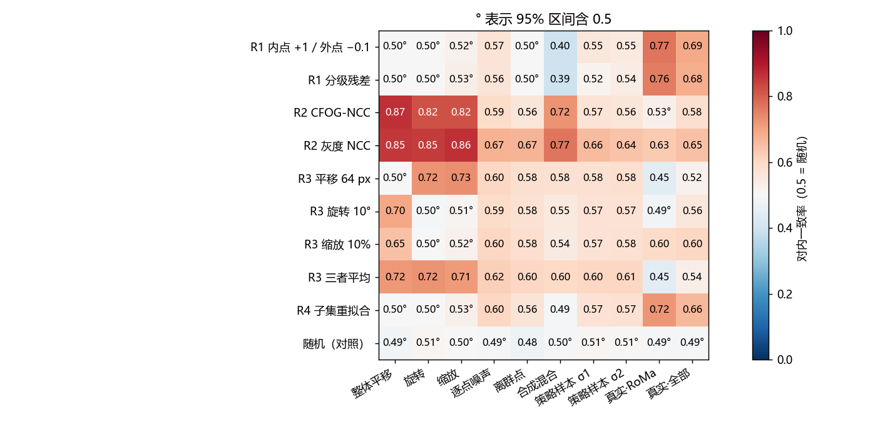
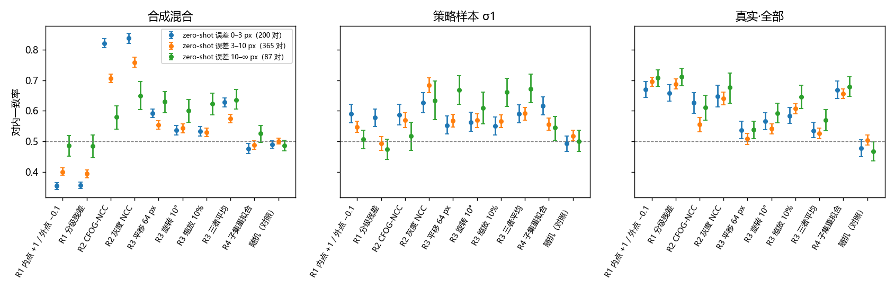

# 候选 reward 各自只看得见一类误差，在策略样本之间都只比随机略好

**摘要**

要在 AnyMatch-RoMa 上做无标注强化学习，先得有一个不用标注、却能把误差小的输出排在前面的 reward。我们在 Val 的 652 对上，为每一对造出误差已知的多份输出：在 zero-shot RoMa 的点对上叠加整体平移、旋转、缩放、逐点噪声和离群点，模拟 RL 策略的组内采样，再加上 8 个现成模型的实际输出。然后看 5 类候选 reward 在同一对内部的排序与真实误差是否一致。结果分成三点。第一，整体的仿射误差只有影像相似度（R2）看得见，对内一致率 0.82–0.87；内点类（R1）和子集重拟合（R4）对它完全看不见。第二，不同模型的实际输出之间，R1 排得最好（3 个 RoMa 模型间 0.77），R2 只有 0.53–0.63。第三，在 RL 真正要比较的策略样本之间，所有 reward 都只略好于随机，最好的是灰度 NCC（0.66），R1 只有 0.52–0.55。随机 reward 在各族都是 0.49–0.51。因此，灰度 NCC 和 R1 可以进入首批训练，两者互补；已知合成扰动一致性（R3）和 R4 应淘汰。整对标量 reward 在组内的信号很弱，组大小和方差控制要按这个强度来设计。

**引言**

【RoMa·RL】要找一种只换监督信号的训练方法：从 zero-shot 的 AnyMatch-RoMa 出发，从模型输出的分布里采样，用不可微的 reward 打分，按策略梯度更新。调研票列出了四类无标注 reward 及其已知骗法：RANSAC 内点或分级残差、warp 后的跨模态相似度、已知合成扰动的一致性、组内自洽。每一类在文献里都有「reward 涨、精度不涨」的先例（RIPE++、WarpC、AltO、SRT）。

这些先例都来自别的数据和别的模型。在月面光学–SAR 上，哪类 reward 能分辨好坏还不知道。另一个前提也没有验证：RL 只在一组采样内部比较 reward，要求的是同一对内部的排序正确，而不是跨对的相关。E3 发现 zero-shot RoMa 的误差里整体平移只占均方误差的 16–30%，主体是平移以外的误差，所以 reward 对不同种类的误差是否都敏感也要分开看。

本分析按 `CONTEXT.md` 定义的 reward 有效性检验来做。我们对同一对造出误差已知、大小不同的多份输出，用标注算出每份的真实误差，统计每个候选 reward 在对内与真实误差排序的一致程度，并按误差种类、版本来源和 zero-shot 的误差大小分开报告。标注只用来评判 reward，不参与任何训练。

**方法**

*数据与输出。* 样本是 Val 中 652 个有标注的对。输出取 E7 记录的点对：RANSAC 之前的全部匹配，按置信度截断到 2000 个，坐标在原始 512 网格上。每份输出都用 RANSAC 拟合仿射，口径与评测相同（`cv2.estimateAffine2D`，阈值 3 px）。真实误差是光学检查点经该仿射映射后到 SAR 检查点的平均距离，与评测协议一致。按 2000 点重新拟合后，zero-shot RoMa 的误差中位数为 4.03 px。

*版本族。* 一个版本是同一对的一份点对，同一族的版本在对内互相比较。

- 合成五族都以 zero-shot RoMa 的点对为底，只改 SAR 一侧，每族包括底本和 4 档误差：
  - 整体平移：1、2、3、5 px，方向逐对随机。
  - 旋转：绕 patch 中心，角度使图像边缘位移 1–5 px。
  - 缩放：各向同性，边缘位移同样为 1–5 px。
  - 逐点噪声：独立高斯，σ 为 0.5、1、2、3 px。
  - 离群点：随机替换 10%、20%、30%、50% 的点。
- 合成混合：把底本和全部 20 个合成版本放在一起比较。
- 策略样本：各 8 份，每份在全部点上加 σ 为 1 px（σ1）或 2 px（σ2）的独立高斯，对应调研票首选的策略形式（细级 warp 上的固定 σ 高斯），模拟 RL 一组内的采样。
- 真实输出：真实·RoMa 为 3 个 RoMa 模型（zero-shot、离线伪标签擦除 + 仿射第 2 轮、在 Val+Test 标注上过拟合）在这一对上的实际点对；真实·全部再加 5 个 LoFTR 系模型。

同一族内各版本真实误差的极差，逐对取中位数，从离群点族的 0.71 px 到合成混合的 3.68 px 不等；两组策略样本为 1.20 px 和 1.45 px。

*候选 reward。* 每个 reward 只用影像和这一份点对，数值越大表示越好。

| reward | 定义 | 出处 |
|---|---|---|
| R1 内点 | 对 RANSAC 仿射残差 < 3 px 的点记 +1，其余记 −0.1，取平均 | RIPE++ 的内点 / 外点打分 |
| R1 分级残差 | 残差 r 记 max(0, 1 − (r/3)²)，取平均 | 形式仿 RIPE++ 附录的分级 reward，系数自拟 |
| R2 CFOG-NCC | 用仿射把 SAR 拉到光学坐标系，在重叠区上比较 CFOG 描述子的归一化互相关 | CFOG：Ye et al., TGRS 2019；平滑尺度等参数自拟 |
| R2 灰度 NCC | 同上，比较两幅输入影像灰度的归一化互相关 | — |
| R3 平移 / 旋转 / 缩放 | 在 SAR 侧叠加 E7 的已知仿射 T（平移 64 px、旋转 10°、缩放 10%），取同一模型在扰动图上的点对拟合 A₂；reward 为 T∘A 与 A₂ 在光学网格上的平均距离取负 | WarpC 的 bipath 一致性；合成族把同一误差在扰动图上再施加一次 |
| R3 三者平均 | 上面三个的平均 | — |
| R4 子集重拟合 | 8 个随机半子集各自拟合，取它们与全体仿射的平均网格距离的负值 | 自拟，属自洽类（SRT） |
| 随机 | 均匀随机数 | 对照，同 Spurious Rewards |

*一致性的度量。* 对内一致率借用 Harrell 一致性指数（C-index，JAMA 1982）：同一对同一族的版本两两比较，只比真实误差相差至少 0.1 px 的两份。reward 较高的一份误差也较小记 1，reward 相等记 0.5，反之记 0。比较结果先在对内平均，再在有可比版本的对之间平均。0.5 等于随机，1 表示完全一致。区间是按对自助抽样 1000 次的 95% 区间。分层按 zero-shot RoMa 在这一对上的误差分成三档：< 3 px（200 对）、3–10 px（365 对）、≥ 10 px（87 对）。

*逐点检验。* 对 zero-shot RoMa 的底本，我们比较每个点相对 RANSAC 仿射的残差，和它相对标注最小二乘仿射的残差，在对内计算 Spearman 相关。标注最小二乘仿射本身在检查点上就有 2.55 px 的残差中位数，所以逐点的「真实残差」带有这么大的噪声底。

*计算。* 只用 CPU，在 126 上运行（`code/reward_validity.py`）。统计与画图由 `code/summarize.py` 完成，逐版本数据见 `extra/data/`。

**结果**

*整体的仿射误差只有影像相似度看得见。* 整体平移、旋转、缩放三族对所有点施加同一个仿射。这时 RANSAC 把误差整个吸收进拟合的仿射，残差不变，所以 R1 和 R4 的对内一致率都在 0.50–0.53，75–100% 的比较打成平手。R2 能看见这类误差：CFOG-NCC 为 0.82–0.87，灰度 NCC 为 0.85–0.86。R3 只能看见与所用 T 不可交换的误差：平移版 R3 对整体平移完全看不见（0.50），对旋转和缩放为 0.72–0.73；旋转版和缩放版 R3 正好相反，对平移为 0.65–0.70，对旋转和缩放约 0.50。把各族混在一起比较时，R1 降到 0.40，比随机还低。原因是带整体误差的版本 R1 与底本相同、误差却更大，而加了噪声的版本 R1 更低、误差却未必更大。

图 1：各 reward（行）在各版本族（列）内的对内一致率，支撑「各 reward 只看得见一类误差」的论断。红色表示与真实误差一致，蓝色表示相反；° 表示 95% 区间含 0.5。

*逐点噪声和离群点几乎改变不了真实误差，所有 reward 在这两族上都只略好于随机。* RANSAC 对噪声和离群点很稳，这两族版本之间的真实误差极差只有 0.71–1.18 px。在这两族上，灰度 NCC 最好（0.67），R1 只有 0.50–0.57，R3 和 R4 为 0.56–0.62。

*不同模型的实际输出之间，R1 排得最好。* 在 3 个 RoMa 模型之间，R1 内点的对内一致率为 0.77 [0.74, 0.79]，R1 分级残差为 0.76，R4 为 0.72；灰度 NCC 为 0.63，CFOG-NCC 为 0.53，与随机没有区别。加上 5 个 LoFTR 系模型后，R1 为 0.69，R4 为 0.66，灰度 NCC 为 0.65。模型之间的差别主要在匹配质量上，内点比例正好反映这一点。R3 在真实·RoMa 上反向排序（平移版 0.45，三者平均 0.45）：伪标签模型和标注过拟合模型在原图上误差不大，在平移 64 px 的扰动图上却输出很差，R3 惩罚的是对大扰动缺乏鲁棒性，而不是原图上的误差。

*在策略样本之间，所有 reward 都只略好于随机。* 同一份输出加 σ 为 1 px 的独立噪声得到 8 个样本，样本之间的真实误差极差中位数达到 1.20 px，这与 E4 观察到的 RANSAC 不稳定一致。但这些差别几乎都来自 RANSAC 的偶然性，不在 reward 看得见的地方。各 reward 的对内一致率如下：

| reward | 策略样本 σ1 | 策略样本 σ2 |
|---|---|---|
| 灰度 NCC | 0.66 [0.64, 0.68] | 0.64 [0.62, 0.66] |
| R3 三者平均 | 0.60 | 0.61 |
| R4 | 0.57 | 0.58 |
| CFOG-NCC | 0.57 | 0.56 |
| R1 内点 | 0.55 [0.54, 0.57] | 0.55 |
| R1 分级残差 | 0.52 | 0.54 |
| 随机 | 0.51 | 0.51 |

表 1：策略样本组内的对内一致率，支撑「策略样本之间所有 reward 都只略好于随机」的论断。

*R2 在 zero-shot 已经较准的对上最有用，R3 在误差大的对上相对更有用。* 合成混合族里，灰度 NCC 在 zero-shot 误差 < 3 px 的对上为 0.84，在 ≥ 10 px 的对上降到 0.65；R3 三者平均在三档上为 0.63、0.58、0.64，不随误差变大而下降，在 ≥ 10 px 的对上与灰度 NCC 持平。R1 在真实输出上不随分层变化（0.67–0.71）。

图 2：按 zero-shot RoMa 在该对上的误差分层的对内一致率，支撑「不同 reward 在不同误差区间有用」的论断。三列依次为合成混合、策略样本 σ1、真实·全部。

*逐点看，RANSAC 残差能大致分出好点和坏点。* 在 zero-shot RoMa 的底本上，点对 RANSAC 仿射的残差与它对标注仿射的残差，对内 Spearman 相关的平均为 0.67（中位数 0.73）。R1 判为内点的点中，54% 的标注残差 < 3 px；判为外点的点中只有 13%。考虑到标注仿射本身有约 2.5 px 的残差，这个区分度已接近标注能证实的上限。按点给 reward 有依据，但它只能把点拉向 RANSAC 仿射，碰不到整体的仿射误差。

*随机 reward 在所有族上都在 0.48–0.51，度量本身没有偏差。*

**讨论**

候选 reward 的排序能力已经分开测清楚。影像相似度是唯一能看见整体仿射误差的 reward，而 E3 显示整体平移在 zero-shot 误差中占 16–30%，加上旋转和缩放还会更多。内点类 reward 能分辨匹配质量不同的模型，也能逐点分配，但对整体仿射完全看不见，单独使用时可能出现 RIPE++ 的「内点涨、精度不涨」。两者互补。据此建议：

- 进入首批训练：灰度 NCC（整对标量，覆盖面最广，在策略样本上也最好）和 R1（分级残差或内点，可以逐点分配）。两者单用或加权组合，组合的权重留给训练实验去定。
- 淘汰：R3。它要两次前向，每个版本只看得见与所用 T 不可交换的误差，在真实 RoMa 输出上还反向排序。R4 的盲区与 R1 相同，排序能力更弱，每份要多拟合 8 次。CFOG-NCC 除整体平移外都不如灰度 NCC，不再单列。
- 随机 reward 对照照旧必做。

本检验有三点局限。第一，版本都在现有模型输出附近，检验的是局部的排序能力，没有覆盖训练中可能被利用的极端输出：R2 在恒等附近的局部极值、R1 的「全部预测为不可匹配」都不会出现在这里。这些要靠训练中的随机 reward 对照和难版评测发现。第二，策略样本由独立噪声构成，真实策略的样本之间有空间相关，结论只对调研票首选的策略形式成立。第三，真实误差受标注噪声限制，0.1 px 的比较门槛下有一部分比较落在标注噪声之内，会把所有 reward 的一致率往 0.5 拉。

对后续实验最要紧的发现是：策略样本之间的对内一致率最高只有 0.66。按整对标量给 reward 时，优势估计的大部分是噪声，组内样本要多、学习率要小，或者改用按点分配的 reward 来降方差。这一点应在首批实验的设计里直接考虑。另外，R1 在混合族上低于 0.5，提示单用 R1 训练时，模型可能用整体仿射误差换取更高的内点比例，值得在首批实验中用难版评测专门检查。
