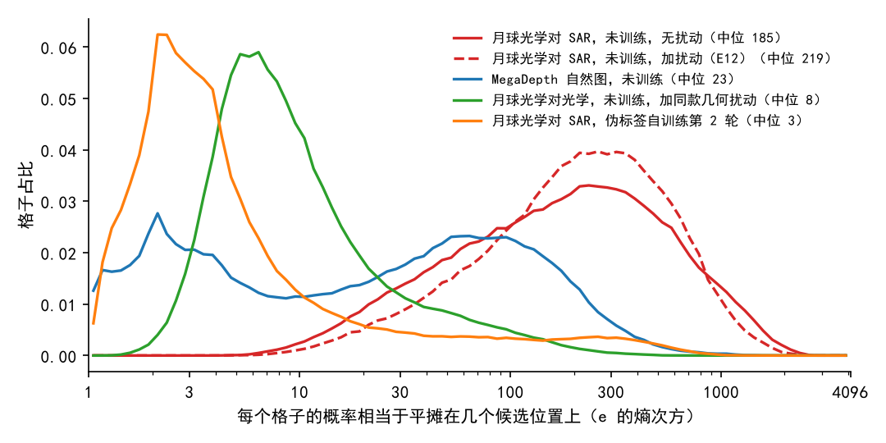

# zero-shot RoMa 粗匹配的概率很分散，主要是因为光学和 SAR 跨了模态，不是 RoMa 本身的特性

**摘要**

我们打算用强化学习在不用标注的情况下训练 RoMa，抽签的随机性来自它粗匹配给出的概率。此前的检查发现，未经训练的模型在月球光学对 SAR 的训练图上，这组概率很分散：一个典型格子的概率相当于平摊在约 220 个候选位置上。这可能是 RoMa 粗匹配本来就如此，也可能是模型不适应月球数据，此前无法区分。我们用同一个模型、同样的统计方法，比较了五种情形：月球光学对 SAR 不加扰动和加训练用扰动，自然场景的 MegaDepth 图像对，月球光学图对它自己的扰动副本，以及在月球数据上用伪标签自训练过的模型。月球光学对 SAR 不加扰动时，概率同样分散（约 185 个位置），扰动的影响很小。MegaDepth 上集中得多（约 23 个位置，有把握的格子约 3 个）；月球光学对光学即使加了同样的几何扰动，也只摊在约 8 个位置上。伪标签自训练后，同一批月球光学对 SAR 的概率收拢到约 3–4 个位置，在训练时没见过的验证图上也是如此。因此，概率分散不是 RoMa 粗匹配的固有特性，主要来自光学与 SAR 之间的模态差异；在月球数据上训练能让它变集中，伪标签训练后的集中程度可以作为强化学习训练是否走对方向的参照。

**引言**

RoMa 找两张图之间的对应时，第一步是粗匹配：把输入图（560×560）切成 40×40 个格子，模型对每个格子在另一张图上 4096 个均匀铺开的候选位置各打一个分，分数转成概率后加起来等于 1。正常使用时，每格取概率最高的位置（下称最高分位置），再由后续的细化步骤一级级修正到逐像素的匹配。强化学习训练时，我们把“取最高分位置”换成“按概率抽一个位置”，比较多次抽签结果的好坏，再提高好结果的概率。所以这组概率有多集中，决定了抽签有多随机。

此前在开跑前的检查里，我们发现未经训练的模型在月球光学对 SAR 的训练图上，这组概率非常分散：典型格子相当于平摊在约 220 个位置上，照原概率抽签时 96% 的格子抽到的都不是最高分位置。那次检查只看了月球数据，而且图上加了训练用的扰动。分散的原因因此有三种可能：RoMa 粗匹配本来就这样；扰动让匹配变难；或者模型不适应月球光学与 SAR 这类数据。这三种可能对强化学习的含义不同：如果是 RoMa 的固有特性，训练时不必指望概率变集中；如果是不适应数据，训练有效时概率应该随之收拢。

本文用同一套统计方法比较几组情形，逐一排除这些可能：去掉扰动，看扰动的影响；换成 RoMa 熟悉的自然场景图，看 RoMa 本身的表现；把 SAR 换成光学图自己，看跨模态的影响；最后看在月球数据上训练过的模型，作为训练有效时概率应往哪里走的参照。

**方法**

*模型。* 未经训练的模型用 AnyMatch 发布的 RoMa 权重（下称 zero-shot 模型）。训练过的模型取我们此前的伪标签自训练（noisy student）第 1、2 轮：先用 zero-shot 模型在训练图上打出匹配点作为伪标签，再从 zero-shot 起步训练一个新模型，第 2 轮的伪标签由第 1 轮的模型重新打；训练时 SAR 图加平移、旋转、缩放和擦除扰动。每轮取验证集 AUC@5 最高的存档，两轮的验证集 AUC@5 分别为 0.320 和 0.328，zero-shot 模型为 0.236。所有模型都只做前向，不训练。

*数据与扰动。* 月球数据取训练集 7907 对中每隔 39 对的一对，共 200 对，与此前的检查是同一批；验证集从 825 对中每隔 4 对取一对，共 200 对。训练用扰动与此前的检查相同：对 SAR 图做随机平移（128 像素以内）、旋转（±20°）、缩放（±20%），再随机擦掉 1–3 块，随机数也相同。“月球光学对光学”把 SAR 图换成同一张光学图，施加与上面完全相同的几何扰动，但不擦除。自然场景图用 LoFTR 论文发布的 MegaDepth-1500 测试集，从 1500 对中均匀取 200 对；这些是同一处建筑在不同时间、不同视角拍的照片，本身已有较大的视角变化，所以不另加扰动。MegaDepth 图像直接缩放到 560×560（不保持长宽比），与月球数据的粗匹配格子数相同。比较的各组列在表 1 中。

*怎样算集中。* 每个格子看三个量。熵衡量概率摊得有多开，e 的熵次方读作“相当于平摊在几个位置上”：熵为 0 表示全在 1 个位置上，熵为 8.32 表示平摊在全部 4096 个位置上。最高分位置的概率越接近 1 越集中。第三个量是照原概率（温度 1）每格抽 16 次时，抽到的不是最高分位置的比例。模型对每个像素还给出一个 0 到 1 的可信度；按最高分位置细化到最后，可信度在格内平均超过 0.5 的格子记为“有把握的格子”，单独统计。每组 200 对、共 32 万个格子，报告中位数。

**结果**

*复现了此前的检查。* 在加训练用扰动的月球光学对 SAR 上，本文的统计与此前的检查逐位相同：熵的中位数为 5.39，有把握的格子占 28%。下文的各组都用同一段代码算出。三个量讲的是同一个故事：熵越大，最高分位置的概率越低，抽到别处的比例越高（表 1），所以下文只报熵。

*去掉扰动，月球光学对 SAR 的概率依然很分散。* 不加扰动时，全部格子的熵中位数为 5.22，相当于平摊在约 185 个位置上；加扰动后为 5.39，约 219 个位置（图 1 两条红线）。逐对比较，扰动让一对图的平均熵只升高了 0.15（中位数），有 42% 的图对反而降低。有把握的格子也只从约 92 个位置降到约 71 个。扰动不是概率分散的主要原因。

图 1：只有月球光学对 SAR 的 zero-shot 概率是分散的，换成自然图、去掉跨模态或经过伪标签训练，都集中得多。横轴是每个格子相当于平摊在几个位置上（对数刻度），纵轴是落在这一档的格子占比；图例括号里是全部格子的中位数。

*在 RoMa 熟悉的自然图上，粗匹配的概率集中得多。* MegaDepth 上全部格子的熵中位数为 3.14，相当于约 23 个位置，比月球光学对 SAR 少了一个数量级。MegaDepth 的分布有两个峰（图 1 蓝线）：有把握的格子熵中位数为 1.08，只相当于约 3 个位置；其余格子摊得较开，可能落在天空、两图不重叠这类本来没有对应的区域（本检查没有逐格核对）。把 MegaDepth 图像改成灰度再复制成三通道输入，熵的中位数为 3.21，几乎不变，所以这一差别不来自彩色与灰度。分散的概率不是 RoMa 粗匹配本来的样子。

*把 SAR 换成光学图本身，概率同样集中，跨模态是主要原因。* 月球光学图对它自己的扰动副本，几何扰动与 SAR 组完全相同，全部格子的熵中位数为 2.07，相当于约 8 个位置。逐对比较，200 对图中每一对在光学对 SAR 时的平均熵都高于光学对光学，中位数高出 3.1。同一片月面、同样的几何扰动，只是把一侧换成 SAR，概率就从约 8 个位置散到约 219 个位置。月面地形本身并不让模型犹豫，让它犹豫的是光学与 SAR 之间的差异。

*伪标签自训练后，概率收拢到约 3–4 个位置，没见过的验证图上也一样。* 在同一批 200 对训练图上，第 1、2 轮模型的熵中位数分别为 1.49 和 1.22，相当于约 4 个和 3 个位置；有把握的格子占比从 zero-shot 的 44% 升到 65% 和 74%。伪标签模型训练时见过这些训练图，所以我们在验证集的 200 对上重复了比较：zero-shot 模型的熵中位数为 4.94（约 140 个位置），第 1、2 轮为 1.32 和 1.08，降幅与训练图上相同。逐对比较，无论训练图还是验证图，每一对的平均熵都比 zero-shot 时低，中位数低约 3.4–3.6。训练后的概率也没有收成单点：第 2 轮在验证图上最高分位置的概率中位数为 0.58，照原概率抽签时仍有 42% 的格子抽到别处。

表 1：只有 zero-shot 模型在月球光学对 SAR 上的概率是分散的。“位置数”为 e 的熵中位数次方；“非最高分比例”为温度 1 每格抽 16 次、抽到的不是最高分位置的比例（全部格子的平均）。每组 200 对。

| 模型 | 数据 | 扰动 | 有把握的格子占比 | 全部格子：熵中位数（位置数） | 最高分位置概率中位数 | 非最高分比例 | 有把握的格子：熵中位数（位置数） |
|---|---|---|---|---|---|---|---|
| zero-shot | 月球光学对 SAR，训练图 | 无 | 0.44 | 5.22（185） | 0.030 | 0.95 | 4.26（71） |
| zero-shot | 月球光学对 SAR，训练图 | 训练用扰动 | 0.28 | 5.39（219） | 0.027 | 0.96 | 4.52（92） |
| zero-shot | MegaDepth 自然图 | 无（自带视角变化） | 0.39 | 3.14（23） | 0.173 | 0.69 | 1.08（3） |
| zero-shot | 月球光学对光学，训练图 | 同样的几何扰动 | 0.31 | 2.07（8） | 0.324 | 0.66 | 1.76（6） |
| 伪标签第 1 轮 | 月球光学对 SAR，训练图 | 无 | 0.65 | 1.49（4） | 0.462 | 0.53 | 1.19（3） |
| 伪标签第 2 轮 | 月球光学对 SAR，训练图 | 无 | 0.74 | 1.22（3） | 0.531 | 0.47 | 1.03（3） |
| zero-shot | 月球光学对 SAR，验证图 | 无 | 0.52 | 4.94（140） | 0.038 | 0.94 | 4.35（77） |
| 伪标签第 1 轮 | 月球光学对 SAR，验证图 | 无 | 0.75 | 1.32（4） | 0.513 | 0.48 | 1.17（3） |
| 伪标签第 2 轮 | 月球光学对 SAR，验证图 | 无 | 0.84 | 1.08（3） | 0.582 | 0.42 | 1.00（3） |

**讨论**

此前看到的分散概率，既不是 RoMa 粗匹配的固有特性，也不是训练用扰动造成的。同一个模型在自然场景图上、在月球光学图对它自己的扰动副本上，都把概率集中在少数几个位置；只有遇到光学对 SAR，概率才摊到上百个位置。模型面对这类跨模态的输入时，在粗匹配上没有明确的赢家。在月球数据上训练能改变这一点：伪标签自训练后，概率收拢到约 3–4 个位置，验证图上同样如此，说明这不是记住了训练图。

本检查有三点局限。第一，伪标签模型训练时见过这 200 对训练图（用的是自己打的伪标签），所以训练图上的数字可能偏乐观；验证图上的降幅与之相同，减轻了这一顾虑。第二，月球光学对光学用的是同一张图和它的副本，两侧的亮度完全一致，比真实的两张光学图更容易匹配，所以它给出的是“没有模态差异时”的一个偏乐观的参照。第三，概率集中不等于定位准确：本检查没有用真值，只说明模型更笃定了；伪标签模型同时也更准（验证集 AUC@5 从 0.236 升到 0.328），但两者在逐格层面是否对应，本检查没有回答。

对强化学习训练，这一结论给出了一个参照。训练有效时，粗匹配的概率应当从约 140–220 个位置收拢到个位数，但不必收成单点：伪标签模型第 2 轮仍有约四成格子在抽签时落到别处。我们此前的首批强化学习实验里，连随机打分也在一两千步内把概率压成了单点，这与训练有效时的形状不同。值得检验的是：一次强化学习训练在验证图上的熵，是平稳地走向约 3 个位置，还是越过它塌成单点。
