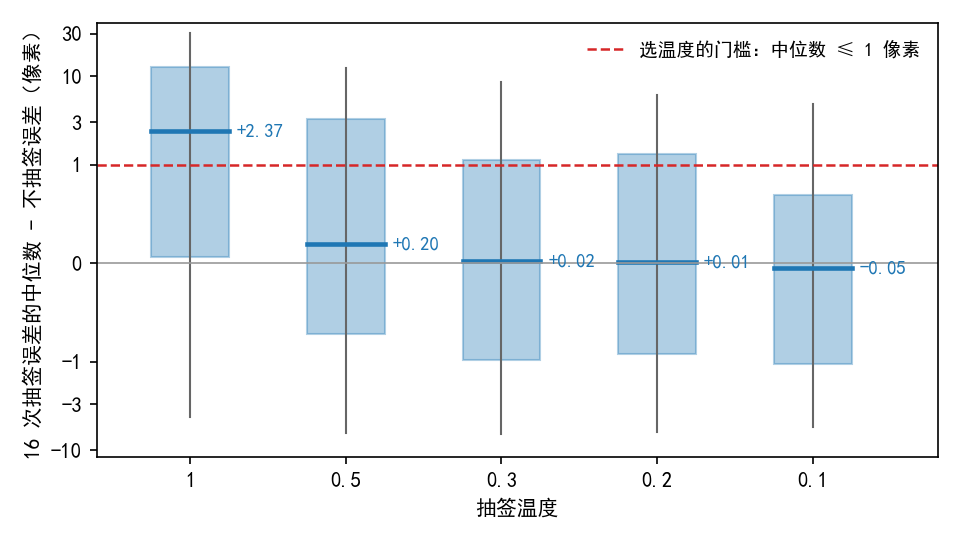

# 按真值看，照原概率抽签时多数图对的抽签结果比不抽签差；温度降到 0.5 及以下，抽签误差的中位数与不抽签相差不到 0.2 像素

**摘要**

我们在尝试用强化学习、不借助标注来训练 RoMa。做法是在粗匹配这一步按概率抽签，代替原来的“取最高分”。首批训练照模型原本的概率抽签（温度 1），开始后不久验证集上的配准精度就大幅下降。此前的检查只用不需要标注的评分，比较了抽签和不抽签的输出，没有用真值确认抽签结果是否更差。本文在验证集上取 200 对有标注的图，加上和训练相同的大幅几何扰动与擦除，用标注点和已知扰动算出真值。随后在五档温度下，每对图各抽 16 次，量每次抽签的真值配准误差，并与不抽签时比较。温度为 1 时，每对图 16 次抽签误差的中位数比不抽签多 2.37 像素（200 对的中位数）。一对图里通常有 14 次比不抽签差；33% 的图对 16 次全都更差，67% 的图对至少有一次更好。温度为 0.5 时，这个差值降到 0.20 像素，0.3、0.2、0.1 时分别为 0.02、0.01、−0.05 像素。按开跑前定好的规则（差值的中位数不超过 1 像素的最高一档），第二批训练的温度中心值为 0.5。同一对图的 16 次抽签之间，灰度相关评分越高，真值误差越小，在 80% 以上的图对里成立；吻合度评分与真值误差的这种关系弱得多。

**引言**

RoMa 分两步找两张图之间的对应。第一步是粗匹配：把输入图（560×560）切成 40×40 个格子，每个格子去另一张图上找大致的落点。另一张图上预先均匀铺了一张 64×64 的固定网格，共 4096 个候选位置，相邻两个相距 8 像素（按原图 512×512 计）。模型对每个格子给这 4096 个位置各打一个分，分数转成概率。正常使用时，每格取概率最高的位置（下称最高分位置），再细化到逐像素的匹配，最后用 RANSAC 拟合出两图之间的仿射。

强化学习需要随机性。我们把粗匹配的“取最高分”改成“按概率抽签”：同一对图抽 16 次，用一个不需要标注的评分给每次结果打分，再提高比同组平均好的那几次的概率。抽签前，每格的分数先除以一个温度再转成概率；温度为 1 就是模型原本的概率，温度越低，抽签越集中在最高分位置附近。

此前的开跑前检查发现，未训练模型的概率很分散。照原概率抽签，几乎每个格子都抽到别的位置，两种不需要标注的评分都比不抽签时低。温度降到 0.3 左右，评分与不抽签时持平。首批训练照原概率抽签，验证集上的配准精度在训练开始后不久就大幅下降。评分低不等于离正确答案远，这一点还没有用真值检验过：抽签结果按真值是否普遍比不抽签差，组内评分高的那次是否真的更准，都还不知道。第二批训练要选一个抽签温度，也需要真值来定。

本文用有标注的图和已知的合成扰动构造真值，在五档温度下比较抽签和不抽签的真值误差，按事先定好的规则选出温度中心值，并检查两种评分在组内能否按真值排序。

**方法**

*模型与数据。* 模型用 AnyMatch 发布的 RoMa 权重，未经我们训练。训练集没有标注，所以数据取自验证集：652 对有标注的图里均匀取 200 对。每对图的 SAR 一侧加上和训练相同的扰动：在半径 128 像素的圆内随机平移、旋转 ±20°、缩放 ±20%，再随机擦掉 1–3 块，不改亮度。每对图只抽一次扰动，五档温度共用。200 对的平移距离中位数为 89 像素。

*真值与误差。* 每对图带有若干标注点，每个标注点给出光学图与原始 SAR 图上的一对对应位置。扰动是我们自己施加的已知仿射，所以扰动后 SAR 图上的真值位置可以精确算出。配准误差沿用评测协议：把预测的仿射换回原始 SAR 图的坐标，光学标注点映射过去后，与 SAR 标注点的平均距离，单位为原始像素（下称标注点误差）。主指标和选温度的规则都用它。另报一种 4 角误差：用标注点最小二乘拟合一个真值仿射，比较预测仿射与它把图块 4 个角映射到的位置，取平均距离。标注点本身不完全符合一个仿射：拟合后残差的中位数为 2.6 像素。“配准成功”指标注点误差不超过 5 像素，AUC@5 为各对 max(0, 1 − 误差/5) 的平均。

*抽签。* 抽签做法与开跑前检查相同。每个格子独立抽一个位置代替最高分位置，其余照正常流程细化，再按可信度挑 5000 个匹配点，用 RANSAC（阈值 3 像素）拟合仿射。“不抽签”取最高分位置，与 RoMa 原本的输出一致。温度取 1、0.5、0.3、0.2、0.1 五档，每对图每档抽 16 次。所有抽签和不抽签都拟合出了仿射，没有失败的。

*组内比较。* 对每对图、每档温度，记下 16 次抽签中标注点误差大于不抽签的次数，以及最好的一次是否小于不抽签。差值定义为 16 次抽签标注点误差的中位数减去不抽签的标注点误差。

*温度的选择规则。* 规则在开跑前定好。在五档温度里，取差值在 200 对上的中位数不超过 1 像素的最高一档；五档都不满足时取 0.1。

*两种评分。* 两种评分与首批训练相同，都只用图像和这次抽签的结果。灰度相关评分：用拟合出的仿射把 SAR 图对齐到光学图，在重叠区域算两图灰度的归一化互相关。吻合度评分：每个像素的匹配与这次仿射差 r 像素，记 max(0, 1 − (r/3)²)，再对所有像素平均。在同一对图的 16 次抽签之间，算评分与标注点误差的秩相关（Spearman）。评分高的抽签误差小时，秩相关为负。

*逐格的距离。* 用标注点拟合的真值仿射，叠加已知扰动，得到每个粗匹配格子的中心在扰动后 SAR 图上的真值落点。只统计落点在画面内的格子，200 对共 245,801 个。对每个格子，量最高分位置和每次抽到的位置离真值落点多远，单位为原始像素。候选位置相隔 8 像素，所以这个距离最小也有几像素。“有把握的格子”沿用开跑前检查的定义：不抽签时最终可信度在格内的平均值超过 0.5。

**结果**

*不抽签时，200 对的标注点误差中位数为 8.0 像素，39% 的图对配准成功。* 在这组大幅扰动下，不抽签的标注点误差四分位为 3.7 和 31.4 像素，AUC@5 为 0.132。200 对里有 78 对配准成功（误差不超过 5 像素），其余 122 对没有。

*温度为 1 时，多数图对的抽签结果比不抽签差，但三分之二的图对至少有一次抽签更好。* 每对图的差值在 200 对上的中位数为 +2.37 像素，四分位为 +0.06 和 +12.5 像素（图 1）。77% 的图对差值为正。一对图 16 次抽签里比不抽签差的次数，中位数为 14 次。33% 的图对 16 次全都更差；67% 的图对至少有一次比不抽签好。把每次抽签都当作一份配准结果，AUC@5 为 0.072，不抽签为 0.132。按不抽签时是否成功分开看，成功的 78 对差值中位数为 +1.15 像素，16 次里差的次数中位数为 15 次；失败的 122 对差值中位数为 +5.1 像素，差的次数中位数为 12 次。

*温度降到 0.5 及以下，抽签误差的中位数与不抽签相差不到 0.2 像素；按规则，温度中心值为 0.5。* 差值的中位数在温度 0.5、0.3、0.2、0.1 时分别为 +0.20、+0.02、+0.01、−0.05 像素（图 1，表 1）。温度越低，16 次全都更差的图对越少，至少一次更好的图对越多，抽签结果的 AUC@5 越接近不抽签。不超过 1 像素的最高一档是 0.5，所以按规则取 0.5。换用 4 角误差，结论相同：温度 1 时差值中位数为 +3.83 像素，0.5 时为 +0.63 像素。各档温度下，差值的分布都很宽：即使温度为 0.1，10% 的图对差值低于 −5.4 像素，10% 高于 +4.9 像素。

图 1：温度为 1 时，16 次抽签误差的中位数比不抽签多 2.37 像素；温度降到 0.5 及以下，这个差值的中位数不超过 0.2 像素，低于选温度的 1 像素门槛。每个箱子是 200 对图的差值分布：粗横线为中位数，箱体为四分位，竖线为 10% 到 90% 分位。纵轴在 ±1 像素以内为线性刻度，以外为对数刻度。

表 1：温度越低，抽签结果按真值越接近不抽签。差值为每对图“16 次抽签标注点误差的中位数 − 不抽签的标注点误差”；除差值外，各比例都在 200 对图上统计。不抽签时的 AUC@5 为 0.132。

| 温度 | 差值的中位数（像素） | 差值为正的图对比例 | 16 次全都更差的图对比例 | 至少一次更好的图对比例 | 抽签结果的 AUC@5 |
|---|---|---|---|---|---|
| 1 | +2.37 | 0.77 | 0.33 | 0.67 | 0.072 |
| 0.5 | +0.20 | 0.60 | 0.13 | 0.88 | 0.112 |
| 0.3 | +0.02 | 0.52 | 0.07 | 0.93 | 0.125 |
| 0.2 | +0.01 | 0.51 | 0.07 | 0.94 | 0.130 |
| 0.1 | −0.05 | 0.48 | 0.05 | 0.95 | 0.135 |

*同一对图的 16 次抽签里，灰度相关评分高的那次真值误差也小；吻合度评分的这种关系弱得多。* 灰度相关评分与标注点误差的组内秩相关，中位数在五档温度下为 −0.58 到 −0.66，80%–84% 的图对为负（表 2）。灰度相关评分最高的那次，在 16 次里按误差排第 3 或第 4（中位数）。它的误差低于同组中位数的图对占 73%–76%；比不抽签更准的图对，温度 1 时占 45%，温度 0.5 时占 61%。吻合度评分的组内秩相关中位数为 −0.09 到 −0.19，60%–69% 的图对为负。吻合度评分最高的那次按误差排第 6 到第 7，比不抽签更准的图对，温度 1 时占 33%，温度 0.5 时占 55%。

表 2：组内排序上，灰度相关评分比吻合度评分更接近真值。秩相关为同一对图 16 次抽签之间评分与标注点误差的 Spearman 相关，取 200 对的中位数；“最高分那次更准”指评分最高的那次抽签的标注点误差小于不抽签。

| 温度 | 灰度相关：秩相关中位数 | 灰度相关：最高分那次更准的比例 | 吻合度：秩相关中位数 | 吻合度：最高分那次更准的比例 |
|---|---|---|---|---|
| 1 | −0.62 | 0.45 | −0.16 | 0.33 |
| 0.5 | −0.62 | 0.61 | −0.19 | 0.55 |
| 0.3 | −0.62 | 0.65 | −0.15 | 0.59 |
| 0.2 | −0.66 | 0.67 | −0.19 | 0.61 |
| 0.1 | −0.58 | 0.68 | −0.09 | 0.64 |

*逐格看，最高分位置离真值落点的中位数为 29 像素；温度为 1 时，抽到的位置更远的情况约为更近的两倍。* 在全部格子里，最高分位置离真值落点的距离中位数为 29.2 像素；有把握的格子里为 20.7 像素（各对中位数再取中位数）。温度为 1 时，抽到的位置离真值落点的中位数为 42.6 像素。按格子和抽签次数平均，31% 的情况比最高分位置更近，64% 更远（表 3）。温度降低后，抽到的位置离真值落点的距离向最高分位置靠拢：温度 0.5 时为 33.3 像素，更近与更远分别占 36% 和 52%。温度 0.1 时为 29.4 像素，两者分别占 21% 和 22%，其余是抽到了最高分位置本身。

表 3：温度为 1 时，抽到的位置多数比最高分位置离真值落点更远；温度越低，两者越接近。距离为原始像素，取全部格子的中位数；更近、更远的比例先在每对图内统计，再对 200 对取平均。最高分位置离真值落点的中位数为 29.2 像素。

| 温度 | 抽到的位置离真值落点（像素） | 比最高分位置更近的比例 | 比最高分位置更远的比例 |
|---|---|---|---|
| 1 | 42.6 | 0.31 | 0.64 |
| 0.5 | 33.3 | 0.36 | 0.52 |
| 0.3 | 30.9 | 0.35 | 0.43 |
| 0.2 | 30.0 | 0.31 | 0.36 |
| 0.1 | 29.4 | 0.21 | 0.22 |

**讨论**

本文用真值回答了开跑前检查留下的问题。温度为 1 时，抽签结果按真值普遍比不抽签差：一对图通常 16 次里有 14 次更差，三分之一的图对 16 次全都更差。另外三分之二的图对里，至少有一次抽签比不抽签更准。温度降到 0.5，抽签误差的中位数与不抽签只差 0.20 像素，按事先定好的规则，温度中心值取 0.5。在评分方面，灰度相关评分在组内的排序与真值大体一致，吻合度评分的一致程度低得多。抽签结果更差，与首批训练中配准精度下降之间有什么关系，本文没有检验。

本检查有四点局限。第一，数据取自验证集，不是训练图：训练集没有标注。扰动和训练相同，但图对不同；而且温度是在验证集上选的。第二，只看了未训练的模型，训练开始后概率的形状会变。第三，每对图只抽了一次扰动，平移距离的中位数为 89 像素，扰动很大。在这组扰动下，不抽签本身就有 61% 的图对配准失败，结论主要反映大扰动下的情况。第四，标注点不完全符合一个仿射（拟合残差中位数 2.6 像素），所以 4 角误差和逐格的真值落点本身有几像素的不确定。

还有两个现象没有得到解释。其一，最高分位置离真值落点的中位数为 29 像素，而不抽签时整对图的标注点误差中位数只有 8 像素；细化和 RANSAC 在这两者之间起了多大作用（未检验），可以比较细化前后每格匹配离真值落点的距离来区分。其二，各档温度下差值的分布都很宽，即使温度为 0.1，也有 10% 的图对抽签误差的中位数比不抽签差近 5 像素以上。
