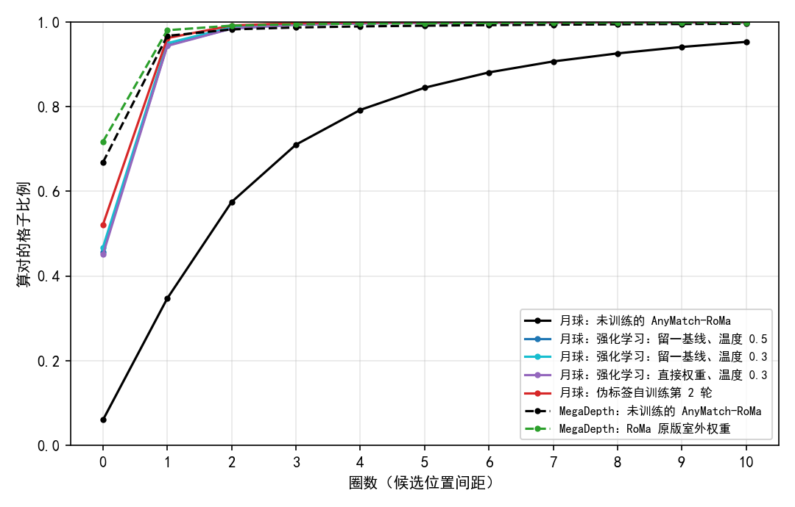

# 强化学习训练后，粗匹配有 94–95% 的格子落在真值一圈以内，与伪标签自训练（96%）接近；把粗匹配换成真值，它们的 AUC@5 只从 0.296–0.298 升到 0.298–0.302

**摘要**

我们在尝试用强化学习、不借助标注来训练 RoMa。第二批训练里有三个配置把验证集 AUC@5 从未训练时的 0.262 提到 0.296–0.298，但训练信号只作用在粗匹配这一步，后面的细化没有训练。要判断粗匹配本身到了什么程度，需要直接按真值去量它，而此前只看过最终配准误差。本文在验证集全部 652 对有标注的图上（不加扰动），用标注点拟合的真值仿射算出每个粗匹配格子的真值落点，量了五个模型：未训练的模型、三个强化学习模型、伪标签自训练第 2 轮的模型。作为参照，在自然图像 MegaDepth-1500 上用深度图和相机位姿算出真值，量了未训练的模型和 RoMa 原版室外权重。三项结果如下。第一，最高分位置落在真值最近候选位置一圈以内的格子，未训练时为 35%，三个强化学习模型为 94–95%，伪标签模型为 96%，MegaDepth 上未训练的模型为 97%。第二，真值一个候选间距以内的概率之和，中位数从未训练时的 0.04 升到强化学习后的 0.93–0.96，伪标签模型为 0.93。第三，把细化的起点换成真值仿射给出的位置、其余照常，三个强化学习模型的 AUC@5 为 0.298–0.302，比不换时多 0.000–0.006。同样替换后，未训练的模型从 0.262 升到 0.306，伪标签模型从 0.328 升到 0.349。

**引言**

RoMa 分两步找两张图之间的对应。第一步是粗匹配：把输入图（560×560）切成 40×40 个格子，每个格子去另一张图上找大致的落点。另一张图上预先均匀铺了一张 64×64 的固定网格，共 4096 个候选位置，相邻两个相距 8 像素（按月球原图 512×512 计）。模型给每个格子对这 4096 个位置各打一个分，分数转成概率。正常使用时，每格取概率最高的位置（下称最高分位置），用它和上下左右 4 个邻居的概率加权平均出一个粗略落点。第二步是细化：从粗略落点出发，在越来越细的尺度上逐级修正，得到逐像素的匹配，再按可信度挑点，用 RANSAC 拟合出两图之间的仿射。

我们的强化学习只在粗匹配这一步加随机性：每格按概率抽一个位置代替最高分位置，用不需要标注的评分打分，再提高好的那几次的概率。第二批训练的评分以模型自己正常推理出的仿射为参照：抽到的位置离参照仿射映射的格子中心越近，得分越高。三个配置训练后，验证集 AUC@5 到了 0.296–0.298，高于未训练时，但低于目前最好的无标注方法——伪标签自训练（0.328）。训练的梯度只经过粗匹配回传，细化部分没有收到训练信号。

此前只用最终配准误差评价这些模型。粗匹配本身选得对不对、给真值附近分了多少概率、如果粗匹配完全正确最终配准能到多少，都还没有直接量过。本文用真值量这三件事，并把强化学习模型与未训练的模型、伪标签模型、自然图像上的模型放在一起比较，作为参照。

**方法**

*模型。* 月球上量五个模型。未训练的模型是 AnyMatch 发布的 RoMa 权重。三个强化学习模型是第二批训练里没有塌缩的三个配置，各取验证集 AUC@5 最高的存档：留一基线、温度 0.5（第 2000 步）；留一基线、温度 0.3（第 3000 步）；直接权重、温度 0.3（第 2000 步）。“留一基线”指每次抽签的得分减去同组其余 15 次的平均再用作权重，“直接权重”指直接用得分当权重；温度越低，抽签越集中在最高分位置附近。伪标签模型是离线伪标签自训练（noisy student）第 2 轮在验证集上最好的存档（第 6000 步）。MegaDepth 上量两个模型：未训练的 AnyMatch-RoMa，以及 RoMa 作者发布的原版室外权重（在 MegaDepth 上训练）。

*月球数据与真值。* 数据为验证集全部 652 对有标注的光学–SAR 图，不加扰动，与训练时选存档用的是同一批图。输入照评测的做法预处理，SAR 用 minmax 拉伸。每对图带有若干标注点，给出两图上的对应位置；用它们最小二乘拟合一个光学到 SAR 的仿射，作为真值仿射。标注点并不完全符合一个仿射：拟合后每对的平均残差，在 652 对上的中位数为 2.6 像素（四分位 1.9 和 3.4 像素）。每个粗匹配格子的中心经真值仿射映射到 SAR 图上，就是这个格子的真值落点。只统计真值落点在 SAR 画面内的格子：652 对共 1,043,200 个格子，去掉落点出画面的 62,430 个（6.0%），剩 980,770 个。

*MegaDepth 数据与真值。* 数据为 MegaDepth-1500 全部 1500 对（LoFTR 论文的测试集），彩色图直接缩放到 560×560，不保持长宽比，格子数与月球相同。每个格子的中心换算回原图像素，取该处深度，按两张图的相机内参与位姿投到第二张图上，得到真值落点。三类格子不计：没有深度的（1,561,843 个，65%），落点出画面的（139,351 个，5.8%），投影深度与第二张图该处深度相差 20% 以上的（视为被遮挡，76,605 个，3.2%；阈值同 LoFTR）。2,400,000 个格子里剩 622,201 个。候选位置的间距按原图计不是 8 像素，所以下文的圈数和“一个间距”都以候选位置间距为单位。

*粗匹配的三个量。* 粗匹配只看第一张图到第二张图这一个方向（月球为光学到 SAR），概率用模型原本的概率（温度 1）。对每个有真值的格子，找出离真值落点最近的候选位置，下称真值候选位置。量三个量。圈数：最高分位置与真值候选位置在 64×64 网格上横、纵相差的较大者；圈数为 0 指最高分位置就是真值候选位置，圈数不超过 n 指它落在以真值候选位置为中心的 (2n+1)×(2n+1) 个位置之内，下称“n 圈以内”。真值附近的概率：离真值落点不超过一个候选间距的候选位置（月球上即 8 像素以内，通常 4 个左右）概率之和。真值候选位置的排名：它的概率在 4096 个候选位置里排第几，排第 1 即最高分位置。排第 1、前 5、前 20 的分档只用来描述分布。

*换成真值粗匹配后的配准。* 只在月球上做，五个模型都做。正常评测时，模型在 560 那一遍从粗匹配算出每格的粗略落点，交给细化。这里把每格的粗略落点直接换成真值仿射把格子中心映射到的连续位置，不取网格点，不做邻居加权；每个格子都换，包括落点出画面的格子。RoMa 正常评测是双向的，SAR 到光学方向用真值仿射的逆来换。粗匹配给出的可信度保持模型原样；细化、864 分辨率上再细化一遍、按可信度抽 10,000 个点、RANSAC（阈值 3 像素）和误差计算都与正常评测相同。配准误差为光学标注点经预测仿射映射后与 SAR 标注点的平均距离，单位为原始像素；AUC@5 为各对 max(0, 1 − 误差/5) 的平均，置信区间由 1000 次按图对重采样的自助法得到。同一程序关掉替换、跑一遍正常评测，五个模型的验证集 AUC@5 与此前公布的数逐位相同。真值仿射本身来自标注点拟合，所以替换后的误差里含有上述 2.6 像素量级的标注误差。

*未训练模型的参照值。* 未训练模型在与训练、评测相同的 SAR 拉伸方式（minmax）下，验证集 AUC@5 为 0.262。此前各轮训练常引用的 0.236 是 SAR 用另一种拉伸方式（2%–98% 分位拉伸）时的值。本文的比较都用 0.262。

**结果**

*强化学习后，94–95% 的格子最高分位置落在真值一圈以内，未训练时为 35%。* 月球上，未训练模型的最高分位置正是真值候选位置的格子占 6.0%，一圈以内的占 34.7%，三圈以内的占 71.0%，十圈以内的占 95.3%（图 1）。三个强化学习模型的曲线几乎重合：第 0 圈为 45.1%–46.8%，一圈以内为 94.4%–95.0%，三圈以内为 99.4%–99.6%。伪标签模型在每一圈都略高：第 0 圈 52.2%，一圈以内 96.2%，三圈以内 99.8%。在 MegaDepth 上，未训练的模型第 0 圈为 66.9%，一圈以内为 96.7%，三圈以内为 98.7%；〔RoMa 原版室外权重待补〕。一圈以内的比例上，三个强化学习模型、伪标签模型和 MegaDepth 上的两个模型都在 94%–97% 之间；第 0 圈的比例上，它们依次约为 46%、52%、67%〔原版待补〕。

图 1：强化学习后，月球上一圈以内的比例从 35% 升到 94–95%，与伪标签模型和 MegaDepth 上的模型接近；第 0 圈的比例仍低于后两者。横轴为圈数（单位为候选位置间距），纵轴为最高分位置落在真值候选位置该圈以内的格子比例。实线为月球验证集 652 对，虚线为 MegaDepth-1500。三个强化学习模型的线几乎重合。

*强化学习后，真值附近的概率从 0.04 升到 0.93–0.96，真值候选位置的排名中位数从第 16 名提到第 2 名。* 未训练模型给真值一个间距以内的候选位置的概率之和，中位数为 0.043，四分位为 0.015 和 0.109；真值候选位置的排名中位数为 16，排第 1 的格子占 6.1%，前 5 占 24.3%，前 20 占 55.4%（表 1）。三个强化学习模型的概率之和中位数为 0.93–0.96，下四分位为 0.65–0.71；排名中位数为 2，排第 1 的占 45%–47%，前 5 占 90%–91%，前 20 占 98.2%–98.6%。伪标签模型的概率之和中位数为 0.93，与强化学习模型相当，下四分位为 0.72，略高；排名中位数为 1，排第 1、前 5、前 20 分别占 52.3%、93.6%、99.5%。MegaDepth 上未训练的模型概率之和中位数为 0.976，排名中位数为 1，排第 1、前 5、前 20 分别占 67.0%、96.1%、98.9%。

表 1：强化学习后，真值附近的概率与伪标签模型相当，真值候选位置排第 1 的比例低于伪标签模型。真值附近的概率指离真值落点一个候选间距以内的候选位置的概率之和，括号内为四分位；排名为真值候选位置在 4096 个候选位置里按概率的名次。

| 数据 | 模型 | 真值附近的概率，中位数（四分位） | 排名中位数 | 排第 1 | 前 5 | 前 20 |
|---|---|---|---|---|---|---|
| 月球 | 未训练 | 0.043（0.015, 0.109） | 16 | 6.1% | 24.3% | 55.4% |
| 月球 | 强化学习：留一基线、温度 0.5 | 0.962（0.705, 0.995） | 2 | 45.9% | 90.4% | 98.2% |
| 月球 | 强化学习：留一基线、温度 0.3 | 0.950（0.699, 0.991） | 2 | 46.9% | 91.1% | 98.6% |
| 月球 | 强化学习：直接权重、温度 0.3 | 0.933（0.646, 0.988） | 2 | 45.2% | 90.0% | 98.3% |
| 月球 | 伪标签自训练第 2 轮 | 0.931（0.716, 0.985） | 1 | 52.3% | 93.6% | 99.5% |
| MegaDepth | 未训练 | 0.976（0.865, 0.996） | 1 | 67.0% | 96.1% | 98.9% |
| MegaDepth | RoMa 原版室外权重 | 〔待补〕 | | | | |

*把粗匹配换成真值后，三个强化学习模型的 AUC@5 为 0.298–0.302，比不换时多 0.000–0.006。* 不替换时，三个强化学习模型的验证集 AUC@5 为 0.296、0.298、0.298，误差中位数为 3.45–3.51 像素（表 2）。替换后为 0.302、0.302、0.298，误差中位数为 3.43–3.46 像素；替换后误差变小的图对占 54%–57%。未训练的模型从 0.262 升到 0.306，误差中位数从 3.75 降到 3.43 像素，66% 的图对误差变小。伪标签模型从 0.328 升到 0.349，误差中位数从 3.28 降到 3.15 像素，71% 的图对误差变小。替换后，五个模型的 AUC@5 在 0.298–0.349 之间：三个强化学习模型低于未训练的模型（0.306），伪标签模型最高。

表 2：把粗匹配换成真值，三个强化学习模型的 AUC@5 几乎不变，未训练的模型和伪标签模型分别升了 0.044 和 0.021。验证集 652 对，方括号内为自助法 95% 置信区间；误差为标注点误差的中位数（像素）；“变小的图对”指替换后误差比不替换时小的图对比例。

| 模型 | 不替换 AUC@5 | 误差中位数 | 换成真值 AUC@5 | 误差中位数 | 变小的图对 |
|---|---|---|---|---|---|
| 未训练 | 0.262 [0.244, 0.280] | 3.75 | 0.306 [0.288, 0.323] | 3.43 | 66.1% |
| 强化学习：留一基线、温度 0.5 | 0.296 [0.278, 0.314] | 3.51 | 0.302 [0.284, 0.319] | 3.43 | 57.4% |
| 强化学习：留一基线、温度 0.3 | 0.298 [0.280, 0.317] | 3.45 | 0.302 [0.285, 0.320] | 3.44 | 55.2% |
| 强化学习：直接权重、温度 0.3 | 0.298 [0.281, 0.317] | 3.47 | 0.298 [0.280, 0.315] | 3.46 | 53.7% |
| 伪标签自训练第 2 轮 | 0.328 [0.310, 0.345] | 3.28 | 0.349 [0.333, 0.366] | 3.15 | 70.7% |

**讨论**

本文回答了粗匹配按真值看到了什么程度。三个强化学习模型的粗匹配，在一圈以内的比例和真值附近的概率上，与伪标签模型和 MegaDepth 上未训练的模型处于同一范围；在第 0 圈的比例和排第 1 的比例上，仍低于这两者。把粗匹配直接换成真值，强化学习模型的最终配准几乎不变，伪标签模型和未训练的模型则各自上升。这些数只作为参照；粗匹配多好算够，本文不作判断。

结果有三点局限。第一，真值仿射来自标注点拟合，标注点本身偏离仿射约 2.6 像素，这既影响“真值候选位置”的认定（候选间距为 8 像素），也直接计入换成真值后的配准误差，所以换成真值后的 AUC@5 不是配准精度的上限。第二，MegaDepth 上只统计有深度且未被遮挡的格子，只占全部格子的 26%，天空等没有深度的区域不在其中；月球上则统计了画面内的全部格子，两者的格子构成不同。第三，粗匹配只量了第一张图到第二张图这一个方向，而正常评测是双向的。

有一个现象尚未解释。粗匹配都换成同一份真值后，五个模型的 AUC@5 仍相差可观：三个强化学习模型为 0.298–0.302，未训练的模型为 0.306，伪标签模型为 0.349。替换后各模型之间剩下的不同，在于细化所用的图像特征、细化层的权重和粗匹配的可信度。强化学习的梯度只到 DINOv2 上加的 LoRA 和粗匹配相关的层，细化层与 VGG 特征和未训练时相同；伪标签训练则同时训练了 VGG、细化层和 LoRA。哪一部分造成了这个差距，本文没有检验（未检验）；把粗匹配的可信度也换成同一份，或者在模型之间交换细化部分，可以区分这几种来源。
