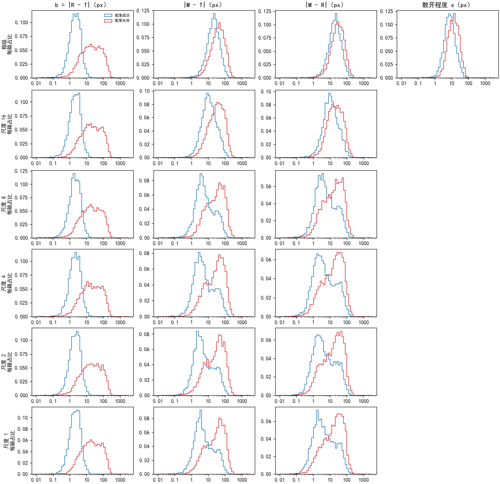
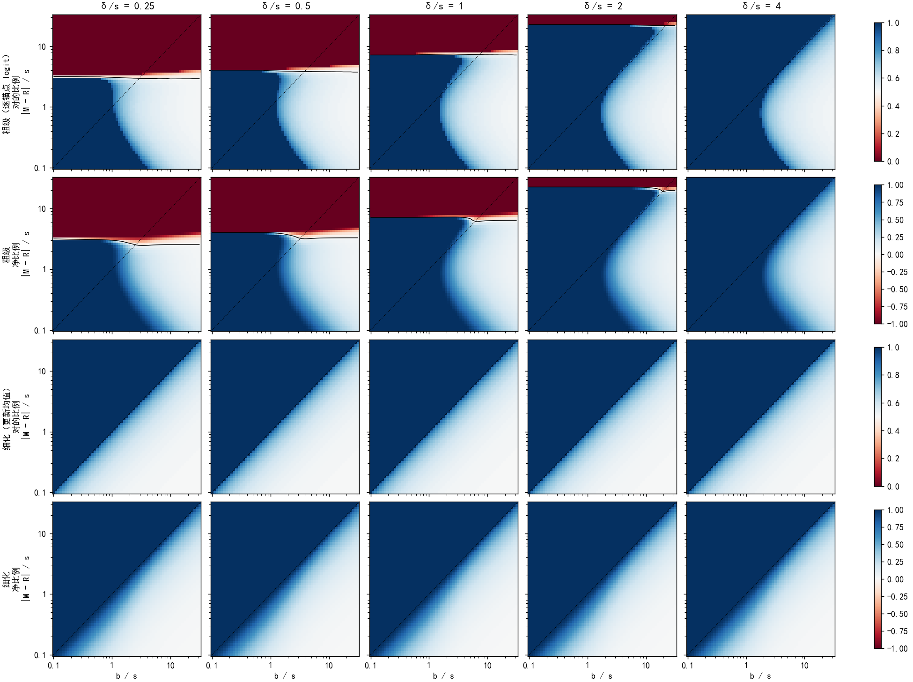
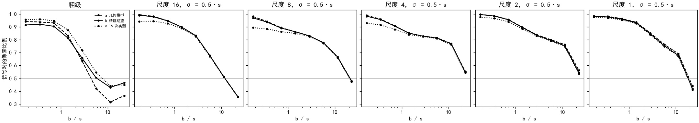

# 以参照仿射为准的奖励，在未训练的 RoMa 上让 63–86% 的格子朝真值移动；参照离真值越远（相对随机性的散开程度），这个比例越接近一半

**摘要**

我们在尝试不借助标注、用强化学习训练 RoMa。奖励以模型正常推理拟合出的仿射为参照：一次抽签离参照给出的位置越近，得分越高。参照本身离真值有一段距离，所以奖励把匹配往参照那边拉，并不保证离真值更近；此前只量过奖励能否给抽签排序，从没量过一步更新是让匹配离真值更近还是更远，也没有理论预测可以对照。我们在 200 对有标注的验证图上，对粗匹配和细化的五级（尺度 16、8、4、2、1）逐级只加一种随机性，把一步更新代入一阶展开，算出每个格子（或像素）期望误差的变化：变小记为信号对，变大记为错。同一个式子用三种方式算：只用几个几何量的理想化模型、模型实际分布下的精确期望、以及和训练一样抽 16 次的实测。结果是，信号对的比例在粗匹配上为 81%，在细化上从尺度 16 的 86% 逐级降到尺度 1 的 63%；尺度 1 上另有 19% 的像素奖励全部下溢为 0、没有信号。按信号强度加权后，对的一方在每一级都占多数（净比例 0.53–0.90）。参照离真值的距离与随机性散开程度之比（下称相对参照偏差）小于 0.5 时，各级 89% 以上的格子信号对；大于 16 时，只有 36–62%。配准成功的图对上各级有 80–98% 对，失败的图对上只有 51–78%。理想化模型给出的比例与精确期望在细化上相差不到 0.01（尺度 2、1 上无信号的像素除外），在粗匹配上总比例相同、但逐格符号只有 85% 一致；16 次实测与精确期望的符号在 87–97% 的格子上一致。在细化上，「对」由一个几何条件完全决定：随机分布的中心落在以真值和参照位置连线为直径的圆外时为对，圆内为错。

**引言**

RoMa 找两张图之间的对应分两步。粗匹配把光学图分成 40×40 个格子，每个格子在 SAR 图上 64×64 = 4096 个候选落点（下称锚点）上给出一组概率，推理时取概率最高的锚点。细化部分再在尺度 16、8、4、2、1 上逐级修正：每一级读入上一级的结果，由一个小卷积网络算出一个位移加上去。尺度 s 的输出网格上相邻两点在原图上相隔 s 个像素。

强化学习需要随机性。粗匹配的随机性来自按概率抽锚点；细化的随机性来自在某一级的输出位置上加一个二维高斯噪声。每对图抽 16 次，每次用奖励打分，再让模型多学得分比同组平均高的那几次。奖励不用标注：先让模型正常推理一次，用 RANSAC 拟合一个仿射（下称参照仿射），把它给出的位置当作"大致正确的答案"（下称参照位置）；一次抽签离参照位置越近，奖励越高。

参照位置不是真值。对每个格子，参照位置离真值位置有一段距离（下称参照偏差）。前一个诊断量得参照偏差的中位数约 6 像素，但尾巴很长，十分之一的格子超过 80 像素。奖励把匹配往参照位置拉；如果匹配已经比参照更靠近真值，或者位于真值和参照之间，往参照那边拉反而会离真值更远。前一个诊断还测了奖励与真实误差在 16 次之间的秩相关（尺度 8 约 −0.7，配准失败的图对只有 −0.02 到 −0.37），但秩相关只说明排序好坏，不直接说明一步更新的方向对不对；粗匹配上也从没量过。

本文把一步更新代入一阶展开，直接算出每个格子期望误差的变化，并用三种方式算同一个量：只用几何量的理想化模型、模型实际分布下的精确期望、和训练一样抽 16 次的实测。三者并排，前两者之差说明理想化丢了多少，后两者之差说明 16 次抽样的噪声有多大。

**方法**

*模型与数据。* 模型用 AnyMatch 发布的 RoMa 权重，未经我们训练。数据、扰动和真值与前一个诊断（细化各级加高斯）完全相同：从验证集 652 对有标注的图里均匀取 200 对；SAR 一侧加训练用的扰动（半径 128 像素内平移、旋转 ±20°、缩放 ±20%，随机擦掉 1–3 块）；标注点最小二乘拟合仿射、叠加已知扰动，得到每个格子中心在扰动后 SAR 图上的真值位置。真值位置落在 SAR 画面外的格子不计。距离一律按原图 512×512 的像素计。按不抽签正常推理时标注点误差是否不超过 5 像素，200 对分为配准成功 78 对、失败 122 对，分法与前一个诊断相同。

*参照与奖励。* 正常推理一次（粗匹配取最高分锚点，细化照常），挑 5000 个匹配点、RANSAC（3 像素）拟合参照仿射，200 对都拟合成功。一个位置离参照位置的距离为 d 时，奖励为 exp(−½(d/δ)²)。尺度 δ 在粗匹配上为 8 像素，在尺度 s 上为 s 像素，与上一轮细化训练相同。一个位置的误差 e 是它离真值位置的距离。

*随机性。* 每次只在一级加随机性，其余各级照常推理，只量这一级本身的输出。粗匹配：每格按温度 0.3 的概率（锚点得分除以 0.3 再归一化）抽锚点，抽到的锚点与上下左右 4 个邻居按概率加权，得到粗匹配位置，与训练相同。细化尺度 16、8、4、2、1：以这一级的输出为中心加二维各向同性高斯，标准差 σ = k·s，k 取 0.25、0.5、1。尺度 16 以前没有加过噪声，这次一并量。

*信号对错。* 把一步期望更新代入一阶展开，得到每个格子期望误差的变化 ΔE[e]：小于 0 记为对，大于 0 记为错，等于 0 记为无信号；|ΔE[e]| 为信号强度。净比例 =（对的强度之和 − 错的强度之和）/ 强度总和，取值在 −1 到 1 之间。
- 粗匹配：把每格 4096 个锚点得分当作互不相关的参数，这是本文的主要近似（实际上它们来自同一个网络）；各锚点的位置也视为不变（实际上邻居加权用到的概率会随更新变化）。策略梯度让锚点 j 的得分变化 π_j(r_j − r̄)，其中 π_j 是它被抽中的概率，r_j 是它的奖励，r̄ 是按概率的平均奖励。于是 ΔE[e] ∝ Σ_j π_j²(r_j − r̄)(e_j − ē)。
- 细化：策略梯度让分布中心 μ 移动 Δμ ∝ E[(r − r̄)(a − μ)]，a 为抽到的位置；期望误差对 μ 的梯度为 E[(e − ē)(a − μ)]/σ²；ΔE[e] 为两者的内积。

*三种算法。*
- a. 几何模型：每格只取四样东西——真值位置、参照位置、分布中心、散开程度，假设策略是以分布中心为中心、以散开程度为标准差的二维各向同性高斯，按上面的式子求积分。粗匹配的分布中心取锚点位置按概率的加权平均，散开程度取 √(协方差的迹 / 2)；细化的分布中心就是这一级的输出，散开程度就是 σ。两个式子在高斯假设下都有闭式。我们用 400 万次抽样和细格点求和核对了闭式，5 组参数下细化相差不到 3%，粗匹配一致到第 6 位有效数字。
- b. 精确期望：用模型实际的分布。粗匹配对 4096 个锚点精确求和；细化每像素抽 1024 次，用样本估计两个期望（去掉同一样本自乘的偏差项）。细化的实际分布本来就是高斯，所以 a、b 两层在细化上只差抽样误差。
- c. 16 次实测：和训练一样每格抽 16 次，每次的优势为它的奖励减去其余 15 次的平均，用这一步实际的更新代入同一个式子（粗匹配：实际的得分变化；细化：Δμ ∝ Σ 优势 ×（抽到的位置 − μ），期望误差的梯度用闭式）。三层的比例尺相同：c 的期望等于 b。

*几何量与分档。* 每格记四个几何量：参照偏差 b（参照位置离真值的距离）、分布中心离真值的距离、分布中心离参照位置的距离、散开程度 s。比值 b/s 下称相对参照偏差，按 0.25、0.5、1、2、4、8、16 分档。比例在全部格子上计数（粗匹配与尺度 16 各 24.6 万个格子，尺度 8、4、2、1 分别为 75 万、301 万、1204 万、4816 万个像素）；画分布用的是每对图每个设置随机留下的 64 个格子。

*相图。* 不用数据，以散开程度为长度单位，把真值放在原点、参照位置放在距离 b/s 处，让分布中心绕参照位置转一圈（360 个角度），统计这一圈上对的比例与净比例，再扫参照偏差、分布中心离参照的距离、奖励尺度与散开程度之比 δ/s 三个量。

**结果**

*参照偏差在各级都约为 6 像素，配准成功的图对约 2 像素、失败的约 20 像素。* 参照偏差的中位数在粗匹配和细化各级都在 5.8–6.1 像素之间，四分之三分位约 28 像素，十分之九分位约 83 像素。配准成功的图对中位数为 2.0–2.1 像素，失败的为 19.3–19.8 像素（图 1）。分布中心离真值的距离在粗匹配上中位数为 29 像素，在尺度 8–1 上降到约 15 像素；离参照位置的距离从 25 像素降到约 10 像素。粗匹配的散开程度中位数为 10.2 像素（成功 7.5、失败 12.7）。在细化上散开程度就是 σ，所以相对参照偏差的中位数随级和 σ 变化：粗匹配 0.72，尺度 16、σ = 0.5·s 时 0.76，尺度 1、σ = 0.5·s 时 12。

图 1：参照偏差、分布中心离真值和离参照位置的距离、粗匹配的散开程度在配准成功与失败的图对上的分布（横轴为对数刻度，纵轴为每箱占比）。细化的散开程度就是 σ，不画。

*几何模型下，细化更新的对错只取决于分布中心是否落在以真值和参照位置连线为直径的圆外。* 细化的更新把分布中心推向参照位置，误差的梯度背离真值，两者的内积在分布中心落在这个圆外时为负、圆内为正，与 σ、δ 无关。所以在相图上，分布中心离参照位置的距离不小于参照偏差时，一圈上全部为对；距离越小，对的比例越接近一半（图 2 下两行）。粗匹配的式子在分布中心离参照位置较近时给出相似的形状；另外，当这个距离超过散开程度的某个倍数时，一圈上全部为错，这个倍数随 δ/s 增大：δ/s 为 0.25、0.5、1、2 时分别约为 3、4、7、20，δ/s 为 4 时在所扫范围内没有出现（图 2 上两行）。

图 2：几何模型的相图。横轴为相对参照偏差，纵轴为分布中心离参照位置的距离与散开程度之比，颜色为分布中心绕参照位置一圈时信号对的比例（第 1、3 行）与净比例（第 2、4 行）；各列为不同的 δ/s。黑实线为比例 0.5（净比例 0）的等值线，虚线为对角线。

*信号对的比例在粗匹配上为 81%，在细化上从尺度 16 的 86% 逐级降到尺度 1 的 63%。* 按精确期望（b 层），对的比例在尺度 16、8、4、2、1 上分别为 86%、81%、79%、75%、63%（表 1）。尺度 2 和尺度 1 上分别有 5% 和 19% 的像素无信号：这些像素离参照位置太远，每次抽签的奖励都下溢为 0。在同一级上，细化的对错比例不随 σ 变化，只有净比例随 σ 变化。按强度加权后，对的一方在每一级都占多数，净比例从粗匹配的 0.90、尺度 16 的 0.77–0.82 降到尺度 1 的 0.53–0.58。

| 设置 | 对 a | 对 b | 对 c | 无信号 b | 净比例 a | 净比例 b | 净比例 c | 成功图对 对 b | 失败图对 对 b |
|---|---|---|---|---|---|---|---|---|---|
| 粗匹配 | 0.81 | 0.81 | 0.85 | 0.00 | 0.94 | 0.90 | 0.89 | 0.93 | 0.72 |
| 尺度 16，σ = 0.25·s | 0.86 | 0.86 | 0.85 | 0.00 | 0.82 | 0.82 | 0.81 | 0.98 | 0.78 |
| 尺度 16，σ = 0.5·s | 0.86 | 0.86 | 0.84 | 0.00 | 0.80 | 0.80 | 0.78 | 0.98 | 0.78 |
| 尺度 16，σ = 1·s | 0.86 | 0.86 | 0.81 | 0.00 | 0.77 | 0.77 | 0.74 | 0.97 | 0.78 |
| 尺度 8，σ = 0.25·s | 0.81 | 0.81 | 0.80 | 0.00 | 0.73 | 0.73 | 0.71 | 0.93 | 0.73 |
| 尺度 8，σ = 0.5·s | 0.81 | 0.81 | 0.79 | 0.00 | 0.71 | 0.71 | 0.68 | 0.92 | 0.73 |
| 尺度 8，σ = 1·s | 0.81 | 0.81 | 0.77 | 0.00 | 0.69 | 0.69 | 0.64 | 0.91 | 0.73 |
| 尺度 4，σ = 0.25·s | 0.79 | 0.79 | 0.78 | 0.01 | 0.66 | 0.66 | 0.64 | 0.89 | 0.72 |
| 尺度 4，σ = 0.5·s | 0.79 | 0.79 | 0.78 | 0.00 | 0.66 | 0.66 | 0.62 | 0.89 | 0.72 |
| 尺度 4，σ = 1·s | 0.79 | 0.79 | 0.76 | 0.00 | 0.65 | 0.65 | 0.59 | 0.89 | 0.72 |
| 尺度 2，σ = 0.25·s | 0.75 | 0.75 | 0.74 | 0.06 | 0.61 | 0.61 | 0.60 | 0.88 | 0.66 |
| 尺度 2，σ = 0.5·s | 0.76 | 0.75 | 0.74 | 0.05 | 0.62 | 0.62 | 0.60 | 0.88 | 0.66 |
| 尺度 2，σ = 1·s | 0.78 | 0.75 | 0.74 | 0.05 | 0.63 | 0.63 | 0.59 | 0.88 | 0.67 |
| 尺度 1，σ = 0.25·s | 0.63 | 0.63 | 0.62 | 0.20 | 0.53 | 0.53 | 0.51 | 0.80 | 0.51 |
| 尺度 1，σ = 0.5·s | 0.65 | 0.63 | 0.63 | 0.19 | 0.54 | 0.54 | 0.53 | 0.80 | 0.51 |
| 尺度 1，σ = 1·s | 0.69 | 0.64 | 0.63 | 0.19 | 0.58 | 0.58 | 0.55 | 0.80 | 0.52 |

表 1：各级信号对的比例与净比例，a 为几何模型、b 为精确期望、c 为 16 次实测；最后两列为精确期望在配准成功与失败的图对上对的比例。全部 200 对、每级约 30 万（粗匹配）到 5600 万（尺度 1）个格子。

*相对参照偏差越大，信号对的比例越低，大于 16 时接近一半。* 相对参照偏差小于 0.5 时，粗匹配和细化各级 89–100% 的格子信号对，净比例为 1.00；在 2–4 之间降到 66–93%；大于 16 时为 36–62%，净比例在 −0.32 到 0.13 之间（图 3；尺度 16、σ = 1·s 的这一档只有 189 个格子，除外）。在细化上，同一级不同 σ 的曲线横向平移，对应于同一个参照偏差除以不同的 σ。按配准成功与失败分开看（σ = 0.5·s），相对参照偏差小于 1 的各档两组都在 87% 以上；在 4–16 的两档，成功的图对有 69–99% 对，失败的图对有 43–80%；大于 16 的一档失败的图对只有 36–55%（各档明细见附件中的分档表）。

图 3：按相对参照偏差分档的信号对的比例（全部图对；细化取 σ = 0.5·s；格子少于 50 个的档不画）。虚线为几何模型，实线为精确期望，点线为 16 次实测。

*几何模型在细化上与精确期望重合，在粗匹配上总比例相同、逐格符号有 15% 不同。* 在细化上，几何模型与精确期望的比例相差不到 0.01，逐像素符号在 94–99% 的像素上一致；只有尺度 2 和 1 上几何模型无信号的像素较少（闭式不发生下溢），对的比例因此高 0–5 个百分点。在粗匹配上，两者对的比例都是 81%，但逐格符号只在 85% 的格子上一致：相对参照偏差小于 1 时几何模型更高（93–94% 对 90–92%），在 8–16 一档更低（31% 对 43%）。

*16 次实测与精确期望的符号在 87–97% 的格子上一致，σ 越大一致得越少。* 在细化上，16 次实测对的比例比精确期望低 0–5 个百分点，差距随 σ 增大：尺度 16 上 σ 为 0.25·s、0.5·s、1·s 时分别低 1、2、5 个百分点；配准成功的图对上差距更大，尺度 16、σ = 1·s 时为 90% 对 97%。在粗匹配上方向相反，16 次实测对的比例高于精确期望（85% 对 81%）。净比例在各级都比精确期望低 0.01–0.06。

**讨论**

本文回答了未训练的模型上，以参照仿射为准的奖励在一步更新里有多少是对的：粗匹配 81%，细化 63–86%，强度加权后对的一方在各级都占多数；比例随相对参照偏差增大而降低，在配准失败的图对上更低。在细化上，几何模型给出的判据（分布中心是否在以真值和参照位置为直径的圆外）与模型实际分布下的结果一致；在粗匹配上，几何模型的总比例与实际相同，逐格符号则有 15% 不一致。

局限有四点。第一，粗匹配把 4096 个锚点得分当作互不相关的参数、锚点位置视为不变，实际训练中得分来自同一个网络，一步更新会同时改动许多格子，本文的数只描述各格各自的方向。第二，只看一阶、一步、一级：没有考虑多级同时加随机性、更新的步长和多步之后的累积。第三，本文用双精度计算奖励，距离超过约 38δ 才下溢为 0；训练代码用单精度，距离超过约 14δ 即为 0。按逐像素子样本，离参照位置超过 14δ 的像素在粗匹配上占 3%，在尺度 8、4、2、1 上分别占 2%、12%、29%、44%，训练时这些像素没有信号，而本文把其中一部分计为对或错。第四，只量了未训练的模型和 200 对图；训练之后参照仿射和模型的分布都会变。

尚未解释的现象有三个。一是粗匹配上 16 次实测对的比例高于精确期望，而细化上相反。二是粗匹配的式子在分布中心离参照位置较远时整圈为错，细化的式子没有这个区域；数据里落在这个区域的格子有多少，本文没有单独统计（未检验，可以按每格的几何量直接算出）。三是在相对参照偏差 4–16 的档里，配准成功的图对有七成以上对，失败的图对低得多；两组在同一档里分布中心离参照位置的距离是否不同，本文没有分开比较（未检验，可以在逐像素子样本上按组比较这个距离与参照偏差之比）。
