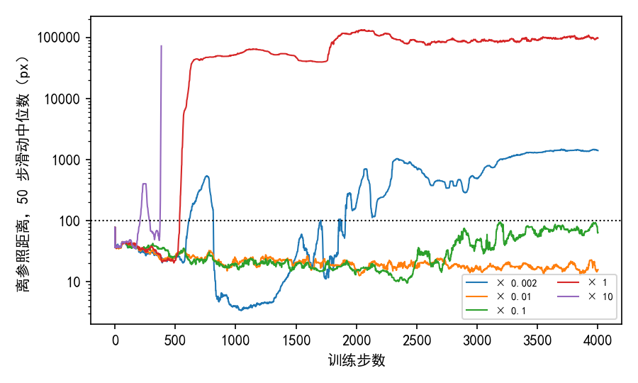
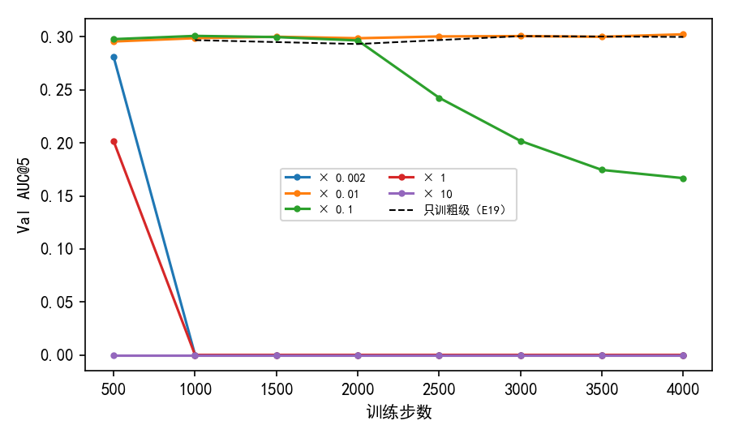

# 细化学习率取五档时，只有锚点的 0.01 倍和 0.1 倍训满 4000 步不发散，验证集 AUC@5 最高 0.302，与只训粗匹配持平；最低的 0.002 倍在第 613 步发散

**摘要**

我们在尝试不用标注、用强化学习训练 RoMa 做月球光学图与 SAR 图的配准。只在粗匹配上抽签训练（E19），验证集 AUC@5 从未训练时的 0.262 提到 0.301；E20 把抽签延伸到细化，五种设置都在 4000 步内发散。本文给细化部分（细化层、尺度 8、4 的投影层与 VGG）单独设学习率。先测出一个锚点：细化部分取学习率 1.4e-5 时，它每步参数的相对改变量与粗匹配解码器相同。然后按锚点的 10、1、0.1、0.01 倍各训练 4000 步，再在最好的 0.01 倍附近补了 0.002 倍。细化的分数改成单精度下不会变成 0 的形状，尺度 16 也加噪声训练。五档中，10 倍、1 倍、0.002 倍分别在第 209、537、613 步发散；0.1 倍和 0.01 倍训满 4000 步，离参照的距离始终没有超过 100 像素。0.01 倍的验证集 AUC@5 在各存档上为 0.296–0.302，最好存档比 E19 高 0.002（配对 95% 区间 −0.004 到 0.008）。0.1 倍在第 1000 步为 0.301，第 2000 步以后降到 0.167；验证集开始变差的第 2000–3000 步，尺度 4 离参照的距离为 6–7 像素，低于第 1000 步的 11 像素。同一配置、同一种子，0.1 倍在第一次启动时于第 641 步发散。发散与否不随细化学习率单调变化，同一设置的两次运行也可以一次发散、一次不发散。

**引言**

RoMa 分两步找两张图之间的对应。第一步是粗匹配：每个格子在另一张图的候选位置之间给出一个概率分布。第二步是细化：在尺度 16、8、4、2、1 上依次修正匹配。“尺度 s”指这一级的输出网格每格相当于原图 s 像素。每一级由一个小网络（细化层）读入两张图在这一尺度的特征和上一级的匹配，输出一个位移。尺度 16 的特征来自 DINOv2，经一个投影层送进细化层；尺度 8 到 1 的特征来自 VGG 卷积网络。最后用 RANSAC 从逐像素的匹配里拟合一个仿射，作为配准结果。

强化学习的分数不用标注：每步先用当前模型对这对图正常推理一次，拟合一个参照仿射；匹配的分数只看它离参照仿射给出的位置有多远（下称离参照的距离）。E19 只在粗匹配上抽签，验证集 AUC@5 为 0.301。E20 在细化输出上也加噪声抽签，细化部分与粗匹配解码器用同一个学习率 3e-5，五种设置都在 450–1340 步之间发散。E20 的细化分数是离参照距离的高斯形状，它在单精度下会变成 0：离参照的距离超过宽度的约 14 倍时，分数为 0，这些像素没有训练信号。

本文要回答的是：细化部分用多大的学习率，可以不发散、并让验证集 AUC@5 高于只训粗匹配。我们先按每步的参数改变量把细化部分与粗匹配对齐，定出锚点，再在锚点的不同倍数上训练；同时把细化分数换成不会变成 0 的形状。

**方法**

*模型、数据与粗匹配。* 同 E20：AnyMatch 发布的 RoMa 权重，DINOv2 每层的注意力投影上挂秩为 8 的 LoRA，放开 VGG 训练。训练集 7907 对，对 SAR 图做随机平移（半径 128 像素的圆内）、旋转（±20°）、缩放（±20%）和随机擦除。粗匹配的抽签与打分同 E19 中宽度 8 像素的高斯形状：每格按温度 0.3 调过的概率抽一个位置，分数为 exp(−½(d/8)²)，d 为离参照的距离（像素）。每对图跑 8 条抽签链。4000 步，前 500 步线性升温，之后按余弦降到 0，种子 0。不加把模型拉回起点的惩罚项，不训练可信度，不裁剪梯度。

*细化抽签。* 尺度 16、8、4 三级加噪声，尺度 2、1 不加噪声，也不训练。在加噪声的级上，细化层算出的匹配（下称这一级的均值）加上横、纵两个方向独立的正态随机量，标准差为 0.5 × s 像素；抽到的位置送进下一级。抽到位置的对数概率为 −‖抽到位置 − 均值‖² / 2σ²。每一级的分数各自减去同一位置其余 7 条链的平均，作为这条链的权重（RLOO，arXiv 2402.14740）。损失为粗匹配一项与三个细化级各一项之和。尺度 8、4 的梯度经细化层回到 VGG；尺度 16 的梯度经尺度 16 的细化层和投影层回到 DINOv2 的 LoRA，所以投影层和 LoRA 同时收到粗匹配与尺度 16 细化两份梯度。

*细化分数。* 细化分数取 1/(1 + ½(d/s)²)：离参照越远越低，在任何有限距离上都大于 0。我们先用未训练的模型、在上述训练设置下跑 200 对训练图，统计三级上抽到位置离参照的距离：中位数为 25–28 像素，90% 分位数约 100 像素，99% 分位数约 205 像素，最大 464–473 像素。在这个范围内，比较单精度下的两种形状（表 1）。高斯形状在尺度 4 上有 24.6% 的像素分数为 0。按距离排序后相邻的两条链距离不同、分数却相同，这种情况在尺度 4 上占 23.6%。新形状下，三级的分数都没有 0；这种分不开的相邻对，比例不超过 4e-7。

表 1：单精度下，高斯形状在尺度 8、4 上有相当一部分像素分数为 0；新形状没有。各项为像素比例。“8 链同分”为 8 条链分数完全相同、这一像素没有训练信号的比例。

| 尺度 | 高斯：分数为 0 | 高斯：8 链同分 | 高斯：相邻分不开 | 新形状：三项 |
|---|---|---|---|---|
| 16 | 0.65% | 1.6% | 0.6% | 0、0、0 |
| 8 | 6.9% | 11.3% | 6.6% | 0、0、4e-7 |
| 4 | 24.6% | 27.5% | 23.6% | 0、0、7e-8 |

*学习率分组与锚点。* 参数分两组。粗匹配组为 LoRA（学习率 1e-4）以及粗匹配解码器和尺度 16 的投影层（3e-5），同 E19。细化组为尺度 16、8、4 的细化层、尺度 8、4 的投影层和 VGG，学习率 = 3e-5 × 0.47 × 倍数。优化器是 AdamW，它按梯度自身的大小归一化每一步，因此我们比较的不是梯度大小，而是每步参数的相对改变量：一组参数这一步的改变量的范数，除以这组参数这一步之前的范数。LoRA 按它对原权重的改变（缩放系数 × B'A' − BA）除以原权重的范数计算。锚点这样测：细化组取 3e-5，跑 100 步；第 1 步因梯度溢出被跳过。在第 11–100 步上取中位数，粗匹配解码器为 1.43e-5，细化组为 3.05e-5，LoRA 为 3.16e-5。前两者之比为 0.47，即细化组学习率取 1.4e-5 时，两组每步的相对改变量相同。这 100 步都在升温期内，但两组按同一个比例升温，比值不受影响。若改以 LoRA 为准，锚点约为 1.04，与 0.47 相差约 2 倍，仍在相邻两档倍数之间。E20 的细化学习率 3e-5 相当于锚点的 2.1 倍。

*五档倍数。* 先取锚点的 10、1、0.1、0.01 倍。第一轮中验证集 AUC@5 最好的是 0.01 倍，按计划再取它的 0.2、0.5、2、5 倍（即锚点的 0.002、0.005、0.02、0.05 倍）。0.002 倍跑完后也发散了，其余三档没有跑。

*评测。* 每 500 步存一次权重，在不加扰动的验证集（652 对）上评测，口径同 E15、E19。配准误差是估计的仿射和标注的仿射，把图块 4 个角映射到的位置之间的平均距离；没有输出仿射的图对记为配准失败，误差记为无穷。AUC@5 是“误差不超过 x 像素的图对比例”在 x 从 0 到 5 像素上的面积除以 5。与 E19 最好存档（第 3000 步，0.301）之差用配对自助法估 95% 区间：在同一批验证图对上有放回地重抽 2000 次。训练驱动按惯例也在测试集上评了最好存档，本文不使用测试集结果。

*发散的判定。* 同 E20：粗匹配离参照的平均距离，它的 50 步滑动中位数首次超过 100 像素的那一步，称为发散起点。参照仿射拟合失败的步不计入。

*第一次启动。* 四档的第一次启动，在第 296–1878 步之间中止：每步记录相对改变量的代码在单精度下算出负的平方和，开方时报错。这段代码只读参数、不参与训练。修正后用同样的配置和种子从头重跑，正式结果取重跑。第一次启动的日志保留，用于比较发散起点。

**结果**

*各档每步的相对改变量之比与设定的倍数一致。* 第 1–100 步，细化组与粗匹配解码器每步相对改变量之比为：1 倍 0.99，0.1 倍 0.10，0.01 倍 0.011，0.002 倍 0.002，10 倍 10.1。在 0.01、0.1、0.002 倍三档的全部 4000 步里，三个细化级上分数为 0 的像素比例每一步都是 0。每步耗时中位数为 1.72–1.74 秒，第 1 步显存 17.56 GB（V100 32 GB）。

*10 倍、1 倍、0.002 倍发散，0.1 倍和 0.01 倍没有；同一设置的两次运行可以一次发散、一次不发散。* 发散起点：10 倍第 209 步，1 倍第 537 步，0.002 倍第 613 步（表 2、图 1）。0.1 倍和 0.01 倍训满 4000 步；离参照距离的 50 步中位数，0.1 倍最高为第 3191 步的 96 像素，0.01 倍在第 100 步以后不超过 46 像素。第一次启动中，10 倍、1 倍、0.1 倍分别在第 267、410、641 步发散，0.01 倍到中止时（第 1878 步）没有发散。0.002 倍的细化组每步改变量只有 0.01 倍的约 1/4，粗匹配组的改变量两者相近（第 500 步附近，粗匹配解码器 7.5e-5 对 6.0e-5，LoRA 2.4e-4 对 1.7e-4）。

表 2：发散与否不随细化学习率单调变化。发散起点为离参照距离的 50 步滑动中位数首次超过 100 像素的步；“—”为 4000 步内没有发散。

| 倍数 | 细化组学习率 | 发散起点（重跑） | 发散起点（第一次启动） |
|---|---|---|---|
| 10 | 1.4e-4 | 209 | 267 |
| 1 | 1.4e-5 | 537 | 410 |
| 0.1 | 1.4e-6 | — | 641 |
| 0.01 | 1.4e-7 | — | —（到第 1878 步） |
| 0.002 | 2.8e-8 | 613 | 未跑 |

图 1：10 倍、1 倍、0.002 倍的离参照距离先后越过 100 像素，0.1 倍和 0.01 倍没有越过。纵轴为粗匹配离参照距离的 50 步滑动中位数（对数轴），虚线为 100 像素。10 倍在第 336 步以后参照仿射全部拟合失败，曲线中断。

*没有发散的两档，验证集 AUC@5 最高与只训粗匹配持平。* 0.01 倍在八个存档上为 0.296–0.302，最好存档（第 4000 步）减 E19 最好存档为 +0.002（95% 区间 −0.004 到 0.008），各存档的误差中位数都是 3.4 像素。0.1 倍在第 1000 步为 0.301，差为 +0.000（−0.006 到 0.007）（表 3、图 2）。发散的三档中，最好的存档都在发散之前（第 500 步）：0.002 倍为 0.281，1 倍为 0.201，10 倍为 0。

表 3：没有发散的两档最好为 0.302 和 0.301，与 E19 的 0.301 在区间之内；0.1 倍第 2000 步以后下降。各列为对应存档的验证集 AUC@5。

| 倍数 | 500 | 1000 | 1500 | 2000 | 2500 | 3000 | 3500 | 4000 | 最好存档减 E19 |
|---|---|---|---|---|---|---|---|---|---|
| 10 | 0.000 | 0.000 | 0.000 | 0.000 | 0.000 | 0.000 | 0.000 | 0.000 | −0.301（−0.318 到 −0.283） |
| 1 | 0.201 | 0.000 | 0.000 | 0.000 | 0.000 | 0.000 | 0.000 | 0.000 | −0.099（−0.113 到 −0.085） |
| 0.1 | 0.298 | 0.301 | 0.300 | 0.297 | 0.243 | 0.202 | 0.174 | 0.167 | +0.000（−0.006 到 0.007） |
| 0.01 | 0.296 | 0.299 | 0.300 | 0.299 | 0.300 | 0.301 | 0.300 | 0.302 | +0.002（−0.004 到 0.008） |
| 0.002 | 0.281 | 0.000 | 0.000 | 0.000 | 0.000 | 0.000 | 0.000 | 0.000 | −0.020（−0.028 到 −0.012） |
| E19（只训粗匹配） | | 0.297 | | 0.293 | | 0.301 | | 0.300 | |

图 2：没有发散的 0.01 倍与只训粗匹配的 E19 重合，0.1 倍在第 2000 步以后下降。虚线为 E19，它每 1000 步存一次。

*0.1 倍在第 2000–3000 步，验证集开始变差，尺度 4 离参照的距离却低于第 1000 步。* 0.1 倍在第 1000、2000、3000 步附近（各取 100 步窗口的中位数），尺度 4 抽到位置离参照的距离为 11.2、6.0、6.9 像素（第 1 步为 33 像素），第 3900 步回升到 18.4 像素；粗匹配离参照的距离为 19、17、34 像素，第 3900 步升到 77 像素。同一时期，验证集误差中位数从 3.4 像素升到 4.5 像素，第 4000 步为 4.8 像素。0.01 倍的尺度 4 离参照距离从 33 像素降到第 3900 步的 13.6 像素，降得比 0.1 倍少。

*0.002 倍在第 800–1000 步，粗匹配与参照几乎重合，验证集却配不准。* 0.002 倍在第 600–800 步离参照的距离升到 236–371 像素，第 800 步以后回落：第 1000 步附近离参照的距离为 3.5 像素，粗匹配分数 0.89（0.01 倍同期为 22 像素、0.39）。这一时期梯度范数为 20–30（0.01 倍为 3.7）。第 1000 步的存档在验证集上每对图都输出了仿射，但误差中位数为 306 像素，AUC@5 为 0。第 1500 步以后，离参照的距离再次上升，第 3900 步为 1420 像素。

**讨论**

引言的问题有一半得到回答。没有找到让验证集 AUC@5 高于只训粗匹配的细化学习率：训满 4000 步不发散的两档里，最好的存档与 E19 之差都在区间之内。其中 0.01 倍的细化组学习率只有 1.4e-7，每步改变量约为粗匹配解码器的 1%。发散的规律没有找到：发散与否不随细化学习率单调变化，0.1 倍在同一配置、同一种子下的两次运行，一次发散、一次没有。

本文有四点局限。第一，每档只有一个种子；表 2 的两次运行说明，单次运行的发散与否不能代表这一档。第二，细扫只跑了 0.002 倍一档，其余三档没有跑。第三，锚点只在前 100 步、升温期内测量，没有核对训练后期两组的改变量之比是否保持。第四，尺度 16 细化的梯度也进入粗匹配组的 LoRA 和投影层，两组的参数并不完全分开；细化学习率不控制这一部分。

以下现象本文没有解释：

- 0.1 倍在第 2000–3000 步，训练中尺度 4 离参照的距离低于第 1000 步，验证集误差却在变大。能区分的检查：在验证集上，按存档比较细化各级离参照的距离与离真值的距离。
- 0.002 倍在第 800–1000 步，粗匹配与它自己的参照仿射几乎重合、分数接近 1，验证集上却每对都配错。能区分的检查：在这一时期的存档上看参照仿射与标注仿射之间的距离，确认参照本身是否已偏离。
- 同一配置、同一种子的两次运行结果不同。两次运行的代码只差在记录改变量的那一段（不参与训练），差别可能来自 GPU 上非确定性的运算；本文没有检验。
