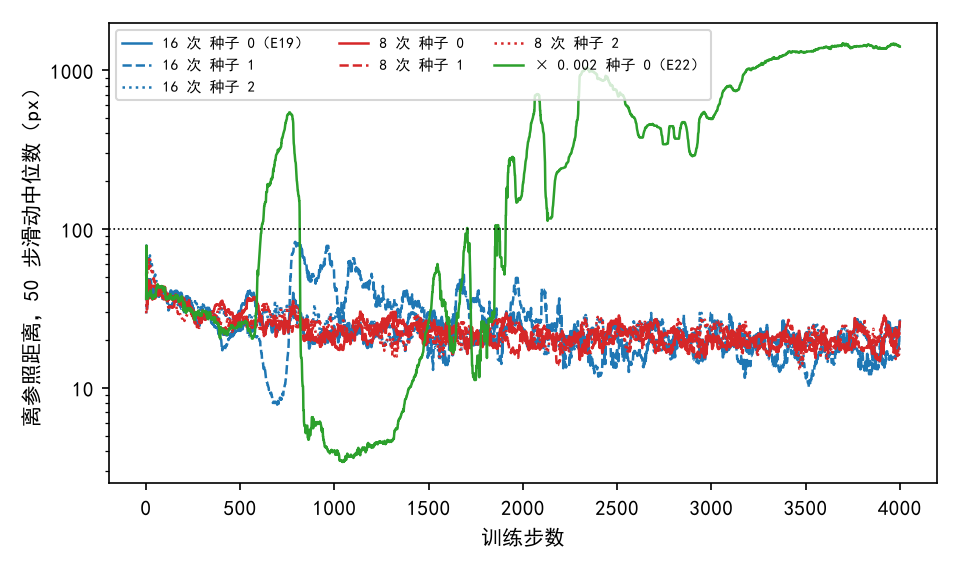
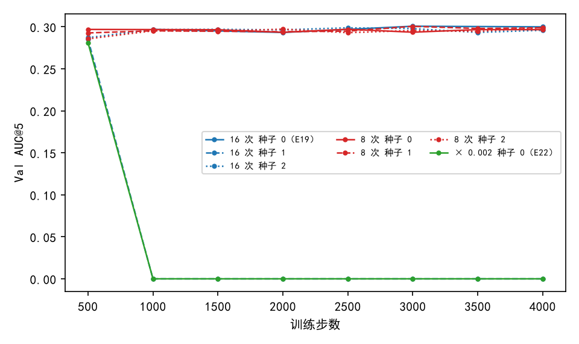
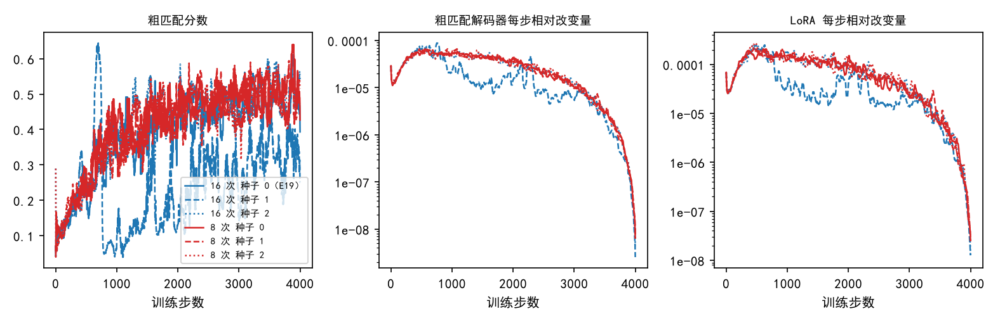

# 只训粗匹配时，每对抽 8 次的三个种子训满 4000 步，验证集 AUC@5 保持在 0.29–0.30；每对抽 16 次的种子 1 到第 1000 步降为 0，离参照距离却始终低于 100 像素

**摘要**

我们在尝试不用标注、用强化学习训练 RoMa 做月球光学图与 SAR 图的配准。只训粗匹配、每对图抽 16 次（E19，种子 0）没有发散；把训练延伸到细化的 E20、E22 多数发散，而它们都是每对抽 8 次，E22 中细化学习率几乎为零的一档也在第 613 步发散。本文只训粗匹配、其余照 E19，比较每对抽 8 次（种子 0、1、2）与 16 次（种子 1、2）。按 E20 的判定（离参照距离的 50 步滑动中位数超过 100 像素），五个运行都没有发散。每对抽 8 次的三个种子，验证集 AUC@5 在各存档上为 0.286–0.301，最好存档与 E19 最好存档之差为 −0.004 到 −0.000，95% 区间都包含 0。每对抽 16 次的种子 2 为 0.287–0.299，差 −0.002（区间 −0.008 到 0.004）。种子 1 在第 500 步为 0.285，第 1000 步以后每个存档都是 0，验证集误差中位数约 300 像素；训练中它离参照距离的 50 步中位数最高 83 像素（第 791 步），之前在第 650–700 步降到 8 像素、粗匹配分数升到 0.62。验证集上配不准的运行，并不都被“离参照距离超过 100 像素”这条判定标出。E22 细化学习率近零一档换种子的两个运行按算力安排没有跑。

**引言**

RoMa 分两步找两张图之间的对应。第一步是粗匹配：图上每个格子在另一张图的候选位置之间给出一个概率分布。第二步是细化：在越来越细的尺度上逐级修正匹配。最后用 RANSAC 从逐像素的匹配里拟合一个仿射，作为配准结果。

强化学习的分数不用标注。每步先用当前模型对这对图正常推理一次，拟合一个参照仿射；然后在粗匹配的概率分布里抽签，抽到的位置离参照仿射给出的位置越近，分数越高（下称离参照距离）。每对图抽若干次，每次的分数减去其余几次的平均，作为这次抽签的权重（RLOO，arXiv 2402.14740）。E19 只在粗匹配上这样训练，每对抽 16 次，验证集 AUC@5 从未训练时的 0.262 提到 0.301。E20 在细化上也抽签，五种设置都在 4000 步内发散；E22 给细化单独设学习率，五档中三档发散，其中细化学习率只有锚点 0.002 倍的一档在第 613 步发散。E20、E22 都是每对抽 8 次；只训粗匹配的 E15、E19 都是 16 次，各只有一个种子。E22 还看到同一配置、同一种子的两次启动，一次发散、一次不发散。

所以缺口在于：只训粗匹配、每对抽 8 次是否也会发散；16 次在别的种子下是否同样不发散。本文在只训粗匹配的设置下，每种抽签次数各跑多个种子回答这两问。

**方法**

*模型、数据与训练。* 完全照 E19 中宽度 8 像素的高斯形状一档：AnyMatch 发布的 RoMa 权重，DINOv2 每层的注意力投影上挂秩为 8 的 LoRA（学习率 1e-4），粗匹配解码器学习率 3e-5，不训 VGG，细化照常推理、不加噪声也不训练。训练集 7907 对，对 SAR 图做随机平移（半径 128 像素的圆内）、旋转（±20°）、缩放（±20%）和随机擦除。粗匹配每格按温度 0.3 调过的概率抽一个位置，分数为 exp(−½(d/8)²)，d 为离参照距离（像素）。4000 步，前 500 步线性升温，之后按余弦降到 0。与 E19 不同的只有三处：每 500 步存一次权重（E19 每 1000 步），每步记录各部分参数的相对改变量，以及下面两项。

*五个运行。* 每对抽 8 次，种子 0、1、2；每对抽 16 次，种子 1、2。16 次、种子 0 即 E19，直接引用。每个运行只启动一次。票里还有 E22 细化学习率为锚点 0.002 倍一档的种子 1、2 复跑，按算力安排没有跑。

*记录的量。* 粗匹配分数是每步全部抽签分数的平均。熵衡量粗匹配的概率分布有多分散，单位为奈特，读作“相当于平摊在 e^熵 个位置上”。每步相对改变量是一组参数这一步改变量的范数除以这一步之前的范数；LoRA 按它对原权重的改变除以原权重的范数计算，同 E22。这些量都在训练图对上逐步记录，下文报告时取 50 步滑动中位数，或某一步起 100 步窗口的中位数。

*发散的判定。* 同 E20：离参照距离的 50 步滑动中位数首次超过 100 像素的那一步，称为发散起点。参照仿射拟合失败的步不计入；本文五个运行没有拟合失败的步。

*评测。* 每个存档在不加扰动的验证集（652 对）上评测，口径同 E15、E19。配准误差是估计的仿射与标注的仿射把图块 4 个角映射到的位置之间的平均距离；没有输出仿射的图对记为配准失败，误差记为无穷。AUC@5 是“误差不超过 x 像素的图对比例”在 x 从 0 到 5 像素上的面积除以 5。每个运行的最好存档与 E19 最好存档（第 3000 步，0.301）之差，用配对自助法估 95% 区间：在同一批验证图对上有放回地重抽 2000 次。训练驱动按惯例也评了测试集，本文不使用。

**结果**

*五个运行按 E20 的判定都没有发散。* 离参照距离的 50 步滑动中位数，每对抽 8 次的三个种子和 16 次的种子 2 最高为 66–78 像素，都出现在第 15 步以内（图 1）；第 500 步以后，它们在 100 步窗口中位数上为 18–34 像素。16 次种子 1 最高为 83 像素，出现在第 791 步。作为对照，E22 细化学习率 0.002 倍一档同期越过 100 像素，第 613 步发散。每步耗时中位数 0.39–0.49 秒，第 1 步显存 9.0 GB。

图 1：只训粗匹配的五个运行和 E19 都没有越过 100 像素；16 次种子 1 在第 600–1000 步先降后升，与其余只训粗匹配的运行分开。纵轴为离参照距离的 50 步滑动中位数（对数轴），虚线为 100 像素。绿线为 E22 细化学习率 0.002 倍一档（种子 0），作为发散的对照。

*每对抽 8 次的三个种子和 16 次的种子 2，验证集 AUC@5 与 E19 持平；16 次的种子 1 从第 1000 步起为 0。* 前四个运行在各存档上为 0.286–0.301，最好存档与 E19 之差在 −0.004 到 −0.000 之间，区间都包含 0，各存档的误差中位数为 3.4–3.5 像素（表 1、图 2）。16 次种子 1 在第 500 步为 0.285，比 E19 低 0.015（区间 −0.022 到 −0.008）；第 1000–4000 步每个存档都是 0。这些存档对每对验证图都输出了仿射（配准失败率为 0），误差中位数为 294–349 像素。

表 1：每对抽 8 次的三个种子和 16 次的种子 2 都与 E19 持平，16 次的种子 1 在第 1000 步以后为 0。各列为对应存档的验证集 AUC@5；E19 每 1000 步存一次。

| 运行 | 500 | 1000 | 1500 | 2000 | 2500 | 3000 | 3500 | 4000 | 最好存档减 E19 |
|---|---|---|---|---|---|---|---|---|---|
| 8 次，种子 0 | 0.297 | 0.297 | 0.297 | 0.293 | 0.297 | 0.294 | 0.297 | 0.297 | −0.004（−0.009 到 0.001） |
| 8 次，种子 1 | 0.293 | 0.295 | 0.295 | 0.294 | 0.295 | 0.301 | 0.298 | 0.299 | −0.000（−0.005 到 0.005） |
| 8 次，种子 2 | 0.286 | 0.295 | 0.295 | 0.297 | 0.293 | 0.296 | 0.294 | 0.299 | −0.002（−0.007 到 0.004） |
| 16 次，种子 1 | 0.285 | 0.000 | 0.000 | 0.000 | 0.000 | 0.000 | 0.000 | 0.000 | −0.015（−0.022 到 −0.008） |
| 16 次，种子 2 | 0.287 | 0.297 | 0.297 | 0.296 | 0.299 | 0.298 | 0.293 | 0.296 | −0.002（−0.008 到 0.004） |
| 16 次，种子 0（E19） | | 0.297 | | 0.293 | | 0.301 | | 0.300 | 0 |

图 2：16 次种子 1 与 E22 的 0.002 倍一档一样，第 1000 步以后降为 0；其余只训粗匹配的运行在 0.29–0.30 之间。16 次种子 1（蓝色虚线）在第 1000 步以后与绿线重合。

*16 次种子 1 在第 650–700 步离参照距离降到 8 像素，第 800 步升到 81 像素，之后分布集中、改变量变小。* 按 50 步滑动中位数，第 600、650、700、750、800 步离参照距离为 20、10、8、15、81 像素，粗匹配分数为 0.30、0.54、0.62、0.44、0.05，熵为 1.12、0.81、0.64、0.88、0.31，梯度范数为 3.9、3.8、2.7、4.1、0.7（图 3）。同一时期 16 次种子 2 的离参照距离为 26–33 像素，粗匹配分数 0.23–0.37，熵 0.70–1.20，梯度范数 1.8–4.7。第 1000 步，种子 1 的梯度范数降到 0.21，LoRA 每步相对改变量为 3.5e-5，种子 2 分别为 2.0 和 1.8e-4。此后种子 1 的熵一直在 0.27–0.37（100 步窗口中位数，第 1000–3900 步；其余只训粗匹配的运行第 2000 步以后为 0.47–0.62）；离参照距离在第 2000、3000、3900 步为 26、23、16 像素，粗匹配分数为 0.18、0.21、0.32，低于其余运行的 0.44–0.52。

图 3：16 次种子 1 的粗匹配分数在第 700 步前后先冲高再跌落，粗匹配解码器和 LoRA 的每步改变量随之降到其余运行的 1/4 到 1/2；其余五个只训粗匹配的运行彼此重合。各量为 50 步滑动中位数；中、右两图为对数轴。

**讨论**

引言的两问得到部分回答。只训粗匹配、每对抽 8 次，三个种子都没有发散，验证集 AUC@5 与 E19 持平。每对抽 16 次，种子 2 同样如此；种子 1 按 E20 的判定没有发散，验证集上却从第 1000 步起每对都配错。所以“16 次在不同种子下都正常”不成立，而“8 次就会发散”在这三个种子上没有出现。E22 细化学习率近零一档换种子的问题没有回答。

本文有三点局限。第一，每个条件只有两到三个种子，每个运行只启动一次；E22 已看到同一配置、同一种子的两次启动结果不同，所以三个种子都不发散不排除更低比例的发散。第二，E20 的判定只看训练图对上离参照距离，参照本身是当前模型的推理结果；16 次种子 1 说明，验证集配不准时这一量可以一直低于 100 像素。第三，E19 每 1000 步存档，第 500 步没有对照值。

以下现象本文没有解释：

- 16 次种子 1 在第 1000 步以后，训练中离参照距离为 16–45 像素，与正常运行相近，验证集误差中位数却约 300 像素。能区分的检查：在第 500、1000 步的存档上，比较验证集参照仿射与标注仿射之间的距离，看参照本身是否已偏离。
- 16 次种子 1 在第 650–700 步分数冲高、离参照距离降到 8 像素，紧接着跌落。E22 的 0.002 倍一档在第 800–1000 步也有离参照距离降到 3.5 像素、验证集配错的一段。两者是否是同一种变化，本文没有比较。能区分的检查：在这两段前后的存档上，看粗匹配最高分位置在验证图对上的分布是否集中到同一类错误位置。
