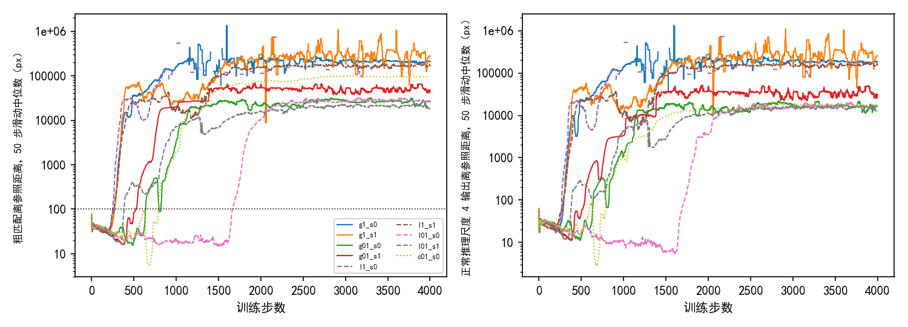

# 精确梯度、逐级局部抽签与整链抽签的九次细化训练全部在 4000 步内发散，最好的验证集 AUC@5 为 0.293，低于只训粗匹配的 0.301

**摘要**

我们在尝试不用标注、用强化学习训练 RoMa 做月球光学图与 SAR 图的配准。只在粗匹配上抽签训练（E19），验证集 AUC@5 为 0.301；E22 把抽签延伸到细化，不发散的两档学习率都没有超过它。E22 的细化信号来自整条链上的抽签：一条链在某一级的分数差，大部分来自上游的抽签，而不是这一级自己。本文在同一个奖励下比较三种细化训练方式：沿正常推理轨迹直接对奖励求导的精确梯度（诊断用，不是强化学习），每一级各自从同一个输出抽 8 次的逐级局部抽签，以及 E22 的整链抽签。粗匹配照 E19 每对 16 次抽签。精确梯度与逐级局部抽签各取细化学习率为锚点的 1 倍、0.1 倍，各跑种子 0、1；整链抽签只跑 0.1 倍、种子 0。九次运行全部发散。1 倍的四次在第 248–270 步发散，各存档的验证集上每对图都没有输出仿射。0.1 倍的五次在第 383–1667 步发散：精确梯度为第 638、523 步，逐级局部抽签为第 1667、383 步，整链抽签为第 788 步。最好的存档是逐级局部抽签 0.1 倍种子 0 的第 1000 步，验证集 AUC@5 为 0.293，比 E19 低 0.008（配对 95% 区间 −0.016 到 0.000）；其余八次的最好存档比 E19 低 0.031–0.301。发散之前，逐级局部抽签的细化梯度与同一步的精确梯度方向几乎一致：四次运行里余弦相似度的中位数为 0.984–0.997，最小 0.938。

**引言**

RoMa 分两步找两张图之间的对应。第一步是粗匹配：每个格子在另一张图的候选位置之间给出一个概率分布。第二步是细化：在尺度 16、8、4、2、1 上依次修正匹配。“尺度 s”指这一级的输出网格每格相当于原图 s 像素。每一级由一个小网络（细化层）读入两张图在这一尺度的特征和上一级的匹配，输出修正后的位置（下称这一级的输出）。最后用 RANSAC 从逐像素的匹配里拟合一个仿射，作为配准结果。

强化学习的分数不用标注：每步先用当前模型对这对图正常推理一次（每格取概率最高的位置，细化到尺度 1），拟合一个参照仿射；匹配的分数只看它离参照仿射给出的位置有多远（下称离参照的距离）。E19 只在粗匹配上抽签，验证集 AUC@5 为 0.301。E22 在细化尺度 16、8、4 的输出上也加噪声抽签，一条链加噪声后的位置送进下一级（下称整链抽签），每对图 8 条链。细化学习率取锚点（细化部分每步的参数改变量与粗匹配解码器相同时的学习率）的 0.1 倍和 0.01 倍时没有发散，但验证集 AUC@5 最高 0.302，与 E19 持平；0.1 倍同一配置的第一次启动在第 641 步发散。

整链抽签里，一条链在某一级的权重是它这一级的分数减去其余 7 条链的平均。各条链在这一级离参照的距离，主要由上游决定：粗匹配抽到的位置不同，上一级加的噪声也不同。E22 开跑前的统计里，三级抽到的位置离参照的中位数是 25–28 像素，而这一级自己的噪声标准差只有 2–8 像素。这样每一步的细化梯度估计里有很大的噪声。本文要回答的是：降低这部分噪声以后，细化训练能不能超过只训粗匹配。我们用两种新的细化训练方式和 E22 的整链抽签对比。其中精确梯度不抽签，给出同一个奖励不带抽签噪声时的训练结果。

**方法**

*模型、数据与粗匹配。* 同 E22：AnyMatch 发布的 RoMa 权重，DINOv2 每层的注意力投影上挂秩为 8 的 LoRA，放开 VGG 训练。训练集 7907 对，对 SAR 图做随机平移（半径 128 像素的圆内）、旋转（±20°）、缩放（±20%）和随机擦除。粗匹配完全照 E19 宽度 8 像素的高斯形状：每对图 16 次抽签，每格按温度 0.3 调过的概率抽一个位置，分数为 exp(−½(d/8)²)，d 为离参照的距离（像素），权重为这次的分数减去其余 15 次的平均（RLOO，arXiv 2402.14740）。4000 步，前 500 步线性升温，之后按余弦降到 0。不加把模型拉回起点的惩罚项，不训练可信度，不裁剪梯度。

*细化奖励与学习率。* 只训练尺度 16、8、4 三级，尺度 2、1 照常推理、不训练。细化奖励同 E22：r = 1/(1 + ½(d/s)²)，d 为这一级的位置离参照的距离（原图像素），s 为这一级的尺度。细化部分（尺度 16、8、4 的细化层，尺度 8、4 的投影层与 VGG）的学习率 = 3e-5 × 0.47 × 倍数，0.47 是 E22 测得的锚点；粗匹配解码器与尺度 16 的投影层 3e-5、LoRA 1e-4，同 E19。每步记录各部分参数的相对改变量：这一步的改变量的范数除以这一步之前参数的范数（E22 的定义）。

*三种细化训练方式。* 三种方式用同一个奖励，区别只在由奖励得到梯度的方法。

- 精确梯度：沿正常推理那条不加噪声的轨迹，每一级的输出 μ_s 保留梯度，细化损失为三级上 −mean r(μ_s) 之和，参照仿射当常数。奖励对 μ_s 直接求导，没有抽签。它不是强化学习，只用作诊断。
- 逐级局部抽签：每一级的输入取正常推理轨迹上这一级的输入，细化层算出 μ_s，再从同一个 μ_s 抽 8 次 x = μ_s + σε（σ = 0.5 × s 像素）。每次按 r(x) 打分，权重为这一次的分数减去其余 7 次的平均，损失为 −mean(权重 × log π)，log π = −‖x − μ_s‖²/2σ²。8 次抽签只在这一级之内，不传给下一级；奖励只当数值用，不对它求导。
- 整链抽签：同 E22，但链数照 E19 改为每对 16 条（粗匹配与细化共用这 16 条链）。

梯度的去向三种方式相同：尺度 8、4 经细化层回到 VGG；尺度 16 经细化层、投影层回到 DINOv2 的 LoRA。开跑前在一对训练图上核对过，三种方式都只有这些参数收到细化损失的梯度，尺度 2、1 的细化层和粗匹配解码器没有。

*九个方法。* 精确梯度与逐级局部抽签各取锚点的 1 倍、0.1 倍，各跑种子 0、1，共八个；整链抽签取 0.1 倍、种子 0。最后这个与 E22 的 0.1 倍只差每对 16 条链（E22 为 8 条），用来把“16 次抽签”与“局部抽签”两处不同分开。E19 与 E22 的结果直接引用，不复跑。

*余弦相似度。* 逐级局部抽签的运行中，每 50 步在这一步的第一对训练图上，分别算逐级局部抽签与精确梯度两种细化损失对三级细化层参数的梯度，拼成一个向量后取余弦相似度。这次计算用独立的随机数，不参与训练。

*评测与发散的判定。* 每 500 步存一次权重，在不加扰动的验证集（652 对）上评测，口径同 E15、E19。配准误差是估计的仿射和标注的仿射，把图块 4 个角映射到的位置之间的平均距离；没有输出仿射的图对记为配准失败，误差记为无穷。AUC@5 是“误差不超过 x 像素的图对比例”在 x 从 0 到 5 像素上的面积除以 5。与 E19 最好存档（第 3000 步，0.301）之差用配对自助法估 95% 区间：在同一批验证图对上有放回地重抽 2000 次。发散起点同 E20：粗匹配离参照的平均距离，它的 50 步滑动中位数首次超过 100 像素的那一步；参照仿射拟合失败的步不计入。训练驱动按惯例也在测试集上评了最好存档，本文不使用测试集结果。

**结果**

*各档细化部分每步的相对改变量与设定的倍数一致。* 第 1–100 步，细化部分与粗匹配解码器每步相对改变量之比：1 倍的四次为 0.74–0.79，0.1 倍的五次为 0.08–0.10。每步耗时中位数：精确梯度 0.50–0.80 秒，逐级局部抽签 0.41–0.71 秒，整链抽签 2.63 秒；第 1 步显存分别为 9.8、10.7、17.8 GB。

*九次运行全部在 4000 步内发散；1 倍在第 248–270 步，0.1 倍在第 383–1667 步。* 1 倍的四次发散起点为：精确梯度第 270、265 步，逐级局部抽签第 248、260 步（表 1、图 1），都早于 E22 整链抽签 1 倍的第 537 步。0.1 倍的五次：精确梯度第 638、523 步，逐级局部抽签第 1667、383 步，整链抽签第 788 步。E22 的整链抽签 0.1 倍（每对 8 条链）重跑时没有发散，第一次启动时在第 641 步发散。发散以后，离参照距离的 50 步中位数停在 1 万到 30 万像素之间，直到第 4000 步没有回落；1 倍的精确梯度两次与逐级局部抽签种子 0，分别有 1773、2159、3180 步参照仿射拟合失败。

表 1：九次运行都发散，同一设置的两个种子发散起点最多相差 1284 步。发散起点为离参照距离的 50 步滑动中位数首次超过 100 像素的步。

| 训练方式 | 倍数 | 种子 0 | 种子 1 |
|---|---|---|---|
| 精确梯度 | 1 | 270 | 265 |
| 逐级局部抽签 | 1 | 248 | 260 |
| 精确梯度 | 0.1 | 638 | 523 |
| 逐级局部抽签 | 0.1 | 1667 | 383 |
| 整链抽签（每对 16 条链） | 0.1 | 788 | 未跑 |
| E22 整链抽签（每对 8 条链） | 1 | 537 | 未跑 |
| E22 整链抽签（每对 8 条链） | 0.1 | 不发散（第一次启动 641） | 未跑 |

图 1：九次运行的离参照距离先后越过 100 像素，1 倍的四次在第 300 步之前越过。左为粗匹配离参照的距离，右为正常推理轨迹上尺度 4 的输出离参照的距离，都是 50 步滑动中位数（对数轴）；左图虚线为 100 像素。实线为精确梯度，虚线为逐级局部抽签，点线为整链抽签。

*发散之前，各方式都把尺度 4 的输出拉近了参照；整链抽签在发散前离参照最近。* 正常推理轨迹上尺度 4 的输出离参照的距离，第 1–100 步的中位数为 25–32 像素。发散起点之前，它的 50 步滑动中位数最低为：1 倍的四次 16.8–17.3 像素；精确梯度 0.1 倍 11.3、11.1 像素；逐级局部抽签 0.1 倍 5.4、11.9 像素；整链抽签 2.9 像素（第 678 步）。整链抽签的粗匹配离参照的距离在第 672 步降到 5.6 像素，此后 116 步内越过 100 像素。

*最好的存档是逐级局部抽签 0.1 倍种子 0 的第 1000 步，验证集 AUC@5 为 0.293，比只训粗匹配低 0.008。* 这次运行在第 500、1000、1500 步为 0.292、0.293、0.289，第 2000 步以后为 0（表 2）。其余运行中，只有整链抽签（第 500 步 0.270）和精确梯度 0.1 倍种子 0（第 500 步 0.120）有大于 0.01 的存档。1 倍的四次，每个存档在验证集上每对图都配准失败：RoMa 从可信度中抽取匹配点这一步报错，可信度全为 0 或含非有限值。0.1 倍各次在发散以后的存档上，配准失败的比例为 19%–100%，AUC@5 为 0。

表 2：九次运行没有一个存档超过 E19 的 0.301。各列为对应存档的验证集 AUC@5，最后一列为最好存档减 E19 最好存档及配对 95% 区间。

| 方法 | 500 | 1000 | 1500 | 2000 | 2500–4000 | 最好存档减 E19 |
|---|---|---|---|---|---|---|
| 精确梯度 1 倍 种子 0 | 0.000 | 0.000 | 0.000 | 0.000 | 0.000 | −0.301（−0.318 到 −0.283） |
| 精确梯度 1 倍 种子 1 | 0.000 | 0.000 | 0.000 | 0.000 | 0.000 | −0.301（−0.318 到 −0.283） |
| 逐级局部抽签 1 倍 种子 0 | 0.000 | 0.000 | 0.000 | 0.000 | 0.000 | −0.301（−0.318 到 −0.283） |
| 逐级局部抽签 1 倍 种子 1 | 0.000 | 0.000 | 0.000 | 0.000 | 0.000 | −0.301（−0.318 到 −0.283） |
| 精确梯度 0.1 倍 种子 0 | 0.120 | 0.000 | 0.000 | 0.000 | 0.000 | −0.181（−0.196 到 −0.165） |
| 精确梯度 0.1 倍 种子 1 | 0.000 | 0.000 | 0.000 | 0.000 | 0.000 | −0.301（−0.318 到 −0.283） |
| 逐级局部抽签 0.1 倍 种子 0 | 0.292 | 0.293 | 0.289 | 0.000 | 0.000 | −0.008（−0.016 到 0.000） |
| 逐级局部抽签 0.1 倍 种子 1 | 0.001 | 0.000 | 0.000 | 0.000 | 0.000 | −0.300（−0.318 到 −0.282） |
| 整链抽签 0.1 倍 种子 0 | 0.270 | 0.000 | 0.000 | 0.000 | 0.000 | −0.031（−0.040 到 −0.022） |
| E22 整链抽签 0.1 倍（8 条链） | 0.298 | 0.301 | 0.300 | 0.297 | 0.243–0.167 | +0.000（−0.006 到 0.007） |
| E22 整链抽签 0.01 倍（8 条链） | 0.296 | 0.299 | 0.300 | 0.299 | 0.300–0.302 | +0.002（−0.004 到 0.008） |
| E19（只训粗匹配） | | 0.297 | | 0.293 | 0.301（3000） | |

*发散之前，逐级局部抽签的细化梯度与精确梯度的余弦相似度为 0.94–1.00。* 四次逐级局部抽签运行在发散起点之前分别算了 5、6、34、8 次，余弦相似度的中位数为 0.984、0.990、0.992、0.997，最小 0.938；分到尺度 16、8、4 三级各自的细化层，中位数为 0.986–0.998。发散以后，中位数为 0.976–0.994，但出现了负值，最小 −0.913。开跑前用未训练的模型在 40 对训练图上算过同一个量，中位数为 0.996，最小 0.876。

**讨论**

引言的问题这一轮没有得到回答。降低细化梯度的估计噪声以后，两种方式在两档学习率下都发散了，最好的存档也低于只训粗匹配。不带抽签噪声的精确梯度在 1 倍下发散最早的一次是第 265 步，0.1 倍是第 523 步，发散起点没有晚于整链抽签。逐级局部抽签的梯度在发散之前与精确梯度方向几乎相同。

本文有三点局限。第一，每个设置只有两个种子，整链抽签只有一个；逐级局部抽签 0.1 倍两个种子的发散起点相差 1284 步，两次运行不足以描述一个设置的发散步数。第二，没有跑 0.01 倍；E22 中不发散、AUC 与 E19 持平的是 0.01 倍和 0.1 倍。第三，余弦相似度只在一对训练图上算，而且 1 倍的运行在发散前只有 5–6 次记录。

以下现象本文没有解释：

- E22 的整链抽签 0.1 倍（8 条链）重跑时训满 4000 步不发散，本文改为 16 条链后在第 788 步发散。两者只差链数，E22 同一配置的两次启动也一次发散、一次不发散；本文没有检验链数是否起作用。能区分的检查：同一设置下 8 条链与 16 条链各跑多个种子，比较发散的比例。
- 整链抽签在发散前的第 672–688 步，粗匹配和尺度 4 离参照的距离降到 5.6 和 2.9 像素，低于其余各次，116 步后越过 100 像素。E22 的 0.002 倍也有离参照的距离先降到很低、再上升的过程。能区分的检查：在这一时期的存档上看参照仿射与标注仿射之间的距离。
- 1 倍各次在第 201–300 步，细化部分与粗匹配解码器每步改变量之比从 0.6–0.8 升到 3.8–11.9，与离参照的距离开始上升在同一时期；本文没有区分两者谁先变。
