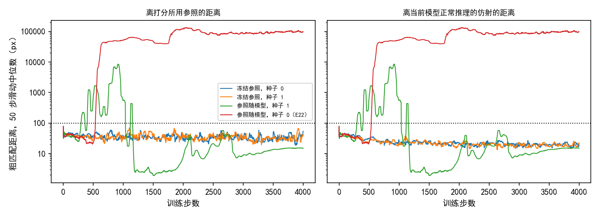
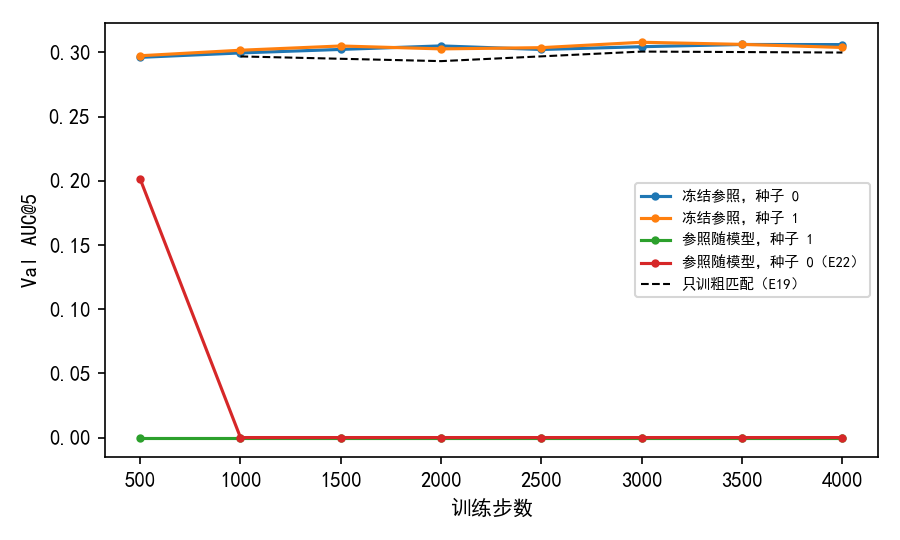

# 参照换成冻结的初始模型后，锚点 × 1 的两个种子都训满 4000 步不发散，验证集 AUC@5 最高 0.308；参照随当前模型的种子 1 在第 299 步发散

**摘要**

我们在尝试不用标注、用强化学习训练 RoMa 做月球光学图与 SAR 图的配准。训练的分数以一个参照仿射为准：E22 每步用当前模型正常推理一次、拟合出参照，所以参照随训练一起变。E22 中细化学习率取锚点 × 1 的设置在第 537 步发散（第一次启动在第 410 步）。本文把参照换成训练开始时模型的一份冻结副本，其余设置照搬 E22 的这一档，跑种子 0、1 两次；另用原设置（参照随当前模型）换种子 1 再跑一次。冻结参照的两次运行都训满 4000 步：粗匹配离打分所用参照的距离，50 步滑动中位数在第 100 步以后最高 59 和 70 像素；离当前模型自己的仿射的距离最高 46 和 42 像素，两种口径都没有越过发散的门槛 100 像素。两次的验证集 AUC@5 在八个存档上为 0.296–0.308，最好存档比只训粗匹配的 E19 高 0.006（配对 95% 区间 −0.000 到 0.012）和 0.007（0.002 到 0.013）。参照随当前模型的种子 1 在第 299 步发散，八个存档的验证集 AUC@5 都是 0；第 1150 步以后它离参照的距离降到 2–20 像素，验证集误差中位数仍在 300 像素以上。到目前为止，参照随当前模型的两个种子都发散，冻结参照的两个种子都没有发散。

**引言**

RoMa 分两步找两张图之间的对应。第一步是粗匹配：每个格子在另一张图的候选位置之间给出一个概率分布。第二步是细化：在尺度 16、8、4、2、1 上依次修正匹配，“尺度 s”指这一级的输出网格每格相当于原图 s 像素。最后用 RANSAC 从逐像素的匹配里拟合一个仿射，作为配准结果。

强化学习的分数不用标注。每一步先对这对训练图正常推理一次、拟合一个仿射，称为参照；抽签得到的匹配位置离参照给出的位置越近，分数越高。E19 只在粗匹配上抽签，验证集 AUC@5 为 0.301。E22 把抽签延伸到细化，给细化部分单独设学习率；其中学习率等于锚点（细化部分每步参数的相对改变量与粗匹配解码器相同的那个学习率）的一档在第 537 步发散。E20 的日志里，先变坏的是粗匹配的分数：粗匹配抽到的位置先和参照拉开几十像素，细化各级的分数当时仍正常。

在这些运行里，参照由当前模型算出，模型每更新一步，参照也跟着变。本文要回答的是：参照不再随训练变化时，E22 会发散的那一档还会不会发散。我们把参照换成训练开始时模型的冻结副本，在同一设置下跑两个种子，并用原设置换一个种子作对照。

**方法**

*模型、数据与训练设置。* 完全照 E22 锚点 × 1 的一档：AnyMatch 发布的 RoMa 权重，DINOv2 每层的注意力投影上挂秩为 8 的 LoRA，放开 VGG 训练。训练集 7907 对，对 SAR 图做随机平移（半径 128 像素的圆内）、旋转（±20°）、缩放（±20%）和随机擦除。粗匹配每格按温度 0.3 调过的概率抽一个位置，分数为 exp(−½(d/8)²)，d 为离参照的距离（像素）。细化在尺度 16、8、4 上加标准差 0.5 × s 像素的高斯噪声，分数为 1/(1 + ½(d/s)²)。每对图 8 条抽签链，每条链的权重为它的分数减去其余 7 条的平均（RLOO，arXiv 2402.14740）。学习率：LoRA 1e-4，粗匹配解码器 3e-5，细化部分（尺度 16、8、4 的细化层、尺度 8、4 的投影层与 VGG）1.4e-5。4000 步，前 500 步线性升温，之后按余弦降到 0。不加把模型拉回起点的惩罚项，不训练可信度，不裁剪梯度。

*冻结参照。* 训练开始时把模型深拷贝一份（LoRA 的增量此时为 0），不训练、不求梯度。每一步用这份副本对同一对已扰动的训练图正常推理，RANSAC（3 像素）拟合参照仿射，粗匹配和细化各级都对它打分。当前模型照旧正常推理一次、拟合自己的仿射，只用于记录，不参与打分。

*三个运行与对照。* 冻结参照跑种子 0、1 两次。原设置（参照随当前模型）跑种子 1 一次。对照为 E22 锚点 × 1 的一档（种子 0），直接引用它的日志与评测。本文三个运行都在 A6000 服务器上跑（种子 0 的冻结参照在 RTX A6000 上，另外两个在 RTX 5880 Ada 上），E22 在 V100 上跑。

*发散的判定。* 同 E20：粗匹配离参照的平均距离，它的 50 步滑动中位数首次超过 100 像素的那一步，称为发散起点。冻结参照的运行另按“离当前模型正常推理的仿射的距离”再算一次；参照随当前模型的运行，两种口径相同。两个参照之间的距离（下称两参照之差）为两个仿射把各格中心映射到的位置之间的平均距离。

*评测。* 每 500 步存一次权重，在不加扰动的验证集（652 对）上评测，口径同 E19、E22。配准误差是估计的仿射和标注的仿射把图块 4 个角映射到的位置之间的平均距离，没有输出仿射的图对误差记为无穷。AUC@5 是“误差不超过 x 像素的图对比例”在 x 从 0 到 5 像素上的面积除以 5。与 E19 最好存档（第 3000 步，0.301）之差用配对自助法估 95% 区间：在同一批验证图对上有放回地重抽 2000 次。训练驱动按惯例也在测试集上评了最好存档，本文不使用测试集结果。

**结果**

*冻结参照的两次运行训满 4000 步不发散；参照随当前模型的种子 1 在第 299 步发散。* 冻结参照的两次运行，离打分所用参照的距离在第 100 步以后最高为 59 像素（种子 0）和 70 像素（种子 1），离当前模型自己的仿射的距离最高为 46 和 42 像素（图 1）。参照随当前模型的种子 1 在第 299 步越过 100 像素，比 E22 种子 0 的第 537 步早；它的距离在第 913 步达到 8465 像素。四个运行里，参照拟合失败的步数都是 0。

图 1：冻结参照的两次运行在两种口径下都没有越过 100 像素，参照随当前模型的两次都越过了。纵轴为粗匹配距离的 50 步滑动中位数（对数轴），虚线为 100 像素。左图为离打分所用参照的距离，右图为离当前模型正常推理的仿射的距离；参照随当前模型的运行两图相同。

*冻结参照的两次运行，验证集 AUC@5 最好存档比 E19 高 0.006 和 0.007。* 种子 0 在八个存档上为 0.296–0.306，最好存档（第 3500 步）减 E19 最好存档为 +0.006（95% 区间 −0.000 到 0.012）；种子 1 为 0.297–0.308，最好存档（第 3000 步）为 +0.007（0.002 到 0.013）（表 1、图 2）。两次各存档的误差中位数为 3.35–3.48 像素。参照随当前模型的种子 1，八个存档都是 0，误差中位数 302–345 像素；E22 种子 0 只有第 500 步为 0.201，其后为 0。最好存档是在同一个验证集上按 AUC@5 选出的，上面的差与区间都带着这一步挑选。

表 1：冻结参照的两次运行各存档都在 0.296 以上，参照随当前模型的两次在第 1000 步以后都是 0。各列为对应存档的验证集 AUC@5。

| 运行 | 500 | 1000 | 1500 | 2000 | 2500 | 3000 | 3500 | 4000 | 最好存档减 E19 |
|---|---|---|---|---|---|---|---|---|---|
| 冻结参照，种子 0 | 0.296 | 0.300 | 0.302 | 0.305 | 0.302 | 0.305 | 0.306 | 0.306 | +0.006（−0.000 到 0.012） |
| 冻结参照，种子 1 | 0.297 | 0.302 | 0.305 | 0.303 | 0.304 | 0.308 | 0.306 | 0.304 | +0.007（0.002 到 0.013） |
| 参照随当前模型，种子 1 | 0.000 | 0.000 | 0.000 | 0.000 | 0.000 | 0.000 | 0.000 | 0.000 | −0.301（−0.318 到 −0.283） |
| 参照随当前模型，种子 0（E22） | 0.201 | 0.000 | 0.000 | 0.000 | 0.000 | 0.000 | 0.000 | 0.000 | −0.099（−0.113 到 −0.085） |
| E19（只训粗匹配） | | 0.297 | | 0.293 | | 0.301 | | 0.300 | |

图 2：冻结参照的两次运行与 E19 重合或略高，参照随当前模型的两次落到 0。参照随当前模型的种子 1 各存档都是 0，与 E22 的曲线在第 1000 步以后重叠。虚线为 E19，它每 1000 步存一次。

*冻结参照的运行里，当前模型的仿射与冻结参照相差几十像素，粗匹配离当前模型的仿射比离冻结参照更近。* 以种子 0 为例（各取 100 步窗口的中位数），两参照之差在第 1 步为 12 像素，第 750 步升到 41 像素，之后在 10–30 像素之间；50 步滑动中位数最高 56 像素（种子 1 为 74 像素）。同一时期，粗匹配离冻结参照的距离为 30–46 像素，离当前模型的仿射从 44 像素降到第 2000 步以后的 18–22 像素。种子 1 的走势相同。粗匹配分布最高分位置的概率，两次都从第 1 步的约 0.22 升到第 3000 步的约 0.79。

*参照随当前模型的种子 1，第 1150–1900 步离参照只有 2–3 像素，粗匹配的 8 条链抽到同一个位置，验证集仍配不准。* 第 1500 步附近，它离参照的距离为 2.3 像素，细化尺度 4 离参照 3.0 像素，粗匹配分数 0.95；第 2000–3900 步离参照 9–21 像素。从第 1000 步起，粗匹配分布最高分位置的概率为 1.00、熵为 0，8 条链的粗匹配分数标准差为 0：全程有 3623 步如此，第一次出现在第 347 步。同一时期的验证集误差中位数为 302–345 像素。冻结参照的两次运行中，8 条链分数完全相同的步分别有 133 和 147 步。

*次要核对。* 同一种子下，冻结参照运行第 1 步离当前模型仿射的距离（51.67 像素）与参照随当前模型运行第 1 步离参照的距离相同，说明两种设置下当前模型这一路的计算一致。第 1 步两份模型的权重相同，两参照之差却不为 0（种子 0 为 1.9 像素，种子 1 为 6.5 像素）。第 1–500 步各部分每步参数的相对改变量，冻结参照与 E22 量级相同（第 250 步附近，粗匹配解码器 4.0e-5 对 4.7e-5，细化尺度 8 为 3.1e-5 对 3.8e-5）。冻结副本让第 1 步显存从 17.7 GB 增加到 18.8 GB，每步耗时中位数 1.25–1.79 秒。

**讨论**

引言的问题在两个种子的范围内有了回答：参照换成冻结的初始模型后，E22 会发散的锚点 × 1 设置两次都没有发散，而原设置换种子后照样发散，两种口径下冻结参照的运行都没有越过门槛。冻结参照的运行同时让验证集 AUC@5 比只训粗匹配高 0.006–0.007，其中一个种子的区间不含 0。

本文有四点局限。第一，每种设置只有两个种子，而 E22 已经看到同一配置的两次运行可以一次发散、一次不发散。第二，冻结参照与参照随当前模型的运行有两处不同：参照不随训练改变，参照也换成了另一份模型的输出；训练中两参照之差达到几十像素。本文的设置分不开这两处各自的作用。第三，本文三个运行在 A6000 服务器上跑，对照 E22 在 V100 上跑，GPU 不同。第四，最好存档在验证集上选出，与 E19 的差带着这一步挑选。

以下现象本文没有解释：

- 参照随当前模型的种子 1 在第 1150–1900 步离参照只有 2–3 像素、粗匹配分数接近 1，验证集误差却在 300 像素以上。E22 中细化学习率最低的一档在第 800–1000 步也有同样的现象。能区分的检查：在这一时期的存档上，看参照仿射与标注仿射之间的距离。
- 冻结参照的运行里，粗匹配离当前模型自己的仿射（约 20 像素）比离打分所用的冻结参照（30–46 像素）更近。未检验。能区分的检查：在验证集上按存档比较当前模型的仿射、冻结参照各自离标注的距离。
- 第 1 步两份模型的权重相同，两参照之差却有 1.9–6.5 像素。可能来自 RANSAC 的随机抽样，也可能来自副本走的编码器实现与原模型不同（未检验）。能区分的检查：固定 RANSAC 的随机数，对同一对图比较两份模型的逐像素匹配。
