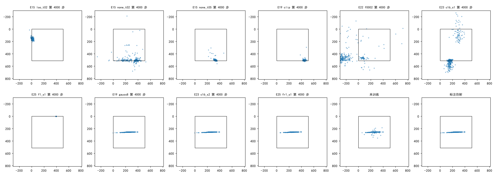
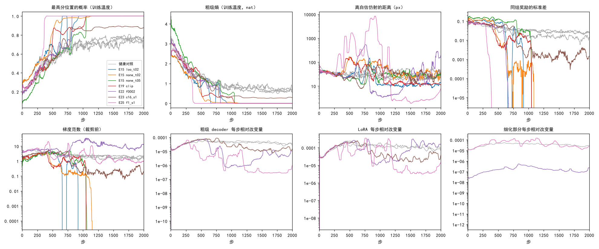
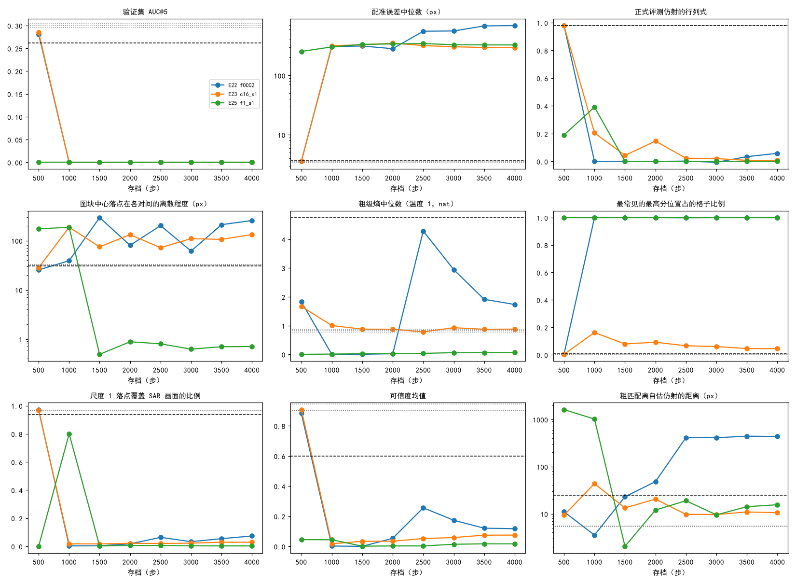

# 七个自洽坍缩运行的粗匹配都落到 SAR 画面边缘附近、与图像内容无关的一处；其中压成单点、只训粗匹配的四个运行此后梯度为 0

**摘要**

我们在尝试不用标注、用强化学习训练 RoMa 做月球光学图与 SAR 图的配准。训练的分数以模型自己估计的仿射为准（自估仿射），E15–E25 的 49 个运行里有七个出现了自洽坍缩：训练中粗匹配离自估仿射很近、分数很高，验证集 AUC@5 却为 0。本文不训练，只读这七个运行的存档（共 32 个）和三个健康运行的最后存档，在验证集 652 对上看坍缩后模型输出什么、在同样的抽签下还有没有梯度，并用训练日志看从健康到坍缩的过程。七个运行的最后存档中，六个的粗匹配把每个格子的最高分位置放在 SAR 图上同一个候选位置，另一个（E23 c16_s1）放在约 35 个相邻候选位置组成的一小片里；这些位置都在 SAR 画面边缘附近（五个在最下一行，一个在最上一行，一个在左起第二列），在 652 对之间不变，各运行之间不同。正式评测的仿射两个奇异值的中位数为 0.02–2.25 和 0.002–0.045（健康运行为 1.01 和 0.97），细化后的匹配只覆盖 SAR 画面的 0.3%–7.4%（健康运行 96%），可信度均值 0.003–0.14（健康运行 0.90–0.95）。在训练时的抽签方式下，压成单点、只训粗匹配的四个存档，每格各份抽签全同，留一优势约 1e-8，梯度范数为 0；它们的粗级权重在第 2000→3000 步的相对改变量四个运行完全相同（7.977e-05）。E23 c16_s1 和两个也训细化的运行仍有梯度，权重仍在变。训练日志上，七个运行前 200 步与健康运行走势相同；之后同组奖励的标准差降一到两个数量级、离自估仿射的距离升高（六个运行越过 100 像素），随后最高分位置的概率升到 1（c16_s1 停在约 0.88），离自估仿射的距离回落到 10–30 像素。

**引言**

RoMa 分两步找两张图之间的对应。第一步是粗匹配：光学图上每个格子（560 输入时 40×40 格，每格相当于原图约 13 像素）在 SAR 图的 64×64 = 4096 个候选位置之间给出一个概率分布，正常推理取概率最高的位置（下称最高分位置），再和它上下左右四个候选位置按概率加权，得到这个格子的粗匹配位置。第二步是细化：在尺度 16、8、4、2、1 上依次修正匹配，最后每个像素有一个匹配位置和一个可信度。评测时按可信度抽点、用 RANSAC 拟合一个仿射，作为配准结果。

本图的强化学习训练粗匹配时，每格按温度调过的概率抽一个候选位置，每对图抽 8 或 16 份。打分不用标注：先用当前模型对这对图正常推理一次、拟合一个仿射（自估仿射），抽到的位置离自估仿射给出的位置越近，分数越高；RLOO 用每份的分数减去同组其余各份的平均作为权重（优势），乘以抽到位置的对数概率求梯度。部分运行在细化的尺度 16、8、4 上也加噪声抽签。

E15–E25 里有七个运行出现了同一种失败（自洽坍缩）：训练中粗匹配离自估仿射很近，验证集 AUC@5 却为 0、误差中位数约 300 像素。它们是 E15 `loo_t02`、`none_t02`、`none_t05`，E19 `clip`，E22 `f0002`，E23 `c16_s1`，E25 `f1_s1`。E15、E19 当时记为“概率压到一个位置上”，E22、E23、E25 把它列为没有解释的现象，没有放在一起看过。本文回答三个问题：坍缩后模型输出的是什么，七个运行是不是同一种解；坍缩后训练是否已经不再更新；从健康到坍缩的过程中发生了什么。

**方法**

*存档。* 七个坍缩运行：E15 三个与 E19 `clip` 取第 1000、4000 步；E22 `f0002`、E23 `c16_s1`、E25 `f1_s1` 每 500 步一个，共 8 个。健康对照取 E19 `gauss8`、E23 `c16_s2`、E25 `fr1_s1` 的第 4000 步，以及未训练的模型（AnyMatch 发布的 RoMa 权重）。七个运行的配置：E15 三个为温度 0.2 的 RLOO、温度 0.2 和 0.5 的直接以分数为权重（不减平均），分数为 RIPE++ 式分级；E19 `clip` 为温度 0.3 的 RLOO、截平分数；其余三个为温度 0.3 的 RLOO、高斯分数，E22 `f0002` 与 E25 `f1_s1` 另在细化尺度 16、8、4 上抽签、每对 8 份，E23 `c16_s1` 只训粗匹配、每对 16 份。七个运行都以当前模型算自估仿射；E25 `fr1_s1` 以冻结的初始模型算（下称初始自估仿射）。每个存档照所属运行的配置构造训练时的网络，把存档里的权重和 DINOv2 的 LoRA 增量原样装回，与训练时是同一个网络。

*数据。* 验证集 652 对有标注的光学–SAR 图，不加扰动。每对的标注点最小二乘拟合出标注仿射（同 E17）。第 2 项只用其中均匀取出的 100 对。

*第 1 项：形态。* 每个存档在 652 对上：正式评测的仿射（训练驱动逐存档评测时写下的结果：560 与 864 两遍、双向、抽 10000 点、RANSAC 3 像素）的两个奇异值、行列式、把图块中心 (256, 256) 映射到的位置，以及这个位置在各对之间的离散程度（两轴标准差的均方根）。另做一次训练时的正常推理（只有 560 一遍），记：粗匹配每格的熵（温度 1，单位 nat，可读作“概率平摊在 e^熵 个位置上”）；每对图里最高分位置互不相同的个数（满 1600）和最常见的那个占的格子比例；粗匹配位置的质心；细化后每个像素的匹配位置覆盖 SAR 画面的比例（16 像素方格里有匹配落入的比例）；可信度的均值；按训练时的做法拟合的自估仿射，以及粗匹配位置离它的平均距离（同训练日志里“离自估仿射的距离”的口径，只是不抽签）。

*第 2 项：坍缩后是否还在学习。* 在 100 对上，用每个存档所属运行自己的训练成分（温度、每对抽签份数、分数、细化抽签都照原配置；未训练模型用 E19 `gauss8` 的配置）算一步训练损失并反向，不更新参数。记最高分位置的概率、同一格各份抽签全同的比例、同组分数的标准差、优势的绝对值、梯度范数（全部参数，以及粗级 decoder、细化尺度 16 等部分，已除去混合精度的放大倍数）。另比较各运行相邻存档之间各部分权重的相对改变量 ‖θ_后 − θ_前‖ / ‖θ_前‖，LoRA 按等效权重增量的范数计。

*第 3 项：成因。* 读七个运行和三个健康运行的训练日志（每步一行），取 50 步滑动中位数，看最高分位置的概率、熵（这两项是训练温度下的）、离自估仿射的距离、同组分数的标准差、裁剪前的梯度范数和各部分每步的相对改变量（E22、E23、E25 才有）。记下每个运行最高分位置的概率首次超过 0.99、同组分数标准差首次低于 1e-3、离自估仿射的距离首次超过 100 像素（E20 的失控判定）的步。每 500 步存档的三个运行，把第 1 项的量按存档连成走势。

*第 4 项：可视化。* 每个存档在 Val 六个 ROI 各取第一对，把可信度图、粗匹配的熵图、尺度 1 的匹配位移和粗匹配最高分位置写成中间结果；正式评测的点对随预测一起放进本实验，工作台上可逐对查看。本实验的 36 个方法就是这 36 份存档，它们的验证集预测复制自原运行的逐存档评测，没有重跑。

**结果**

*坍缩后，粗匹配把每个格子的最高分位置放在 SAR 画面边缘附近同一处，这一处在各对图之间不变。* 七个运行的最后存档里，六个在每对图上都只有 1–2 个不同的最高分位置，最常见的那个占全部格子（表 1）。其中五个运行的粗匹配位置质心在 652 对之间的 10% 与 90% 分位数相同，即每对图都落在同一处，与图像内容无关；E22 `f0002` 的质心在 x 172–195、y 457–508 像素之间。这一处在 E15 `none_t02`、`none_t05`、E19 `clip`、E22 `f0002` 为 SAR 图最下一行候选位置（y = 508 像素，x 分别为 364、332、444、172），在 E25 `f1_s1` 为最上一行（412, 4），在 E15 `loo_t02` 为左起第二列（12, 156）。E23 `c16_s1` 不同：每对图有约 35 个不同的最高分位置，最常见的只占 4%，它们挤在最下一行 x = 158–167 附近、离散程度 51 像素（健康运行 146 像素），熵中位数 0.88 nat，与健康运行（0.77–0.86）相近。七个运行都是“压到画面边缘附近一处”，但具体位置各不相同。

图 1：坍缩运行的仿射把图块中心送到画面边缘附近、各运行不同的位置，健康运行与标注一样落在画面中部的一条带上。每个点是一对验证图上正式评测的仿射把图块中心 (256, 256) 映射到的位置（SAR 像素），方框为 SAR 画面。

*坍缩后的仿射几乎把整张图压成一条线或一个点，细化后的匹配只覆盖画面的百分之几，可信度普遍很低。* 正式评测的仿射，两个奇异值的中位数在六个运行为 0.02–0.49 和 0.002–0.045，行列式中位数的绝对值不超过 0.06；健康运行为 1.01、0.97 和 0.98（表 1）。细化后的匹配覆盖 SAR 画面的 0.3%–7.4%，健康运行为 96%–97%；可信度均值 0.003–0.14，健康运行 0.90–0.95，未训练模型 0.60。在训练时的正常推理里，粗匹配离自估仿射的距离为 5.5–18.7 像素（E22 `f0002` 除外），与健康运行的 5.4–5.5 像素同一量级，比未训练模型的 24.5 像素还近；自估仿射离标注的误差中位数为 290–350 像素。

表 1：七个坍缩运行的最后存档与健康运行。各列为验证集 652 对的中位数（AUC@5 除外）。“最高分位置”为粗匹配质心（SAR 像素）；“不同位置数”为每对图里不同最高分位置的个数（满 1600）；“离自估仿射”为正常推理下粗匹配离自估仿射的距离（像素）。

| 存档（第 4000 步） | AUC@5 | 误差（px） | 最高分位置 | 不同位置数 | 熵（nat） | 仿射奇异值 | 行列式 | 落点覆盖 | 可信度均值 | 离自估仿射 |
|---|---|---|---|---|---|---|---|---|---|---|
| E15 `loo_t02` | 0 | 301 | (12, 156) | 1 | 0.0001 | 0.056 / 0.017 | 0.0006 | 0.9% | 0.008 | 12.4 |
| E15 `none_t02` | 0 | 322 | (364, 508) | 1 | 0.0009 | 0.057 / 0.005 | 0.0000 | 0.5% | 0.001 | 18.7 |
| E15 `none_t05` | 0 | 305 | (332, 508) | 1 | 0.0017 | 0.025 / 0.004 | −0.0000 | 0.5% | 0.138 | 5.5 |
| E19 `clip` | 0 | 349 | (444, 508) | 1 | 0.0000 | 0.044 / 0.006 | −0.0000 | 0.8% | 0.003 | 9.4 |
| E22 `f0002` | 0 | 692 | (172, 508) | 2 | 1.73 | 2.25 / 0.045 | 0.058 | 7.4% | 0.117 | 434 |
| E23 `c16_s1` | 0 | 294 | (163, 508) 一片 | 35 | 0.88 | 0.49 / 0.024 | 0.008 | 2.9% | 0.075 | 10.5 |
| E25 `f1_s1` | 0 | 327 | (412, 4) | 1 | 0.063 | 0.020 / 0.002 | 0.0000 | 0.3% | 0.005 | 15.5 |
| E19 `gauss8`（健康） | 0.300 | 3.46 | 中部 | 1548 | 0.82 | 1.01 / 0.97 | 0.98 | 96.5% | 0.901 | 5.5 |
| E23 `c16_s2`（健康） | 0.296 | 3.49 | 中部 | 1550 | 0.77 | 1.01 / 0.97 | 0.98 | 96.4% | 0.903 | 5.4 |
| E25 `fr1_s1`（健康） | 0.304 | 3.44 | 中部 | 1547 | 0.86 | 1.01 / 0.97 | 0.98 | 96.7% | 0.945 | 5.4 |
| 未训练 | 0.262 | 3.75 | 中部 | 1144 | 4.75 | 1.01 / 0.97 | 0.98 | 93.7% | 0.600 | 24.5 |

*E22 `f0002` 后期与 E15 `none_t02` 早期是两个例外。* E22 `f0002` 第 1000 步与其他运行同样，粗匹配全部落在 (172, 508)、离自估仿射 3.5 像素；第 2500 步以后粗匹配仍落在这一处，但细化后的匹配与可信度变了，熵中位数升到 1.7–4.3 nat，正式评测的仿射把图块中心送到画面左侧外（x 中位数 −225 到 −367 像素），粗匹配离自估仿射 409–442 像素，误差中位数 556–692 像素（图 3）。训练日志上它离自估仿射的距离第 2000 步为 475 像素，第 3900 步为 1420 像素。E15 `none_t02` 第 1000 步还没有压成一处：每对图有 5 个不同的最高分位置，熵 0.39 nat，正式评测的仿射奇异值 1.24 和 0.68、行列式 0.90，验证集 AUC@5 为 0.002、误差中位数 201 像素；第 4000 步压到 (364, 508)，行列式为 0。票里提到的“行列式约 0.9”对应的是它的第 1000 步。

*压成单点、只训粗匹配的四个存档，在训练时的抽签方式下没有梯度。* E15 三个与 E19 `clip` 的第 4000 步（以及 E15 `loo_t02` 第 1000 步），最高分位置的概率为 1，100 对里每格 16 份抽签全部相同，同组分数的标准差为 0，留一优势约 1e-8，梯度范数为 0（表 2）。E15 `none_t05` 直接以分数为权重，权重为 0.69，梯度范数仍只有 8.5e-6：抽到的位置概率为 1，它的对数概率对参数的梯度为 0。训练日志里这四个运行从第 1000 步前后起梯度范数恰为 0，74%–79% 的步同组分数标准差为 0。相邻存档之间，它们粗级 decoder 的相对改变量在第 2000→3000 步四个运行都是 7.977e-05，第 3000→4000 步为 1.556e-05–1.591e-05；LoRA 的等效权重增量为 0.0015–0.0028，健康的 E19 `gauss8` 同期为 1.35 和 0.25。

表 2：在训练时的抽签方式下（100 对的中位数），压成单点、只训粗匹配的存档梯度为 0，其余坍缩存档仍有梯度。“各份全同”为同一格各份抽签抽到同一位置的格子比例；“细化尺度 16”一列为这一级的优势与梯度范数，只对也训细化的运行有。

| 存档（第 4000 步） | 最高分概率 | 各份全同 | 同组分数标准差 | 粗级优势 | 梯度范数 | 其中粗级 decoder | 细化尺度 16：优势 / 梯度 |
|---|---|---|---|---|---|---|---|
| E15 `loo_t02` | 1 | 100% | 0 | 2e-8 | 0 | 0 | — |
| E15 `none_t02` | 1 | 100% | 0 | 0.24（权重） | 0 | 0 | — |
| E15 `none_t05` | 1 | 100% | 0 | 0.69（权重） | 8.5e-6 | 8.0e-6 | — |
| E19 `clip` | 1 | 100% | 0 | 2e-8 | 0 | 0 | — |
| E23 `c16_s1` | 0.88 | 46% | 0.0084 | 0.0066 | 0.88 | 0.63 | — |
| E22 `f0002` | 0.99 | 99.5% | 0 | 7e-9 | 4.37 | 0.55 | 0.025 / 3.52 |
| E25 `f1_s1` | 1 | 100% | 0 | 8e-9 | 0.79 | 0.029 | 0.114 / 0.22 |
| E19 `gauss8`（健康） | 0.91 | 60% | 0.0055 | 0.0043 | 0.34 | 0.28 | — |
| E23 `c16_s2`（健康） | 0.91 | 61% | 0.0046 | 0.0036 | 0.28 | 0.24 | — |
| E25 `fr1_s1`（健康） | 0.90 | 66% | 0.0052 | 0.0046 | 1.24 | 0.28 | 0.120 / 0.59 |
| 未训练 | 0.25 | 0.3% | 0.135 | 0.110 | 3.04 | 2.75 | — |

*E23 `c16_s1` 与两个也训细化的运行坍缩后仍在更新。* E23 `c16_s1` 各存档（第 1000–4000 步）里 44%–57% 的格子各份全同，梯度范数 0.68–1.23，比健康运行（0.28–0.34）还大；它的 LoRA 每 500 步的增量为 0.02–2.3，与同配置的健康运行 E23 `c16_s2`（0.06–2.3）相当；粗匹配那一片的位置沿最下一行从 x = 226（第 1000 步）移到 163（第 4000 步）。E22 `f0002` 与 E25 `f1_s1` 的粗匹配各份全同、粗级优势约 1e-8，但细化各级抽签的优势仍为 0.005–0.13，同一像素各份分数从不全同；梯度主要在细化部分（尺度 16 为 0.1–8），细化部分的权重每 500 步的相对改变量为 4e-7–6e-5（`f0002`，细化学习率为锚点的 0.002 倍）和 8e-5–0.007（`f1_s1`；健康的 E25 `fr1_s1` 为 7e-5–0.003）。

*七个运行前 300–500 步与健康运行走势相同，之后同组分数的标准差先掉下来、离自估仿射的距离升高，再压成一处并回到离自估仿射很近。* 训练日志的 50 步滑动中位数（图 2）：前 200 步，七个运行的最高分位置概率从 0.13–0.33 升到 0.34–0.53，同组分数的标准差 0.06–0.15，离自估仿射 30–45 像素，与三个健康运行重合。随后，同组分数的标准差在第 360 步（E25 `f1_s1`）到第 1049 步（E19 `clip`）之间降到 1e-3 以下（E23 `c16_s1` 在第 1378 步；健康运行的滑动中位数始终高于 1e-3），梯度范数降到约 0.5；同一段里离自估仿射的距离升高，六个运行越过 100 像素（第 299–825 步，峰值 105–8465 像素），E23 `c16_s1` 最高 83 像素。越过 100 像素与标准差降到 1e-3 以下的先后：E15 `none_t02`、`none_t05`、E19 `clip`、E22 `f0002`、E25 `f1_s1` 先越过 100 像素（相差 17–619 步），E15 `loo_t02` 先降标准差（第 655 步，越过 100 像素在第 806 步）。接着最高分位置的概率首次超过 0.99（第 390–1072 步；E23 `c16_s1` 停在 0.85–0.89），熵降到 0，同组分数标准差恰为 0（首次在第 347–1027 步），离自估仿射的距离回落到 10–30 像素，此后保持（E22 `f0002` 第 1500 步以后又升到数百像素，见上文）。E25 `f1_s1` 的回落最晚：第 400–1000 步离自估仿射数百到数千像素，第 1150 步以后约 2–20 像素（同 E25）。

图 2：七个运行先与健康运行重合，第 300–1100 步之间同组分数的标准差掉下来、离自估仿射的距离升高，随后概率压到 1、距离回落。各量为 50 步滑动中位数，只画前 2000 步；灰线为三个健康运行。细化部分的改变量只有 E22 `f0002`、E25 两个运行记录。

*每 500 步存档的两个运行，第 500 步仍健康，第 1000 步已坍缩。* E22 `f0002` 和 E23 `c16_s1` 第 500 步的验证集 AUC@5 为 0.281 和 0.285，仿射行列式 0.98，匹配覆盖 97%，可信度均值 0.88 和 0.91，都与健康运行相近；第 1000 步 AUC@5 为 0，覆盖降到 0.3% 和 1.8%，可信度均值降到 0.002 和 0.017（图 3）。E25 `f1_s1` 第 500 步已坍缩，那时正常推理下粗匹配离自估仿射 1620 像素，第 1500 步以后为 2–19 像素。

图 3：E22 `f0002` 与 E23 `c16_s1` 在第 500 到 1000 步之间从健康变为坍缩，此后各量基本不动，E22 `f0002` 第 2500 步以后细化与可信度又有变化。黑色虚线为未训练模型，灰色点线为三个健康运行的最后存档。

*次要核对。* 训练时的模型与本文装回存档后的模型是同一个网络：E25 `fr1_s1` 的初始自估仿射由训练开始时拷下的未训练模型给出，本文同样在装回存档前拷贝。第 2 项里，混合精度按 65536 倍放大后出现非有限梯度的图对按 256 倍重算，重算后都有限；这样的图对在 E22 `f0002` 第 1500–4000 步占 89%–96%，其余存档 0–41%。工作台评测（`metrics.json`）与原运行逐存档评测的 AUC@5 一致。

**讨论**

三个问题都有了初步回答。第一，七个运行坍缩后输出的是同一类解：粗匹配把所有格子送到 SAR 画面边缘附近、与图像内容无关的一处，仿射近乎把整张图压成线或点，可信度普遍很低；但落到哪一处各运行不同，E23 `c16_s1` 是一小片而不是一个点，E22 `f0002` 后期的细化又离开了这一处。第二，“不再更新”只对压成单点、只训粗匹配的四个运行成立：它们每格各份抽签全同，留一优势和对数概率的梯度都为 0；只要还有别的随机来源（`c16_s1` 的概率没有压到 1，两个细化运行的细化抽签），梯度和权重的变化就还在。第三，过程上，七个运行都是先出现同组分数的标准差骤降、离自估仿射的距离升高，再压成一处、回到自洽；这一顺序是从日志的滑动中位数读出来的，“为什么同组分数的差别会骤降”本文没有回答。

本文有三点局限。第一，第 2 项只在验证集 100 对上、不加扰动地算，训练时用的是加了难版扰动的训练图对；票里不做训练图对上的分析。第二，E15、E19 的四个运行只有第 1000、4000 步两个存档，坍缩前后的形态只能从日志看。第三，第 3 项的事件步取自 50 步滑动中位数，阈值（0.99、1e-3、100 像素）是描述用的，换阈值先后顺序可能变化。

以下现象本文没有解释：

- 坍缩落到的位置都在画面边缘附近，而不是任意位置。未检验。能区分的检查：看训练时（加了难版扰动的训练图）SAR 画面的补零区在不在这些位置，以及坍缩前最后几百步最高分位置在画面上的分布。
- 压成单点的四个运行，梯度为 0 以后粗级权重的相对改变量在四个运行逐位相同。可能只剩 AdamW 的权重衰减在起作用（未检验）。能区分的检查：用学习率表和权重衰减系数算出纯衰减时的改变量，并扣除不参与优化的缓冲区。
- 坍缩后可信度均值降到 0.003–0.14，粗级以外的部分（只训粗匹配的运行里细化层和 VGG 不训练）也随之变化。只训粗匹配的运行里，可信度的变化只能来自粗级 decoder 与 DINOv2 的 LoRA 经细化层传下来的输入。未检验。能区分的检查：把坍缩存档的粗匹配位置换成健康运行的，看可信度是否恢复。
- E22 `f0002` 第 2500 步以后细化把匹配移到画面左侧外，离自估仿射数百像素，与其余运行坍缩后“回到自洽”不同。
