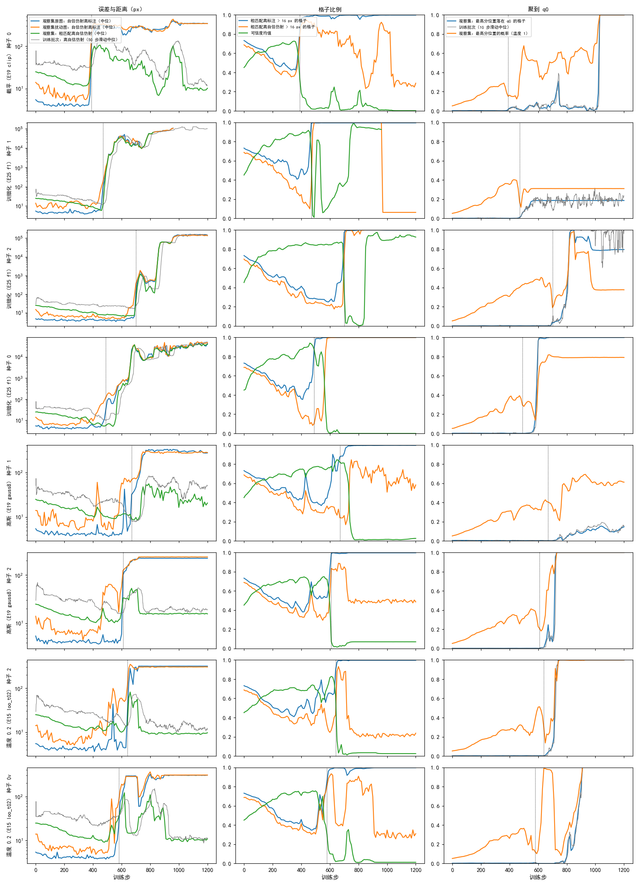
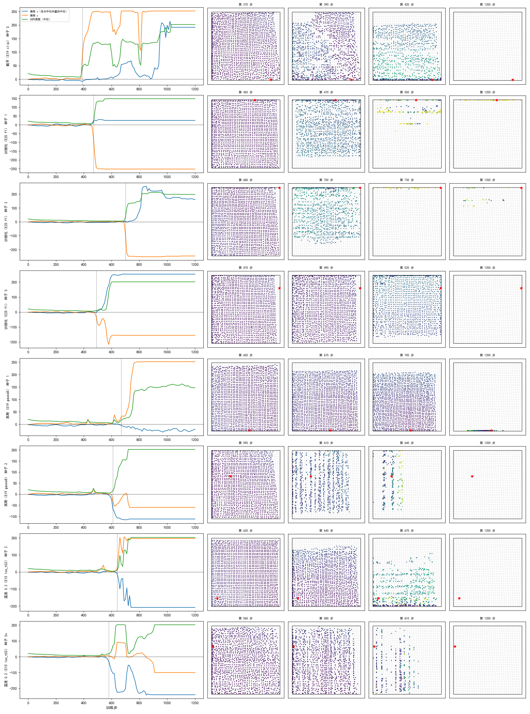
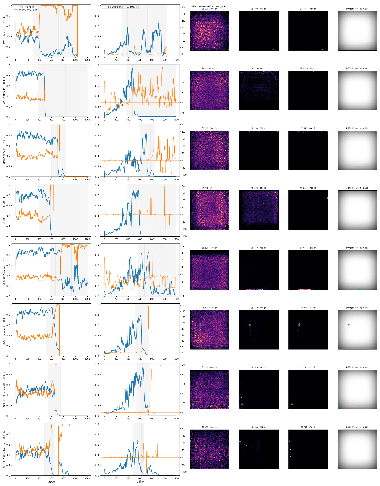
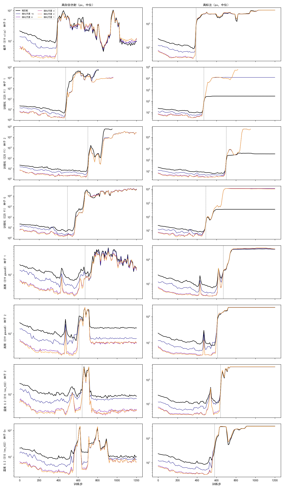
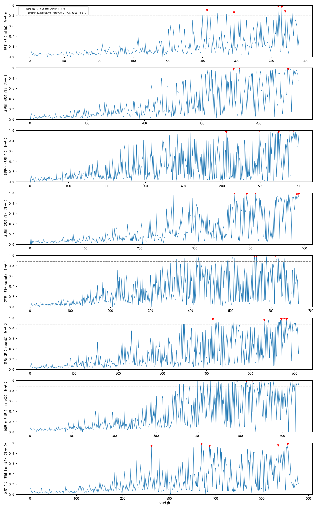

# 坍缩前粗匹配先整体偏离标注，配准在几十步内随之失效，找不到单个触发批次

**摘要**

我们在尝试不用标注、用强化学习训练 RoMa 做月球光学图与 SAR 图的配准。训练给抽签打分的依据是模型自己估计的仿射（自估仿射）。E26 发现，坍缩的运行最终都落在同一类平凡解上：粗匹配把全部格子送到 SAR 画面上同一处，自估仿射也跟着指向那里。但从健康走到这一步的过程，只靠每 500 步一个的存档和训练日志看不出来。本文重跑四个配置，每个配置三个种子，训到第 1200 步，逐步记录训练批次上每个格子的状态，每 10 步在一个固定的观察集上推理一次，以此回答四个问题：离自估仿射的距离为什么升高，怎样聚到一点，训细化的运行为什么先失控，有没有触发它的训练批次。13 个运行里有 8 个失效。看到的过程如下。在配准失效前 30 步，观察集上的配准误差仍与健康运行相当，但粗匹配离标注超过 16 px 的格子已经比健康运行多，离自估仿射超过 16 px 的格子却多得少，训细化的运行甚至更少。之后 10–30 步内，粗匹配整体朝画面的某一边滑过去，配准随之失效，自估仿射跟着粗匹配走。失效后有信号的格子迅速减少，剩下的最高分位置沿着边缘汇到一处 q0。q0 多在画面边缘，但有一个运行落在画面内部的非补零区。训细化的运行失效后，细化输出飞出画面上万像素，粗匹配仍停在画面以内。逐步看每次更新后改变的格子，这个比例从第 100 步左右起逐渐变大，最大的几次跳动分散在失效前几百步里，没有一个批次能单独解释失效。另外，同一配置、同一种子在两种 GPU 上会从第 1 步起分叉，一边坍缩、一边健康，所以坍缩不由训练批次的序列决定。

**引言**

RoMa（arXiv:2305.15404）分两步找两张图之间的对应。第一步是粗匹配：光学图分成 40×40 个格子（每格约 13 像素），每个格子在 SAR 图的 64×64 = 4096 个候选位置上给出一个概率分布。正常推理时每格取概率最高的候选位置（下称最高分位置），再按邻居概率加权，得到这一格的粗匹配位置。第二步是细化：从粗匹配出发，在尺度 16、8、4、2、1 上逐级修正，最后按可信度抽点，用 RANSAC（Fischler & Bolles 1981）拟合一个仿射，作为配准结果。

强化学习只改训练信号。每一步对一对图做四件事。一是抽签：每个格子按温度调过的概率抽候选位置，每对抽 16 份（训细化的运行 8 份）。二是算自估仿射：当前模型对这对图正常推理一次，拟合出的仿射即自估仿射。三是打分：抽到的位置离自估仿射给出的位置越近，分数越高；远到一定程度后分数停在下限上。四是更新：用 RLOO（Kool et al. 2019；arXiv:2402.14740），每份分数减去同组其余各份的平均，作为这份抽签的权重，再乘以抽到位置的对数概率求梯度。同组各份分数相同时，这一格就没有梯度。

E15–E25 的运行里，有一部分训练分数正常，验证集上却几乎每对都配错。E26 读这些运行的存档发现，它们都落在同一类平凡解上：粗匹配把全部格子送到同一处 q0，自估仿射把整张图映射到那里，抽签也抽在那里，于是匹配和自估仿射彼此一致，但 q0 与图像内容无关。E26 只有每 500 步一个的存档，看不出模型是怎样从健康走到 q0 的。本文重跑其中三个坍缩配置和一个原本健康的配置，逐步记录训练批次和一个固定观察集，回答四个问题：离自估仿射的距离为什么升高；有信号的格子怎样聚到 q0、q0 是否对应 SAR 的补零区；训细化的运行与只训粗匹配的运行在失控时有什么不同；有没有一个触发失效的训练批次。

**方法**

*配置与运行。* 四个配置照原实验的设置，只把训练截在第 1200 步（学习率调度仍按原来的 4000 步）：截平分数（E19 `clip`）、温度 0.2 的分级分数（E15 `loo_t02`）、训细化（E25 `f1_s1` 的设置）、高斯分数（E19 `gauss8`，原运行健康，作对照）。每个配置跑种子 0、1、2。原来坍缩的运行跑在 V100 上。为了复现，温度 0.2 的种子 0 在 V100 上又跑了一次（`loo_t02_s0v`），所以一共 13 个运行。记录只多做推理、不改变训练：截平种子 0 与 E19 `clip`、高斯种子 1 与 E23 `c16_s1`、`loo_t02_s0v` 与 E15 `loo_t02` 逐步完全相同，日志上的三个事件步都一致。训细化的运行与原运行在前几步就有差异（见本节末段）。

*训练批次的记录。* 每步记下这一步那对图的扰动与补零比例、自估仿射（6 个数与内点数），以及 1600 个格子各自的最高分位置、它的概率、粗匹配位置、离自估仿射的距离、这一格的信号，并在更新后对同一批次再推理一次，记下更新后的最高分位置和粗匹配位置。一格的信号是损失对这一格 logits 的梯度大小，信号为 0 即同组各份分数相同、这一格不参与更新。更新后移动的格子比例是更新前后粗匹配位置相差超过 1 px 的格子占比。训细化的运行还记下尺度 16、8、4 各级的输出。

*固定观察集。* 从验证集等距取 16 对，每对用原图和一个固定的难版扰动（随机平移、旋转、缩放与擦除，标注检查点随 SAR 一起变换），共 32 个样本。每 10 步用当前模型正常推理一次，记录与训练批次相同的量，另记以下四个量。配准误差：自估仿射在检查点上的误差中位数（同 workbench 的评测）。粗匹配离标注的距离：粗匹配位置与按标注仿射映射的位置之差。粗匹配离自估仿射的距离：同上，但与自估仿射映射的位置比。各级细化输出离两者的距离。离标注超过 16 px 的格子比例和离自估仿射超过 16 px 的格子比例，都取全部 32 个样本、全部格子的平均。

*失效与健康的判据。* 第 1200 步观察集原图上的配准误差中位数超过 20 px 记为失效，否则为健康。失效起点是此后观察集原图配准误差一直超过 20 px 的第一步；在这之前越界又恢复的，记为短暂越界。q0 取第 1200 步观察集上最常见的最高分位置。健康参照是 5 个健康运行在同一步的中位数；看每步的跳动时，只用只训粗匹配的 4 个健康运行作参照。

*可复现检查。* 存档带 AdamW（arXiv:1711.05101）与梯度缩放器的状态、各随机数发生器的状态和数据加载的位置，可以从存档原样续训。从截平种子 0 第 300 步的存档续训 100 步，在原来的 V100 上与在 3090 上各一次；从训细化种子 1 第 400 步的存档在 V100 上续训 100 步。每步比较训练日志上的损失与离自估仿射的距离。

**结果**

*13 个运行里 8 个失效；三个配置的失效都不止一个种子，原来健康的高斯配置也失效了两个。* 失效的运行最终配准误差在 200 px 以上（训细化的运行上万 px），健康的都在 4 px 左右（表 1）。截平种子 0 复现了 E19 `clip`。V100 上的温度 0.2 种子 0 复现了 E15 `loo_t02` 第 658 步的坍缩；同一配置、同一种子在 3090 上没有失效。

表 1：13 个运行的结局。失效起点按观察集（每 10 步）；概率过 0.99 的步按训练日志（50 步滑动中位数，同 E26），"—" 表示到第 1200 步未发生。

| 配置 | 种子 | GPU | 结局 | 失效起点 | 最高分位置概率过 0.99 | 第 1200 步配准误差（px） |
|---|---|---|---|---|---|---|
| 截平（E19 `clip`） | 0 | V100 | 失效 | 390 | 1049 | 343 |
| | 1 | V100 | 健康 | — | — | 4.1 |
| | 2 | 3090 | 健康 | — | — | 4.1 |
| 温度 0.2（E15 `loo_t02`） | 0 | 3090 | 健康 | — | — | 3.9 |
| | 0 | V100 | 失效 | 580 | 658 | 305 |
| | 1 | V100 | 健康 | — | — | 3.7 |
| | 2 | V100 | 失效 | 640 | 753 | 316 |
| 训细化（E25 `f1`） | 0 | V100 | 失效 | 490 | — | 43237 |
| | 1 | V100 | 失效 | 470 | — | 拟合失败（输出为 NaN） |
| | 2 | 3090 | 失效 | 700 | 846 | 139438 |
| 高斯（E19 `gauss8`） | 0 | 3090 | 健康 | — | — | 4.1 |
| | 1 | V100 | 失效 | 670 | — | 273 |
| | 2 | V100 | 失效 | 610 | 747 | 222 |

*配准失效之前，粗匹配离标注的格子已经变多，离自估仿射的格子多得少；配准在 10–30 步内由正常变成失效。* 图 1 是 8 个失效运行的观察集曲线。失效前 30 步，原图配准误差仍在 4–6 px，与健康运行差不多（表 2）；离标注超过 16 px 的格子比例，除截平种子 0 外都是健康运行的 1.5–2.7 倍；离自估仿射超过 16 px 的格子比例，只训粗匹配的运行至多是健康运行的 1.6 倍，训细化的三个运行还低于健康运行。截平种子 0 是例外：失效前 30 步各量都和健康运行一样，380 到 390 步之间一起变坏。失效的那 10–30 步里，配准误差从个位数升到 100 px 以上；只训粗匹配的运行，离自估仿射的距离同时升高，训细化种子 0 的离自估仿射距离在失效后 20 步内仍停在 5–7 px。高斯种子 1 在第 620 步、温度 0.2 种子 2 在第 540 步各有一次短暂越界，之后又恢复，几十步后才真正失效。

图 1：配准失效之前，粗匹配离标注的格子先变多；配准失效时，粗匹配与自估仿射一起偏离标注。左列为距离（对数轴），中列为格子比例与可信度均值，右列为最高分位置落在 q0 附近（1.5 个锚点以内）的格子比例与最高分位置的概率。虚线为失效起点。

表 2：失效起点前 30 步，观察集上各量与健康运行同一步的中位数（括号内）。

| 运行 | 失效起点 | 原图配准误差（px） | 离标注 > 16 px 的格子比例 | 离自估仿射 > 16 px 的格子比例 |
|---|---|---|---|---|
| 截平种子 0 | 390 | 4.1（4.0） | 0.43（0.45） | 0.39（0.37） |
| 温度 0.2 种子 0（V100） | 580 | 4.8（3.8） | 0.51（0.30） | 0.45（0.28） |
| 温度 0.2 种子 2 | 640 | 4.5（4.0） | 0.65（0.27） | 0.27（0.24） |
| 训细化种子 0 | 490 | 5.9（4.2） | 0.53（0.35） | 0.10（0.32） |
| 训细化种子 1 | 470 | 6.2（3.8） | 0.49（0.32） | 0.14（0.30） |
| 训细化种子 2 | 700 | 5.8（3.8） | 0.45（0.25） | 0.20（0.23） |
| 高斯种子 1 | 670 | 4.8（4.2） | 0.73（0.27） | 0.30（0.24） |
| 高斯种子 2 | 610 | 4.4（4.0） | 0.53（0.28） | 0.37（0.25） |

*失效时，各对图的粗匹配朝同一个方向整体滑动，滑向画面的某一边。* 把每对图上全部格子相对标注的偏移取中位，再在 16 对之间取中位，就得到所有图对共同的偏移（图 2 左列）。失效前它在 0 附近。失效后 10–50 步内，它沿 x 或 y 方向偏到 100–250 px，同一个运行里各对图偏的方向相同。同一对图内的离散也从约 10 px 增大到 100–200 px。看单对图的落点：粗匹配先在画面靠某一边的区域变稀，再整片挤到那一边；高斯种子 2 和 V100 上的温度 0.2 种子 0 则先收成几列竖条，再收到一处。

图 2：失效时，各对图的粗匹配朝同一方向滑向画面一边。左列为观察集原图上所有图对共同的偏移（x、y）与对内离散；右边四列为一对图（ROI_035/patch_0）上全部格子的粗匹配落点，颜色为离标注的距离（0–300 px），灰点为标注位置，红星为 q0。四列依次为失效前 20 步、失效起点、失效后 30 步和第 1200 步。第 1200 步各点都压在 q0 上或落在画面外。

*失效后有信号的格子迅速减少，剩下的格子的最高分位置沿边缘汇到 q0；q0 在失效之后才出现，不要求落在补零区。* 失效前 100 步，训练批次上有 37–87% 的格子有信号；失效后 100 步，6 个运行降到 4–40%，训细化种子 0 和高斯种子 1 还有 57–69%；前者再过约一百步降到 0，后者到第 1200 步仍有一到四成，它也是失效运行里没有压成一点的一个（表 3、图 3）。有信号格子的最高分位置在失效前铺满画面；失效后多数运行集中到画面的一条边上，再沿这条边汇到 q0（图 3 中间三列）。训练批次上最高分位置落在 q0 附近的格子过一成，都在失效起点附近或之后，至多晚 220 步。8 个 q0 里 6 个在画面边缘。SAR 画面边缘本来就常被补零，q0 处的补零比例（多在 0.44–0.73）与边缘一般的格子相当（图 3 最右列），远高于全图平均的 0.20。但高斯种子 2 的 q0 落在画面内部，那里几乎从不补零（0.01）。

图 3：失效后有信号的格子迅速减少，最高分位置沿边缘汇到 q0。第一列为训练批次上有信号的格子比例与最强一成格子占的信号（20 步滑动中位数）；第二列为更新后粗匹配移动超过 1 px 的格子比例，以及移动的格子朝 q0 方向的位移；中间三列为三段步数里有信号格子的最高分位置在 SAR 画面上的分布（按信号大小加权），三段是失效前 100 步、失效到概率过 0.99（或第 1200 步）的前半和后半；最右列为训练批次上 SAR 各处的平均补零比例，越暗补零越多。青色星为 q0。

表 3：q0 的位置、补零比例与出现的时间，以及失效前后 100 步内有信号的格子比例（训练批次）。画面为 512×512 px。

| 运行 | q0（x, y） | 在边缘 | q0 处补零比例 | 落在 q0 的格子过一成 / 过半 | 失效起点 | 有信号的格子比例（前 → 后） |
|---|---|---|---|---|---|---|
| 截平种子 0 | (444, 508) | 是 | 0.60 | 585 / 741 | 390 | 0.38 → 0.09 |
| 温度 0.2 种子 0（V100） | (12, 156) | 是 | 0.44 | 798 / 875 | 580 | 0.37 → 0.05 |
| 温度 0.2 种子 2 | (44, 452) | 否 | 0.44 | 671 / 716 | 640 | 0.46 → 0.10 |
| 训细化种子 0 | (508, 100) | 是 | 0.51 | 576 / 585 | 490 | 0.83 → 0.57 |
| 训细化种子 1 | (324, 4) | 是 | 0.47 | 486 / — | 470 | 0.82 → 0.06 |
| 训细化种子 2 | (508, 4) | 是 | 0.73 | 695 / 801 | 700 | 0.71 → 0.06 |
| 高斯种子 1 | (284, 508) | 是 | 0.45 | 747 / — | 670 | 0.86 → 0.69 |
| 高斯种子 2 | (140, 196) | 否 | 0.01 | 660 / 718 | 610 | 0.87 → 0.40 |

*训细化的运行失效后，细化输出飞到画面外上万像素，自估仿射跟着细化输出走；粗匹配仍停在画面以内。* 只训粗匹配的运行失效后，粗匹配和各级细化离标注都停在 200–350 px，也就是画面以内（图 4 右列）。训细化的三个运行，粗匹配离标注同样停在约 300 px，而尺度 16 到 1 的细化输出在失效后 100–200 步内升到 10⁴–10⁵ px。自估仿射是从细化后的匹配拟合的，所以粗匹配离自估仿射的距离也升到 10⁴ px 以上（图 4 左列）。种子 1 最后整个输出变成 NaN。失效之前，训细化运行的粗匹配比只训粗匹配的健康运行更贴近自估仿射（表 2 末列），离标注却更远。就失效的早晚而言，训细化的三个运行（470–700 步）并不比只训粗匹配的失效运行（390–670 步）更早。

图 4：训细化的运行失效后，细化输出飞出画面，粗匹配仍在画面以内。左列为观察集上粗匹配与各级细化离自估仿射的距离，右列为离标注的距离（中位数，对数轴）。只训粗匹配的运行也画了各级细化，它们的细化部分不训练。

*每次更新改变的格子比例从第 100 步左右起逐渐变大，最大的几次跳动分散在失效前几百步，没有单个触发批次。* 图 5 是训练批次上每次更新后粗匹配移动超过 1 px 的格子比例。8 个失效运行在前 100 步都只有几个百分点，之后逐渐升高，到失效前一两百步时经常超过一半。每个运行最大的 5 次跳动都改变了 86–100% 的格子，超过只训粗匹配的健康运行同段步数的 99% 分位（0.81–0.88），但它们分散在失效前 0–320 步之间，前后也有同样大的跳动而没有立即失效。截平种子 0 最大的两次跳动在第 360、365 步，离失效起点 25–30 步，但之前第 257 步也有一次几乎同样大的跳动。

图 5：每次更新改变的格子比例逐渐变大，最大的跳动（红色三角）分散在失效前几百步。只画到失效起点（竖虚线）。灰色虚线是只训粗匹配的健康运行在同一段步数里的 99% 分位，训细化的运行没有同类的健康运行，未画。

*同一 GPU 上只训粗匹配的运行可以逐步复现，换 GPU 或训细化的就不行，一边坍缩一边健康的情形都出现了。* 截平种子 0 从第 300 步续训，在原来的 V100 上 100 步与原运行逐步完全相同，包括第 390 步的失效（表 4）。在 3090 上续训，第 301 步起就与原运行不同，到第 400 步离自估仿射的距离为 35 px，原运行为 207 px，配准仍然正常。训细化种子 1 即使在同一台 V100 上续训，第 402 步起也不同，到第 500 步差了一个数量级。两次续训的每一步拿到的都是同一对图，所以差异来自浮点运算的顺序，不来自数据。这与 PyTorch 的说明一致：不同平台之间不保证结果相同，部分 CUDA 算子即使在同一平台上也不确定。温度 0.2 种子 0 在两种 GPU 上的两次完整运行，一次复现了坍缩，一次健康（表 1）。

表 4：从存档续训 100 步与原运行逐步比较。

| 续训 | GPU | 每步图对相同 | 第一个不同的步 | 第 400/500 步离自估仿射的距离（原运行 / 续训，px） |
|---|---|---|---|---|
| 截平种子 0，从第 300 步 | V100（同原运行） | 是 | 无 | 207 / 207 |
| 截平种子 0，从第 300 步 | 3090 | 是 | 301 | 207 / 35 |
| 训细化种子 1，从第 400 步 | V100（同原运行） | 是 | 402 | 1252 / 69 |

**讨论**

四个问题都有了部分回答。第一，配准失效之前，粗匹配离标注的格子已经比健康运行多，离自估仿射的格子多得少；配准随后在 10–30 步内失效，失效时粗匹配和自估仿射一起偏离标注。所以"先离标注，后离自估仿射"大体成立，截平种子 0 是例外，三者几乎同时变化。第二，失效后有信号的格子迅速减少，最高分位置先滑到画面一边，再沿边汇到 q0。q0 在失效之后才出现，多在边缘，但不要求是补零区。第三，训细化的运行失效后，细化输出飞出画面，自估仿射跟着它走；粗匹配本身与只训粗匹配的运行相似。在这 6 个种子里，它们的失效并没有更早。第四，没有找到单个触发批次：每次更新改变的格子比例从早期起就逐渐变大，大跳动分散出现。同一配置、同一种子仅因 GPU 不同就一坍一健，这也说明结局不由某一个批次决定。

局限。每个配置只有三个种子，加上硬件差异，失效起点的早晚不能用来比较配置。观察集只有 16 对，失效前的量是 32 个样本、全部格子的平均，没有区分原图与扰动版，也没有区分标注落在 SAR 画面之外的格子。每格的信号只记了大小与方向分量，没有追踪它经 LoRA 和共享特征对别的格子造成的影响。训细化的配置在同一 GPU 上也不能逐步复现，所以对它的分析只能看统计规律，不能对单个步做反事实比较。

尚未解释的现象如下。
- 失效前粗匹配离标注的格子变多，为什么离自估仿射的格子多得少？可能是自估仿射在这些格子上也偏了，但原图上的配准误差仍正常（未检验）。区分的办法是把这两个量按原图与扰动版、按标注是否落在画面内分开算。
- 为什么所有图对朝同一方向滑动，方向又因运行而异？共同的偏移意味着变化来自与具体图像无关的部分，例如粗匹配头里的位置相关项（未检验）。
- 高斯分数在离得很远时下溢为 0，可能是训细化运行失效后粗匹配信号消失的原因（由分数公式推测，未检验）。
- 高斯种子 2 的 q0 落在画面内部的非补零区，那里有什么特别之处，尚不清楚。
