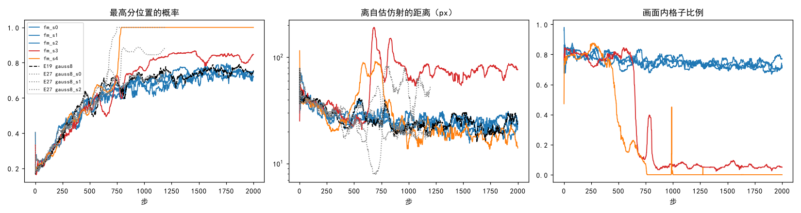

# 画面外的格子照 RoMa 处理后，5 个种子仍有 2 个失效

**摘要**

我们在尝试不用标注、用强化学习训练 RoMa 做月球光学图与 SAR 图的配准：粗匹配每格抽一个位置，按它离模型自己估计的仿射（自估仿射）有多近打分。这样训练会随机地坍缩，同一配置换个种子就可能从健康变成失效（E27）。现在的训练对那些在 SAR 上根本没有对应位置的格子（自估仿射把它们映射到 SAR 画面外或补零区）照样打分、照样给梯度，而 RoMa 原本的损失对这类像素只训可信度、不训匹配。本文照 RoMa 的做法改了两处：这些格子不参与策略梯度，粗级可信度学着把它们判为不可信；其余照只训粗匹配的高斯分数配置（E19 `gauss8`），跑 5 个种子、2000 步。结果 3 个种子健康，第 2000 步 Val AUC@5 与原设置相同；2 个种子失效，比例与原设置已有的运行（4 个里失效 2 个）相当。两个失效的种子在配准失效之前，画面内格子的比例先从约 0.8 降到 0.5 以下，最后接近 0；其中一个到第 2000 步最高分位置的概率也没有超过 0.99，只看这个量会把它判成健康。

**引言**

RoMa 的粗匹配把光学图分成 40×40 个格子，每格在 SAR 上 64×64 个候选位置里给出一个概率分布，推理时取概率最高的位置（最高分位置），再由细化逐级修正。我们的强化学习只训这一级：每格按概率抽 16 次位置，用当前模型正常推理一次、RANSAC 拟合出自估仿射，按抽到的位置离自估仿射映射的位置的距离打分，再用留一基线（RLOO）把分数换成每次抽签的权重。训练图每步都叠加一个随机的平移、旋转和缩放，SAR 被移出去的部分补零，所以每步都有一部分格子在 SAR 上找不到对应位置。

E27 把坍缩的过程逐步记录下来，但没有找到触发它的批次，事后对"画面外的格子被推向边缘"的只读检查也没有找到支持。另一方面，RoMa 原损失里可信度的目标就是"这个像素在另一张图里是否可见"：看不见的像素不进匹配损失，只训可信度为 0（离线伪标签 #157 已照此做）。我们的强化学习既不训可信度，也不区分这类格子。本文不再找机制，直接检验照 RoMa 处理这类格子能不能消掉随机失效。

**方法**

*训练设置。* 底座为 E19 `gauss8`：只训粗匹配，高斯分数 exp(−½(d/8)²)（d 为离自估仿射的距离，单位 px），温度 0.3，每对 16 份，自估仿射来自当前模型正常推理、RANSAC 3 px；难版扰动（平移半径 128 px、旋转 ±20°、缩放 ±20%、擦除），DINOv2 qkv 加 LoRA r 8，学习率 3e-5，按 4000 步 warmup 500 + cosine 调度，本文训到第 2000 步。展开后的配置与 E19 `gauss8` 只差下面两项、存档间隔（500 步）和截止步。

*画面外的格子。* 每步用自估仿射把 40×40 个格子中心映射到 SAR 上，落在画面外、或落在补零区（像素值 < 1/255、再外扩 4 px）的格子记为画面外，其余为画面内，画面内格子的比例记为"画面内格子比例"。改动有两处：画面外格子的权重置零，不参与策略梯度；粗级可信度对这张掩码（画面内 1、画面外 0）加二元交叉熵，权重 0.01（romatch 的 ce_weight，同 #157）。自估仿射拟合失败的那一步两处都不做。代码为 `[rloo] frame_mask`、`cert_bce`。

*运行。* 种子 0–4，种子 0–3 在 126 的 4 张 V100 上、种子 4 在 160 的 V100 上。原计划每 500 步评一次 Val 并按峰值补评 Test；训练只用了约 20 分钟，评测成了瓶颈，训完后改为只评第 2000 步的 Val（`code/val_last.py`），中间存档与 Test 没有评。启动记录里每个种子各有一条被停掉的驱动启动和一条只评 Val 的启动。

*判据与对照。* 第 2000 步 Val 配准误差中位数超过 20 px 记为失效（阈值同 E27）。"最高分位置的概率"取 1600 格的平均，与"离自估仿射的距离"一样取训练日志的 50 步滑动中位数（同 E26、E27）。对照是原设置已有的 4 个运行：E19 `gauss8`（种子 0，4000 步）与 E27 的 `gauss8` 三个种子（训到第 1200 步，结局按 E27 的观察集判定）。

**结果**

*3 个种子健康，Val 与原设置相同；2 个种子失效，比例与原设置相当。* 表 1。健康的种子 0–2 第 2000 步 Val AUC@5 为 0.295–0.299，配准误差中位数 3.5 px，与 E19 `gauss8` 第 2000 步（0.293、3.5 px）一致。种子 3、4 失效，误差中位数 280、376 px。原设置的 4 个运行里也是 2 个失效。E27 的种子 1、2 在 V100 上失效，本文同样的种子在 V100 上健康；但损失改了以后，训练从第 1 步起就和原运行不同，E27 也显示只换 GPU 就能让同一种子一坍一健，所以不能按种子配对比较。

表 1：5 个种子与原设置的结局。最后 100 步为第 1901–2000 步（E27 为第 1101–1200 步）的平均。

| 运行 | 结局 | 最高分位置的概率过 0.99 的步 | 最后 100 步最高分位置的概率 | 最后 100 步离自估仿射的距离（px） | 第 2000 步 Val AUC@5 | Val 配准误差中位数（px） |
|---|---|---|---|---|---|---|
| 种子 0 | 健康 | — | 0.70 | 33 | 0.299 | 3.5 |
| 种子 1 | 健康 | — | 0.72 | 27 | 0.297 | 3.5 |
| 种子 2 | 健康 | — | 0.73 | 31 | 0.295 | 3.5 |
| 种子 3 | 失效 | — | 0.82 | 78 | 0.015 | 280 |
| 种子 4 | 失效 | 786 | 1.00 | 21 | 0.000 | 376 |
| E19 `gauss8` | 健康 | — | 0.72 | 32 | 0.293 | 3.5 |
| E27 `gauss8` 种子 0 | 健康 | — | 0.72 | 26 | — | — |
| E27 `gauss8` 种子 1 | 失效 | — | 0.87 | 76 | — | — |
| E27 `gauss8` 种子 2 | 失效 | 747 | 1.00 | 19 | — | — |

*两个失效的种子都在配准失效前先失去了画面内的格子。* 图 1 右。健康的种子全程画面内格子比例在 0.7–0.8 之间，50 步滑动中位数最低 0.67。种子 4 从第 476 步、种子 3 从第 653 步起降到 0.5 以下，此后接近 0，即自估仿射把几乎全部格子映射到了 SAR 画面外或补零区，这些格子都不再有策略梯度。种子 4 画面内比例下降比最高分位置的概率过 0.99 早约 300 步。同一段里两个种子离自估仿射的距离都先升到 100 px 以上（图 1 中）。

图 1：失效的两个种子（红、橙）先失去画面内的格子，之后一个落到最高分位置概率为 1 的平凡解，另一个停在 0.8 左右。蓝色为本文健康的 3 个种子，黑色虚线为 E19 `gauss8`，灰色点线为 E27 `gauss8` 的三个种子（训到第 1200 步）。均为 50 步滑动中位数；画面内格子比例只有本文的运行有。

*只看最高分位置的概率会漏判一半失效。* 种子 3 的配准已完全失效，但最高分位置的概率最高只到 0.87，按 0.99 的阈值会被判为健康；E27 `gauss8` 种子 1 也是这样。这两个运行在日志上的共同点是离自估仿射的距离停在 75–80 px，约为健康运行的 2.5 倍。

*可信度学到了掩码。* 粗级可信度的二元交叉熵在前 100 步平均 0.30–0.32，最后 100 步健康种子降到 0.17，失效种子 0.13–0.17。

**讨论**

照 RoMa 处理画面外的格子没有消掉随机失效：5 个种子失效 2 个，原设置 4 个运行失效 2 个；对健康的运行，它既不损害也不提升第 2000 步的 Val。失效的过程有一个此前看不到的量可以描述：自估仿射在失效前把格子成片地映射到画面外，画面内格子比例从约 0.8 跌到接近 0。

局限：每组只有 4–5 个运行，失效概率的中等差别分辨不出来；只训到第 2000 步，只评了第 2000 步的 Val，没有中间存档和 Test 的结果；失效按 Val 判定，失效起点只能从训练日志估。

尚未解释的现象：画面内格子比例的下降是自估仿射本身大幅移动的结果，还是掩码把这些格子的梯度拿掉之后进一步推动了下降，数据不能区分（未检验）；原设置的训练日志里没有这个量，E27 的逐步记录里有自估仿射和补零区，可以在原设置的失效运行上算出同一个比例，看它是否同样在失效前下降。
