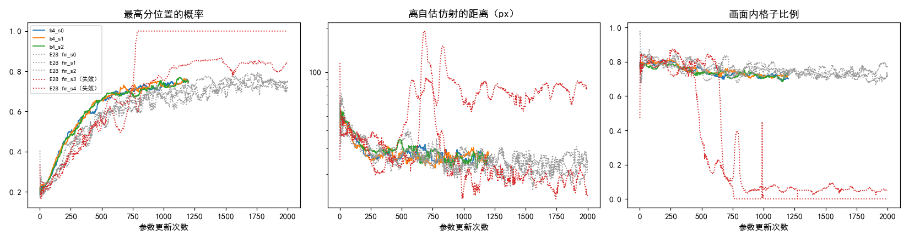
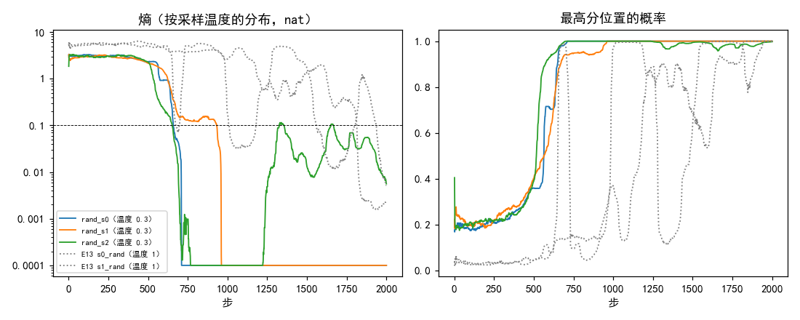

# 每步 4 对图的 3 个种子都健康；温度 0.3 下随机奖励在 1000 步内把概率压到一个位置上

**摘要**

我们在尝试不用标注、用强化学习训练 RoMa 做月球光学图与 SAR 图的配准。只训粗匹配的配置会随机失效：E28 照 RoMa 处理画面外的格子以后，5 个种子仍有 2 个失效。按策略采样、更新幅度被归一化的策略梯度，单靠更新本身的随机性就可能收敛到一个确定的动作（Mei et al. 2021，#214 调研），所以本文做了两组。第一组把每次参数更新用的图对从 1 对加到 4 对，其余照 E28，跑 3 个种子到第 1200 次更新。3 个种子都健康，Val AUC@5 为 0.294–0.297，与 E28 健康种子第 2000 次更新时相同；画面内格子比例全程在 0.68 以上，没有出现 E28 失效种子那样的下跌。第二组把奖励换成与抽签结果无关的随机数，温度 0.3，跑 3 个种子到第 2000 步：三个种子的熵分别在第 652、660、932 步降到 0.1 以下，此后最高分位置的概率在 0.96 以上；温度 1 下的同一对照（E13）两个种子在第 675、1814 步降到 0.1 以下。随机奖励下概率同样会被压到一个位置上，温度 0.3 并不比温度 1 慢。

**引言**

RoMa 的粗匹配把光学图分成 40×40 个格子，每格在 SAR 上 64×64 个候选位置里给出一个概率分布，推理时取概率最高的位置（最高分位置）。我们的强化学习只训这一级：每格按概率（温度 0.3）抽 16 次位置，按抽到的位置离模型自己估计的仿射（自估仿射）映射的位置有多近打分，再用留一基线（RLOO）把分数换成每次抽签的权重，提高比同组平均好的抽签的概率。

这样训练会随机地失效：同一配置换个种子，Val 配准误差的中位数就可能从 3.5 px 变成几百 px（E27）。E28 让画面外的格子不参与梯度、并训练可信度，5 个种子里仍有 2 个失效；失效的种子在配准失效之前，画面内格子的比例先从约 0.8 跌到接近 0。至今每次参数更新只用 1 对图，梯度的随机性很大。另一方面，#214 调研到的理论结果说，按策略采样的策略梯度在更新幅度被归一化时（Adam 与之同类，推断）会以正的概率收敛到任意一个确定的动作；E13 在温度 1 下用随机奖励也确实把概率压到了一个位置上。

本文检验两件事：每次更新用 4 对图、降低更新的随机性，能不能消掉随机失效；奖励与抽签无关时，温度 0.3 下的概率会不会同样被压到一个位置上。

**方法**

*每步 4 对。* 底座为 E28 `fm`：E19 `gauss8`（只训粗匹配，高斯分数 exp(−½(d/8)²)，d 为离自估仿射的距离；温度 0.3，每对 16 份；难版扰动；DINOv2 qkv 加 LoRA r 8；学习率 3e-5，按 4000 次更新 warmup 500 + cosine 调度）加上画面外格子不参与策略梯度（`frame_mask`）和粗级可信度的二元交叉熵 0.01（`cert_bce`）。本文只把每次参数更新的图对数从 1 改为 4（`[optim] batch = 4`，4 对的损失取平均），学习率不变。V100 32 GB 放得下 4 对（峰值约 28 GB），没有改用梯度累积。种子 0–2，训到第 1200 次更新，只评第 1200 次更新的存档在 Val 上的结果，不评 Test。

*随机奖励。* 底座为 E19 `gauss8`，只把奖励换成每格独立的 0–1 均匀随机数（`[rloo] reward = "rand"`），与抽到的位置无关；随机奖励不算自估仿射，所以不开 `frame_mask`。温度 0.3，种子 0–2，训到第 2000 步，不评 Val。对照为 E13 的两个随机奖励运行（种子 0 和 1）。两者展开后的配置只差温度（E13 为 1）和存档设置；E13 早于后来新增的参数，这些参数的默认值保持旧行为。

*指标。* 每次更新时日志记下全部格子的平均：熵（按采样温度下的分布计算，单位 nat；熵为 h 大致相当于把概率平摊在 e^h 个位置上），最高分位置的概率，离自估仿射的距离，以及画面内格子比例（自估仿射把格子中心映射到 SAR 画面内、且不在补零区的格子所占的比例，定义同 E28）。曲线与"降到某值以下的步"都取 50 步滑动中位数（同 E26–E28）；日志只保留 5 位小数，熵小于 1e-5 时记为 0。

*判据与对照。* 第 1200 次更新的 Val 配准误差中位数超过 20 px 记为失效（同 E28）。对照是 E28 的 5 个种子（每次更新 1 对，3 健康 2 失效）；它们的 Val 只评了第 2000 次更新。两组的横轴都是参数更新次数，每步 4 对的运行在同样的更新次数下看过的图对是 E28 的 4 倍。

*运行。* 训练在 160 的两张 V100（0、1 号卡）上，每步 4 对的每个种子约 36 分钟，随机奖励的每个种子 43–57 分钟。Val 评测原计划放在 150 的 3090 上，实际在 160 的 V100（0 号卡）上评，在训练之后依次进行。训练与评测入口分别是 `code/train_queue.py` 和 `code/eval_queue.py`，所以每个每步 4 对的种子各有一条训练和一条评测的启动记录。

**结果**

*每步 4 对的 3 个种子都健康，Val 与 E28 的健康种子相同。* 表 1。三个种子第 1200 次更新的 Val 配准误差中位数都是 3.5 px，AUC@5 为 0.294–0.297，与 E28 健康种子第 2000 次更新（0.295–0.299）和 E19 `gauss8` 第 2000 步（0.293）一致。E28 的两个失效种子在第 476 和第 653 次更新开始失去画面内的格子（E28），都在本文训练的 1200 次更新以内。

表 1：每步 4 对与 E28 的结局。日志量为第 1101–1200 次更新的平均。

| 运行 | 每次更新的图对 | 结局 | 最高分位置的概率 | 离自估仿射的距离（px） | 画面内格子比例 | Val AUC@5 | Val 配准误差中位数（px） |
|---|---|---|---|---|---|---|---|
| 每步 4 对，种子 0 | 4 | 健康 | 0.74 | 31 | 0.70 | 0.297 | 3.5 |
| 每步 4 对，种子 1 | 4 | 健康 | 0.74 | 28 | 0.72 | 0.297 | 3.5 |
| 每步 4 对，种子 2 | 4 | 健康 | 0.74 | 29 | 0.71 | 0.294 | 3.5 |
| E28 种子 0 | 1 | 健康 | 0.71 | 29 | 0.74 | 0.299* | 3.5* |
| E28 种子 1 | 1 | 健康 | 0.65 | 32 | 0.73 | 0.297* | 3.5* |
| E28 种子 2 | 1 | 健康 | 0.69 | 35 | 0.72 | 0.295* | 3.5* |
| E28 种子 3 | 1 | 失效 | 0.83 | 76 | 0.08 | 0.015* | 280* |
| E28 种子 4 | 1 | 失效 | 1.00 | 24 | 0.34 | 0.000* | 376* |

\* E28 只评了第 2000 次更新的 Val。

*每步 4 对的画面内格子比例全程没有下跌。* 图 1 右。三个种子的画面内格子比例（50 步滑动中位数）最低 0.68–0.70，与 E28 健康种子（最低 0.67–0.68）相同。离自估仿射的距离从约 55 px 降到 30 px 左右，没有 E28 失效种子那样升到 100 px 以上的段（图 1 中）。在同样的更新次数下，每步 4 对的最高分位置的概率比 E28 的健康种子升得快一些（图 1 左），三个种子之间的曲线也更贴近。

图 1：每步 4 对的 3 个种子（彩色实线）在训练日志上与 E28 的健康种子（灰色点线）一致，没有出现 E28 失效种子（红色点线）那样的画面内格子比例下跌。横轴为参数更新次数，均为 50 步滑动中位数；离自估仿射的距离为对数轴。

*温度 0.3 下，随机奖励在 1000 步内把每格的概率压到一个位置上。* 表 2、图 2。三个种子起始的熵约为 3（相当于平摊在约 20 个位置上），在第 500 步前后开始下降，分别在第 652、660、932 步降到 0.1 以下，最高分位置的概率在第 679–956 步超过 0.99。种子 0 和 1 此后熵一直在 1e-4 以下。种子 2 在第 1200 步后熵回升，第 1300–1900 步在 0.01–0.1 之间起伏，最高分位置的概率始终在 0.96 以上，第 2000 步回到 0.995。

表 2：随机奖励下熵降到 0.1 以下的步。熵与最高分位置的概率按各自的采样温度计算；前 100 步、最后 100 步为平均。

| 运行 | 温度 | 前 100 步的熵 | 熵降到 0.1 以下的步 | 最后 100 步的熵 | 前 100 步最高分位置的概率 | 最后 100 步最高分位置的概率 |
|---|---|---|---|---|---|---|
| 种子 0 | 0.3 | 3.1 | 660 | < 1e-4 | 0.20 | 1.00 |
| 种子 1 | 0.3 | 2.9 | 932 | < 1e-4 | 0.23 | 1.00 |
| 种子 2 | 0.3 | 3.1 | 652 | 0.011 | 0.22 | 0.995 |
| E13 种子 0 | 1 | 5.5 | 1814 | 0.003 | 0.04 | 1.00 |
| E13 种子 1 | 1 | 5.2 | 675 | 0.059 | 0.05 | 0.99 |

图 2：温度 0.3 的随机奖励（彩色实线）在 1000 步内把熵压到 0.1 以下，温度 1 的 E13（灰色点线）一个种子同样早、一个更晚。熵为对数轴，小于 1e-4 的按 1e-4 画；虚线为 0.1。均为 50 步滑动中位数。

*温度 0.3 下的随机奖励塌得比温度 1 更齐。* 温度 0.3 的三个种子降到 0.1 以下的步落在 652–932 之间；温度 1 的两个种子一个在 675、一个在 1814，并且在第 750–1800 步之间熵多次回升到 1 以上（图 2 左）。温度 0.3 起点的分布本来就更集中（熵 3 对 5.5，最高分位置的概率 0.2 对 0.04）。

**讨论**

第一组的问题有了部分回答：每次更新用 4 对图，3 个种子都健康，Val 与 E28 的健康种子相同，训练日志上也没有失效的前兆。但这个结果还不能说明失效率降低了。E28 的失效比例是 5 个里 2 个，按这个比例 3 个种子全部健康的概率约为 0.6³ ≈ 0.22，所以 3/3 健康与"失效率不变"并不矛盾；票里的判据也把它算作"有希望、之后补种子确认"。另外，本文只训到第 1200 次更新，E28 的失效虽然都在第 1200 次更新以前开始，但更晚才出现的失效看不到；每步 4 对时每次更新看过的图对是 E28 的 4 倍，按看过的图对算，本文的 1200 次更新相当于 E28 的 4800 步。

第二组的问题有了回答：奖励与抽签无关时，温度 0.3 下的概率同样在 1000 步内被压到一个位置上，比 E13 温度 1 的对照不慢。这与"单靠更新的随机性也会收敛到确定动作"的理论一致；它说明在我们的设置里，即使奖励不带任何信息，每次更新 1 对图的训练也会坍缩。本文的随机奖励组每次更新只用 1 对，没有检验每次 4 对时随机奖励是否同样坍缩。

局限：两组每组只有 3 个种子；每步 4 对只评了第 1200 次更新的 Val，没有中间存档和 Test；Val 在 V100 而不是原计划的 3090 上评测；温度 1 的对照只有 E13 的 2 个种子，表 2 的温度比较只是粗略的。

尚未解释的现象：随机奖励的种子 2 在熵降到接近 0 之后又回升到 0.1 附近，持续约 700 步，其他两个种子没有，原因数据不能区分（未检验）。
