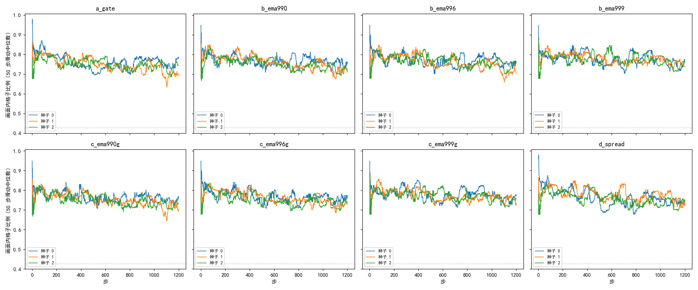

# 三种办法的 8 组 24 个运行到第 1200 步全部健康，约束从未生效、等于底座的一组也全部健康

**摘要**

用强化学习训练 RoMa 的粗匹配时，参照仿射来自当前模型自己，训练会随机地坍缩：E28 在照 RoMa 处理画面外格子之后，5 个种子仍有 2 个失效，失效前参照仿射先把格子成片映射到 SAR 画面外。本文在 E28 的设置上分别加了三种不让参照跑偏的办法：参照合理性检查（参照仿射不像扰动范围内的仿射时这一步不学）、EMA 参照（参照由模型参数的指数滑动平均给出，τ 取三档）、两者合用，以及格子分散约束，共 8 组，每组种子 0–2，训到第 1200 步。24 个运行全部健康，第 1200 步 Val AUC@5 为 0.292–0.298，配准误差中位数 3.5 px，画面内格子比例全程不低于 0.63。但格子分散约束在三个运行里一次也没有生效（所有格子的平均抽签分布的熵最低 6.7，阈值是 4），这一组实际就是 E28 的底座，它的三个种子同样健康。E28 里这三个种子也是健康的。所以本实验能说明这些办法在这三个种子上没有带来失效，也没有明显改变 Val；它们能不能减少失效，这组数据分不出来。

**引言**

我们在尝试不用标注、用强化学习训练 RoMa 做月球光学图与 SAR 图的配准。RoMa 的粗匹配把光学图分成 40×40 个格子，每格在 SAR 上给出一个位置的概率分布。训练时每格按这个分布抽 16 次位置；再让模型正常推理一次、用 RANSAC 拟合出一个仿射，称为参照仿射，抽到的位置离参照仿射映射的位置越近得分越高。问题在于参照仿射就出自正在被训练的模型：模型变了，参照也跟着变。之前的实验里，参照越能被模型带着走，失效越多：每份样本各自做参照几乎每次都失效（E13），用当前模型做参照约一半失效（E19、E27、E28），用训练开始时冻结的模型做参照 2 个运行都没有失效（E25）。E28 还看到，失效之前参照仿射先漂到画面外，画面内格子的比例从约 0.8 跌到接近 0；E26 的失效则是参照退化成一条线或一个点。

冻结参照等于离线伪标签，不是我们要的方法。#214 调研了几种在强化学习里限制参照漂移的常见做法，本文检验其中三种，以及两种的组合，看它们能不能减少随机失效：一是每步检查参照仿射像不像扰动范围内的仿射，不像就这一步不学；二是参照改由 EMA 模型给出，它的参数是当前模型参数的指数滑动平均（exponential moving average，EMA）；三是直接惩罚格子全都挤到同一处。

**方法**

*底座。* 全部运行的底座是 E28 `fm`：只训粗匹配，高斯分数 exp(−½(d/8)²)（d 为抽到的位置离参照仿射映射位置的距离，单位 px），温度 0.3，每对 16 份，RLOO 留一基线；参照仿射来自当前模型正常推理、RANSAC 3 px；参照仿射映射到 SAR 画面外或补零区的格子不参与策略梯度，粗级可信度对画面内掩码加权重 0.01 的二元交叉熵（E28）。难版扰动（平移半径 128 px、旋转 ±20°、缩放 ±20%、擦除），DINOv2 qkv 加 LoRA r 8，学习率 3e-5，按 4000 步 warmup 500 + cosine 调度，本文只训到第 1200 步，只存、只评第 1200 步。每组在底座上只加下面一项（第 3 组加两项）。

*参照合理性检查。* 每步拟合出参照仿射后检查三项，任一不过，这对图这一步的优势全部置零、也不做可信度的交叉熵，即这一步不学：面积倍数（线性部分的行列式）在 [0.5, 2] 内，扰动的缩放 ±20% 对应 0.64–1.44；两个奇异值之比不小于 0.7，扰动是相似变换，比值为 1；画面内格子比例不小于 0.427。最后这个阈值取 E28 三个健康种子训练日志中单步画面内格子比例的 1% 分位（各 2000 步，共 6000 步；`code/gate_threshold.py`，`extra/gate_threshold.json`）。检查只看参照仿射本身，不用扰动的具体数值。日志记录每步是否被拦、被哪一项拦，被拦比例为被拦步数占全部 1200 步的比例。

*EMA 参照。* 另存一份模型，每次参数更新后它的可训练参数向当前模型靠近一步：θ_EMA ← τ·θ_EMA + (1−τ)·θ。参照仿射和画面内掩码都由这份EMA 模型正常推理得到。τ 取 0.99、0.996、0.999，大致相当于EMA 模型落后当前模型 100、250、1000 步。日志另记"当前模型与EMA 参照的距离"：当前模型自己推理出的仿射与EMA 参照仿射把格子映射到的位置平均相差多少 px（同 E25 的 `ref_gap`）。

*组合。* EMA 参照的三档各加上参照合理性检查，检查对象是EMA 参照给出的仿射。

*格子分散约束。* 把所有画面内格子的抽签分布（温度 0.3）平均成一个 4096 维的分布，算它的熵 H，读作"所有格子合起来平摊在约 e^H 个位置上"；加损失 0.1·max(0, 4 − H)。正常情况下 H 约 6–7，所有格子挤到一处时接近 0。

*运行与判据。* 8 组各跑种子 0–2，共 24 个运行，训练在 160 的 V100（GPU 2、3）上，评测在 150 的 3090 与 160 的 V100 上；训练与评测分开（`code/train_only.py`、`code/eval_last.py`），只评第 1200 步的 Val，不评 Test。第 1200 步 Val 配准误差中位数超过 20 px 记为失效（同 E28）。画面内格子比例、被拦比例等日志量的曲线取 50 步滑动中位数（同 E26–E28）。对照是 E28 的 5 个种子（训到第 2000 步，3 健康 2 失效）。

**结果**

*24 个运行全部健康，Val 与 E28 的健康种子相当。* 表 1。8 组的第 1200 步 Val AUC@5 都在 0.292–0.298，配准误差中位数都在 3.5 px 左右，组间差别不超过种子间差别。E28 健康种子第 2000 步为 0.295–0.299、3.5 px，步数不同，只能粗略对照。

表 1：各组 3 个种子第 1200 步的 Val 结局与训练日志。数字为 3 个种子的范围；画面内格子比例的平均取全部 1200 步，最低取 50 步滑动中位数；与EMA 参照的距离取最后 100 步。

| 组 | 健康 / 运行 | Val AUC@5 | Val 配准误差中位数（px） | 画面内格子比例（平均） | 画面内格子比例（最低） | 被拦比例 | 与EMA 参照的距离（px） |
|---|---|---|---|---|---|---|---|
| 参照合理性检查 | 3 / 3 | 0.295–0.298 | 3.46–3.52 | 0.75–0.76 | 0.63–0.69 | 4.8%–5.8% | — |
| EMA 参照 τ 0.99 | 3 / 3 | 0.293–0.297 | 3.48–3.52 | 0.74–0.77 | 0.67–0.68 | — | 9–12 |
| EMA 参照 τ 0.996 | 3 / 3 | 0.293–0.295 | 3.47–3.52 | 0.76–0.77 | 0.66–0.70 | — | 10–14 |
| EMA 参照 τ 0.999 | 3 / 3 | 0.292–0.295 | 3.48–3.54 | 0.78 | 0.68–0.71 | — | 16–30 |
| EMA 参照 τ 0.99 + 检查 | 3 / 3 | 0.296–0.297 | 3.46–3.49 | 0.75–0.76 | 0.64–0.68 | 4.8%–5.6% | 6–19 |
| EMA 参照 τ 0.996 + 检查 | 3 / 3 | 0.292–0.296 | 3.49–3.54 | 0.75–0.77 | 0.68–0.71 | 6.7%–7.2% | 7–18 |
| EMA 参照 τ 0.999 + 检查 | 3 / 3 | 0.293–0.296 | 3.50–3.55 | 0.77–0.78 | 0.68–0.71 | 9.2%–9.9% | 18–29 |
| 格子分散约束 | 3 / 3 | 0.293–0.296 | 3.50–3.53 | 0.75–0.77 | 0.68–0.70 | — | — |
| E28（对照，第 2000 步） | 3 / 5 | 0.295–0.299（健康） | 3.5（健康） | — | 0.67（健康） | — | — |

*没有一个运行失去画面内的格子。* 图 1。24 个运行的画面内格子比例都在 0.65–0.85 之间起伏，50 步滑动中位数最低 0.63，没有一个像 E28 的两个失效种子那样跌到 0.5 以下。

图 1：8 组 24 个运行的画面内格子比例都停在 0.65–0.85，没有失效前那种下跌。50 步滑动中位数，颜色区分种子；灰色点线为参照合理性检查的阈值 0.427。

*格子分散约束一次也没有生效，这一组等于底座。* 所有格子的平均抽签分布的熵全程在 6.7 以上（各运行最低 6.70–6.82），从未低于阈值 4，三个运行的约束损失每一步都是 0。这组的训练与 E28 的底座只差在多算了一个不参与梯度的量，可以当作底座在种子 0–2、160 的 V100 上训到第 1200 步的对照。它的三个种子都健康；E28 在 126 的 V100 上用同样的种子训到第 2000 步，也都健康。

*参照合理性检查在健康运行里拦下约 5%–10% 的步，主要拦在奇异值比上。* 表 2。单独使用时被拦比例 4.8%–5.8%，与EMA 参照合用后随 τ 增大升到 9%–10%。按项看，画面内格子比例一项只拦 0.4%–1.8%，与按 1% 分位定阈值相符；拦得最多的是奇异值之比（2.7%–6.3%），其次是面积倍数（1.2%–5.1%），这两项都随 τ 增大而增多。

表 2：参照合理性检查各项拦下的步数比例（3 个种子的范围）。一步可能同时不过几项，各项之和可以超过总比例。

| 组 | 总计 | 面积倍数 | 奇异值之比 | 画面内格子比例 |
|---|---|---|---|---|
| 参照合理性检查 | 4.8%–5.8% | 1.2%–1.8% | 3.2%–3.6% | 0.5%–1.8% |
| EMA 参照 τ 0.99 + 检查 | 4.8%–5.6% | 1.9%–2.1% | 2.7%–3.3% | 0.5%–1.2% |
| EMA 参照 τ 0.996 + 检查 | 6.7%–7.2% | 3.0%–3.7% | 3.5%–4.3% | 0.5%–1.1% |
| EMA 参照 τ 0.999 + 检查 | 9.2%–9.9% | 4.7%–5.1% | 5.3%–6.3% | 0.4%–0.8% |

*τ 越大，当前模型离 EMA 参照越远。* 表 1 最后一列。最后 100 步当前模型与EMA 参照的距离，τ 0.99 的两组为 6–19 px，τ 0.999 的两组升到 16–30 px；合用检查与否，同一档 τ 的范围大体重叠。

**讨论**

问题是这三种办法能不能减少随机失效。本实验给出的回答有限：8 组里没有一个运行失效，按票里的判据每组都"有希望"；但格子分散约束从未生效，这一组就是底座，它在同样的三个种子上同样没有失效，E28 里这三个种子也没有失效。因此 24 个健康运行既可能来自这些办法，也可能只是种子 0–2 在这个设置下本来就不容易失效，数据不能区分（未检验）。能确定的是：在这三个种子上，这些办法没有引出新的失效，第 1200 步 Val 也没有明显变化；参照合理性检查在健康运行里拦下 5%–10% 的步，没有影响 Val。

局限：每组只有 3 个种子，且都是 E28 里健康的种子；E28 失效的种子 3、4 没有跑。失效按第 1200 步 Val 判定；E28 的两个失效种子在第 476、653 步就开始失去画面内格子，这个时间窗口落在 1200 步以内，但更晚才开始的失效看不到。训练换到了 160 的 V100，E27 显示只换 GPU 就可能改变同一种子的结局。

尚未解释的现象：参照合理性检查主要拦在奇异值比上，且 τ 越大拦得越多；被拦的参照仿射究竟是真的变形，还是那一步 RANSAC 拟合不稳，没有逐步看过（未检验）。格子分散约束的阈值 4 远低于健康运行的 6.7 以上，它在 E28 那种失效里能不能起作用，取决于失效时熵是否会降到 4 以下，E28 的日志里没有记录这个量。
