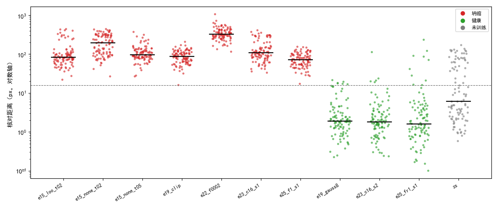
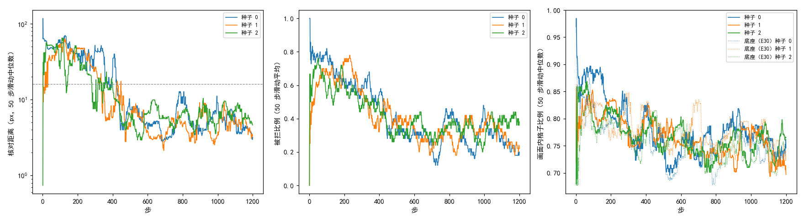

# 多扰动互相核对把坍缩存档与健康存档完全分开，训练中却拦下四成的步；3 个种子都健康，但它们在 E28 里本来就健康

**摘要**

用强化学习训练 RoMa 的粗匹配时，打分的参照仿射出自正在被训练的模型，训练会随机地坍缩：E28 的 5 个种子里 2 个失效；E26 看到坍缩后模型把所有格子送到 SAR 画面上与图像内容无关的同一处。本文检验一种从原理上能识别这类解的核对：对同一张 SAR 再施加两个已知扰动，各自推理后换算回原坐标，与原图的估计互相比对，三者对不上（两两之间格子位置平均相差超过 16 px）就这一步不学，对得上就用三者的逐格中位数作参照。先做只读检查：在 E26 的 7 个坍缩存档上，100 对验证图全部被拦，核对距离的中位数为 73–327 px；在 3 个健康存档上只拦 5%–10%，中位数不到 2 px，两组逐对区分的 AUC 为 0.99。再在 E28 的设置上用它训练种子 0–2 到第 1200 步：3 个运行都健康，Val AUC@5 为 0.292–0.296，与同样种子、同样步数的底座相当；但训练中有 41% 的步被拦，前 100 步拦下 64%–79%，最后 100 步仍有 20%–38%。这 3 个种子在 E28 里本来就健康，同批 E30 的 24 个运行也全部健康，所以本实验不能说明这个核对减少了失效。

**引言**

我们在尝试不用标注、用强化学习训练 RoMa 做月球光学图与 SAR 图的配准。RoMa 的粗匹配把光学图分成 40×40 个格子，每格在 SAR 上给出一个位置的概率分布。训练时每格按这个分布抽 16 次位置；再让模型正常推理一次、用 RANSAC 拟合出一个仿射，称为参照仿射，抽到的位置离参照仿射映射的位置越近得分越高。参照仿射就出自正在被训练的模型，训练因此会随机地坍缩：E28 在照 RoMa 处理画面外格子之后，5 个种子仍有 2 个失效。E26 读了 7 个坍缩运行的存档，发现它们都落在同一类解上：粗匹配把所有格子送到 SAR 画面边缘附近的同一处，参照仿射把整张图压到这一处，抽签、细化和参照三者彼此一致，而这一处与图像内容无关。

这类解有一个弱点（#214 调研）。如果对同一张 SAR 再施加一个已知的平移旋转缩放 T，正确的仿射会跟着 T 变；把在扰动后的 SAR 上估出的仿射用 T 的逆换算回来，应当与在原图上估出的仿射一致。与图像内容无关、固定在画面某一处的解不会跟着 T 变，换算回来以后就差一个 T，两次结果对不上。SuperPoint 的 homographic adaptation（arXiv 1712.07629）用的是同一思路，只是它拿多次结果求平均。反过来，跟着图像内容一起走的一致偏差，在这种核对下看不出来。

本文回答两个问题：这个核对能不能把坍缩的模型和健康的模型分开；把它放进训练、对不上就不学，3 个种子会不会都健康。

**方法**

*核对距离。* 对一对训练图，SAR 已经施加过训练用的随机扰动。在它上面再施加 2 个随机的已知仿射 T₁、T₂，分布与训练扰动相同但幅度减半：平移在半径 64 px 的圆盘内均匀，旋转 ±10°，缩放 ±10%，画面外补零。原图和两份再扰动的图各用当前模型正常推理一次，按可信度抽 5000 点、RANSAC 3 px 拟合仿射（与参照仿射的拟合相同），后两个用 Tᵢ 的逆换算回原 SAR 的坐标，得到对同一件事的 3 个估计。两个估计之间的距离定义为它们把 40×40 个格子中心映射到的位置平均相差多少 px（原图 512 px 的尺度，同 E25 的 `ref_gap`）；3 个估计两两之间取最大的一对，称为核对距离。核对距离超过 16 px，或有任一份拟合失败，记为被拦。

*训练。* 底座是 E28 `fm`：只训粗匹配，高斯分数 exp(−½(d/8)²)（d 为抽到的位置离参照仿射映射位置的距离，单位 px），温度 0.3，每对 16 份，RLOO 留一基线；参照仿射映射到 SAR 画面外或补零区的格子不参与策略梯度，粗级可信度对画面内掩码加权重 0.01 的二元交叉熵。难版扰动（平移半径 128 px、旋转 ±20°、缩放 ±20%、擦除），DINOv2 qkv 加 LoRA r 8，学习率 3e-5，按 4000 步 warmup 500 + cosine 调度，训到第 1200 步，只存、只评第 1200 步。在底座上只改一处：每步算核对距离，被拦时这对图这一步的策略梯度权重全部置零（可信度的交叉熵照常）；没被拦时参照仿射换成 3 个估计把格子中心映射到的位置逐格取中位数、再最小二乘拟合出的仿射，打分和画面内掩码都用它。多出来的两份只推理、不求梯度。代码为 `[rloo] mp_n = 2`（`finetune/parts/rloo.py`）。

*只读检查。* 不训练，在 E26 用过的存档上算同一个核对距离：7 个坍缩运行（E15 `loo_t02`、`none_t02`、`none_t05`，E19 `clip`，E22 `f0002`，E23 `c16_s1`，E25 `f1_s1`）与 3 个健康运行（E19 `gauss8`、E23 `c16_s2`、E25 `fr1_s1`）的第 4000 步，以及未训练的模型。数据为 Val 有标注的对里均匀取出的 100 对；为模拟训练时已扰动的 SAR，每对先施加一个训练同分布的随机扰动（各存档相同），再按上文算核对距离。同时记下原图估计相对标注的配准误差，超过 20 px 记为这对配错。两组存档之间逐对核对距离的区分度用 ROC 曲线下面积（AUC，即任取一对坍缩存档的图和一对健康存档的图，前者核对距离更大的概率；Hanley & McNeil 1982）。代码为 `code/gap_check.py`。

*运行与判据。* 种子 0–2，训练在 150 的 3090（GPU 2）上依次跑，评测在 150 的 3090（GPU 3）上，只评第 1200 步的 Val，不评 Test（`code/train_queue.py`、`code/eval_queue.py`）。第 1200 步 Val 配准误差中位数超过 20 px 记为失效（同 E28）。日志量的曲线取 50 步滑动中位数（被拦比例取 50 步滑动平均，同 E26–E28、E30）。对照有两个：E28 的 5 个种子（126 与 160 的 V100，训到第 2000 步，种子 0–2 健康、3–4 失效）；E30 的格子分散约束组，它的约束一次也没有生效，等于底座在种子 0–2、160 的 V100 上训到第 1200 步。表和图由 `code/summary.py` 生成。

**结果**

*核对距离把坍缩存档与健康存档完全分开。* 表 1、图 1。7 个坍缩存档的 100 对图全部被拦，核对距离的中位数在 73–327 px；3 个健康存档只拦下 5%–10%，中位数 1.6–1.9 px。逐对比较，两组的 AUC 为 0.99：随便拿坍缩存档的一对和健康存档的一对，前者核对距离更大的概率是 99%。健康存档的 300 对里只有 2 对配错，这 2 对都被拦下；配对了的 298 对里有 6% 被拦。

表 1：只读检查中各存档 100 对验证图的核对距离与配准误差。被拦为核对距离超过 16 px 的比例；配错为原图估计相对标注的配准误差超过 20 px 的比例。

| 存档 | 组 | 核对距离中位数（px） | 四分位范围（px） | 被拦 | 配准误差中位数（px） | 配错 |
|---|---|---|---|---|---|---|
| E15 `loo_t02` | 坍缩 | 83 | 65–108 | 100% | 286 | 100% |
| E15 `none_t02` | 坍缩 | 193 | 102–308 | 100% | 355 | 100% |
| E15 `none_t05` | 坍缩 | 96 | 82–130 | 100% | 319 | 100% |
| E19 `clip` | 坍缩 | 87 | 65–111 | 100% | 355 | 100% |
| E22 `f0002` | 坍缩 | 327 | 271–424 | 100% | 1656 | 100% |
| E23 `c16_s1` | 坍缩 | 108 | 82–154 | 100% | 315 | 100% |
| E25 `f1_s1` | 坍缩 | 73 | 54–97 | 100% | 322 | 100% |
| E19 `gauss8` | 健康 | 1.9 | 1.2–3.4 | 6% | 3.6 | 0% |
| E23 `c16_s2` | 健康 | 1.8 | 1.2–3.3 | 5% | 3.6 | 0% |
| E25 `fr1_s1` | 健康 | 1.6 | 0.9–4.2 | 10% | 3.6 | 2% |
| 未训练 | — | 6.1 | 2.5–62.5 | 38% | 4.8 | 21% |

图 1：坍缩存档的核对距离几乎都在 16 px（虚线）以上，健康存档几乎都在以下。每个点是一对验证图，黑色横线为中位数，纵轴为对数。

*未训练的模型被拦下近四成的对。* 表 1 最后一行。未训练模型的核对距离中位数 6.1 px，但分布很宽，上四分位已到 62 px，38% 的对被拦；它在这 100 对上有 21% 配错。配错的 21 对全部被拦，配对的 79 对里也有 22% 被拦；在这个模型上，配错的对核对距离更大的概率（AUC）为 0.89。

*3 个种子到第 1200 步都健康，Val 与底座相当。* 表 2。第 1200 步 Val AUC@5 为 0.292–0.296，配准误差中位数 3.5 px；E30 里等于底座的一组用同样的种子训到第 1200 步，为 0.293–0.296、3.5 px。E28 的种子 0–2 第 2000 步为 0.295–0.299、3.5 px。这 3 个种子在 E28 里都健康，在 E30 等于底座的一组里也都健康。

表 2：3 个种子第 1200 步的 Val 结局与训练日志。被拦比例为被拦步数占步数的比例；画面内格子比例的平均取全部 1200 步，最低取 50 步滑动中位数；核对距离取没被拦和被拦的全部步。底座为 E30 的格子分散约束组（约束从未生效）。

| 运行 | 结局 | Val AUC@5 | Val 配准误差中位数（px） | 被拦比例（全部） | 被拦比例（前 100 步） | 被拦比例（最后 100 步） | 核对距离中位数（px，全部 / 最后 100 步） | 画面内格子比例（平均 / 最低） |
|---|---|---|---|---|---|---|---|---|
| 种子 0 | 健康 | 0.292 | 3.53 | 41% | 79% | 20% | 8.0 / 3.6 | 0.77 / 0.70 |
| 种子 1 | 健康 | 0.295 | 3.46 | 41% | 64% | 24% | 6.7 / 4.3 | 0.77 / 0.69 |
| 种子 2 | 健康 | 0.296 | 3.47 | 41% | 64% | 38% | 7.7 / 5.0 | 0.77 / 0.68 |
| 底座 种子 0 | 健康 | 0.293 | 3.50 | — | — | — | — | 0.76 / 0.68 |
| 底座 种子 1 | 健康 | 0.296 | 3.51 | — | — | — | — | 0.77 / 0.70 |
| 底座 种子 2 | 健康 | 0.293 | 3.53 | — | — | — | — | 0.75 / 0.68 |

*训练中有四成的步被拦，开头最多，到最后仍有两三成。* 表 2、图 2。三个运行全程被拦的比例都是 41%。开头的 100 步拦下 64%–79%；前 400 步左右，核对距离的滑动中位数大多在 16 px 以上，被拦比例停在 0.6–0.8；此后核对距离降到 3–10 px，被拦比例降到 0.2–0.4，但到最后 100 步仍有 20%–38%，核对距离的中位数 3.6–5.0 px，比只读检查里健康存档的 1.6–1.9 px 大。没有一步出现拟合失败。

图 2：核对距离（左）与被拦比例（中）在训练开头最高、之后下降，画面内格子比例（右）与底座同样停在 0.68 以上。左图虚线为 16 px 的阈值；右图点线为底座的三个种子。

*画面内格子比例与底座相同，没有失效前的那种下跌。* 表 2、图 2 右。三个运行的画面内格子比例全程平均 0.77，50 步滑动中位数最低 0.68–0.70，与底座的 0.68–0.70 相同；E28 的两个失效种子在第 476、653 步跌到 0.5 以下，本文没有一个运行出现这种下跌。

**讨论**

本文要回答两件事。第一件有了明确的回答：多扰动互相核对能把 E26 的坍缩模型和健康模型分开，7 个坍缩存档的每一对都被拦，健康存档只拦下一成以内，而且这几个坍缩运行来自不同的设置（E15、E19、E22、E23、E25），都被同一个阈值拦住。第二件没有回答：3 个种子都健康，按票里的判据算有希望，但这 3 个种子在 E28 里本来就健康，E30 的 24 个运行（同样是种子 0–2）也全部健康，E30 里等于底座的一组同样健康。所以 3 个都健康不能说明失效率降低；核对能否救下 E28 的种子 3、4 那类运行，本实验没有检验。

局限。只跑了种子 0–2，而它们在 E28 里都是健康的，E28 失效的种子 3、4 没有跑。失效按第 1200 步的 Val 判定，比第 1200 步更晚才开始的失效看不到。训练在 150 的 3090 上，E28 在 V100 上，E27 显示只换 GPU 就可能改变同一种子的结局，所以和 E28 不能按种子配对比较。只读检查用的是已经坍缩完的第 4000 步存档；它说明坍缩之后能被识别，没有说明在坍缩刚开始、模型还没压到一处的时候能不能被识别。只读检查只取了 100 对 Val。

尚未解释的现象。训练中被拦的比例很高，开头拦下六到八成，最后仍有两到四成，第 1200 步的 Val 却与底座相当。被拦的这些步是配错的对、还是配对了但三次估计在 16 px 上下波动，本文没有逐步看过（未检验；可以把被拦步的核对距离与那一步原图估计相对标注的误差放在一起看）。训练末期的核对距离（3.6–5.0 px）也比只读检查中健康存档的（1.6–1.9 px）大，两者的数据不同：前者是训练图、只有一对且每步一个，后者是 Val 的 100 对，还没有在同样的数据上比过（未检验）。
