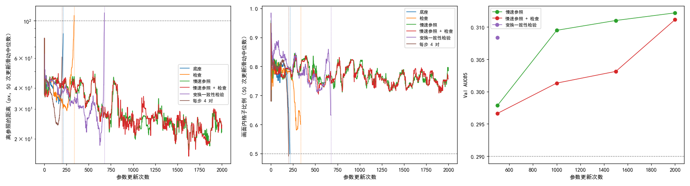

# 同时训细化时，只有用了慢速参照的两组训满了 2000 步

**摘要**

用强化学习训练 RoMa 时，打分用的参照仿射来自正在被训练的模型。此前同时训细化的运行（E20、E22、E24）几乎都坍缩了；E29–E31 的几种防坍缩办法只在只训粗匹配时试过。本文先把细化损失的系数定为 4.2：这样在粗匹配和细化共用的参数（DINOv2 的 LoRA、尺度 16 的投影层）上，两种损失的梯度大致一样大。然后在 E28 `fm` 上同时训细化，再分别加上 E29–E31 的各种办法，共 6 组，每组种子 0，训到第 2000 次参数更新。训练日志里离参照的距离或画面内格子比例一越线，这组就当场停下。

结果：底座、参照合理性检查、变换一致性检验、每步 4 对这 4 组，分别在第 214、336、677、200 次更新时越线停下；其中 3 组停在第一个存档之前，没有可评的存档。用了慢速参照的两组（单用，以及加检查）都训满了 2000 次，两条判据始终没越线，4 个存档的 Val AUC@5 都在 0.297 以上，第 2000 次更新时为 0.312、0.311，比只训粗匹配的 E28 `fm` 种子 0 高 0.013、0.012，配对区间都不含 0。这两组按票里的判据算"能稳定训练"，但每组只有一个种子。

**引言**

我们在尝试不用标注、用强化学习训练 RoMa 做月球光学图与 SAR 图的配准。RoMa 先在尺度 16 上做粗匹配，再经尺度 16、8、4、2、1 的细化层逐级修正位置。训练时每一步先让当前模型正常推理一次，用 RANSAC 拟合出一个参照仿射。粗匹配在每格的概率分布上抽 16 次位置，细化在每一级的输出周围加高斯噪声抽 8 次，抽到的位置离参照仿射给出的位置越近，得分越高。参照本身来自正在被训练的模型，训练会随机地坍缩：模型把所有格子送到 SAR 画面上与图像内容无关的同一处，参照也跟着过去，三者彼此一致（E26、E27）。

E20、E22、E24 同时训细化，几乎都坍缩了。E22 把细化层的学习率降到很小，仍然坍缩，当时据此认为问题不在细化学习率。但细化损失会经尺度 16 的特征流回尺度 16 投影层和 DINOv2 的 LoRA，这两组参数粗匹配也在用，学习率不归细化学习率管，所以那个结论不成立。另一方面，E29–E31 试过的几种防坍缩办法（每步 4 对、参照合理性检查、慢速参照、变换一致性检验）都只在只训粗匹配时跑过。

本文回答：同时训细化时，把这些办法分别加上去，哪一种能让训练不坍缩，验证集上又是什么水平。

**方法**

*细化损失的系数。* 优化器 AdamW 对每个参数单独归一化更新量，所以细化损失前乘多大的系数 w_f，对只收到细化信号的参数（细化层、VGG）几乎没有影响；它只改变共用参数里粗匹配信号和细化信号的比例。我们在 100 对带训练扰动的训练图上，按训练时的算法分别算出粗匹配损失和细化各级损失，各自单独求梯度，在 LoRA 和尺度 16 投影层上取梯度范数。模型用两个：未训练的模型，以及 E19 `gauss8` 第 1000 步的存档。粗匹配损失按 E28 `fm` 的粗级损失算，即策略梯度项加 0.01 × 可信度的二元交叉熵。w_f 取两个模型共 200 对上逐对比值（粗匹配 / 细化）的中位数。代码为 `code/wf_grad.py`。

*底座。* 粗匹配完全照 E28 `fm`（E19 `gauss8` 加上 E28 对画面外格子的两处处理），细化照 E24 的逐级抽签：尺度 16、8、4 每一级都从正常推理时这一级的输入出发，只在这一级之内抽 8 次，噪声 σ = 0.5 × 尺度（px）。分数为 1/(1 + ½(d/s)²)，d 为抽到的位置离参照的距离，s 为这一级的尺度；各级各自减去同一位置其余 7 次的平均分（留一基线）。在此之上新加三处：

- 细化损失乘 w_f；
- 细化也照 RoMa 处理画面外：参照仿射把某像素映射到 SAR 画面外或补零区时，这个像素的策略梯度权重置零；三个训练级输出的可信度，对画面内掩码加权重 0.01 的二元交叉熵；
- 参照合理性检查或变换一致性检验没通过时，这对图的细化也不学（之前只停粗匹配）。

细化部分的学习率取 E22 的锚点 1 倍（1.4e-5），VGG 放开训练。其余同 E28：难版扰动，DINOv2 qkv 加 LoRA r 8，学习率 3e-5（LoRA 1e-4），按 4000 步做 warmup 500 + cosine 调度，训到第 2000 步，每 500 步存档。代码开关为 `[rloo] fine_w`、`fine_mask`、`fine_cert_bce`（`finetune/parts/rloo.py`），配置见 `configs/`。

*六组。* 每组在底座上只加一项：

- 底座：不加；
- 检查：参照合理性检查，同 E30 `a_gate`。参照仿射的面积倍数要在 [0.5, 2] 内，两个奇异值之比 ≥ 0.7，画面内格子比例 ≥ 0.427；任一项不过，这对图这一步不学；
- 慢速参照：参照仿射和画面内掩码由参数滑动平均（τ = 0.999）的那份模型推理得到，同 E30 `b_ema999`；
- 慢速参照 + 检查：同 E30 `c_ema999g`；
- 变换一致性检验：同 E31。对 SAR 再施加 2 个已知仿射，3 个估计换算回原坐标后两两相差超过 16 px，这对图就不学；没超过时，参照取 3 个估计的逐格中位数；
- 每步 4 对：4 对图的梯度累积起来更新一次。

种子都是 0。

*提前停与判据。* 照票：离参照的距离（粗匹配抽到的位置离参照仿射的平均距离）的 50 步滑动中位数超过 100 px，或画面内格子比例（参照仿射把格子中心映射到 SAR 画面内、且不在补零区的格子所占比例）的 50 步滑动中位数低于 0.5，这组就停训，不再另存档。训练代码按前向步计数，所以每步 4 对的组把步数、调度、存档间隔和滑动窗口都乘 4：窗口为 200 对图，即 50 次更新。下文的"更新次数"对这组已经换算过。能稳定训练的判据是：训到第 2000 次更新，两条曲线始终不越线，4 个存档的 Val AUC@5 都 ≥ 0.29。Val 为 652 对，只评 Val、不评 Test；与 E28 `fm` 种子 0 第 2000 步的差用配对自助法估 95% 区间（同一批验证图有放回地重抽 2000 次，同 E25）。

*运行。* 训练在 150 的 3 张 3090（0–2 号卡）和 160 的 V100（0 号卡）上，评测在 160 的 V100（1 号卡）上；训练卡训完自己的组后也转去评测（`code/train_queue.py`、`code/eval_queue.py`、`code/card.sh`）。开跑前每组先在 150 上冒烟跑 30–40 步，6 组都能跑通（`code/smoke.sh`）。表和图由 `code/summary.py` 生成。

**结果**

*在共用参数上，粗匹配梯度约为细化梯度的 4 倍，细化的那份全部来自尺度 16。* 表 1。尺度 8、4 的细化层只读 VGG 特征，梯度到不了 LoRA 和尺度 16 投影层，实测为 0。两个模型的比值差了一倍多：E19 第 1000 步存档的粗匹配梯度变大，细化梯度变小。合起来的中位数是 4.17，取 w_f = 4.2。细化可信度的交叉熵（权重 0.01，不乘 w_f）在共用参数上的梯度约为细化策略项的 1%。

表 1：粗匹配损失与细化各级损失在共用参数（LoRA + 尺度 16 投影层）上的梯度范数，100 对训练图的中位数。比值为逐对算的粗匹配 / 细化尺度 16，方括号内为四分位。

| 模型 | 粗匹配 | 细化尺度 16 | 细化尺度 8、4 | 比值 |
|---|---|---|---|---|
| 未训练 | 0.957 | 0.315 | 0 | 2.78 [2.15, 4.33] |
| E19 `gauss8` 第 1000 步 | 1.359 | 0.231 | 0 | 6.41 [4.11, 9.88] |
| 两者合计 200 对 | | | | 4.17 |

*底座、检查、变换一致性检验、每步 4 对都在 700 次更新以内越线停下。* 表 2、图 1。底座和每步 4 对先越线的是画面内格子比例，跌破 0.5；检查和变换一致性检验先越线的是离参照的距离，升过 100 px。越线之前，这几组的两条曲线和另外两组差不多，然后在几十次更新之内急转直下（图 1 左、中）。检查组越线前的最后 50 步里，有 40% 的步被检查拦下；变换一致性检验组全程有 56% 的步被拦，越线前的最后 50 步被拦 80%。底座、检查、每步 4 对停在第 500 次更新之前，没有存档可评；变换一致性检验组第 500 次更新的存档 Val AUC@5 为 0.308。

*用了慢速参照的两组训满 2000 次更新，判据全部满足。* 表 2、图 1。两组离参照距离的滑动中位数最高 79 px，画面内格子比例最低 0.70，都没有越线。两组的曲线几乎重合：慢速参照 + 检查组全程只有 6.9% 的步被检查拦下，前 100 步为 15%，最后 100 步不到 1%。4 个存档的 Val AUC@5 都在 0.297 以上，随训练逐步上升（图 1 右），配准误差中位数为 3.4–3.5 px。

表 2：六组的结局。滑动中位数的窗口为 50 次更新；"—"表示没有这个存档。与 E28 的差为 Val AUC@5 减去 E28 `fm` 种子 0 第 2000 步（0.299），括号内为配对自助法 95% 区间。

| 组 | 停在第几次更新 | 越线的量 | 离参照距离最高（px） | 画面内格子比例最低 | 被拦的步 | Val AUC@5（第 500 / 1000 / 1500 / 2000 次） | 第 2000 次与 E28 的差 | 判据 |
|---|---|---|---|---|---|---|---|---|
| 底座 | 214 | 画面内格子比例 0.498 | 84 | 0.50 | — | — / — / — / — | — | 否 |
| 检查 | 336 | 离参照距离 107 px | 107 | 0.58 | 14% | — / — / — / — | — | 否 |
| 慢速参照 | 训满 | — | 79 | 0.71 | — | 0.298 / 0.309 / 0.311 / 0.312 | +0.013（+0.006，+0.020） | 是 |
| 慢速参照 + 检查 | 训满 | — | 79 | 0.70 | 7% | 0.297 / 0.301 / 0.303 / 0.311 | +0.012（+0.005，+0.019） | 是 |
| 变换一致性检验 | 677 | 离参照距离 111 px | 111 | 0.63 | 56% | 0.308 / — / — / — | — | 否 |
| 每步 4 对 | 200 | 画面内格子比例 0.491 | 79 | 0.49 | — | — / — / — / — | — | 否 |

图 1：只有用了慢速参照的两组（绿、红）两条曲线始终没越线，另外四组在 700 次更新以内越线（竖点线为停下的位置，横虚线为判据）。左：离参照的距离，对数轴；中：画面内格子比例；右：各存档的 Val AUC@5。左、中两幅为 50 次更新的滑动中位数，横轴为参数更新次数。

*慢速参照两组在第 1000 次更新以后的 Val 高于只训粗匹配。* 表 2 最后两列。与 E28 `fm` 种子 0 第 2000 步相比，慢速参照组从第 1000 次更新起高出 0.011–0.013，区间都不含 0；慢速参照 + 检查组第 2000 次更新时高出 0.012，区间不含 0。E28 健康的 3 个种子第 2000 步为 0.295–0.299。

**讨论**

票里问的是：同时训细化时，哪种防坍缩办法能让训练稳定。在种子 0 上，答案是用了慢速参照的两组：它们训满 2000 次更新，两条日志判据始终没越线，验证集 AUC@5 比只训粗匹配的 E28 高约 0.012。另外四组都在 700 次更新以内越线。底座越线，说明在本文的设置下（w_f = 4.2、细化学习率锚点 1 倍、细化也处理画面外），同时训细化仍会坍缩；检查和变换一致性检验都只拦下一部分步，也没能挡住。

局限有三点。第一，每组只有一个种子。E28 只训粗匹配时 5 个种子里坍缩 2 个，E30 里只训粗匹配的同一种子 0 在各组都健康，所以这里一组健康、一组坍缩，不足以说明各办法的失效率。第二，越线后就停训，所以本文没有看到越线的组之后会不会恢复，也没有它们越线时的存档；只有变换一致性检验组留下一个越线前的存档。第三，w_f 只测了一个值。两个模型的比值差一倍多，训练过程中比值很可能也在变，本文没有检验 w_f 取别的值时结论是否一样。

还有两点没有解释。一是慢速参照组的 Val 高于 E28，这份高出来自细化训练还是来自慢速参照本身，本文分不开：E30 的慢速参照组只训粗匹配、只训到第 1200 步，没有可以直接对照的第 2000 步结果。二是在只训粗匹配的 E29 里，每步 4 对的 3 个种子都健康；本文同时训细化时，同一种子的每步 4 对却在第 200 次更新越线，比底座还早。这里的每步 4 对用的是梯度累积，E29 用的是一次喂 4 对，两者在数学上等价，但随机数的走法不同。
