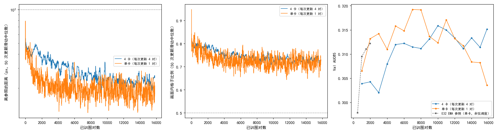

# EMA 参照训满 2 遍训练集没有坍缩，Val AUC@5 在 5000 对之后停在 0.31–0.32

**摘要**

E32 里用 EMA 参照（参照仿射由参数滑动平均的那份模型给出）的一组在种子 0 上训满了 2000 次更新，Val AUC@5 还在涨，但只训了约 0.25 遍训练集。本文想知道训得更久能到多少。先测了单卡一步的耗时：去掉一处把特征图转成字符串的写法后，每对图从 1.03 秒降到 0.91 秒；SDPA 没有通过梯度核对，没有用。再写了单机多卡数据并行，2 卡、4 卡上每对图分别要 0.50、0.26 秒，各卡参数完全相同。然后用 E32 的 EMA 参照配置、warmup 后学习率恒定，训 2 遍训练集（约 15800 对），主运行用 4 张卡、每次更新 4 对，对照用 1 张卡、每次更新 1 对。两个运行都训满了，两条提前停的判据始终没越线。4 卡运行的 Val AUC@5 在 5000 对之后停在 0.311–0.316，最后一个存档 0.315，和最高的存档分不开。单卡对照在 7000–8000 对最高（0.319），之后回落，最后一个存档 0.304，比最高时低 0.016，区间不含 0。两个运行在 9000 对以后的同一处存档上差别都在 ±0.005 以内，区间都含 0。两个运行的最高值都比 E32 的 0.312 高一点，没有到伪标签路线最好的 0.329。

**引言**

我们在尝试不用标注、用强化学习训练 RoMa 做月球光学图与 SAR 图的配准。训练时每一步先正常推理一次，用 RANSAC 拟合出一个参照仿射；粗匹配和细化各自在模型的输出周围抽若干个位置，离参照越近得分越高。参照来自模型自己，训练会随机地坍缩：模型把格子都送到 SAR 上同一个与内容无关的地方，参照也跟过去。E32 发现，参照改由参数的滑动平均（τ = 0.999）那份模型来给，在同时训细化时能训满 2000 次更新不坍缩，Val AUC@5 到 0.312，比只训粗匹配的 E28 高约 0.012。下文把这份模型叫"EMA 参照"。

但 E32 每次更新只用 1 对图，2000 次更新只看了约 0.25 遍训练集（7907 对），学习率也停在余弦调度的半路上，Val 还在涨。它训到收敛能到多少、训久了会不会坍缩，都还不知道。单卡训 2 遍训练集要 4 小时以上，所以本文先测时、把一次训练压短，再用压短后的流程训一次长的。

本文回答三个问题：单卡一步的时间花在哪里、能快多少；多卡能快多少、和单卡算的是不是同一件事；训 2 遍训练集时 Val AUC@5 在哪里走平、最高多少、有没有坍缩，4 卡和单卡是否一致。

**方法**

*测时。* 在 160 的 1 张 V100 上，用 E32 `ema` 的配置跑 60 步，前 10 步不计，取每步耗时的中位数，同时每 200 ms 记一次 GPU 利用率（`code/profile_step.py`）。一步里各部分的耗时另跑一遍：每个部分进出时都同步一次 GPU，记各部分自己的时间；插进去的同步会让合计变长，所以只用来看比例。按用户决定（2026-10-27），这一步只做测时，单卡提速只考虑 SDPA（PyTorch 自带的高效注意力实现，用在 DINOv2 的注意力上）；cuDNN 自动调优、fused AdamW、混合精度等其余办法不再尝试，也没有做更细的测时，所以单卡调优并没有做完。

*梯度核对。* 提速不能改变训练本身。从训练集里均匀取 8 对图，扰动按索引和种子给定，两份代码在同样的随机数下各算一遍损失并反向，逐对比较全部可训练参数的梯度，余弦相似度要 ≥ 0.99（`code/grad_check.py`）。同一份代码算两遍作为基准。

*多卡数据并行。* 单机多卡，每张卡每步算 1 对图，各卡把全部反向做完后梯度取平均，再做同一次参数更新，所以每次更新用 N 对图（`finetune/dist.py`）。各卡开训前从 0 号卡复制同一份参数，EMA 参照因此也从同一份参数起步、之后跟着同样的参数更新。各卡读不同的图（DistributedSampler），抽签和加噪的随机数各不相同。日志、存档、提前停的记录只由 0 号卡写，提前停由各卡汇总全部记录后各自判断，结果相同。学习率不按卡数放大。2 卡、4 卡各短跑 100 次更新，记各卡参数和 EMA 参照与 0 号卡的最大差、每次更新的耗时。

*长训练。* 配置照 E32 `ema`（粗匹配照 E28 `fm`，细化尺度 16、8、4 逐级抽签，细化损失系数 4.2，画面外处理，细化学习率 1.4e-5、VGG 放开，难版扰动，DINOv2 qkv LoRA r 8，学习率 3e-5（LoRA 1e-4），EMA 参照 τ = 0.999），改两处：warmup 500 对之后学习率恒定，不再余弦下降；训 2 遍训练集。两个运行，种子都是 0：

- 4 卡（主运行）：160 的 4 张卡，每次更新 4 对，3954 次更新（15816 对，训练集补齐到 4 的倍数），warmup 125 次更新，每 250 次更新（1000 对）存档；
- 单卡（对照）：126 的 1 张卡，每次更新 1 对，15814 次更新，每 1000 次更新存档。

两个运行的对比用来分开"每次更新的对数变了"和"训练拉长了"各自的影响。下文都按已训的图对数对齐。

*提前停与评测。* 照 E32：离参照的距离（粗匹配抽到的位置离参照仿射给出的位置的平均距离）的 50 次更新滑动中位数超过 100 px，或画面内格子比例（参照仿射把格子中心映射到 SAR 画面内、且不在补零区的格子所占比例）的滑动中位数低于 0.5，就停训。4 卡运行每次更新进 4 个记录，窗口取 200 个记录，即 50 次更新。每个存档在不加扰动的验证集（652 对）上评测，口径同 E15、E19：配准误差是估计的仿射和标注的仿射把图块 4 个角映射到的位置之间的平均距离，没有输出仿射的图对误差记为无穷；AUC@5 是"误差不超过 x 像素的图对比例"在 x 从 0 到 5 像素上的面积除以 5。不评 Test。两个存档之差用配对自助法估 95% 区间：在同一批验证图对上有放回地重抽 2000 次（同 E32）。表和图由 `code/summary.py` 生成。

**结果**

*单卡一步里，当前模型和 EMA 参照的前向各占约三成，原代码大量时间花在 GPU 等 CPU 上。* 表 1。当前模型带梯度的编码与粗级前向、EMA 参照的推理、主反向是三个大头，各约 0.2 秒；EMA 参照这一侧（编码、细化、抽点与 RANSAC）合计约占一步的三成。原代码的 GPU 利用率只有 31%：细化前设置混合精度时照抄了 romatch 的写法，把整张特征图转成字符串去和 "cuda" 比较，每一步因此有约 1900 次 GPU 与 CPU 之间的同步。这个比较对结果不起作用（romatch 只看设备，在 cuda 上恒为打开），去掉之后返回值不变，每对图从 1.03 秒降到 0.91 秒，GPU 利用率升到 72%（表 2）。下文的长训练和多卡都用去掉之后的代码。

表 1：原代码一步里各部分的耗时（秒，中位数）。每部分进出时都同步一次 GPU，所以合计比不插同步时的 1.03 秒略长，只看比例。

| 部分 | 秒 |
|---|---|
| 当前模型前向（编码与粗级，带梯度） | 0.206 |
| EMA 参照推理（编码与粗级） | 0.202 |
| 主反向 | 0.189 |
| EMA 参照推理（抽点与 RANSAC） | 0.067 |
| 细化三级的反向 | 0.061 |
| 当前模型正常推理（抽点与 RANSAC） | 0.057 |
| EMA 参照推理（细化） | 0.049 |
| 当前模型正常推理（细化） | 0.049 |
| 细化三级抽签（不含反向） | 0.047 |
| 优化器 | 0.046 |
| 粗匹配抽签、打分与其余 | 0.044 |
| EMA 参照更新 | 0.026 |
| 画面内掩码 | 0.006 |
| 取数据 | 0.004 |
| 合计（带逐段同步） | 1.038 |

*SDPA 只快 7%，梯度对不上，没有用。* 表 2、表 3。SDPA 把每对图从 0.91 秒降到 0.85 秒，显存从 11.3 GB 降到 7.2 GB，但 8 对图里只有 1 对的梯度余弦相似度 ≥ 0.99，最低 0.51；同一份代码算两遍时 8 对都是 1.000。cuDNN 自动调优在用户决定不再尝试之前已经测过，没有变快，梯度也只有 3 对通过，同样没有用。

表 2：单卡与多卡的每对图耗时（秒，中位数）。加速比都相对去掉字符串比较之后的单卡（0.91 秒）。多卡的参数最大差为 100 次更新后各卡参数、EMA 参照与 0 号卡的最大绝对差。

| 设置 | 每次更新的对数 | 每次更新（秒） | 每对图（秒） | GPU 利用率 | 显存（GB） | 参数最大差 | EMA 参照最大差 | 加速比 |
|---|---|---|---|---|---|---|---|---|
| E32 `ema` 原代码 | 1 | 1.029 | 1.029 | 31% | 11.3 | | | 0.88 |
| 去掉字符串比较（长训练用的代码） | 1 | 0.908 | 0.908 | 72% | 11.3 | | | 1.00 |
| 再加 SDPA | 1 | 0.849 | 0.849 | 67% | 7.2 | | | 1.07 |
| 再加 cuDNN 自动调优 | 1 | 0.901 | 0.901 | 72% | 25.4 | | | 1.01 |
| 2 卡数据并行 | 2 | 1.003 | 0.502 | | 11.3 | 0 | 0 | 1.81 |
| 4 卡数据并行 | 4 | 1.042 | 0.260 | | 11.3 | 0 | 0 | 3.49 |

表 3：提速写法与原写法的梯度余弦相似度（8 对图逐对比较）。

| 写法 | 最低 | 中位数 | ≥ 0.99 的对数 |
|---|---|---|---|
| 同一份代码再算一遍 | 1.000 | 1.000 | 8 / 8 |
| SDPA | 0.510 | 0.966 | 1 / 8 |
| cuDNN 自动调优 | 0.802 | 0.973 | 3 / 8 |

*多卡几乎按卡数线性变快，各卡参数始终相同，短跑的日志与单卡相近。* 表 2。每次更新的耗时从单卡的 0.91 秒只涨到 1.00 秒（2 卡）、1.04 秒（4 卡），每对图的耗时降到 0.50、0.26 秒，即 1.8 倍、3.5 倍。100 次更新后各卡的参数和 EMA 参照与 0 号卡的最大差都是 0。前 200 对图里，2 卡、4 卡的离参照距离、画面内格子比例、得分的平均值与单卡同一份代码跑两遍时的差别在同一量级（`extra/data/short.csv`）。

*两个运行都训满了 2 遍训练集，判据始终没越线。* 图 1 左、中。离参照距离的滑动中位数在开头最高（4 卡 55 px，单卡 79 px），之后一路下降；画面内格子比例最低 0.71（4 卡）、0.64（单卡），离 0.5 都远。按已训的图对数比，单卡的离参照距离降得更快，后半程也更低（约 18 px，4 卡约 22 px）。

*4 卡运行的 Val AUC@5 在 5000 对之后走平，最后一个存档和最高的存档分不开。* 表 4、表 5、图 1 右。4 卡运行前 3000 对在 0.302–0.304，到 5000 对升到 0.312，之后在 0.311–0.316 之间起伏；最高 0.316（10000 对），最后一个存档 0.315，两者之差 −0.001，区间含 0。最后一个存档比第一个存档（1000 对）高 0.011，区间不含 0。

*单卡对照在 7000–8000 对最高，之后回落到和第一个存档差不多。* 表 4、表 5、图 1 右。单卡 2000 对时已到 0.313，7000、8000 对最高（0.319），之后逐步下降，最后一个存档 0.304，比最高时低 0.016，区间不含 0；和第一个存档（1000 对，0.307）分不开。回落时两条判据都没有变化（图 1 左、中），训练得分还在缓慢上升，所以回落发生在判据看不到的地方，不属于判据所定义的坍缩。

表 4：各存档的 Val AUC@5，按已训图对数对齐。差为 4 卡减单卡，括号内为配对自助法 95% 区间；最后一行 4 卡为 15816 对、单卡为 15814 对。

| 已训图对数 | 4 卡更新次数 | 4 卡 | 单卡 | 差 |
|---|---|---|---|---|
| 1000 | 250 | 0.304 | 0.307 | −0.003（−0.008，+0.003） |
| 2000 | 500 | 0.304 | 0.313 | −0.009（−0.014，−0.004） |
| 3000 | 750 | 0.302 | 0.314 | −0.012（−0.018，−0.006） |
| 4000 | 1000 | 0.308 | 0.311 | −0.003（−0.008，+0.003） |
| 5000 | 1250 | 0.312 | 0.316 | −0.004（−0.009，+0.002） |
| 6000 | 1500 | 0.312 | 0.315 | −0.003（−0.008，+0.003） |
| 7000 | 1750 | 0.311 | 0.319 | −0.008（−0.013，−0.003） |
| 8000 | 2000 | 0.311 | 0.319 | −0.008（−0.014，−0.002） |
| 9000 | 2250 | 0.313 | 0.314 | −0.001（−0.005，+0.004） |
| 10000 | 2500 | 0.316 | 0.312 | +0.004（−0.002，+0.009） |
| 11000 | 2750 | 0.315 | 0.317 | −0.002（−0.007，+0.003） |
| 12000 | 3000 | 0.313 | 0.313 | 0.000（−0.006，+0.006） |
| 13000 | 3250 | 0.311 | 0.312 | −0.001（−0.005，+0.004） |
| 14000 | 3500 | 0.313 | 0.308 | +0.005（−0.000，+0.010） |
| 15000 | 3750 | 0.311 | 0.308 | +0.003（−0.001，+0.008） |
| 15816 / 15814 | 3954 | 0.315 | 0.304 | +0.012（+0.006，+0.017） |

表 5：同一个运行里，最后一个存档与最高的存档、与第一个存档的 Val AUC@5 之差（配对自助法 95% 区间）。

| 运行 | 最后一个存档 | 比最高的存档（几对时） | 比第一个存档（1000 对） |
|---|---|---|---|
| 4 卡 | 0.315 | −0.001（−0.005，+0.004），10000 对 | +0.011（+0.004，+0.019） |
| 单卡 | 0.304 | −0.016（−0.022，−0.010），7000 对 | −0.003（−0.012，+0.006） |

图 1：两个运行都训满了，判据没越线；4 卡的 Val 在 5000 对之后走平，单卡在 7000–8000 对最高之后回落。横轴都是已训图对数。左：离参照的距离，对数轴；中：画面内格子比例；左、中两幅为 50 次更新的滑动中位数（4 卡的 50 次更新是 200 对，所以曲线更平滑），横虚线为判据。右：各存档的 Val AUC@5，灰色虚线为 E32 EMA 参照组（单卡，余弦调度，2000 次更新）。

*4 卡和单卡前半程不一致，9000 对以后一致，最后一个存档 4 卡更高。* 表 4。3000 对以前和 7000、8000 对，4 卡比单卡低 0.008–0.012，区间不含 0；这时 4 卡在同样的图对数上只做了单卡四分之一的更新次数。9000 对到 15000 对，两者之差都在 −0.002 到 +0.005 之间，区间都含 0。最后一个存档 4 卡比单卡高 0.012，区间不含 0，这来自单卡的回落。

*单卡对照在 126 上训到约 4000 对之后变慢了一倍多。* 前 4000 对每次更新约 0.76 秒，之后约 1.74 秒，全程用了约 7 小时；4 卡运行约 1 小时训完。126 的 nvidia-smi 不可用，看不到同机别的进程，变慢的原因本文没有查。

**讨论**

票里的三个问题都有了初步答案。单卡一步里，当前模型和 EMA 参照的前向、主反向是大头；原代码的 GPU 利用率低，主要因为一处把特征图转成字符串的写法造成大量同步，去掉后快了 1.13 倍；SDPA 梯度对不上，没有用；其余单卡提速没有尝试，所以单卡调优没有做完。多卡在 2、4 张卡上分别快 1.8、3.5 倍，各卡参数一致。长训练中，EMA 参照在 2 遍训练集里两个运行都没越线；4 卡运行的 Val AUC@5 在 5000 对后停在 0.311–0.316，单卡对照最高 0.319，之后回落。两者的最高值都只比 E32 的 0.312 高 0.004–0.007，没有到伪标签路线的 0.329（N）。

局限有三点。第一，每个运行只有一个种子。单卡和 4 卡在同一处存档上的差，以及单卡的回落，都可能随种子变化；本文没有办法区分。第二，配对自助法只考虑验证图对的抽样，不包括训练本身的随机性；相邻存档之间 ±0.005 的起伏，本身就说明单个存档的值会随训练的偶然波动上下。第三，两个运行同时改了两件事：每次更新的对数，以及同样图对数下的更新次数。单卡回落、4 卡没有回落，可能和每次更新的对数（梯度噪声）有关，也可能只是单卡在同样的图对数上走了 4 倍的更新步数、走得更远；本文的设置分不开这两者（未检验）。

还有两点没有解释。一是单卡回落时，离参照距离、画面内格子比例都没有变化，训练得分还在上升，Val 却下降了 0.016；训练日志里有什么量能提前看到这种回落，本文没有找到。二是 4 卡在 2000–3000 对时低于单卡、9000 对以后追平，这和"同样图对数下更新次数少"一致，但没有直接检验，例如在 4 卡上按更新次数对齐与单卡比较。
