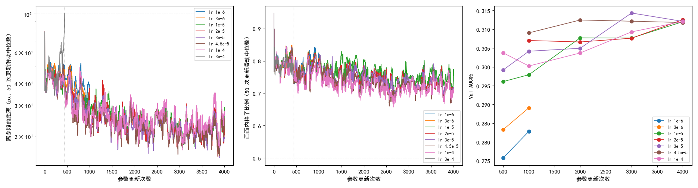

# 学习率在 1e-5 到 1e-4 之间训到 4000 次更新后 Val 分不出高下，3e-4 在第 442 次更新就越线停下

**摘要**

E32 找到了能稳定训练的配置：用 EMA 参照、粗匹配和细化一起训。但它的学习率 3e-5 是沿用旧设置定的，没有在这个配置上搜过。本文把 E32 `ema` 的学习率调度改成 warmup 500 次更新后恒定，在对数尺度上搜主学习率（LoRA 学习率同比例缩放），用逐轮减半的办法分三轮做：第 1 轮 6 组各训 1000 次更新，留最好的 3 组接着训到 4000 次，再在最好一组两侧按 1.5 倍各补 1 组，从头训到 4000 次。种子都是 0，只测 Val。结果：3e-4 在 warmup 还没结束的第 442 次更新时离参照的距离越线，被提前停下；1e-6 到 1e-4 都没有越线。训 1000 次时，1e-6 到 3e-5 学习率越大 Val AUC@5 越高，1e-6、3e-6、1e-5 比 3e-5 低，区间不含 0。训到 4000 次时，1e-5、2e-5、3e-5、4.5e-5、1e-4 这 5 组的 Val AUC@5 都在 0.310 到 0.313 之间，与 3e-5 相比，最后一个存档和最后两个存档平均两种口径下的差都在 ±0.003 以内，区间全部跨 0。也就是说，在单个种子、4000 次更新的范围内，学习率在 1e-5 到 1e-4 这一个数量级内都一样，坍缩从 3e-4 这一档开始。

**引言**

我们在用强化学习、不用标注，训练 RoMa 做月球光学图与 SAR 图的配准。每一步先让模型推理一次，用 RANSAC 拟合出一个参照仿射，再按抽到的位置离参照的远近打分。E32 表明，参照改由参数的滑动平均（τ = 0.999）那份模型推理得到（下文称 EMA 参照）以后，粗匹配和细化一起训也能训满 2000 次更新，Val AUC@5 比只训粗匹配高约 0.012。

这个配置里的学习率（主学习率 3e-5，LoRA 1e-4）是在更早、更容易坍缩的设置下定的。学习率太小，训得慢；太大，模型和参照一起跑偏，训练坍缩。在 EMA 参照下，哪一档最好、从哪一档开始坍缩，还不知道。

本文在 E32 的配置上搜学习率，回答三个问题：学习率在哪个数量级最好、过大从哪一档开始坍缩；细搜后最好的学习率与 3e-5 相比差多少；单卡与 4 卡对学习率的排序是否一致。第三个问题要用 #226 的多卡代码，本文没有做（见讨论）。

**方法**

*底座。* E32 `ema` 原样：E28 `fm` 的粗匹配，细化尺度 16、8、4 逐级抽签，细化损失系数 4.2，画面外处理，DINOv2 qkv 加 LoRA r 8，VGG 放开，难版扰动，EMA 参照 τ = 0.999。只改一处：学习率按 warmup 500 次更新升到设定值，之后恒定，不再余弦下降，这样训到第 1000 次和训到第 4000 次时的学习率相同，前一段可以直接接着训。单卡，每次更新 1 对图，种子 0。配置见 `configs/_e34.toml`。

*学习率怎么缩放。* 各组只改主学习率和 LoRA 学习率，两者保持 3 : 10 的比例（默认 3e-5 对 1e-4）。细化层和 VGG 的学习率在代码里是主学习率的 0.47 倍，随主学习率一起变。下文的"学习率"都指主学习率。

*三轮。* 学习率在对数尺度上取值（Bengio 2012，*Practical recommendations for gradient-based training of deep architectures*），所有取值先各训一小段，留下好的一半训得更长，即逐轮减半（Jamieson & Talwalkar 2016；Li et al. 2018，Hyperband）。

- 第 1 轮：1e-6、3e-6、1e-5、3e-5、1e-4、3e-4 共 6 组，各训 1000 次更新，在第 500、1000 次存档。
- 第 2 轮：按第 1 轮留最好的 3 组，从第 1000 次的存档接着训到第 4000 次，每 1000 次存档。存档里带优化器状态、随机数、数据顺序和 EMA 参照的权重，接着训的第 1001 次与不中断时是同一次更新。唯一的不同是下面提前停止用的 50 次滑动窗口要重新攒满。
- 第 3 轮：在第 2 轮最好的一组两侧，按 1.5 倍各补 1 组，从头训到 4000 次，每 1000 次存档。

*提前停止。* 同 E32：离参照的距离（粗匹配抽到的位置离参照仿射给出位置的平均距离）的 50 次更新滑动中位数超过 100 px，或画面内格子比例（参照仿射把格子中心映射到 SAR 画面内、且不在补零区的格子所占比例）的 50 次更新滑动中位数低于 0.5，这组当场停训，不另存档，直接淘汰。

*比较。* 每个存档在 Val（652 对）上测 AUC@5，不测 Test。每组报两个数：最后一个存档的 Val AUC@5，和最后两个存档的平均，看两者是否指向同一结论。与 3e-5 组在同样的更新次数上比，差值的 95% 区间用配对自助法：同一批 652 对 Val 图有放回地重抽 2000 次，两个存档平均时每次重抽分别算两个存档的 AUC@5 再平均（同 E32 的 `summary.py`）。区间跨过 0 记为"分不出高下"。

*运行。* 训练和评测在 126 的 V100（3 号卡）、160 的 V100（2、3 号卡）和 A6000（1 号卡）上，同一张卡上一个进程训练、一个进程在存档出来后测 Val（`code/card.sh`、`code/train_queue.py`、`code/eval_queue.py`）。第 2 轮的 1e-5 组在 A6000 上训和测，结果拷回 gpfs。表和图由 `code/summary.py` 生成。

**结果**

*3e-4 在第 442 次更新时离参照的距离越线，其余 5 组训满 1000 次没有越线。* 表 1、图 1 左。3e-4 组离参照距离的滑动中位数从第 350 次更新前后起停在 60 px 上下，第 420 次以后在 20 多次更新内从 64 px 升到 100.9 px。此时 warmup 还没结束，学习率约为设定值的 0.9 倍。它停在第一个存档之前，没有可测的存档。另外 5 组在第 500 到 1000 次更新之间，离参照距离的滑动中位数最高 47–52 px，画面内格子比例最低 0.70–0.73。

*训 1000 次时，学习率从 1e-6 到 3e-5 越大，Val 越高；1e-4 与 3e-5 分不出高下。* 表 1。1e-6、3e-6、1e-5 三组比 3e-5 低，两种口径下区间都不含 0；1e-4 与 3e-5 两种口径下都分不出高下。两种口径选出的前三都是 3e-5、1e-4、1e-5，第 2 轮留下这 3 组。

表 1：第 1 轮各组的 Val AUC@5。差为减去 3e-5 组同一更新次数的值，括号内为配对自助法 95% 区间。

| 学习率 | 第 500 次 | 第 1000 次 | 两个存档平均 | 与 3e-5 之差：第 1000 次 | 与 3e-5 之差：两个存档平均 | 提前停止 |
|---|---|---|---|---|---|---|
| 1e-6 | 0.276 | 0.283 | 0.279 | −0.021（−0.029，−0.013） | −0.022（−0.029，−0.016） | 否 |
| 3e-6 | 0.283 | 0.289 | 0.286 | −0.015（−0.022，−0.008） | −0.015（−0.022，−0.009） | 否 |
| 1e-5 | 0.296 | 0.298 | 0.297 | −0.006（−0.012，−0.000） | −0.005（−0.009，−0.001） | 否 |
| 3e-5 | 0.299 | 0.304 | 0.302 | — | — | 否 |
| 1e-4 | 0.304 | 0.300 | 0.302 | −0.004（−0.010，+0.002） | +0.000（−0.004，+0.005） | 否 |
| 3e-4 | — | — | — | — | — | 第 442 次，离参照距离 100.9 px |

*训到 4000 次时，1e-5 到 1e-4 的 5 组 Val 分不出高下。* 表 2、图 1 右。第 2 轮的 3 组训满 4000 次，最后一个存档的 Val AUC@5 都是 0.312，最后两个存档平均以 3e-5 最高（0.313），所以第 3 轮在 3e-5 两侧补了 2e-5 和 4.5e-5。这两组也训满 4000 次。5 组最后一个存档的 Val AUC@5 在 0.312 到 0.313 之间，最高的是 2e-5（0.3126）；最后两个存档平均在 0.310 到 0.313 之间，最高的是 3e-5（0.3132）。两种口径下最高的不是同一组，但与 3e-5 的差都在 ±0.003 以内，区间全部跨 0。第 1 轮时比 3e-5 低 0.006 的 1e-5，训到第 2000 次时已经追上。

表 2：训到 4000 次更新的 5 组。1e-5、3e-5、1e-4 的第 2000–4000 次接着第 1 轮的第 1000 次存档训；2e-5、4.5e-5 从头训。差与区间同表 1，"分不出"即区间跨 0。画面内格子比例为 50 次更新滑动中位数的全程最低值。

| 学习率 | 第 1000 次 | 第 2000 次 | 第 3000 次 | 第 4000 次 | 最后两个存档平均 | 与 3e-5 之差：第 4000 次 | 与 3e-5 之差：两个存档平均 | 画面内格子比例最低 | 提前停止 |
|---|---|---|---|---|---|---|---|---|---|
| 1e-5 | 0.298 | 0.308 | 0.308 | 0.312 | 0.310 | −0.000（−0.005，+0.005），分不出 | −0.003（−0.007，+0.001），分不出 | 0.70 | 否 |
| 2e-5 | 0.307 | 0.307 | 0.308 | 0.313 | 0.310 | +0.000（−0.004，+0.005），分不出 | −0.003（−0.006，+0.000），分不出 | 0.69 | 否 |
| 3e-5 | 0.304 | 0.305 | 0.314 | 0.312 | 0.313 | — | — | 0.67 | 否 |
| 4.5e-5 | 0.309 | 0.312 | 0.312 | 0.312 | 0.312 | −0.000（−0.006，+0.005），分不出 | −0.001（−0.005，+0.002），分不出 | 0.66 | 否 |
| 1e-4 | 0.300 | 0.304 | 0.309 | 0.312 | 0.311 | −0.000（−0.006，+0.006），分不出 | −0.003（−0.006，+0.001），分不出 | 0.66 | 否 |

图 1：3e-4 在第 442 次更新越线（竖点线），其余各组两条曲线始终没越线；训到 4000 次的 5 组 Val 收拢到 0.312 附近。左：离参照的距离，对数轴；中：画面内格子比例；左、中两幅为 50 次更新的滑动中位数，横虚线为提前停止的界线。右：各存档的 Val AUC@5。横轴为参数更新次数。

*学习率越大，画面内格子比例的最低值越低，但都离 0.5 的界线很远。* 表 2 倒数第二列、图 1 中。从 1e-5 到 1e-4，最低值从 0.70 降到 0.66。

*两处核对。* 第 2 轮接着训的第一条日志是第 1001 次更新，说明确实从存档接着走。1e-5 组第 1000 次存档在 V100 和 A6000 上各测了一次，Val AUC@5 分别为 0.2979 和 0.2976，差 0.0004，说明换显卡测带来的差远小于表 2 里各组之间的差的区间宽度。

**讨论**

第一个问题有了答案：在单个种子上，训到 4000 次更新时，学习率在 1e-5 到 1e-4 之间 Val AUC@5 都一样，3e-4 在 500 次更新以内坍缩。第 1 轮里小学习率的劣势只是起步慢：1e-5 在第 1000 次时还比 3e-5 低，到第 2000 次就追上了。第二个问题的答案是：细搜之后没有哪一档能和 3e-5 分出高下。按最后一个存档最高的是 2e-5，按最后两个存档平均最高的是 3e-5，两者差不到 0.003，区间都跨 0，所以后续搜参继续用 3e-5 也不吃亏。第三个问题（单卡与 4 卡的排序是否一致）没有做：它要用 #226 的多卡代码，#226 在本文结束时还没合并，160 的 4 张卡也不全空。

局限有四点。第一，只有种子 0。表 2 里各组与 3e-5 的差（≤ 0.003），和同一组相邻存档之间的起伏差不多大（3e-5 第 3000、4000 次差 0.002，2e-5 差 0.005），单个种子分不出这样小的差。第二，第 1 轮只训 1000 次就淘汰，对起步慢的小学习率不利；1e-5 后来追上了，3e-6 训得更久会不会也追上，本文没有检验。第三，第 2 轮的 3 组是接着第 1 轮训的，提前停止的滑动窗口在第 1001 次重新攒，第 1001 到 1050 次之间不会触发停止；这 3 组离界线都很远，不影响结论。第四，只测了 Val。

E32 `ema` 用余弦下降的学习率，训到第 2000 次时 Val AUC@5 为 0.312；本文恒定学习率的 3e-5 组第 2000 次为 0.305，要到第 3000 次才到 0.314。两者只差学习率调度，但只有一个种子，相邻存档之间就有 0.005 左右的起伏，这个差是否来自调度，本文的数据回答不了。另外，1e-4 是唯一一组第 1000 次比第 500 次低的（0.300 对 0.304），之后又回升，原因不清楚。
