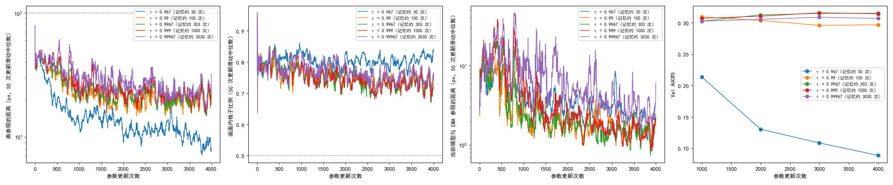

# EMA 参照的记忆长度取 300 和 1000 次更新时 Val 最高且分不出高下，取 30 次时 Val 随训练一路下降

**摘要**

E34 在 EMA 参照、粗匹配和细化一起训、恒定学习率的配置上把学习率定为 3e-5。这个配置里 EMA 参照的 τ = 0.999 是在只训粗匹配、训 1200 步的设置下（E30）挑的，在现在训得更长、细化一起训的设置下没有重新看过。本文在 E34 的配置上只改 τ，按 EMA 的记忆长度 1/(1−τ) 在对数尺度上取 30、100、300、1000、3000 次更新，即 τ = 0.967、0.99、0.9967、0.999、0.99967，各从头训到 4000 次更新、每 1000 次存档测 Val，种子 0。结果：5 组都训满 4000 次，没有一组触发提前停止。τ = 0.9967 与 0.999 的 Val AUC@5 都在 0.315 附近，两者之差在两种口径下区间都跨 0。τ = 0.99967 比 0.999 低约 0.007，τ = 0.99 低约 0.018，区间都不含 0。τ = 0.967 第 1000 次存档的 Val AUC@5 只有 0.213，之后每个存档都更低，第 4000 次为 0.089；同时它训练日志里离参照的距离是 5 组里最小的。当前模型与 EMA 参照的距离在前 1000 次更新里随 τ 增大而增大，此后各组都降到几个像素，最后 1000 次更新里在 1.5–2.9 px 之间。也就是说，在单个种子、4000 次更新的范围内，记忆长度 300 到 1000 次更新一样好，τ 从 0.99 这一档开始变差，到 0.967 时 Val 坍缩，而这种坍缩提前停止的两条判据都没有察觉。

**引言**

我们在用强化学习、不用标注，训练 RoMa 做月球光学图与 SAR 图的配准。每一步先让模型推理一次，用 RANSAC 拟合出一个参照仿射，再按抽到的位置离参照的远近打分。参照如果直接取正在训练的模型，参照会被模型带着跑偏，训练随机坍缩。E30、E32 的做法是另存一份 EMA 模型：每次参数更新后，它的参数变为 τ × 旧 EMA 参数 + (1 − τ) × 当前模型参数，大致等于当前模型最近 1/(1 − τ) 次更新的平均（下文称"记忆长度"）。参照仿射和画面内掩码都由这份 EMA 模型推理得到（下文称 EMA 参照）。τ 越大，参照越稳，但跟得越慢；τ 越小，参照跟得越快，防跑偏的作用也越弱。τ 再大到记忆长度超过训练长度时，EMA 参照几乎不动，接近冻结的初始模型，等于离线伪标签，不是我们要的方法。

E30 在只训粗匹配、训到 1200 步的设置下比过 τ = 0.99、0.996、0.999，三档都健康，Val 分不开。之后 E32 加上了细化一起训，E34 改成恒定学习率、训到 4000 次更新，τ 一直沿用 0.999。训得更长、可训的部分更多以后，τ 的哪一档最好、从哪一档开始变差，还不知道。

本文在 E34 的配置上搜 τ，回答三个问题：哪个 τ 最好，与 0.999 差多少；τ 小到哪一档开始坍缩或变差；当前模型与 EMA 参照的距离随 τ 怎么变。

**方法**

*底座。* E34 的配置原样（`configs/_e35.toml`）：E32 `ema` 的粗匹配和细化尺度 16、8、4 一起训，细化损失系数 4.2，画面外处理，DINOv2 qkv 加 LoRA r 8，VGG 放开，难版扰动；学习率按 warmup 500 次更新升到 3e-5（LoRA 1e-4）后恒定。单卡，每次更新 1 对图，种子 0。各组只改 τ（配置里的 `[rloo] ref_ema`）。

*τ 的取值。* 按记忆长度 1/(1 − τ) 在对数尺度上取 30、100、300、1000、3000 次更新，τ 取到 3–5 位有效数字：0.967、0.99、0.9967、0.999、0.99967（对应记忆长度约 30、100、303、1000、3030 次）。不取更大的值，理由见引言。

*训练长度。* 每组从头训到 4000 次更新，每 1000 次存档并测 Val，不做逐轮淘汰。E34 里第 1000 次更新的排序和第 4000 次不一致，短跑淘汰在这个配置上不可靠。

*提前停止。* 同 E32：离参照的距离（粗匹配抽到的位置离参照仿射给出的位置的平均距离）的 50 次更新滑动中位数超过 100 px，或画面内格子比例（参照仿射把格子中心映射到 SAR 画面内、且不在补零区的格子所占比例）的 50 次更新滑动中位数低于 0.5，这组当场停训。

*当前模型与 EMA 参照的距离。* 每次更新时当前模型也正常推理一次、拟合出自己的仿射，只用来记录：两个仿射把各个格子中心映射到的位置之间的平均距离（px），即 E30 的同名量（日志里的 `ref_gap`）。它说明 EMA 模型落后当前模型多远。下文按每 1000 次更新一段取中位数报告。

*比较。* 每个存档在 Val（652 对）上测 AUC@5，不测 Test。每组报两个数：最后一个存档（第 4000 次）的 Val AUC@5，和最后两个存档（第 3000、4000 次）的平均。与 τ = 0.999 组在同样的存档上比，差值的 95% 区间用配对自助法：同一批 652 对 Val 图有放回地重抽 2000 次，两个存档平均时每次重抽分别算两个存档的 AUC@5 再平均（同 E32、E34 的 `summary.py`）。区间跨过 0 记为"分不出高下"。

*运行。* 5 组同时跑：τ = 0.967、0.99 在 160 的 2、3 号卡，其余 3 组在 150 的 0、1、5 号卡，同一张卡上一个进程训练、一个进程在存档出来后测 Val（`code/card.sh`、`code/train_queue.py`、`code/eval_queue.py`，沿用 E34）。表和图由 `code/summary.py` 生成。

**结果**

*5 组都训满 4000 次更新，没有一组触发提前停止。* 表 1、图 1 左、中。各组离参照距离的滑动中位数只在训练最开头的几次更新里接近 80 px（窗口还没攒满），之后最高约 60 px（τ = 0.99967 在第 800 次更新前后）；画面内格子比例的滑动中位数全程不低于 0.63。

*τ = 0.9967 和 0.999 的 Val 最高，两者分不出高下；τ = 0.99967 和 0.99 比 0.999 低。* 表 1、图 1 右。τ = 0.9967 与 0.999 第 4000 次存档的 Val AUC@5 分别为 0.315 和 0.314，最后两个存档平均都是 0.315，两种口径下的差都在 ±0.001 以内，区间跨 0。τ = 0.99967 两种口径下都比 0.999 低 0.007，τ = 0.99 低 0.018–0.019，区间都不含 0。τ = 0.99 的 Val 在第 1000 次存档时是 5 组里最高的（0.309），之后逐个存档下降；其余三组从第 1000 次到第 3000 次是上升的。

*τ = 0.967 的 Val 从第 1000 次存档起就远低于其余各组，并逐个存档下降。* 表 1、图 1 右。它第 1000 次存档的 Val AUC@5 为 0.213，第 4000 次降到 0.089，Val 配准误差中位数从 4.3 px 升到 6.4 px；其余 4 组的中位数全程在 3.3–3.5 px 之间。

表 1：各组每个存档的 Val AUC@5 和比较结果。差为减去 τ = 0.999 组同一存档的值，括号内为配对自助法 95% 区间。画面内格子比例为 50 次更新滑动中位数的全程最低值。

| τ（记忆长度） | 第 1000 次 | 第 2000 次 | 第 3000 次 | 第 4000 次 | 最后两个存档平均 | 与 0.999 之差：第 4000 次 | 与 0.999 之差：两个存档平均 | 画面内格子比例最低 | 提前停止 |
|---|---|---|---|---|---|---|---|---|---|
| 0.967（30） | 0.213 | 0.130 | 0.108 | 0.089 | 0.099 | −0.226（−0.241，−0.210） | −0.217（−0.231，−0.202） | 0.75 | 否 |
| 0.99（100） | 0.309 | 0.304 | 0.296 | 0.297 | 0.296 | −0.018（−0.027，−0.009） | −0.019（−0.027，−0.011） | 0.68 | 否 |
| 0.9967（300） | 0.302 | 0.313 | 0.315 | 0.315 | 0.315 | +0.001（−0.005，+0.007），分不出 | −0.000（−0.005，+0.005），分不出 | 0.64 | 否 |
| 0.999（1000） | 0.307 | 0.311 | 0.316 | 0.314 | 0.315 | — | — | 0.67 | 否 |
| 0.99967（3000） | 0.302 | 0.305 | 0.309 | 0.307 | 0.308 | −0.007（−0.013，−0.002） | −0.007（−0.011，−0.003） | 0.64 | 否 |

图 1：5 组都没有越过提前停止的界线；τ = 0.967 离参照的距离最小，Val 却最低且一路下降。从左到右：离参照的距离（对数轴）、画面内格子比例、当前模型与 EMA 参照的距离（对数轴），三幅都是 50 次更新的滑动中位数，横虚线为提前停止的界线；最右为各存档的 Val AUC@5。横轴为参数更新次数。

*τ = 0.967 训练日志里离参照的距离最小、画面内格子比例最高。* 表 2、图 1 左、中。最后 1000 次更新里，它离参照距离的中位数约 10 px，其余 4 组在 20–23 px 左右；画面内格子比例的中位数约 0.81，其余 4 组在 0.72–0.75。按训练日志看，这一组比其他组更"顺"，但 Val 在变差。

*当前模型与 EMA 参照的距离在前 1000 次更新里随 τ 增大而增大，之后各组都降到几个像素。* 表 2、图 1 第三幅。前 1000 次更新里，这个距离的中位数从 τ = 0.967、0.99 的 5–6 px 增大到 τ = 0.999、0.99967 的 11–14 px。之后各组都在下降：τ ≤ 0.999 的 4 组在第 1001–2000 次更新时已降到 2–3.4 px，τ = 0.99967 降得最慢，这一段还有 7.5 px。最后 1000 次更新里各组在 1.5–2.9 px 之间，τ = 0.99967 最大（2.9 px），其次是 τ = 0.967（2.2 px），中间三档都在 1.5 px 左右，并不随 τ 单调变化。

表 2：训练日志里三个量每 1000 次更新一段的中位数（逐次记录，不滑动）。

| τ（记忆长度） | 当前模型与 EMA 参照的距离（px）：1–1000 / 1001–2000 / 2001–3000 / 3001–4000 | 离参照的距离（px），3001–4000 | 画面内格子比例，3001–4000 |
|---|---|---|---|
| 0.967（30） | 5.7 / 3.4 / 2.8 / 2.2 | 10.2 | 0.81 |
| 0.99（100） | 5.2 / 1.9 / 1.7 / 1.5 | 19.6 | 0.74 |
| 0.9967（300） | 6.5 / 2.0 / 1.6 / 1.5 | 20.4 | 0.72 |
| 0.999（1000） | 11.3 / 2.6 / 1.8 / 1.5 | 21.2 | 0.73 |
| 0.99967（3000） | 13.7 / 7.5 / 4.0 / 2.9 | 22.6 | 0.75 |

*与 E34 的核对。* τ = 0.999 组与 E34 的 3e-5 组配置相同（只差存档频率，以及 E34 那组在第 1000 次存档后中断、接着训）。两者四个存档的 Val AUC@5 相差 0.002–0.006，第 4000 次分别为 0.314 和 0.312，在同一组相邻存档的起伏范围内。

**讨论**

三个问题都有了单个种子上的答案。第一，记忆长度 300 和 1000 次更新（τ = 0.9967、0.999）一样好，两者之差区间跨 0，沿用 0.999 不吃亏。第二，τ 往小走，从 0.99（记忆 100 次）开始 Val 变差，到 0.967（记忆 30 次）Val 坍缩到第 4000 次的 0.089；往大走，0.99967（记忆约 3000 次，接近训练总长）也比 0.999 低。第三，当前模型与 EMA 参照的距离主要在训练前段随 τ 增大而增大，训到后段各组都只有一两个像素，后段这个量分不开中间三档。

τ = 0.967 的坍缩值得单独记一笔：它没有出现以前那种参照被带到画面外的失效（画面内格子比例反而最高），离参照的距离也最小，提前停止的两条判据都没有察觉，只有 Val 能看出来。E30 τ = 0.99 的组在 1200 步内健康，本文 τ = 0.99 训到 4000 次也没有坍缩，但 Val 从第 1000 次起就在缓慢下降。

局限有三点。第一，只有种子 0；τ = 0.99967 与 0.999 的差（0.007）只比相邻存档的起伏大一些，换种子是否成立没有检验。第二，只训到 4000 次更新；记忆长度 3000 次的 EMA 参照在这个长度下大部分时间还落后得多（表 2 第 1001–2000 次段 7.5 px），训得更长时它与 0.999 的差会不会缩小，本文回答不了。第三，只测了 Val。

尚未解释的现象：τ = 0.967 训练日志里离参照的距离小、画面内格子比例高、Val 却差，这几个量为什么同时出现，本文没有检验；一个可以区分的检查是看它的存档在 Val 上推理出的仿射与真值的偏差是否有固定的方向或尺度（例如整体缩放或平移），以及 EMA 参照与当前模型是否一同偏向同一个错误的解。另外，τ = 0.99 的 Val 在第 1000 次时最高、之后下降，原因同样不清楚。
