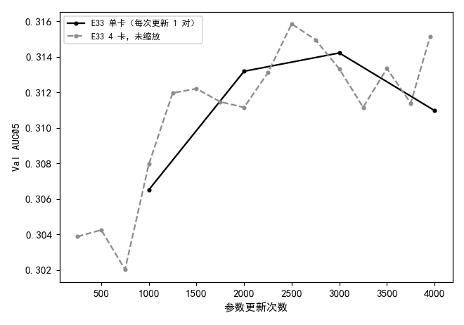
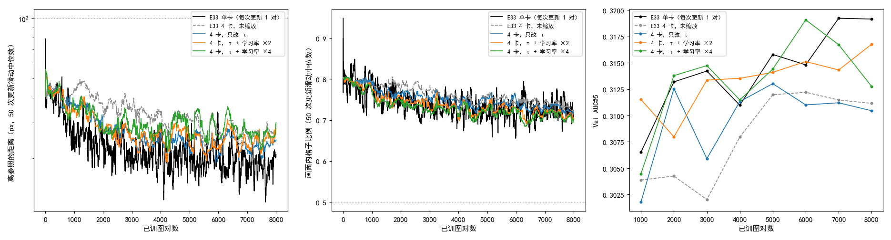

# 4 卡把 τ 换成 0.996、学习率放大 2–4 倍后，按图对数与单卡的 Val AUC@5 平均只差 0.001

**摘要**

E33 把 EMA 参照的强化学习训练搬到 4 张卡上（每次更新 4 对图），学习率和 EMA 参照的 τ 都照搬单卡；按已训图对数对齐时，4 卡在 8 个存档里有 4 个比单卡低、区间不含 0，提速没有兑现成同样的效果。本文先用 E33 已有的评测补上按更新次数对齐的区间：4 卡和单卡在第 1000–4000 次更新的 4 处存档上区间都含 0。再按文献里的缩放规则，在 4 卡上训了三组各 2000 次更新（8000 对）：只把 τ 从 0.999 换成 0.996（0.999⁴），τ 换掉再把学习率按平方根放大 2 倍，或按线性放大 4 倍。三组都没有越过提前停的判据。和 E33 单卡在同一图对数的存档比，区间不含 0 的存档从未缩放的 4 个变成只改 τ 3 个、平方根 2 个、线性 1 个，平均差从 −0.006 变到 −0.005、−0.001、−0.001。只改 τ 与未缩放的 4 卡基本分不开，学习率放大后在前 3000 对比只改 τ 高。平方根缩放的最高点在最后一个存档（8000 对，0.317）；线性缩放在 6000 对达到 0.319 后回落到 0.313，区间不含 0。单卡的回落在 E33 里从 9000 对开始，本文没训到那里。每组只有一个种子。

**引言**

我们在尝试不用标注、用强化学习训练 RoMa 做月球光学图与 SAR 图的配准。训练时每一步先用 EMA 参照（参数按滑动平均更新的那份模型）正常推理一次，拟合出参照仿射；当前模型的粗匹配和细化各自在输出周围抽若干个位置，离参照越近得分越高。EMA 参照每次参数更新后变成 τ × 旧参数 + (1 − τ) × 当前参数，大致等于最近 1/(1 − τ) 次更新的平均，τ = 0.999 时约记住最近 1000 次更新。

E33 把这套训练搬到 4 张卡上做数据并行：每张卡每步算 1 对图，梯度平均后做一次更新，所以每次更新用 4 对图，每对图的耗时降到单卡的 1/3.5。但它的学习率和 τ 都照搬单卡。按已训图对数对齐时，单卡前期领先，在 7000–8000 对最高（0.319）；4 卡在同样的图对数上 8 个存档里有 4 个比单卡低、区间不含 0。按参数更新次数对齐时，两者看上去差不多，但没有算区间。也就是说，4 卡每次更新多看的 3 对图像是没有带来额外的进步，"每对图快 3.5 倍"没有兑现成"同样效果快 3.5 倍"。

一个自然的解释是，每次更新的对数变大以后，学习率和 τ 都应该跟着调整。文献里有现成的缩放规则：AdamW 下每次更新的对数变成 k 倍时，学习率乘 √k（Malladi et al. 2022, *On the SDEs and Scaling Rules for Adaptive Gradient Algorithms*）；SGD 习惯用的线性缩放是乘 k（Goyal et al. 2017, *Accurate, Large Minibatch SGD*）；参数的滑动平均要按同样的图对数记忆，τ 换成 τ^k（Busbridge et al. 2023, *How to Scale Your EMA*）。本文把这些规则用到 4 卡上，看它能否让 4 卡按图对数走出和单卡同一条曲线；同时只用已有结果，补上 E33 按更新次数对齐时的区间。

**方法**

*训练设置。* 三组都照 E33 的 4 卡运行（E32 EMA 参照的配置，warmup 后学习率恒定；粗匹配照 E28 `fm`，细化尺度 16、8、4 逐级抽签，细化损失系数 4.2，画面外处理，难版扰动，DINOv2 qkv LoRA r 8），在 160 的 4 张 V100 上数据并行，每次更新 4 对，种子 0。warmup 按图对数计，500 对 = 125 次更新，同 E33。只训 2000 次更新（8000 对），每 250 次更新（1000 对）存档。三组只改学习率和 τ（表 1）。细化和 VGG 的学习率是主学习率的 0.47 倍，跟着主学习率变；LoRA 的学习率是单独给的绝对值，按同样的倍数改。

表 1：各运行的设置。k = 4 是每次更新的对数。τ = 0.996 ≈ 0.999⁴，按图对数仍记住约 1000 对。

| 运行 | 每次更新的对数 | 主学习率 | LoRA 学习率 | τ | 更新次数 |
|---|---|---|---|---|---|
| E33 单卡 | 1 | 3e-5 | 1e-4 | 0.999 | 15814 |
| E33 4 卡，未缩放 | 4 | 3e-5 | 1e-4 | 0.999 | 3954 |
| 只改 τ（`ema_only`） | 4 | 3e-5 | 1e-4 | 0.996 | 2000 |
| τ + 平方根缩放（`sqrt`） | 4 | 6e-5（× √k） | 2e-4 | 0.996 | 2000 |
| τ + 线性缩放（`linear`） | 4 | 1.2e-4（× k） | 4e-4 | 0.996 | 2000 |

从 E33 的 4 卡到"只改 τ"只差 τ；"只改 τ""平方根""线性"三组的 τ 相同，学习率是 1、2、4 倍。

*提前停与评测。* 提前停照 E33：离参照的距离（粗匹配抽到的位置离参照仿射给出的位置的平均距离）的 50 次更新滑动中位数超过 100 px，或画面内格子比例（参照仿射把格子中心映射到 SAR 画面内、且不在补零区的格子所占比例）的滑动中位数低于 0.5，就停训。每个存档在不加扰动的验证集（652 对）上评测，口径同 E33：配准误差是估计的仿射和标注的仿射把图块 4 个角映射到的位置之间的平均距离，没有输出仿射的图对误差记为无穷；AUC@5 是"误差不超过 x 像素的图对比例"在 x 从 0 到 5 像素上的面积除以 5。评测在 150 的空卡上随训随测。不评 Test。

*比较。* 两个存档之差用配对自助法估 95% 区间：在同一批验证图对上有放回地重抽 2000 次，取 AUC@5 之差的 2.5% 和 97.5% 分位（同 E33）。每组在 1000–8000 对的 8 个存档上，与 E33 单卡在同一图对数的存档比，数区间不含 0 的存档；E33 未缩放的 4 卡在同样的比较里有 4 个（2000、3000、7000、8000 对）。票里事先定的判据是：某组区间不含 0 的存档明显少于 4 个，且最高点位置、之后是否回落与单卡一致，就记为"这条规则让 4 卡贴近单卡"。E33 按更新次数对齐时，比 4 卡第 u 次更新与单卡第 u 次更新的存档（u = 1000、2000、3000；4 卡只训到 3954 次，u = 4000 用它的最后一个存档）。表和图由 `code/summary.py` 生成。

**结果**

*E33 的 4 卡和单卡按更新次数对齐时分不出高下。* 表 2、图 2。在第 1000、2000、3000 次更新和最后一处（4 卡 3954 次、单卡 4000 次），4 卡减单卡的 Val AUC@5 之差在 −0.002 到 +0.004 之间，4 个区间都含 0。按图对数对齐时，同样两个运行在 8 个存档里有 4 个区间不含 0，都是 4 卡更低。

表 2：E33 按参数更新次数对齐，4 卡（未缩放）减单卡的 Val AUC@5 之差，括号内为配对自助法 95% 区间。

| 更新次数（4 卡 / 单卡） | 4 卡 | 单卡 | 差 |
|---|---|---|---|
| 1000 / 1000 | 0.308 | 0.307 | +0.001（−0.004，+0.007） |
| 2000 / 2000 | 0.311 | 0.313 | −0.002（−0.007，+0.003） |
| 3000 / 3000 | 0.313 | 0.314 | −0.001（−0.007，+0.005） |
| 3954 / 4000 | 0.315 | 0.311 | +0.004（−0.001，+0.009） |

图 2：按参数更新次数对齐时，E33 的 4 卡与单卡的 Val AUC@5 走在一起。横轴是参数更新次数，4 卡每 250 次、单卡每 1000 次一个存档。

*三组都训满 2000 次更新，两条判据始终没越线。* 图 1 左、中。三组离参照距离的滑动中位数最高都是 56 px，画面内格子比例的滑动中位数最低 0.69–0.71，和 E33 的 4 卡（55 px、0.71）一样，离判据都远。三组的离参照距离在 2000 对以后都比单卡高，和 E33 的 4 卡相近；线性缩放的一组在后半程略高于另外两组。

*按图对数和单卡比，区间不含 0 的存档从未缩放 4 卡的 4 个减到只改 τ 3 个、平方根 2 个、线性 1 个。* 表 3、表 4、图 1 右。这些存档上 4 卡都比单卡低。8 个存档的平均差从未缩放 4 卡的 −0.006 变到只改 τ −0.005、平方根 −0.001、线性 −0.001。平方根缩放不含 0 的两个存档（2000、7000 对）差都是 −0.005，7000 对的区间上端恰好在 0；线性缩放不含 0 的是最后一个存档（8000 对，−0.006）。

表 3：各组每个存档的 Val AUC@5，按已训图对数对齐。E33 两个运行只列到 8000 对。

| 已训图对数 | E33 单卡 | E33 4 卡，未缩放 | 只改 τ | τ + 平方根 | τ + 线性 |
|---|---|---|---|---|---|
| 1000 | 0.307 | 0.304 | 0.302 | 0.312 | 0.304 |
| 2000 | 0.313 | 0.304 | 0.313 | 0.308 | 0.314 |
| 3000 | 0.314 | 0.302 | 0.306 | 0.313 | 0.315 |
| 4000 | 0.311 | 0.308 | 0.311 | 0.314 | 0.311 |
| 5000 | 0.316 | 0.312 | 0.313 | 0.314 | 0.314 |
| 6000 | 0.315 | 0.312 | 0.311 | 0.315 | 0.319 |
| 7000 | 0.319 | 0.311 | 0.311 | 0.314 | 0.317 |
| 8000 | 0.319 | 0.311 | 0.310 | 0.317 | 0.313 |

表 4：各组减 E33 单卡（同一图对数）的 Val AUC@5 之差，括号内为配对自助法 95% 区间，* 标出区间不含 0 的存档。最后一行为 8 个存档里区间不含 0 的个数和平均差。

| 已训图对数 | E33 4 卡，未缩放 | 只改 τ | τ + 平方根 | τ + 线性 |
|---|---|---|---|---|
| 1000 | −0.003（−0.008，+0.003） | −0.005（−0.010，+0.001） | +0.005（−0.001，+0.011） | −0.002（−0.008，+0.003） |
| 2000 | −0.009（−0.014，−0.004）* | −0.001（−0.006，+0.005） | −0.005（−0.010，−0.001）* | +0.001（−0.005，+0.006） |
| 3000 | −0.012（−0.018，−0.006）* | −0.008（−0.014，−0.003）* | −0.001（−0.006，+0.005） | +0.001（−0.004，+0.006） |
| 4000 | −0.003（−0.008，+0.003） | 0.000（−0.005，+0.006） | +0.003（−0.003，+0.007） | +0.001（−0.005，+0.006） |
| 5000 | −0.004（−0.009，+0.002） | −0.003（−0.007，+0.002） | −0.002（−0.006，+0.003） | −0.001（−0.007，+0.004） |
| 6000 | −0.003（−0.008，+0.003） | −0.004（−0.009，+0.002） | 0.000（−0.004，+0.006） | +0.004（−0.001，+0.010） |
| 7000 | −0.008（−0.013，−0.003）* | −0.008（−0.013，−0.003）* | −0.005（−0.009，−0.000）* | −0.002（−0.008，+0.003） |
| 8000 | −0.008（−0.014，−0.002）* | −0.009（−0.014，−0.004）* | −0.002（−0.007，+0.003） | −0.006（−0.012，−0.001）* |
| 不含 0 的个数 / 平均差 | 4 / −0.006 | 3 / −0.005 | 2 / −0.001 | 1 / −0.001 |

图 1：三组都没越线；按图对数对齐时，学习率放大的两组 Val AUC@5 比只改 τ 的一组更接近单卡。横轴都是已训图对数，只画到 8000 对。左：离参照的距离，对数轴；中：画面内格子比例；左、中两幅为 50 次更新的滑动中位数（4 卡的 50 次更新是 200 对，曲线更平滑），横虚线为判据。右：各存档的 Val AUC@5。

*只改 τ 和未缩放的 4 卡基本一样，学习率放大后在前 3000 对里比只改 τ 高。* 表 5。只改 τ 减未缩放 4 卡，8 个存档里只有 2000 对一处区间不含 0（+0.008），其余在 −0.002 到 +0.004 之间。平方根减只改 τ，在 1000、3000、8000 对三处区间不含 0（+0.010、+0.007、+0.006）；线性减只改 τ，在 3000、6000 对两处（+0.009、+0.008）；这些差都是正的。线性和平方根之间，只有 1000 对（−0.007）和 2000 对（+0.006）两处区间不含 0，方向相反。

表 5：组与组之间按图对数比，8 个存档里区间不含 0 的个数（括号内为这些存档及差）。逐存档的数值见 `extra/data/between.csv`。

| 比较 | 只差 | 区间不含 0 的存档 |
|---|---|---|
| 只改 τ − E33 4 卡未缩放 | τ | 1（2000 对 +0.008） |
| 平方根 − 只改 τ | 学习率 ×2 | 3（1000 对 +0.010，3000 对 +0.007，8000 对 +0.006） |
| 线性 − 只改 τ | 学习率 ×4 | 2（3000 对 +0.009，6000 对 +0.008） |
| 线性 − 平方根 | 学习率 ×2 | 2（1000 对 −0.007，2000 对 +0.006） |

*平方根缩放的最高点在 8000 对，线性缩放在 6000 对最高之后回落。* 表 3、表 6。单卡在 8000 对以内的最高点是 7000、8000 对（0.319）。平方根缩放一直缓慢上升，最高是最后一个存档（8000 对，0.317）。线性缩放在 6000 对最高（0.319，和单卡最高时一样），到 8000 对降到 0.313，比自己的最高点低 0.006，区间不含 0。只改 τ 最高在 5000 对（0.313），之后走平，最后一个存档与最高点分不开。单卡自己的回落在 E33 里是从 9000 对开始的，本文只训到 8000 对，所以看不到平方根缩放在 8000 对之后会不会像单卡那样回落。

表 6：同一个运行里，8000 对的存档减去 8000 对以内最高的存档（配对自助法 95% 区间）。

| 运行 | 最高的存档 | 8000 对 | 差 |
|---|---|---|---|
| E33 单卡 | 7000 对，0.319 | 0.319 | −0.000（−0.004，+0.004） |
| E33 4 卡，未缩放 | 6000 对，0.312 | 0.311 | −0.001（−0.006，+0.003） |
| 只改 τ | 5000 对，0.313 | 0.310 | −0.003（−0.008，+0.002） |
| τ + 平方根 | 8000 对，0.317 | 0.317 | — |
| τ + 线性 | 6000 对，0.319 | 0.313 | −0.006（−0.012，−0.001） |

每组 2000 次更新在 4 张 V100 上约 31 分钟；每个存档的 Val 评测在一张 3090 上约 18 分钟。

**讨论**

票里的三个问题都有了初步答案。第一，按更新次数对齐时，E33 的 4 卡和单卡在 4 处存档上区间都含 0，分不出高下；按图对数对齐时 4 卡落后，这与"每次更新多看的 3 对图没有带来额外进步"一致。第二，只改 τ 让 4 卡离单卡近的程度很小（区间不含 0 的存档 4 → 3，平均差 −0.006 → −0.005），与未缩放的 4 卡也基本分不开；在此之上把学习率放大 2 倍或 4 倍，不含 0 的存档降到 2 个、1 个，平均差都到 −0.001，前 3000 对的 Val 也比只改 τ 高。按票里事先定的判据，平方根缩放（2 个，最高点在 8000 对）和线性缩放（1 个，但 6000 对之后回落）都比未缩放少，但只差 2–3 个存档，算不算"明显"由讨论会定。第三，线性缩放在 8000 对以内就从最高点回落了 0.006，单卡在这一段没有回落；平方根缩放到 8000 对还在上升，之后会不会回落本文没有训到。

局限有三点。第一，每组只有种子 0，单卡对照也只有 E33 的一个种子；相邻存档之间 ±0.005 的起伏本身就和组间差别同一量级，比较只能说到这个精度。第二，配对自助法只考虑验证图对的抽样，不包括训练本身的随机性；数"区间不含 0 的存档"时，8 个存档之间也不独立。第三，训练只到 8000 对，单卡在 E33 里从 9000 对开始回落，所以"缩放后的 4 卡是否像单卡那样回落"只看到了线性缩放提前回落这一面。

还有两点没有解释。一是线性缩放的离参照距离在后半程略高于另外两组，而三组 4 卡的这个距离都比单卡高，这个差别和 Val 的关系本文没有检查。二是线性缩放在 6000 对的 0.319 之后降到 0.313，是学习率偏大带来的回落，还是存档之间的偶然起伏，本文的一个种子分不开（未检验）。
