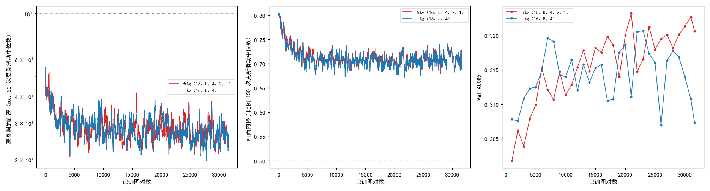
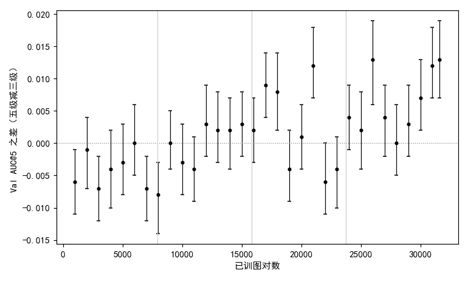

# 细化监督加到全部五级后，前一遍训练集 Val AUC@5 比三级略低，第三、四遍比三级高

**摘要**

到目前为止的强化学习训练里，RoMa 的细化只在尺度 16、8、4 三级上受监督，尺度 2、1 照常推理、不训练。当初不训这两级，是因为旧的高斯奖励在这两级上有三到四成像素拿不到信号，而且更早给全部细化级加噪声的一批训练全部发散；现在细化用的奖励在任何距离上都不为 0，训练里也有了 EMA 参照和画面外处理，这两条原因都已不成立。本文在 4 卡、学习率按线性规则放大的设置下，把监督加到全部五级细化，与只监督三级的对照各训 4 遍训练集（31628 对），每 1000 对在验证集上评测一次。两组都训满，没有触发提前停训，训练曲线几乎重合；五级每次更新比三级慢约 13%。五级与三级的 Val AUC@5 之差随训练推进由负转正：第一遍训练集内平均差 −0.004，7 个存档里 3 个五级更低；第三、四遍平均差 +0.002、+0.006，17 个存档里 7 个五级更高，没有一个五级更低。最后一个存档上五级 0.321、三级 0.307，五级高 0.013。不过三级自己相邻存档之间的起伏就有 0.01 左右，后半程的差有一部分来自三级的几个低点；每组只有一个种子。

**引言**

我们在尝试不用标注、用强化学习训练 RoMa 做月球光学图与 SAR 图的配准。RoMa 先在粗网格上为光学图的每个格子找 SAR 图上的对应位置（粗匹配），再由一串细化层逐级修正：尺度 16、8、4、2、1 各有一个细化层，读入上一级给出的对应位置和这一尺度的图像特征，输出一个位移，把对应位置往更准的方向挪一点；尺度数越小，网格越细，最后一级（尺度 1）直接给出每个像素的对应位置。训练时每一步先用 EMA 参照（参数按滑动平均更新的那份模型）正常推理一次，拟合出一个仿射变换作为参照；粗匹配和受监督的细化级各自在自己的输出周围抽若干个位置，离参照仿射给出的位置越近得分越高，再按策略梯度更新。

到目前为止，受监督的细化级只有尺度 16、8、4。不训尺度 2、1 有两条原因。一是此前一次逐级检查奖励信号的诊断发现，当时的高斯奖励用单精度算时，在尺度 2、1 上有三到四成像素的奖励下溢成 0，拿不到信号。二是更早一批给全部细化级加噪声的五种设置全部发散，但那时整条细化链一起抽签、用高斯奖励，没有 EMA 参照，也没有对画面外格子的处理。现在细化的奖励改成了柯西形式（1/(1 + ½(d/s)²)，d 为抽到的位置离参照的距离，s 为这一级的尺度），在任何距离上都不为 0；训练里也有了 EMA 参照和画面外处理。两条原因都已不再成立，但尺度 2、1 加上监督以后训练会怎样、结果会不会变好，还没有试过。

本文把监督加到全部五级细化，尺度 2、1 的做法与其他三级完全相同，再训一组只监督三级的对照，比较两者在验证集上的配准精度。需要对照是因为这次的学习率和训练长度都是新的，没有现成的三级运行可比。

**方法**

*训练设置。* 两组都沿用此前 4 卡运行的配置：粗匹配的抽签与奖励同前，细化各级逐级局部抽签（每级从正常推理时这一级的输出周围抽 8 次，不往下一级传），柯西奖励，画面外处理，可信度一起学，难版扰动，DINOv2 每块 qkv 加 LoRA（r 8），VGG 放开，从原始 RoMa 开始，种子 0。在一台机器的 4 张 V100 上数据并行，每次更新 4 对图。学习率按单卡基准 5e-5 线性放大 4 倍，主学习率 2e-4；LoRA 学习率单卡基准 1e-4，放大到 4e-4；细化层和 VGG 是主学习率的 0.47 倍。EMA 参照的 τ = 0.999⁴ ≈ 0.996（Busbridge et al. 2023，*How to Scale Your EMA*），按图对数仍记住约 1000 对。warmup 500 对，之后学习率恒定。训练集训 4 遍，共 31628 对（7907 次更新），每 1000 对存档。

*两组的区别。* 两组只差受监督的细化级：五级为尺度 16、8、4、2、1，三级为尺度 16、8、4（此前所有运行的做法）。细化损失系数两组都是 4.2。这个系数是为了让粗匹配和细化在共用参数（DINOv2 的 LoRA 和尺度 16 的投影层）上梯度大致相当；只有尺度 16 的细化梯度会到达这些参数，尺度 2、1 的梯度只回到它们自己的细化层和 VGG，所以加上这两级不改变这个比例。

*开跑前的核对。* 在一张 3090 上用同一对训练图，单卡连续做 12 次完整的更新，量每次更新的耗时与显存峰值，并在第一次更新时记下各级细化层收到的梯度大小。

*提前停与评测。* 提前停同此前的 4 卡运行：离参照的距离（粗匹配抽到的位置离参照仿射给出的位置的平均距离）的 50 次更新滑动中位数超过 100 px，或画面内格子比例（参照仿射把格子中心映射到 SAR 画面内、且不在补零区的格子所占比例）的滑动中位数低于 0.5，就停训。每个存档在不加扰动的验证集（652 对）上评测，口径同前：配准误差是估计的仿射和标注的仿射把图块 4 个角映射到的位置之间的平均距离，没有输出仿射的图对误差记为无穷；AUC@5 是"误差不超过 x 像素的图对比例"在 x 从 0 到 5 像素上的面积除以 5。不评 Test。

*比较。* 每个存档上五级减三级的 Val AUC@5 之差，用配对自助法估 95% 区间：在同一批验证图对上有放回地重抽 2000 次，取差的 2.5% 和 97.5% 分位。为了看趋势，按训练集遍数把存档分成四段（每遍 7907 对），每段报两组的平均 AUC@5、平均差，以及区间整个在 0 以上、整个在 0 以下的存档数。表和图由实验目录里的出表脚本生成。

**结果**

*尺度 2、1 的细化层在五级时收到梯度，五级每次更新比三级慢约一成，显存不变。* 开跑前的单卡核对里，五级的尺度 2、1 细化层梯度范数为 0.34、0.36（尺度 8、4 为 3.5、1.5），三级时这两级没有梯度；每次更新五级 0.83 s、三级 0.75 s，显存峰值都是 12.2 GB。正式训练在 4 张 V100 上，每次更新的中位耗时五级 0.95 s、三级 0.84 s，训满 7907 次更新分别用了 2 小时 11 分和 1 小时 57 分。

*两组都训满 4 遍，没有越过提前停的判据，训练曲线几乎重合。* 图 1 左、中。离参照距离的滑动中位数最高五级 55 px、三级 56 px，画面内格子比例的滑动中位数最低 0.68、0.67，离判据都远；两组的曲线在整个训练过程中相互交叠。

图 1：五级和三级都没越线，训练曲线几乎重合；Val AUC@5 在后半程五级多在三级之上。左：离参照的距离，对数轴；中：画面内格子比例；左、中两幅为 50 次更新的滑动中位数，横虚线为判据。右：各存档的 Val AUC@5。横轴都是已训图对数。

*五级与三级之差随训练推进由负转正。* 表 1、图 2。第一遍训练集内，五级平均比三级低 0.004，7 个存档里 3 个五级更低，例如 3000 对时五级比三级低 0.007（95% 区间 −0.012 到 −0.002，换一批验证图大概率仍是三级高）。第二遍平均差 −0.001，只有 8000 对一处五级更低。第三遍平均差 +0.002，第四遍 +0.006；这两遍 17 个存档里有 7 个五级更高，没有一个五级更低（22000 对五级低 0.006，区间 −0.011 到 −0.000，上端恰在 0）。最后一个存档（31628 对）五级 0.321、三级 0.307，五级高 0.013（95% 区间 +0.007 到 +0.019，换一批验证图大概率仍是五级高）。两组配准误差的中位数都在 3.3–3.4 px 之间，差别不超过 0.1 px。

表 1：按训练集遍数分段，两组的平均 Val AUC@5、五级减三级的平均差，以及 95% 区间整个在 0 以上 / 以下的存档数。逐存档的数值见图 2。

| 训练集第几遍 | 存档数 | 五级 | 三级 | 平均差 | 五级更高 / 更低的存档 |
|---|---|---|---|---|---|
| 1（1000–7000 对） | 7 | 0.308 | 0.312 | −0.004 | 0 / 3 |
| 2（8000–15000 对） | 8 | 0.315 | 0.315 | −0.001 | 0 / 1 |
| 3（16000–23000 对） | 8 | 0.318 | 0.316 | +0.002 | 3 / 0 |
| 4（24000–31628 对） | 9 | 0.320 | 0.314 | +0.006 | 4 / 0 |

图 2：五级减三级的 Val AUC@5 之差在前两遍多为负，后两遍多为正。竖线为配对自助法 95% 区间，灰色竖线分开训练集的四遍。

*后半程的差有一部分来自三级的低点；三级最后一个存档比自己的最高点低 0.013。* 图 1 右。五级的 Val AUC@5 在训练中大体缓慢上升，最高 0.323（21000 对和 31000 对），最后一个存档 0.321，比自己的最高点低 0.003（95% 区间 −0.008 到 +0.003，换一批验证图高低可能反过来）。三级在 7000 对已到 0.320，此后在 0.307 到 0.321 之间起伏，最高 0.321（22000、23000 对），最后一个存档 0.307，比最高点低 0.013（95% 区间 −0.020 到 −0.007，换一批验证图大概率仍是最高点更高）。差最大的几个存档（26000、31000、31628 对，+0.012 到 +0.013）都对应三级的低点（0.307–0.311）。

**讨论**

票里的问题是把监督加到尺度 2、1 以后会怎样。在这一组设置下，训练没有发散，训练曲线与三级几乎一样，每次更新多花约 13% 的时间。验证集上，第一遍训练集内五级略低于三级，之后差逐渐转正，第三、四遍平均高 0.002、0.006，没有一个存档五级明显更低；最后一个存档五级高 0.013。五级的 AUC@5 在后半程走得更稳，三级的起伏更大、末尾下降。

局限有三点。第一，两组各只有种子 0。三级自己相邻存档之间的起伏可达 0.01，和组间差同一量级；后半程的正差有一部分来自三级的几个低点，换一个种子三级的低点会不会落在别处，本文分不开。第二，配对自助法只反映换一批验证图带来的波动，不反映训练本身的随机性；各存档之间也不独立，"几个存档五级更高"不能当作独立的几次重复。第三，学习率 2e-4（单卡基准 5e-5）和训 4 遍都是新设置，结论只对这一设置成立。

还有两点没有解释。一是前一遍训练集内五级为什么偏低：尺度 2、1 的细化层一开始的更新会不会先让最细两级的输出变差，再慢慢变好，本文没有看这两级的输出离参照的距离随训练的变化（未检验；训练日志里记有正常推理时各级输出离参照的距离，可以直接画出来比较）。二是三级在后半程为什么起伏更大、末尾下降，是三级本身在长训练下的回落，还是这一个种子的偶然，本文的一个种子分不开（未检验）。
