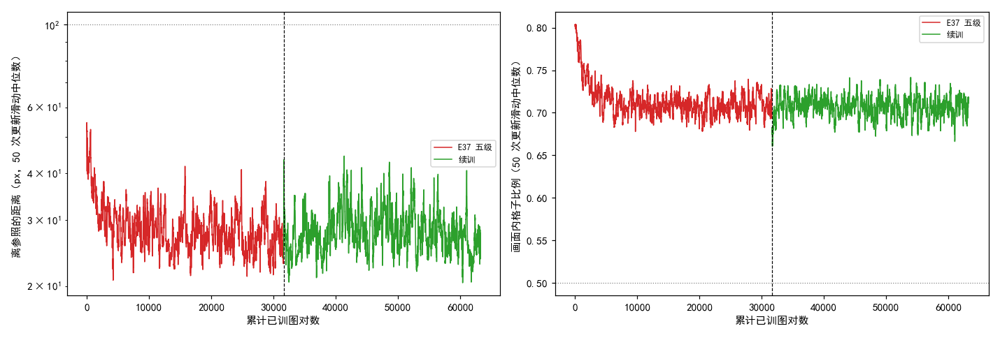
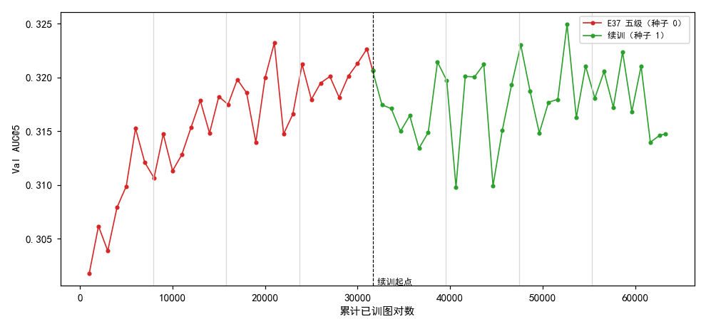
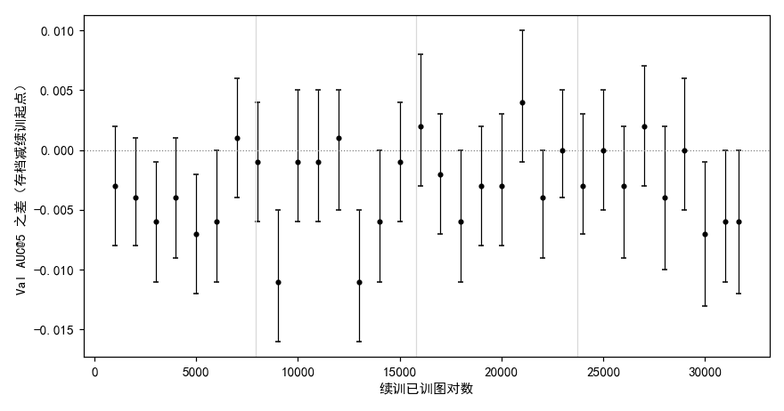

# 从五级监督训满 4 遍的模型再训 4 遍，Val AUC@5 没有继续上升，在 0.310–0.325 之间起伏

**摘要**

细化监督加到全部五级（尺度 16、8、4、2、1）的那次训练，训满 4 遍训练集时 Val AUC@5 的各遍平均值还在缓慢上升（0.308、0.315、0.318、0.320），看不出是否已经走平。本文从那次训练的最后一个存档（Val AUC@5 0.321）出发，配置不变、换种子 1，再训 4 遍（31628 对），每 1000 对在验证集上评测一次。续训没有触发提前停训，训练曲线与前 4 遍处在同一水平。续训的 32 个存档没有一个明显高于起点，最高 0.325，比起点高 0.004（95% 区间 −0.001 到 +0.010，换一批验证图高低可能反过来）；9 个明显低于起点，最低 0.310。按遍分段，续训四遍的平均 Val AUC@5 为 0.317、0.317、0.319、0.318，都低于起点，也低于前一次训练第四遍的 0.320；相邻存档之间的起伏比前 4 遍大。续训用的是重新开始的优化器和参照，起点不是真正的断点；只有一个种子。

**引言**

我们在尝试不用标注、用强化学习训练 RoMa 做月球光学图与 SAR 图的配准。RoMa 先在粗网格上为光学图的每个格子找 SAR 图上的对应位置（粗匹配），再由尺度 16、8、4、2、1 五个细化层逐级修正对应位置。训练时每一步先用 EMA 参照（参数按滑动平均更新的那份模型）正常推理一次，拟合出一个仿射变换作为参照；粗匹配和各级细化各自在自己的输出周围抽若干个位置，离参照仿射给出的位置越近得分越高，再按策略梯度更新。

上一次实验把细化监督加到了全部五级，训 4 遍训练集（31628 对）。它的 Val AUC@5 按遍平均为 0.308、0.315、0.318、0.320，第三遍到第四遍只涨了约 0.002；最高点 0.323 出现在 21000 对和 31000 对，相邻存档之间的起伏约 0.003–0.01。仅凭这条曲线，分不清它是还在缓慢上升，还是已经走平、只是在起伏。

本文从那次训练的最后一个存档出发再训 4 遍，看 Val AUC@5 接下来怎么走。

**方法**

*起点与配置。* 起点是上一次五级训练的最后一个存档（7907 次更新 = 31628 对）。装入时，存档里的 LoRA（DINOv2 每块 qkv 上的低秩增量）合并进 DINOv2 的权重，再挂一套从零开始的新 LoRA，所以起点的输出与存档相同。其余配置与上一次完全相同：五级细化都受监督，主学习率 2e-4、LoRA 4e-4、细化层与 VGG 为主学习率的 0.47 倍，EMA 参照的 τ = 0.996，warmup 后学习率恒定，一台机器的 4 张 V100 数据并行、每次更新 4 对，细化损失系数 4.2，提前停的判据也相同。只改了三处：种子取 1，避免图对顺序与上一次的第一遍重复；再训 4 遍（31628 对 = 7907 次更新），每 1000 对存档；起点也存一份并评测，作为续训的零点。

*与真正接着训的区别。* 上一次没有保存优化器状态，所以续训时 AdamW 的动量从零开始，EMA 参照也重置为起点本身。原来的参照比当前模型滞后约 1000 对，续训开头没有这段滞后，约 1000 对后恢复。warmup 仍为 500 对，用来压住动量清零后开头几十步步长不准的更新。

*评测与比较。* 每个存档在不加扰动的验证集（652 对）上评测，口径同前：配准误差是估计的仿射和标注的仿射把图块 4 个角映射到的位置之间的平均距离，没有输出仿射的图对误差记为无穷；AUC@5 是"误差不超过 x 像素的图对比例"在 x 从 0 到 5 像素上的面积除以 5。不评 Test。每个续训存档与起点比，用配对自助法估 95% 区间：在同一批验证图对上有放回地重抽 2000 次，取 AUC@5 之差的 2.5% 和 97.5% 分位。按遍分段时，每遍 7907 对，续训的四遍记为第 5–8 遍，不含起点。表和图由实验目录里的出表脚本生成。

*一次作废的启动。* 第一次启动时，起点那份存档评出的 Val AUC@5 是 0.211，与上一次的 0.321 对不上。原因是 RoMa 把 DINOv2 放在列表里，它的权重不在模型的参数字典中，存档只保存当次训练挂上的 LoRA；起点合并进 DINOv2 的那份 LoRA 在存档时丢了，评测时 DINOv2 回到原始权重。训练本身从正确的起点出发，但存下的每个存档评测时都缺了起点的改动。修正后，存档另外记下起点已经合并的 LoRA，评测装入时按同样的顺序先合并它们；此前没有别的实验从带 LoRA 的存档起步，不影响已有结果。第一次启动停在约第 1400 次更新，产物已删，本文的结果全部来自修正后的第二次启动。

**结果**

*起点存档的验证集结果与上一次的最后一个存档逐对相同。* 续训起点评出的 Val AUC@5 为 0.321，652 对图的配准误差与上一次最后一个存档逐对相同，装入无误。

*续训训满 4 遍，没有越过提前停的判据，训练曲线与前 4 遍处在同一水平。* 图 1。离参照距离（粗匹配抽到的位置离参照仿射给出的位置的平均距离）的 50 次更新滑动中位数，续训中最高 44 px，前 4 遍后段约 25–30 px，续训的中段多在 30–40 px 之间；画面内格子比例（参照仿射把格子中心映射到 SAR 画面内、且不在补零区的格子所占比例）的滑动中位数最低 0.66，续训开头有一个短暂的下探，之后回到约 0.70–0.72，与前 4 遍相同。两个量都离判据（100 px、0.5）很远。每次更新的中位耗时 0.82 s，训满用了 1 小时 51 分。

图 1：续训没有越过提前停的判据，训练曲线与前 4 遍处在同一水平。左：离参照的距离，对数轴；右：画面内格子比例；都是 50 次更新的滑动中位数，横点线为判据，竖虚线为续训起点。横轴为累计已训图对数。

*续训后 Val AUC@5 没有超过起点，各遍平均都低于起点。* 图 2、图 3、表 1。续训的头两个存档（1000、2000 对）比起点低 0.003、0.004（95% 区间 −0.008 到 +0.002、−0.008 到 +0.001，换一批验证图高低可能反过来），但之后第一遍里仍有三个存档明显更低（3000、5000、6000 对，低 0.006–0.007），没有在 1000 对左右回升。整个续训的 32 个存档里，没有一个的区间整个在起点之上，9 个整个在起点之下。最高的存档在续训 21000 对，0.325，比起点高 0.004（95% 区间 −0.001 到 +0.010，换一批验证图高低可能反过来）；最低的两个在 9000 和 13000 对，都是 0.310，比起点低 0.011（95% 区间 −0.016 到 −0.005，换一批验证图大概率仍比起点低）。按遍平均，续训四遍为 0.317、0.317、0.319、0.318，比起点低 0.001–0.004，也都低于上一次第四遍的 0.320。最后一个存档 0.315，比起点低 0.006（95% 区间 −0.012 到 0.000，上端恰在 0），比续训的最高点低 0.010（95% 区间 −0.016 到 −0.005，换一批验证图大概率仍是最高点更高）。配准误差的中位数在整个续训中保持在 3.25–3.43 px。

图 2：续训后的 Val AUC@5 在起点附近起伏，没有继续上升。红：上一次五级训练（种子 0）；绿：续训（种子 1）；竖虚线为续训起点，浅灰竖线分开训练集的各遍。横轴为累计已训图对数。

图 3：续训的 32 个存档没有一个明显高于起点，9 个明显低于起点。纵轴为存档减起点的 Val AUC@5 之差，竖线为配对自助法 95% 区间，浅灰竖线分开续训的四遍。

表 1：按遍分段的 Val AUC@5。第 1–4 遍为上一次五级训练，第 5–8 遍为续训；最后一列为区间整个在起点之上 / 之下的存档数（只对续训）。

| 训练集第几遍 | 存档数 | 平均 | 最高 | 最低 | 高于 / 低于起点的存档 |
|---|---|---|---|---|---|
| 1（1000–7000 对） | 7 | 0.308 | 0.315 | 0.302 | — |
| 2（8000–15000 对） | 8 | 0.315 | 0.318 | 0.311 | — |
| 3（16000–23000 对） | 8 | 0.318 | 0.323 | 0.314 | — |
| 4（24000–31628 对） | 9 | 0.320 | 0.323 | 0.318 | — |
| 5（续训 1000–7000 对） | 7 | 0.317 | 0.321 | 0.313 | 0 / 3 |
| 6（续训 8000–15000 对） | 8 | 0.317 | 0.321 | 0.310 | 0 / 3 |
| 7（续训 16000–23000 对） | 8 | 0.319 | 0.325 | 0.315 | 0 / 1 |
| 8（续训 24000–31628 对） | 9 | 0.318 | 0.322 | 0.314 | 0 / 2 |

*续训中相邻存档之间的起伏比前 4 遍大。* 图 2。相邻存档 Val AUC@5 之差的标准差，续训为 0.005，上一次第二到第四遍为 0.003。上一次第四遍的 9 个存档落在 0.318–0.323 之间，续训第八遍落在 0.314–0.322 之间，续训全程落在 0.310–0.325 之间。

**讨论**

票里的问题是 Val AUC@5 在训满 4 遍之后是继续缓慢上升，还是已经走平。在这一组设置下，再训 4 遍没有让 Val AUC@5 超过起点：32 个存档没有一个明显更高，各遍平均比起点低 0.001–0.004，在 0.310–0.325 之间起伏，起伏比前 4 遍大。至于这算是"已经走平"还是"续训方式带来的扰动"，本文的数据分不开。

局限有三点。第一，起点不是真正的断点：优化器动量清零、EMA 参照重置、换了种子，续训的头一遍与"接着训"的差别本文没有直接对照。第二，只有一个种子；配对自助法只反映换一批验证图带来的波动，不反映训练本身的随机性，各存档之间也不独立。第三，没有三级的同期续训，不能拿来比较五级和三级在更长训练下谁更好。

还有两点没有解释。一是续训第一遍为什么整体低于起点、而且没有在 1000 对左右回升：可能是优化器和参照重置后的扰动比预想的持续更久，也可能是起点本身恰好落在起伏的高处（起点 0.321 高于上一次第四遍的平均 0.320，但在那一遍的范围之内）。两者都未检验；用上一次训练中间某个存档（例如 24000 对）照同样方式续训一段，看头几千对是否同样先掉，可以区分前一种可能。二是续训中段离参照的距离比前 4 遍后段略高、存档间起伏变大，与换种子、参照重置有没有关系，本文没有检验。
