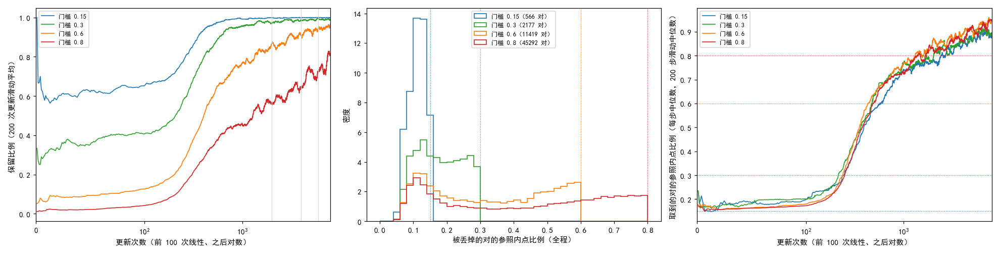
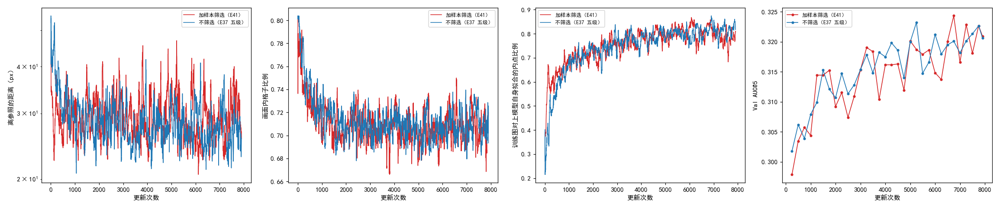
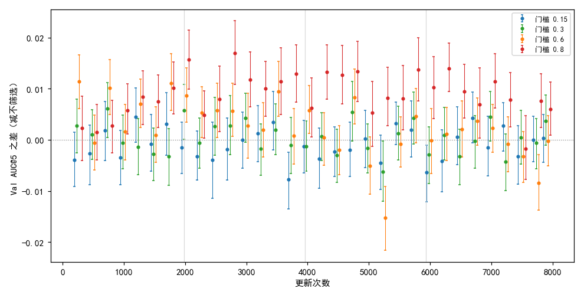
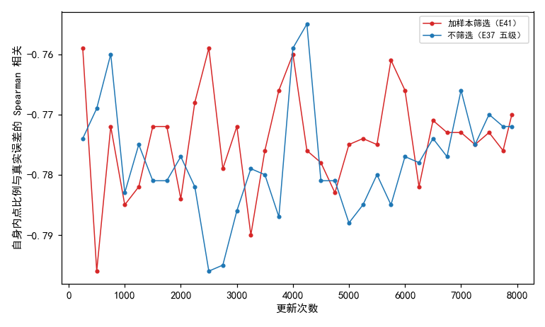
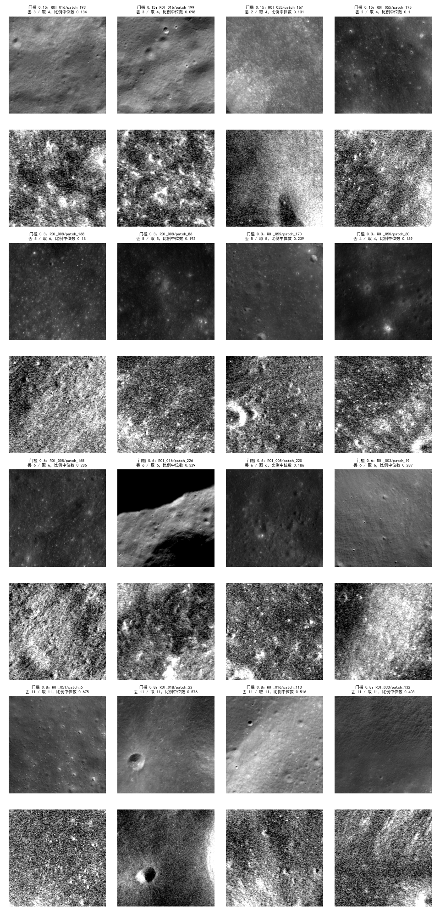

# 门槛 0.8 时筛选一直持续到训练结束，Val AUC@5 四段平均比不筛选高 0.006–0.011；门槛 0.15–0.6 在训练后半段与不筛选的平均差在 0.001 以内

**摘要**

现有的强化学习训练里，每一步的参照是模型自己的慢速平均副本推理一次、用 RANSAC 拟合出的仿射，参照错了模型照样会被拉过去；拟合时落在仿射 3 px 以内的点所占比例（内点比例）低，往往说明这个参照不可信。本文在目前最好的配置（细化五级都受监督、4 卡、7907 次更新）上加一道固定门槛的筛选：参照内点比例低于门槛的图对不学，换下一对，其余完全不变；门槛取 0.15、0.3、0.6、0.8 四个值，各训一次，与已有的不筛选结果逐存档比较。参照的内点比例在开训后几百次更新里整体升高，所以门槛越低，筛选越早停止起作用：门槛 0.15 第 300 次更新以后保留比例超过 0.95；0.3 在 0.93–0.99 之间；0.6 从 0.69 缓慢升到 0.93；0.8 到最后一段仍只有 0.69。全程丢掉的图对依次为 566、2177、11419、45292 对。验证集上，按训练进度分四段，门槛 0.8 的平均 Val AUC@5 比不筛选依次高 0.006、0.011、0.010、0.008，32 个存档中有 27 个高出的幅度大于换一批验证图带来的波动，最后一个存档 0.327 对 0.321（差 +0.006，95% 区间 +0.001 到 +0.011）；门槛 0.6 只在前两段高约 0.005；门槛 0.15、0.3 四段平均差都在 0.002 以内。模型在验证集上自身的内点比例与真实误差的 Spearman 相关，五次训练的各个存档都在 −0.72 到 −0.80 之间。门槛 0.8 的一次训练用了 3.35 小时，不筛选的 2.16 小时。单种子，对照不重跑。

**引言**

我们在用强化学习、不用标注训练 RoMa 做月球光学图与 SAR 图的配准。模型对一对图输出两图之间的稠密对应，从中按可信度抽一批点对，再用 RANSAC 拟合成一个仿射，把光学图的像素坐标映射到 SAR 图上。训练时每一步，模型的一份慢速平均副本（参数按滑动平均缓慢跟着模型走，下称参照模型）先对这对图正常推理一次，抽 5000 个点、用 3 px 的 RANSAC 阈值拟合出一个仿射当参照；模型自己的粗匹配和五级细化各自在输出周围抽若干个位置，离参照仿射给出的位置越近得分越高，再按策略梯度更新。

这样做的前提是参照大体是对的。可参照只是模型自己的一次推理，它错了的时候，模型照样会被拉向这个错的仿射。拟合时有多少点落在拟合出的仿射 3 px 以内，即内点比例，是一个现成的可信度读数：内点比例低，说明模型自己的点对彼此对不上，这时拟合出的仿射多半不可信。伪标签那条路线用过这个读数，按内点数只留前一半的图对来学，在 LoFTR 上比全用高约 0.006，在 RoMa 上基本持平。无标注训练大语言模型的 SRT（arXiv 2505.21444，附录 I.7）也有类似做法：一道题的 32 个回答里，多数答案所占比例低于 60% 就丢掉这道题，再补抽新题凑满一批。

现有训练对每一对图都学，包括参照内点比例很低的那些。第一次尝试把门槛定在训练起点内点比例的中位数 0.15，结果参照的内点比例在开训后几百次更新里就整体升到门槛以上，此后筛选几乎不起作用，只回答了“筛选只在开头起作用”时的情况。本文再取三个更高的固定门槛 0.3、0.6、0.8，让筛选分别主要作用在训练前期、延续到中期、贯穿全程，与已有的不筛选结果在验证集上逐存档比较；同时记录筛选本身随训练怎样变化、多花了多少时间，以及内点比例这个读数在训练后的模型上还能不能反映对错。

**方法**

*训练设置。* 除筛选外，四个门槛与此前细化五级都受监督的那次训练（E37 的五级组）完全相同：从原始 RoMa 起训，DINOv2 每块 qkv 加 LoRA（r 8），VGG 放开；粗匹配抽锚点，细化五级各自在输出周围局部抽签，奖励按离参照仿射的距离给；参照模型的滑动平均系数 τ = 0.996；一台机器上 4 张 V100 数据并行，每次更新每张卡一对图；主学习率 2e-4、LoRA 学习率 4e-4，warmup 125 次更新后恒定；难版训练扰动（SAR 上平移在半径 128 px 的圆盘内、旋转 ±20°、缩放 ±20%，另加随机擦除）；种子 0；共 7907 次更新，每 250 次更新存档。提前停的判据也照旧（离参照的距离或画面内格子比例的滑动中位数越线就停），五次训练都没有触发。对照直接用 E37 五级组已有的逐存档结果，不重跑；它也在同一台机器的 4 张 V100 上训练。四个门槛的训练都在这台机器上依次进行。

*筛选。* 每张卡按原来的数据顺序取下一对图，照训练时的扰动处理后，先由参照模型推理、拟合参照仿射（5000 个点，RANSAC 3 px），得到参照内点比例 = 内点数 ÷ 5000，拟合失败记 0。比例不低于门槛，这对图照常抽签、打分、参与这一步更新，参照仿射直接沿用刚才这次拟合；低于门槛就丢掉，不抽签，接着取下一对，直到这张卡取到一对过门槛的。四张卡都有了一对，做这一步更新，所以无论门槛多高，每次更新学的都是 4 对、全程都学 31628 对次。一张卡的数据取完一遍，就按原规则重新打乱进入下一遍；门槛越高，同样 7907 次更新里取到的对越多、过的遍数越多。因为各卡丢掉的对数不同，各卡进入下一遍的时刻会错开，此后同一步里两张卡可能取到同一对图。标注只用于评测，不参与筛选。保留比例 = 过门槛的对数 ÷ 取到的对数。每取到一对图都记下第几次更新、哪一对、参照内点比例、学还是丢。

*门槛。* 0.15 是训练起点（原始 RoMa，也是参照模型的起点）上参照内点比例的中位数四舍五入到 0.05：从训练集里用固定种子随机取 2000 对，完全按训练时的路径（同一份配置建模型和训练集，同样的扰动，调用训练中筛选所用的同一个函数）推理、拟合。0.3、0.6、0.8 按门槛 0.15 那次训练各阶段取到的对里、内点比例不低于这个值的比例选出，事前估计 0.3 主要在前期起作用，0.6 延续到中期，0.8 全程都在拦。门槛全程不变。

*评测。* 每个存档在不加扰动的验证集（652 对有标注）上评测，口径同此前：配准误差是光学图上的标注点经估计的仿射映射后到 SAR 图上对应标注点的平均距离，失败记无穷；AUC@x 是“误差不超过 t 像素的图对比例”在 t 从 0 到 x 像素上的面积除以 x；SR@x 是误差不超过 x 像素的图对比例。与对照同一存档位置的 AUC@5 之差用配对自助法估 95% 区间：在同一批 652 对上有放回地重抽 2000 次，取差的 2.5% 与 97.5% 分位。为了看趋势，按更新次数把存档分成四段，每段 1977 次更新，与“训练集一遍”的长度相同。

*评测用的卡。* 存档原则上在 RTX 3090 上评测，3090 被别人占满时改在 V100 上评测。不筛选的 32 个存档有 30 个在 RTX 3090 上、2 个在 V100 上（第 7250、7500 次更新）；门槛 0.15 有 23 个在 RTX 3090、9 个在 V100；0.3 为 21 / 11；0.6 为 15 / 17；0.8 为 11 / 21。每个存档用的卡在表 5 中标出。此前对同一类模型核对过，换这两种卡评测，单对误差平均差 0.20 px，Val AUC@5 差 0.0001（E40）。

*模型自身的内点比例。* 为了看筛选所依赖的读数在训练后还能不能反映对错，每个存档在验证集上另算一个量：评测时保存下来的点对（10000 个点中按可信度取前 2000 个）里，离这对图估计的仿射不超过 3 px 的比例，估计失败记 0；再算它与真实配准误差的 Spearman 秩相关，负得越多，说明内点比例越高的图对误差越小。这批点对和训练中筛选用的 5000 个点不是同一批，阈值同为 3 px。

*开销。* 训练时间取开训到最后一个存档写出的时间；每次更新的耗时含被丢掉的对的参照推理。前 500 次更新单独统计，因为丢掉的对集中在这一段。

**结果**

*训练起点上，四个门槛能过的图对依次约为一半、四分之一强、7%、1%。* 表 1。2000 对里没有一对拟合失败；分布右偏，中位数以下集中在 0.07–0.15 之间，上四分位数 0.33，最高 5% 在 0.65 以上。按这 2000 对，门槛 0.15、0.3、0.6、0.8 下能过的比例分别为 51.6%、28.0%、6.7%、1.3%。

表 1：训练起点（原始 RoMa）在训练集随机 2000 对上的参照内点比例分布（按训练时的扰动与参照拟合）。

| 分位 | 5% | 10% | 25% | 50% | 75% | 90% | 95% | 均值 |
|---|---|---|---|---|---|---|---|---|
| 参照内点比例 | 0.074 | 0.084 | 0.107 | 0.155 | 0.331 | 0.525 | 0.645 | 0.239 |

*参照内点比例在四次训练里都以同样的速度升高，门槛越高，筛选起作用的时间越长。* 表 2、图 1。四次训练取到的对的参照内点比例几乎走同一条曲线：前 100 次更新中位数 0.17–0.19，第 301–500 次 0.60–0.62，最后一段 0.89–0.93（图 1 右）。保留比例因此都随训练升高，但停在不同的高度：门槛 0.15 第 300 次更新以后超过 0.95；0.3 第 500 次以后在 0.93–0.99 之间；0.6 从第 501–1000 次的 0.69 升到最后一段的 0.93；0.8 从 0.38 升到 0.69，到训练结束也没有接近 1。被丢掉的对的内点比例按定义都在门槛以下；门槛 0.6、0.8 丢掉的对在门槛以下分布得较散（图 1 中），后期被丢掉的对的中位数分别约为 0.49、0.66。五次训练里没有一对被丢掉的对是拟合失败。

表 2：按更新次数分段的保留比例，括号内为这一段平均每次更新四张卡共取到的对数（不筛选为 4）。

| 更新次数 | 门槛 0.15 | 门槛 0.3 | 门槛 0.6 | 门槛 0.8 |
|---|---|---|---|---|
| 1–100 | 0.60（6.7） | 0.33（12.1） | 0.09（45.6） | 0.02（172.8） |
| 101–300 | 0.81（5.0） | 0.59（6.7） | 0.28（14.4） | 0.13（29.8） |
| 301–500 | 0.95（4.2） | 0.82（4.9） | 0.53（7.5） | 0.29（13.9） |
| 501–1000 | 0.99（4.0） | 0.93（4.3） | 0.69（5.8） | 0.38（10.6） |
| 1001–2000 | 1.00（4.0） | 0.97（4.1） | 0.79（5.1） | 0.47（8.5） |
| 2001–4000 | 1.00（4.0） | 0.98（4.1） | 0.86（4.6） | 0.56（7.2） |
| 4001–7907 | 1.00（4.0） | 0.99（4.1） | 0.93（4.3） | 0.69（5.8） |

图 1：门槛越高，保留比例越晚接近 1；门槛 0.8 到训练结束仍在 0.7 左右。左：保留比例（200 次更新滑动平均），灰色竖线把更新次数分成四段；中：全程被丢掉的对的参照内点比例分布，虚线为各自的门槛；右：取到的全部对的参照内点比例（每步中位数的 200 步滑动中位数），虚线为门槛。左、右两图横轴前 100 次更新为线性、之后为对数。

*门槛越高，被筛掉、从没学到的图对越多。* 表 3。四次训练都取到了训练集全部 7907 对。门槛 0.8 全程取了 76920 对，相当于把训练集过了约 9.7 遍；7872 对至少被丢掉过一次，只有 35 对从没被丢掉，1361 对（17%）每次被取到都被丢掉，从头到尾没有学过。门槛 0.6 下每次都被丢掉的有 271 对，0.3 下 14 对，0.15 下没有。

表 3：每个门槛下，训练集 7907 对被筛选的情况。

| 门槛 | 取到的对数 | 丢掉的对数 | 至少丢过一次的对 | 从没丢过的对 | 每次都被丢掉的对 |
|---|---|---|---|---|---|
| 0.15 | 32194 | 566 | 548 | 7359 | 0 |
| 0.3 | 33805 | 2177 | 1812 | 6095 | 14 |
| 0.6 | 43047 | 11419 | 6514 | 1393 | 271 |
| 0.8 | 76920 | 45292 | 7872 | 35 | 1361 |

*训练曲线：离参照的距离与画面内格子比例五次训练走势相近，都离提前停的判据很远。* 图 2。门槛 0.6、0.8 在前约 1000 次更新里离参照的距离比其余三次低，之后五条曲线交织。训练图对上当前模型自身拟合的内点比例，门槛越高越高（门槛 0.8 全程约 0.9，不筛选从约 0.25 升到 0.8 上下）；这一量只在被学的对上记录，门槛越高，被学的对本身就是内点比例越高的那些，五条曲线不能直接比较。

图 2：五次训练的离参照距离、画面内格子比例走势相近；Val AUC@5 门槛 0.8 的一条从第 1000 次更新起位于其余四条之上。从左到右：离参照的距离（px，对数轴）、画面内格子比例、训练图对上当前模型自身拟合的内点比例（都是 50 次更新滑动中位数），以及各存档的 Val AUC@5。横轴都是更新次数。

*门槛 0.8 的 Val AUC@5 四段平均比不筛选高 0.006–0.011，门槛 0.6 只在前两段高约 0.005，门槛 0.15 和 0.3 四段都相差不到 0.002。* 表 4、表 5、图 3。门槛 0.8 的 32 个存档里，27 个比不筛选高、而且换一批验证图大概率仍是它更高（95% 区间两端都为正，下称明显更高；两端都为负称明显更低），没有一个明显更低；差最大的在第 2750 次更新，+0.017（+0.011 到 +0.023）；最后一个存档 0.327 对 0.321，差 +0.006（+0.001 到 +0.011，换一批验证图大概率仍是门槛 0.8 更高）；全程最高 0.333（第 4250 次更新），不筛选的最高 0.323。门槛 0.6 前两段 15 个存档里 9 个明显更高，后两段 17 个存档里 2 个明显更高、2 个明显更低（第 5250 次更新低 0.015，−0.022 到 −0.009；第 7750 次更新低 0.008，−0.014 到 −0.003）；最后一个存档 0.320，差 −0.000（−0.005 到 +0.005，高低可能反过来）。门槛 0.3 的 32 个存档里 2 个明显更高、1 个明显更低，最后一个存档 0.324，差 +0.004（−0.001 到 +0.009，高低可能反过来）。门槛 0.15 没有一个明显更高、2 个明显更低，最后一个存档 0.321，差 +0.000（−0.004 到 +0.005）。配准误差的中位数，门槛 0.8 的各存档在 3.21–3.44 px 之间，其余四次在 3.26–3.46 px 之间。各存档的 AUC@3、SR@3、SR@5、误差中位数见 `extra/data/val.csv`。

表 4：四个门槛加上不筛选的总表。前四列为各段的平均 Val AUC@5，括号内为减不筛选的平均差；最高点括号内为所在的更新次数；耗时为开训到最后一个存档的小时数。

| 门槛 | 第 1 段（250–1750） | 第 2 段（2000–3750） | 第 3 段（4000–5750） | 第 4 段（6000–7907） | 最后存档 | 最高点 | 全程丢掉的对数 | 耗时（h） |
|---|---|---|---|---|---|---|---|---|
| 0（不筛选） | 0.308 | 0.315 | 0.318 | 0.320 | 0.321 | 0.323（5250） | 0 | 2.16 |
| 0.15 | 0.308（−0.000） | 0.313（−0.002） | 0.317（−0.001） | 0.319（−0.001） | 0.321 | 0.324（6750） | 566 | 1.86 |
| 0.3 | 0.308（+0.000） | 0.316（+0.002） | 0.318（−0.000） | 0.320（−0.000） | 0.324 | 0.324（7907） | 2177 | 2.59 |
| 0.6 | 0.314（+0.006） | 0.320（+0.005） | 0.318（−0.001） | 0.320（−0.000） | 0.320 | 0.324（3500） | 11419 | 2.37 |
| 0.8 | 0.314（+0.006） | 0.326（+0.011） | 0.328（+0.010） | 0.328（+0.008） | 0.327 | 0.333（4250） | 45292 | 3.35 |

表 5：逐存档的 Val AUC@5，括号内为减不筛选同一存档位置的差与配对自助法 95% 区间。带 * 的存档在 V100 上评测，其余在 RTX 3090 上。

| 更新次数 | 不筛选 | 门槛 0.15 | 门槛 0.3 | 门槛 0.6 | 门槛 0.8 |
|---|---|---|---|---|---|
| 250 | 0.302 | 0.298（−0.004 [−0.009, +0.002]） | 0.304（+0.003 [−0.003, +0.008]） | 0.313（+0.011 [+0.006, +0.017]） | 0.304（+0.002 [−0.004, +0.009]） |
| 500 | 0.306 | 0.303（−0.003 [−0.009, +0.003]） | 0.307（+0.001 [−0.004, +0.006]） | 0.306（−0.001 [−0.006, +0.005]） | 0.308（+0.002 [−0.004, +0.007]） |
| 750 | 0.304 | 0.306（+0.002 [−0.004, +0.007]） | 0.310（+0.006 [+0.001, +0.011]） | 0.314（+0.010 [+0.005, +0.016]） | 0.307（+0.003 [−0.003, +0.008]） |
| 1000 | 0.308 | 0.304（−0.004 [−0.009, +0.002]） | 0.307（−0.001 [−0.006, +0.005]） | 0.309（+0.002 [−0.004, +0.007]） | 0.314（+0.006 [+0.001, +0.011]） |
| 1250 | 0.310 | 0.314（+0.004 [−0.001, +0.010]） | 0.308（−0.001 [−0.007, +0.004]） | 0.317（+0.007 [+0.002, +0.012]） | 0.318（+0.008 [+0.003, +0.013]） |
| 1500 | 0.315 | 0.314（−0.001 [−0.006, +0.005]） | 0.312（−0.003 [−0.008, +0.002]） | 0.316（+0.001 [−0.004, +0.006]） | 0.323（+0.007 [+0.002, +0.013]） |
| 1750 | 0.312 | 0.315（+0.003 [−0.003, +0.009]） | 0.309（−0.003 [−0.009, +0.002]） | 0.323（+0.011 [+0.006, +0.017]） | 0.322*（+0.010 [+0.005, +0.015]） |
| 2000 | 0.311 | 0.309（−0.002 [−0.007, +0.004]） | 0.316（+0.006 [+0.000, +0.011]） | 0.319（+0.009 [+0.004, +0.014]） | 0.326*（+0.016 [+0.010, +0.021]） |
| 2250 | 0.315 | 0.311（−0.003 [−0.008, +0.002]） | 0.314（−0.001 [−0.006, +0.004]） | 0.320（+0.005 [+0.001, +0.010]） | 0.320*（+0.005 [+0.000, +0.010]） |
| 2500 | 0.311 | 0.307（−0.004 [−0.011, +0.003]） | 0.314（+0.003 [−0.003, +0.008]） | 0.317（+0.006 [+0.000, +0.011]） | 0.319*（+0.008 [+0.002, +0.014]） |
| 2750 | 0.313 | 0.311（−0.002 [−0.008, +0.004]） | 0.316（+0.003 [−0.003, +0.009]） | 0.319（+0.006 [+0.001, +0.011]） | 0.330（+0.017 [+0.011, +0.023]） |
| 3000 | 0.315 | 0.315（−0.000 [−0.005, +0.005]） | 0.320（+0.004 [−0.001, +0.009]） | 0.318*（+0.003 [−0.004, +0.009]） | 0.327*（+0.012 [+0.006, +0.017]） |
| 3250 | 0.318 | 0.319（+0.001 [−0.004, +0.007]） | 0.316（−0.002 [−0.007, +0.003]） | 0.320（+0.002 [−0.003, +0.007]） | 0.328*（+0.010 [+0.005, +0.015]） |
| 3500 | 0.315 | 0.318（+0.004 [−0.002, +0.009]） | 0.317（+0.002 [−0.003, +0.007]） | 0.324*（+0.009 [+0.005, +0.015]） | 0.326*（+0.011 [+0.005, +0.018]） |
| 3750 | 0.318 | 0.310*（−0.008 [−0.013, −0.002]） | 0.317（−0.001 [−0.007, +0.004]） | 0.319*（+0.001 [−0.005, +0.006]） | 0.331*（+0.013 [+0.007, +0.019]） |
| 4000 | 0.317 | 0.316*（−0.001 [−0.006, +0.004]） | 0.316（−0.001 [−0.006, +0.004]） | 0.323*（+0.006 [+0.001, +0.011]） | 0.324（+0.006 [+0.001, +0.012]） |
| 4250 | 0.320 | 0.316（−0.004 [−0.009, +0.002]） | 0.321（+0.001 [−0.004, +0.005]） | 0.320*（+0.000 [−0.005, +0.005]） | 0.333*（+0.013 [+0.008, +0.019]） |
| 4500 | 0.319 | 0.316（−0.002 [−0.007, +0.003]） | 0.316（−0.003 [−0.008, +0.002]） | 0.317（−0.002 [−0.007, +0.003]） | 0.331*（+0.013 [+0.007, +0.018]） |
| 4750 | 0.314 | 0.312（−0.002 [−0.007, +0.004]） | 0.319（+0.005 [−0.000, +0.011]） | 0.322*（+0.008 [+0.003, +0.014]） | 0.327*（+0.013 [+0.007, +0.019]） |
| 5000 | 0.320 | 0.320*（+0.000 [−0.005, +0.006]） | 0.318（−0.002 [−0.006, +0.003]） | 0.315*（−0.005 [−0.011, +0.001]） | 0.325*（+0.005 [−0.001, +0.011]） |
| 5250 | 0.323 | 0.319*（−0.004 [−0.010, +0.001]） | 0.317*（−0.006 [−0.012, −0.000]） | 0.308*（−0.015 [−0.022, −0.009]） | 0.331（+0.008 [+0.003, +0.014]） |
| 5500 | 0.315 | 0.318（+0.003 [−0.001, +0.007]） | 0.316*（+0.001 [−0.004, +0.007]） | 0.314*（−0.001 [−0.005, +0.004]） | 0.323*（+0.008 [+0.002, +0.015]） |
| 5750 | 0.317 | 0.319（+0.002 [−0.003, +0.008]） | 0.321*（+0.004 [−0.001, +0.009]） | 0.321（+0.005 [−0.001, +0.010]） | 0.330*（+0.014 [+0.008, +0.020]） |
| 6000 | 0.321 | 0.315（−0.006 [−0.012, −0.001]） | 0.318*（−0.003 [−0.009, +0.003]） | 0.321*（−0.000 [−0.007, +0.006]） | 0.332*（+0.010 [+0.004, +0.016]） |
| 6250 | 0.318 | 0.314*（−0.004 [−0.010, +0.002]） | 0.319*（+0.001 [−0.004, +0.006]） | 0.319*（+0.001 [−0.004, +0.006]） | 0.332*（+0.014 [+0.009, +0.019]） |
| 6500 | 0.319 | 0.320*（+0.001 [−0.005, +0.006]） | 0.316*（−0.003 [−0.009, +0.002]） | 0.322*（+0.002 [−0.003, +0.008]） | 0.329（+0.009 [+0.004, +0.015]） |
| 6750 | 0.320 | 0.324（+0.004 [−0.001, +0.009]） | 0.320*（−0.000 [−0.006, +0.005]） | 0.324*（+0.004 [−0.001, +0.008]） | 0.327*（+0.007 [+0.000, +0.014]） |
| 7000 | 0.318 | 0.317（−0.002 [−0.007, +0.005]） | 0.323*（+0.004 [−0.000, +0.009]） | 0.320（+0.002 [−0.002, +0.007]） | 0.330*（+0.011 [+0.006, +0.017]） |
| 7250 | 0.320* | 0.323*（+0.003 [−0.002, +0.007]） | 0.316（−0.004 [−0.010, +0.001]） | 0.319*（−0.001 [−0.006, +0.004]） | 0.328*（+0.008 [+0.003, +0.013]） |
| 7500 | 0.321* | 0.318*（−0.003 [−0.009, +0.003]） | 0.322*（+0.000 [−0.005, +0.006]） | 0.318*（−0.003 [−0.008, +0.002]） | 0.320*（−0.002 [−0.008, +0.005]） |
| 7750 | 0.323 | 0.323（+0.000 [−0.004, +0.005]） | 0.322*（−0.001 [−0.006, +0.004]） | 0.314*（−0.008 [−0.014, −0.003]） | 0.330（+0.008 [+0.002, +0.013]） |
| 7907 | 0.321 | 0.321*（+0.000 [−0.004, +0.005]） | 0.324*（+0.004 [−0.001, +0.009]） | 0.320*（−0.000 [−0.005, +0.005]） | 0.327*（+0.006 [+0.001, +0.011]） |

图 3：门槛 0.8 的逐存档差（红）从第 1000 次更新起几乎都在 0 以上，其余三个门槛大多在 0 附近。纵轴为减不筛选的 Val AUC@5 之差，竖线为配对自助法 95% 区间；同一存档位置的四个点左右错开画。

*评测用的卡对这些差的影响，按已有核对要小一个量级，但没有在这些存档上逐一核对。* 门槛 0.8 与不筛选比较的存档里，门槛 0.8 一侧在 RTX 3090 上评测、不筛选也在 RTX 3090 上的 11 个，平均差 +0.007；门槛 0.8 一侧在 V100 上、不筛选在 RTX 3090 上的 19 个，平均差 +0.011。门槛 0.6 的这两组平均差分别为 +0.005（15 个）与 +0.000（15 个），不过 V100 那组多是训练后半段的存档。

*模型自身的内点比例与真实误差的相关，五次训练都在 −0.72 到 −0.80 之间。* 图 4。不筛选的 32 个存档在 −0.755 到 −0.796 之间，门槛 0.15 在 −0.759 到 −0.796，0.3 在 −0.740 到 −0.793，0.6 在 −0.723 到 −0.787，0.8 在 −0.740 到 −0.797；第 1 段各次的平均都约为 −0.78，第 4 段在 −0.76 到 −0.77 之间。同期验证集上自身内点比例的中位数五次训练都从 0.64–0.73 升到 0.86–0.89。也就是说，内点比例整体在升高，按它给图对排序与按真实误差排序的一致程度在各门槛之间差别不大。

图 4：五次训练各存档上，模型自身的内点比例与真实配准误差的 Spearman 相关都在 −0.72 到 −0.80 之间。

*门槛越高，被反复丢掉的对越多；门槛 0.8 下丢得最多的对每次被取到都被丢掉。* 图 5。门槛 0.15 下丢得最多的两对（ROI_016 的 patch_193 和 patch_199）在 4 次里被丢掉 3 次；门槛 0.3 下最多的一对（ROI_008/patch_168）6 次里丢了 5 次；门槛 0.6 下有 271 对每次被取到都被丢掉，取到次数最多的 6 次全丢；门槛 0.8 下有 1361 对每次都被丢掉，取到次数最多的那些 11 次全丢，被丢掉时的参照内点比例中位数在 0.22–0.68 之间。门槛 0.15–0.6 下丢得最多的 20 对多来自 ROI_008、ROI_016、ROI_025、ROI_055 等几个区域，门槛 0.8 的前 20 对分散在 14 个区域。图 5 里这些对的 SAR 图斑点噪声都很重；光学图多数起伏平缓、亮度均匀、撞击坑小而少，也有带清楚撞击坑的（如 ROI_018/patch_22），以及一半画面是黑色无数据区的（ROI_016/patch_226）。被丢掉次数相同的对很多，图 5 只画了各门槛按次数排序的前 4 对，完整的前 20 对见 `extra/data/most_discarded.csv`。

图 5：各门槛下被丢掉次数最多的 4 对（每个门槛两排：上排光学，下排 SAR，都是未加训练扰动的原图），标题为丢掉次数 / 取到次数，以及被丢掉时参照内点比例的中位数。

*门槛越高，开头几百次更新越慢；之后每次更新的耗时与门槛没有一致的关系。* 表 6。前 500 次更新，门槛 0.8 平均每次更新取 52 对，用了 0.90 小时，不筛选的用 0.15 小时；门槛 0.6 取 17.9 对、0.34 小时。第 500 次更新以后，各次每次更新耗时的中位数在 0.82–1.29 s 之间，但排序与门槛不一致：门槛 0.3 这段只多取约 2% 的对，中位数却是最慢的 1.29 s；门槛 0.6 多取约 15%，中位数 0.83 s。门槛 0.8 全程 3.35 小时，比不筛选多 1.19 小时。

表 6：训练开销。每次更新取到的对数为四张卡合计。

| 门槛 | 全程取到的对数 | 平均每次更新取到的对数 | 前 500 次：每次更新取到的对数 | 前 500 次：耗时（h） | 前 500 次：每次更新耗时中位数（s） | 第 500 次以后：每次更新耗时中位数（s） | 全程耗时（h） |
|---|---|---|---|---|---|---|---|
| 0（不筛选） | 31628 | 4.00 | 4.0 | 0.15 | 1.02 | 0.95 | 2.16 |
| 0.15 | 32194 | 4.07 | 5.0 | 0.14 | 0.86 | 0.82 | 1.86 |
| 0.3 | 33805 | 4.28 | 7.1 | 0.17 | 1.05 | 1.29 | 2.59 |
| 0.6 | 43047 | 5.44 | 17.9 | 0.34 | 1.63 | 0.83 | 2.37 |
| 0.8 | 76920 | 9.73 | 52.0 | 0.90 | 2.53 | 1.04 | 3.35 |

**讨论**

票里的问题是：参照内点比例低于固定门槛的对不学，在筛选作用于训练不同阶段时，Val 上和不筛选的同配置有什么不同。四个门槛的结果把这个问题分成了两种情况。门槛 0.15、0.3 的筛选在前约 500 次更新以后基本停止起作用，它们与不筛选在四段上的平均差都在 0.002 以内；门槛 0.6 的筛选延续到中后期、保留比例 0.7–0.9，前两段平均高约 0.005，后两段与不筛选相同；门槛 0.8 的筛选贯穿全程、到最后一段仍丢掉约 30% 的对，从第 1000 次更新起几乎每个存档都比不筛选高，四段平均高 0.006–0.011，全程最高点 0.333。也就是说，在这一组设置下，只有筛选一直持续的那个门槛，在整个训练过程中与不筛选拉开了差距。为什么会这样，本文的数据不能回答。

局限有五点。第一，每个门槛只有一个种子，对照也没有重跑；不筛选那次自身相邻存档之间的起伏约 0.01，与门槛 0.8 的平均差同一量级，只是门槛 0.8 的差在 32 个存档里有 31 个为正。第二，配对自助法只反映换一批验证图带来的波动，不反映训练本身的随机性；各存档之间也不独立。第三，各门槛的存档分别在两种卡上评测，比例不同，门槛 0.8 有 21 个在 V100 上，而对照几乎都在 RTX 3090 上；按已有核对换卡的影响约 0.0001，但没有在这些存档上逐一核对。第四，筛选同时改变了几件事：学哪些对、同样的更新次数里把训练集过了几遍（门槛 0.8 约 9.7 遍、不筛选 4 遍）、以及各卡的数据顺序，本文没有把它们分开。第五，只评了验证集原始档，没有评难版和 Test。

还有几点没有解释，各附一个能区分的检查（都未检验）。一是门槛 0.8 高出的部分来自哪里：是因为只学参照可信的对，还是因为取的对更多、数据顺序不同，或只是这一个种子的运气。可以换种子重跑门槛 0.8 与不筛选各一次，看差是否保持；再跑一次按门槛 0.8 每段的保留比例随机丢对、不看内点比例的对照，看高出的部分是否还在。二是门槛 0.8 下 1361 对从没学过，这些对在验证集上对应的区域是否因此变差：可以按 ROI 拆开验证集，比较门槛 0.8 与不筛选在各 ROI 上的差。三是评测用的卡：在 RTX 3090 上重评门槛 0.8 在 V100 上评的 21 个存档，就能排除换卡的影响。四是门槛 0.6 第 5250、7750 次更新两个存档明显低于不筛选，前后相邻存档都没有，本文看不出原因；换种子重跑可以看这类单点低值是否随机出现。五是每次更新的耗时在第 500 次以后与门槛对不上（门槛 0.3 最慢、门槛 0.15 比不筛选还快），按理筛选只会多出被丢掉的对的参照推理；可以在同一台机器的同样 4 张卡上把几种配置各跑几百次更新、交替进行，比较耗时，看这是否来自机器上同时运行的其他任务。
