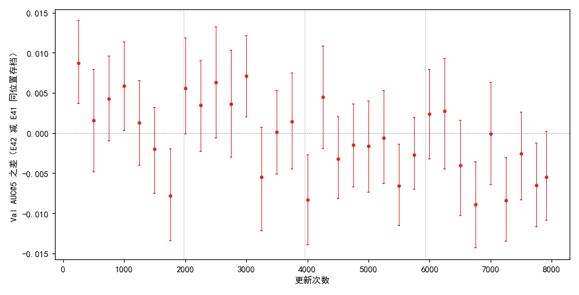
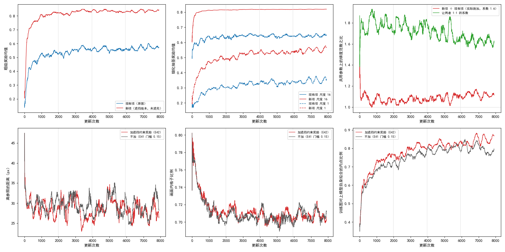
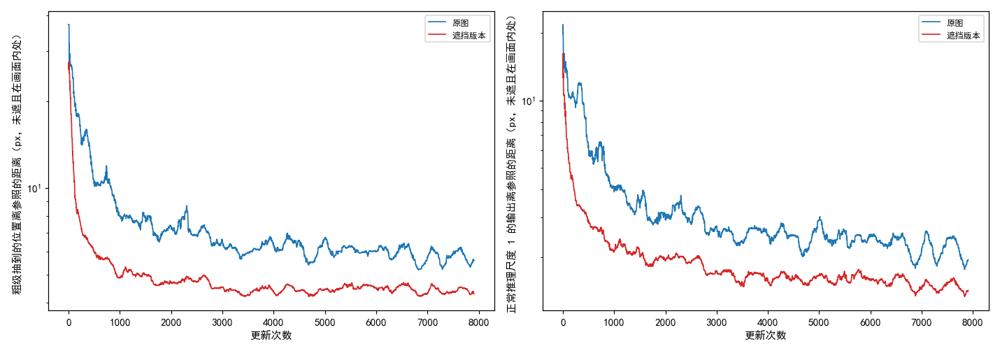

# 加遮挡约束奖励后，Val AUC@5 前半程比不加平均高约 0.002–0.003、后半程低约 0.003，最后存档低 0.006；遮挡版本上的对应全程比原图更靠近参照

**摘要**

现有的强化学习训练只要求模型的对应和它自己的慢速平均副本给出的参照仿射一致。此前的测试时检验里，在两张图的同一地面位置遮住一块、多次推理取平均，比只换随机种子取平均高 0.003，是几项约束里唯一高于对照的。本文把遮挡做成训练中的第二项奖励，叠加在现有奖励旁：每一步给每对图另做一个遮挡版本（光学图上随机一块约 20% 面积的正方形，SAR 上遮住它经参照仿射映过去的四边形，被遮处填噪声），模型在遮挡版本上照样抽签，在没遮住的地方按离原图参照仿射的距离打分；新项的系数按开训前 50 次更新里两项梯度大小 1:1 定为 1.6。其余设置与此前的样本筛选实验（参照内点比例门槛 0.15，下称不加）完全相同，种子 0，训练 7907 次更新，与不加的已有结果逐存档比较。票里的停止规则（第 1 遍训练集的 8 个存档全部低于不加、或平均低 0.01 以上就停）没有触发，训满了 4 遍。按训练进度分四段，加遮挡奖励的平均 Val AUC@5 减不加依次为 +0.0017、+0.0028、−0.0025、−0.0034；32 个存档里 3 个明显更高、6 个明显更低，明显更低的都在第 1750 次更新及以后；最后一个存档 0.315 对 0.321，差 −0.006（−0.011 到 +0.000）。训练中，在光学图没被遮住的格子上，遮挡版本抽到的位置离参照的距离全程比原图小，比值从开头的 0.44 升到最后一段的 0.76；这一差别在只量不学的 50 次更新里就已存在（0.87）。每次更新的耗时中位数是不加的 1.76 倍。单种子，对照不重跑。

**引言**

我们在用强化学习、不用标注训练 RoMa 做月球光学图与 SAR 图的配准。模型对一对图输出两图之间的稠密对应，从中按可信度抽一批点对，再用 RANSAC 拟合成一个仿射，把光学图的像素坐标映射到 SAR 图上。训练时每一步，模型的一份慢速平均副本（参数按滑动平均缓慢跟着模型走，下称参照模型）先对这对图正常推理一次、拟合出一个仿射当参照；模型自己的粗匹配和五级细化各自在输出周围抽若干个位置，离参照仿射给出的位置越近得分越高，再按策略梯度更新。这一项下称现有项。

现有项只要求模型和自己的慢速副本一致，不要求模型在输入有缺损时仍给出同样的对应。此前的测试时检验（E40）在两张图的同一地面位置遮住一块、推理多次再把结果平均，比只换随机种子推理多次再平均高 0.003（−0.000 到 +0.005）。这说明“遮住一部分后结果不变”可能是一个有用的约束，但只在测试时用过，没有放进训练。

本文把它放进训练：遮住一块之后，模型在没遮住的部分抽到的对应，要和原图上得到的参照仿射一致。训一次，看 Val 上和不加这一项的同配置有什么不同。这一项相当于“把遮挡后的图给模型，参照仍用原图的仿射”，和把遮挡当数据增强很接近；本文不另跑区分两者的实验。

**方法**

*训练设置。* 与此前样本筛选实验（E41）里参照内点比例门槛 0.15 的那次训练完全相同，只多一项奖励：从原始 RoMa 起训，DINOv2 每块 qkv 加 LoRA（r 8），VGG 放开；粗匹配抽锚点，细化五级（尺度 16、8、4、2、1）各自在输出周围局部抽签；参照模型的滑动平均系数 τ = 0.996；参照内点比例低于 0.15 的图对不学、换下一对；4 张卡数据并行，每次更新每张卡一对图；主学习率 2e-4、LoRA 学习率 4e-4，warmup 125 次更新后恒定；难版训练扰动；种子 0；共 7907 次更新（训练集 4 遍），每 250 次更新存档。坍缩判据照旧（离参照的距离或画面内格子比例的滑动中位数越线就停），本次没有触发。对照直接用 E41 门槛 0.15 已有的逐存档结果，不重跑；它在一台机器的 4 张 V100 上训练，本文的正式训练也在同型号的 4 张 V100 上。

*遮挡版本。* 每对图照常做扰动、筛选、参照推理和现有项，不改。然后同一对图另生成一个遮挡版本，位置每步重新随机抽：光学图（512 px 见方）上边长 229 px 的正方形（约 20% 面积），左上角在图内均匀抽；SAR 上遮住这个正方形经参照仿射映过去的四边形，SAR 因扰动移出画面而补零的区域不遮。被遮处填这张图自己全图均值、标准差的高斯噪声，截到 [0, 1]。照 E40 的做法。

*新项。* 当前模型在遮挡版本上照原图的方式抽签（粗级与细化五级），打分方式与现有项相同，参照用的是原图上算出的那个参照仿射；光学图上落在被遮处的格子和像素不打分。两项损失相加，新项乘系数 1.6。

*系数怎样定。* 从原始 RoMa 起，用同一配置但新项系数为 0（照算新项、量完梯度后撤掉，只按现有项更新）训 50 次更新，每次在两项共用的参数上量现有项与新项各自的梯度范数，取“现有项 ÷ 新项”的中位数 1.61（四分位 1.27–1.91，48 次有效），取两位有效数字 1.6，之后全程固定。两项梯度范数的中位数分别为 15.6 与 11.3。

*评测。* 每个存档在不加扰动的验证集（652 对有标注）上评测，口径同 E41：配准误差是光学图上的标注点经估计的仿射映射后到 SAR 图上对应标注点的平均距离；AUC@x 是“误差不超过 t 像素的图对比例”在 t 从 0 到 x 像素上的面积除以 x；SR@x 是误差不超过 x 像素的图对比例。与不加同一存档位置的 AUC@5 之差用配对自助法估 95% 区间：在同一批 652 对上有放回地重抽 2000 次，取差的 2.5% 与 97.5% 分位；区间两端都为正称明显更高，都为负称明显更低。按更新次数把存档分成四段，每段 1977 次更新，即训练集一遍。本文 32 个存档都在 RTX 3090 上评测；不加的 32 个里 23 个在 RTX 3090、9 个在 V100 上（表 2 中标出）。

*遮挡的影响怎样量。* 训练中每一步，只在光学图没被遮、且参照仿射映到 SAR 画面内的格子上，比较遮挡版本与原图：粗级抽到的位置离参照的平均距离，以及正常推理在尺度 1 的输出离参照的平均距离。两者用同一时刻的模型、同一批格子、同一个参照仿射。比值小于 1 表示遮挡版本更靠近参照。

*第一次训练。* 正式训练之前，同一配置在另一台机器（4 张 RTX 3090）上训过一次，训到第 2150 次更新左右时因共享存储故障中断。它的 8 个第 1 遍存档评完，用来执行票里的停止规则，没有触发；多卡训练不支持从存档续训，于是在 V100 上从头重训，正式结果都来自重训。两次训练同一种子、同一配置，第 1 遍 8 个存档的结果见表 3。

**结果**

*停止规则没有触发。* 第一次训练的 8 个第 1 遍存档，减不加的 AUC@5 差平均 +0.0035，8 个里 2 个为负；重训的同样 8 个平均 +0.0022，也是 2 个为负。两次都不满足“8 个全低”或“平均低 0.01 以上”，训满 4 遍。

*按段平均，前两段比不加高约 0.002–0.003，后两段低约 0.003；明显更低的存档都在第 1750 次更新及以后。* 表 1、表 2、图 1。32 个存档里 3 个明显更高（第 250、1000、3000 次更新），6 个明显更低（第 1750、4000、5500、6750、7250、7750 次更新）；后两段 17 个存档里 14 个低于不加。最后一个存档 0.315 对 0.321，差 −0.006（−0.011 到 +0.000，换一批验证图大概率仍是加遮挡奖励的更低，但也可能相等）。全程最高点 0.322（第 3000 次更新），不加的最高点 0.324（第 6750 次更新）。最后一个存档的其他指标：AUC@3 0.097 对 0.101，SR@3 0.399 对 0.422，SR@5 0.814 对 0.808，误差中位数 3.36 px 对 3.30 px。各存档的 AUC@3、SR@3、SR@5、误差中位数见 `extra/data/val.csv`。

表 1：按训练进度分四段的平均 Val AUC@5。差为加遮挡奖励减不加；明显更高 / 更低指 95% 区间两端同号的存档数。

| 段 | 存档 | 加遮挡奖励 | 不加 | 差 | 低于不加的存档 | 明显更高 | 明显更低 |
|---|---|---|---|---|---|---|---|
| 第 1 段 | 250–1750（7 个） | 0.310 | 0.308 | +0.0017 | 2 | 2 | 1 |
| 第 2 段 | 2000–3750（8 个） | 0.316 | 0.313 | +0.0028 | 1 | 1 | 0 |
| 第 3 段 | 4000–5750（8 个） | 0.315 | 0.317 | −0.0025 | 7 | 0 | 2 |
| 第 4 段 | 6000–7907（9 个） | 0.316 | 0.319 | −0.0034 | 7 | 0 | 3 |

表 2：逐存档的 Val AUC@5，括号内为加遮挡奖励减不加的差与配对自助法 95% 区间。带 * 的不加存档在 V100 上评测，其余都在 RTX 3090 上。

| 更新次数 | 加遮挡奖励 | 不加 | 差 [95% 区间] |
|---|---|---|---|
| 250 | 0.307 | 0.298 | +0.009 [+0.004, +0.014] |
| 500 | 0.305 | 0.304 | +0.002 [−0.005, +0.008] |
| 750 | 0.310 | 0.306 | +0.004 [−0.001, +0.010] |
| 1000 | 0.310 | 0.304 | +0.006 [+0.000, +0.011] |
| 1250 | 0.316 | 0.314 | +0.001 [−0.004, +0.007] |
| 1500 | 0.312 | 0.314 | −0.002 [−0.008, +0.003] |
| 1750 | 0.307 | 0.315 | −0.008 [−0.013, −0.002] |
| 2000 | 0.315 | 0.309 | +0.006 [−0.000, +0.012] |
| 2250 | 0.315 | 0.312 | +0.003 [−0.002, +0.009] |
| 2500 | 0.314 | 0.307 | +0.006 [−0.001, +0.013] |
| 2750 | 0.315 | 0.311 | +0.004 [−0.003, +0.010] |
| 3000 | 0.322 | 0.315 | +0.007 [+0.002, +0.012] |
| 3250 | 0.314 | 0.319 | −0.006 [−0.012, +0.001] |
| 3500 | 0.318 | 0.318 | +0.000 [−0.005, +0.005] |
| 3750 | 0.312 | 0.310* | +0.001 [−0.005, +0.008] |
| 4000 | 0.308 | 0.316* | −0.008 [−0.014, −0.003] |
| 4250 | 0.321 | 0.316 | +0.005 [−0.002, +0.011] |
| 4500 | 0.313 | 0.316 | −0.003 [−0.008, +0.002] |
| 4750 | 0.310 | 0.312 | −0.002 [−0.007, +0.004] |
| 5000 | 0.319 | 0.320* | −0.002 [−0.007, +0.004] |
| 5250 | 0.318 | 0.319* | −0.001 [−0.006, +0.005] |
| 5500 | 0.311 | 0.318 | −0.007 [−0.012, −0.001] |
| 5750 | 0.316 | 0.319 | −0.003 [−0.007, +0.002] |
| 6000 | 0.317 | 0.315 | +0.002 [−0.003, +0.008] |
| 6250 | 0.316 | 0.314* | +0.003 [−0.005, +0.009] |
| 6500 | 0.316 | 0.320* | −0.004 [−0.010, +0.002] |
| 6750 | 0.315 | 0.324 | −0.009 [−0.014, −0.004] |
| 7000 | 0.317 | 0.317 | −0.000 [−0.006, +0.006] |
| 7250 | 0.314 | 0.323* | −0.008 [−0.014, −0.003] |
| 7500 | 0.315 | 0.318* | −0.003 [−0.008, +0.003] |
| 7750 | 0.316 | 0.323 | −0.007 [−0.012, −0.001] |
| 7907 | 0.315 | 0.321* | −0.006 [−0.011, +0.000] |

图 1：前约 3000 次更新的差多在 0 以上，此后多在 0 以下。纵轴为加遮挡奖励减不加同一存档位置的 Val AUC@5 之差，竖线为配对自助法 95% 区间，灰色竖线把更新次数分成四段。

*同一配置、同一种子训两次，同一存档位置的 AUC@5 相差最多 0.006。* 表 3。第一次训练（RTX 3090）与重训（V100）的第 1 遍 8 个存档，差在 −0.006 到 +0.005 之间，绝对值平均 0.004；两次各自减不加的平均差为 +0.0035 与 +0.0022。

表 3：两次训练第 1 遍存档的 Val AUC@5。第一次训练的第 1250、1500、2000 次更新在 V100 上评测，其余都在 RTX 3090 上。

| 更新次数 | 250 | 500 | 750 | 1000 | 1250 | 1500 | 1750 | 2000 |
|---|---|---|---|---|---|---|---|---|
| 第一次训练 | 0.306 | 0.311 | 0.311 | 0.313 | 0.312 | 0.316 | 0.313 | 0.310 |
| 重训 | 0.307 | 0.305 | 0.310 | 0.310 | 0.316 | 0.312 | 0.307 | 0.315 |
| 不加 | 0.298 | 0.304 | 0.306 | 0.304 | 0.314 | 0.314 | 0.315 | 0.309 |

*两项梯度的实际比例全程在 1.06–1.13 之间；离参照的距离、画面内格子比例与不加走势相同，训练图对上自身拟合的内点比例后半程高于不加。* 图 2。新项梯度乘系数 1.6 后与现有项梯度之比，按训练段取中位数依次为 1.13（前 250 次）、1.06、1.06、1.09、1.12；“让两者 1:1 的系数”在 1.63–1.78 之间，比定系数时的 1.61 略高。两项梯度范数都随训练下降，现有项从 5.8 降到 1.4。离参照的距离和画面内格子比例两条曲线与不加交织在一起；训练图对上当前模型自身拟合的内点比例，从约第 1000 次更新起多数时候高于不加，最多高约 0.08。图 2 左上、中上两图里，现有项的奖励是对原图全部格子平均，新项的奖励只对没遮住、在画面内的格子平均，两者不能直接比较；同一批格子上的比较见下一段。

图 2：训练曲线（200 次更新滑动中位数）。上排：粗级奖励均值、细化尺度 16 与 1 的抽签奖励均值、两项在共用参数上的梯度范数之比；下排（与不加叠画）：离参照的距离、画面内格子比例、训练图对上模型自身拟合的内点比例。灰色竖线把更新次数分成四段。

*在同一批没遮住的格子上，遮挡版本离参照的距离全程比原图小，比值从 0.44 升到 0.76。* 表 4、图 3。只量不学的那 50 次更新（原始 RoMa、新项不参与更新）里，遮挡版本粗级抽到的位置离参照 20.7 px、原图 23.9 px（比值 0.87），正常推理尺度 1 的输出 9.3 px 对 12.1 px（0.77）。正式训练的前 250 次更新里，这两个比值降到 0.44 与 0.37，此后逐段回升，最后一段为 0.76 与 0.68。两者的距离都随训练下降，原图下降得慢一些。遮住的面积，光学图上全程 20%，SAR 上 17%。

表 4：光学图没被遮、参照映到画面内的格子上，遮挡版本与原图离参照的距离（px，各段的中位数）及比值。

| 更新次数 | 粗级：遮挡版本 | 粗级：原图 | 比值 | 尺度 1：遮挡版本 | 尺度 1：原图 | 比值 |
|---|---|---|---|---|---|---|
| 1–250 | 7.80 | 17.61 | 0.44 | 4.09 | 11.02 | 0.37 |
| 251–500 | 6.11 | 11.36 | 0.54 | 3.05 | 6.89 | 0.44 |
| 501–1000 | 5.32 | 9.44 | 0.56 | 2.36 | 4.69 | 0.50 |
| 1001–1977 | 4.87 | 7.45 | 0.65 | 2.04 | 3.31 | 0.62 |
| 1978–3954 | 4.53 | 6.51 | 0.70 | 1.75 | 2.74 | 0.64 |
| 3955–5931 | 4.45 | 6.07 | 0.73 | 1.61 | 2.44 | 0.66 |
| 5932–7907 | 4.42 | 5.82 | 0.76 | 1.50 | 2.22 | 0.68 |

图 3：遮挡版本（红）离参照的距离全程低于原图（蓝）。左：粗级抽到的位置；右：正常推理尺度 1 的输出。都只算光学图没被遮、参照映到画面内的格子，200 次更新滑动中位数，纵轴为对数。

*每次更新的耗时中位数是不加的 1.76 倍，峰值显存多 1.0 GB。* 表 5。新项每次更新约 0.62 s，占全部耗时的四成多。

表 5：训练开销（都在 4 张 V100 上）。

| | 每次更新耗时中位数（s） | 其中新项（s） | 第 1 次更新峰值显存（GB） | 开训到最后一个存档（h） |
|---|---|---|---|---|
| 加遮挡奖励 | 1.44 | 0.62 | 12.2 | 3.23 |
| 不加 | 0.82 | — | 11.2 | 1.86 |

**讨论**

票里的问题是：把遮挡做成一项约束奖励叠加在现有奖励旁，Val 上和不加这一项的同配置有什么不同。在这一个种子上，前约 3000 次更新加遮挡奖励的存档多数高于不加，段平均高 0.002–0.003；此后多数低于不加，段平均低约 0.003，最后一个存档低 0.006，没有一段的平均差超过 0.004。同一配置、同一种子的两次训练之间，同一存档位置就能相差 0.006，与这些段平均差同一量级，所以这些差有多少来自新项、多少来自训练本身的随机性，本文的数据分不开。

局限有四点。第一，单种子，对照没有重跑；表 3 显示同配置两次训练逐存档相差可达 0.006。第二，配对自助法只反映换一批验证图带来的波动，不反映训练的随机性；各存档之间也不独立。第三，本文全部存档在 RTX 3090 上评测，不加有 9 个存档在 V100 上；此前核对过换这两种卡评测，Val AUC@5 差约 0.0001（E40），没有在这些存档上逐一核对。第四，遮挡参数只取了一组（一块、边长 229 px、填噪声），新项系数只按开训时的梯度定了一次。

还有两点没有解释，各附一个能区分的检查（都未检验）。

一是遮挡版本为什么在没遮住的格子上反而比原图更靠近参照。遮挡只拿走信息，按理不会让没遮住的部分更准。一个可能是：SAR 上被遮的四边形是按参照仿射从光学图的正方形映过去的，两块噪声区的边界在两张图上恰好按参照仿射对齐，模型可以靠对准这两块的轮廓得到和参照一致的对应，而不必看图里的地物。只量不学时比值已是 0.87，说明原始 RoMa 就能利用这一点；训练后比值先降到 0.44，说明新项可能在奖励模型利用这条轮廓。区分的办法：在同一个存档上，把 SAR 上的四边形按偏离参照仿射若干像素的仿射来放，或只遮光学图、不遮 SAR，看没遮住格子上的距离是否回到原图的水平；也可以把遮挡框画在两张图互不对应的位置。若轮廓确实起作用，这一项学到的就不只是“缺一块仍然对得上”，Val 后半程低于不加也可能与此有关。

二是后半程为什么低于不加。可能是新项本身在后期起反作用，也可能只是这个种子的起伏。区分的办法：换种子重跑加遮挡奖励与不加各一次，看后两段的差是否保持同号；或把新项系数在第 2000 次更新以后降为 0，看后半程是否回到不加的水平。
