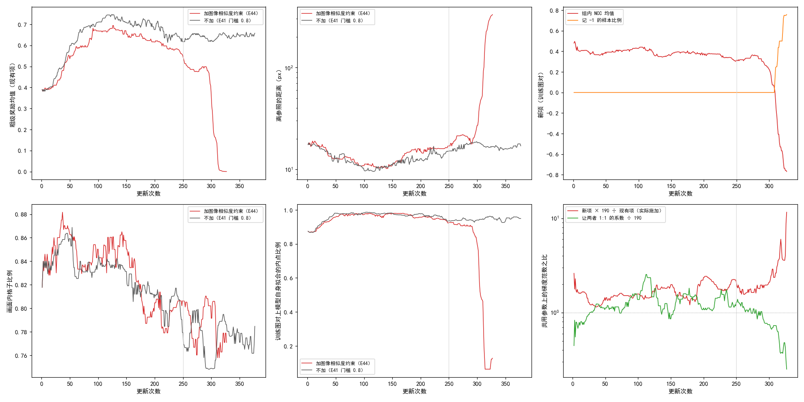

# 加图像相似度约束奖励后，训练在第 327 次更新被坍缩判据停下；唯一的存档（第 250 次更新）Val AUC@5 比不加低 0.008

**摘要**

现有的强化学习训练里，奖励看的是模型抽到的对应离参照仿射有多近，参照是模型自己的慢速平均副本推理一次、用 RANSAC 拟合出的仿射。模型和副本一起整体错时，这个奖励照样高。本文在目前样本筛选门槛 0.8 的配置旁边加一项不经过参照的约束：同一组的每份粗级样本拟合一个仿射，把 SAR 按它变到光学图上，两图灰度的归一化互相关（NCC）越高，这份样本的奖励越高；新项系数按前 50 次更新里两项梯度大小之比的中位数定为 190。训练前约 250 次更新里，离参照的距离、画面内格子比例和不加时走势相近，现有项的奖励略低；第 290 次更新前后，离参照的距离从约 15 px 在 15 次更新内升到 170 px 以上，组内 NCC 均值从约 0.35 降到 −1 附近，训练在第 327 次更新被坍缩判据停下。唯一的存档（第 250 次更新）Val AUC@5 为 0.296，不加同一位置为 0.304，差 −0.008（95% 区间 −0.014 到 −0.001）。同一组内 NCC 与真实误差的秩相关在 −0.29 到 −0.80 之间，而 NCC 最高的样本与离参照最近的样本九成以上的步里不是同一份。

**引言**

RoMa 先在粗网格上为光学图的每个格子给出 SAR 图上各位置的概率，训练时从中为每个格子抽一个落点，合起来是一份粗级样本，也就是一整张对应场；再逐级细化。现有的强化学习训练对同一对图抽一组样本（这里每组 16 份），按每个落点离参照仿射映过去的位置有多近给奖励，组内比较好坏后提高好样本的概率。参照来自模型自己的慢速平均副本，所以离参照近只是对的必要条件：如果整幅图的平移、旋转或缩放错了同一个量，而模型和副本错得一样，现有奖励看不见。

图像本身能看见这类错。把 SAR 按一份样本拟合出的仿射变到光学网格上，两图灰度的归一化互相关（NCC：重叠区域逐像素灰度的相关系数，−1 到 1，越大越像）不经过参照，只用两张图的像素。它的缺点是光学和 SAR 的灰度关系不是线性的，NCC 最大的位置不一定是真实对齐的位置。此前只用 NCC 当唯一奖励（E13）始终没有超过原始 RoMa。本文问的是：NCC 不当唯一奖励，而是作为一项约束加在现有奖励旁边，训练会怎样变化。

**方法**

*训练设置。* 与此前样本筛选实验（E41）里参照内点比例门槛 0.8 的那次训练完全相同，只多一项奖励：从原始 RoMa 起训，DINOv2 每块 qkv 加 LoRA（r 8），VGG 放开；粗匹配每组抽 16 份样本，细化五级（尺度 16、8、4、2、1）各自在输出周围局部抽签；参照模型的滑动平均系数 τ = 0.996；参照的内点比例低于 0.8 的图对这一步不学、补抽下一对；4 张 V100 数据并行，每次更新每张卡一对图；主学习率 2e-4、LoRA 学习率 4e-4；难版训练扰动；种子 0；计划 7907 次更新，每 250 次更新存档。对照直接用 E41 门槛 0.8 已有的逐存档结果与训练日志，不重跑；它同样在 4 张 V100 上训练。

*新项。* 每对图照常做扰动、筛选、参照推理和现有项，不改。然后对同组每份粗级样本，用它全部格子的“格心 → 落点”拟合一个仿射（RANSAC，阈值同参照拟合），把 SAR 按这个仿射变到光学网格上，在 SAR 的非补零区域内算灰度 NCC；拟合失败或重叠不足 1000 px 的记 −1。每份样本的优势为它的 NCC 减去同组其余 15 份的平均，乘在这份样本粗级的对数概率上（这张对应场的所有格子用同一个优势），细化各级不加这一项。总损失为现有项加 190 倍的新项。

*系数怎样定。* 从原始 RoMa 起，用同一配置但新项系数为 0（照算新项、量完梯度后不用它更新）训 50 次更新，每次在两项共用的参数上量现有项与新项各自的梯度范数，取“现有项 ÷ 新项”的中位数 190.9（四分位 160–242，49 次有效），取两位有效数字 190，之后全程固定。两项梯度范数的中位数分别为 2.18 与 0.0136。正式训练中两项梯度之比各卡分别量，日志记的是 4 张卡的平均。

*坍缩判据与停止规则。* 照 E41：离参照的距离的滑动中位数超过 100 px，或画面内格子比例的滑动中位数低于 0.5，就停训；窗口为 200 个记录，即 50 次更新（每次更新 4 张卡各记一条），与 E41 的配置相同（票里写的“200 次更新窗口”按记录数理解）。票里另有一条按前 8 个存档判断是否停训的规则，本次训练没到第 2 个存档，未用上。

*评测。* 存档在不加扰动的验证集（652 对有标注）上评测，口径同 E41：配准误差是光学图上的标注点经估计的仿射映射后到 SAR 图上对应标注点的平均距离；AUC@x 是“误差不超过 t 像素的图对比例”在 t 从 0 到 x 像素上的面积除以 x；SR@x 是误差不超过 x 像素的图对比例。与不加同一存档位置的 AUC@5 之差用配对自助法估 95% 区间：在同一批 652 对上有放回地重抽 2000 次，取差的 2.5% 与 97.5% 分位。两边的第 250 次更新存档都在 RTX 3090 上评测。

*NCC 能否分辨好坏。* 训练图对没有标注，NCC 与真实误差的关系改在有标注的验证图对上量：每 50 次更新，每张卡取一对验证图，照训练的扰动处理 SAR，当前模型照训练同样抽 16 份粗级样本、按上面的做法打 NCC；真实误差为这份样本拟合的仿射换回未扰动坐标后，标注点的平均配准误差。组内 NCC 与真实误差的 Spearman 秩相关为负，表示 NCC 高的样本误差小；4 张卡平均后每 50 次更新得一个数。它量的是验证图对上重新抽的样本，不是训练那一步的样本，只记录、不参与训练。另在每个训练步记录：NCC 最高的样本与离参照最近（参照画面内格子上的平均距离最小）的样本不是同一份的步数比例，以及新项优势的组内标准差。

**结果**

*第 290 次更新前后训练崩掉，第 327 次更新被坍缩判据停下。* 图 1。前约 250 次更新里，离参照的距离、画面内格子比例、训练图对上模型自身拟合的内点比例与不加的曲线交织在一起，现有项的粗级奖励一直比不加低 0.04–0.08。第 250 次更新以后，离参照的距离逐渐高出不加几 px；第 290 次更新起，在约 15 次更新内从 15 px 升到 170 px 以上，现有项奖励从 0.5 降到接近 0，自身拟合的内点比例从约 0.8 降到 0.1 以下，组内 NCC 均值从约 0.35 降到 −1 附近，记 −1 的样本（拟合失败或重叠不足）比例从 0 升到约七成。离参照的距离的滑动中位数在第 327 次更新越过 100 px（101.6 px），训练停止。这期间各卡参数保持一致（存档时检查的最大差为 0）。

图 1：加新项的训练（红）在第 290 次更新前后崩掉，此前与不加（灰）走势相近。上排：现有项的粗级奖励均值、离参照的距离（对数轴）、新项在训练图对上的组内 NCC 均值与记 −1 的样本比例；下排：画面内格子比例、训练图对上模型自身拟合的内点比例、两项在共用参数上的梯度范数之比。均为 20 次更新的滑动中位数，竖线为第 250 次更新（唯一的存档）。

*唯一的存档 Val AUC@5 比不加同一位置低 0.008。* 表 1。第 250 次更新：AUC@5 0.296 对 0.304，差 −0.008（−0.014 到 −0.001，换一批验证图大概率仍是加新项的更低）；AUC@3、SR@3 也较低，SR@5 相近，误差中位数高 0.08 px。不加的这次训练在第 500 次更新为 0.308。

表 1：第 250 次更新存档的 Val 指标。差为加新项减不加。

| | AUC@5 | AUC@3 | SR@3 | SR@5 | 误差中位数（px） |
|---|---|---|---|---|---|
| 加图像相似度约束（E44） | 0.296 | 0.094 | 0.387 | 0.768 | 3.49 |
| 不加（E41 门槛 0.8） | 0.304 | 0.100 | 0.400 | 0.770 | 3.41 |
| 差 | −0.008 | −0.006 | −0.014 | −0.002 | +0.08 |

*实际施加的新项梯度从现有项的 1.2 倍逐渐升到 1.8 倍，崩掉时升到 3 倍以上。* 表 2。按每 50 次更新取两项梯度范数各自的中位数，190 倍新项与现有项之比依次为 1.24、1.36、1.56、1.65、1.54、1.82、3.08（最后一段为第 301–327 次更新）。两项梯度范数都随训练下降，现有项降得更快：前 50 次更新现有项 2.40、新项 0.0156，第 101–150 次更新为 0.83 与 0.0068。日志里逐步的“实际比例”是 4 张卡各自比值的平均，各卡差别大，按段平均后为 1.5–2.6，比按中位数算的高；“让两者 1:1 的系数”同样是各卡平均，按段在 210–390 之间。

*验证图对上，组内 NCC 与真实误差的秩相关在 −0.29 到 −0.80 之间，随训练没有一致的走向。* 表 2。只量不学的那 50 次更新为 −0.40；正式训练每 50 次更新一个数，依次为 −0.80、−0.45、−0.59、−0.76、−0.29、−0.44，崩掉的最后一段 NCC 在组内全部相同，算不出。每个数只来自 4 对验证图，起伏大。

*NCC 最高的样本与离参照最近的样本，九成左右的步里不是同一份；新项优势的组内标准差在 0.006–0.019 之间，崩掉时升到 0.031。* 表 2。每组 16 份样本，若两者毫无关系，不是同一份的比例应为 15/16 = 0.94；实测各段为 0.89–0.95。新项优势的组内标准差在前 200 次更新从 0.016 降到 0.006，此后回升。训练图对上的组内 NCC 均值在崩掉前保持在 0.28–0.41。

表 2：每 50 次更新一段的新项诊断（各段的平均；梯度之比为两项梯度范数各自取中位数后之比）。

| 更新 | 组内 NCC 均值 | 记 −1 的比例 | 优势组内标准差 | NCC 最高 ≠ 离参照最近 | 秩相关（验证图对） | 190 倍新项 ÷ 现有项 |
|---|---|---|---|---|---|---|
| 1–50（只量不学） | 0.399 | 0.000 | 0.014 | 0.91 | −0.40 | — |
| 1–50 | 0.397 | 0.000 | 0.016 | 0.93 | −0.80 | 1.24 |
| 51–100 | 0.407 | 0.000 | 0.008 | 0.93 | −0.45 | 1.36 |
| 101–150 | 0.380 | 0.000 | 0.007 | 0.93 | −0.59 | 1.56 |
| 151–200 | 0.382 | 0.000 | 0.006 | 0.94 | −0.76 | 1.65 |
| 201–250 | 0.340 | 0.000 | 0.009 | 0.89 | −0.29 | 1.54 |
| 251–300 | 0.277 | 0.013 | 0.019 | 0.95 | −0.44 | 1.82 |
| 301–327 | −0.665 | 0.675 | 0.031 | 0.80 | — | 3.08 |

*每次更新的耗时中位数是不加的 1.25 倍，峰值显存相同。* 第 101–327 次更新（避开开训时样本筛选大量补抽的阶段），每次更新耗时中位数 3.50 s 对 2.80 s，其中新项 0.42 s；第 1 次更新的峰值显存都是 11.2 GB。

**讨论**

票里问的是 NCC 作为现有奖励旁边的一项约束时训练会怎样。本次的答案只覆盖前 327 次更新：训练在约 290 次更新时崩掉，此前唯一的存档比不加低 0.008。训满 4 遍会怎样、后面的存档与不加相比如何，这次没有数据。

局限：单种子；只有一个存档，E41 自身相邻存档间的起伏约 0.01；对照没有重跑；秩相关每 50 次更新只来自 4 对验证图；NCC 是跨模态的弱尺子，最大值可能偏离真实对齐；新项只作用在粗级。

尚未解释的现象。第一，崩掉的起点：崩之前新项实际施加的梯度已从现有项的 1.2 倍升到 1.8 倍，崩掉过程中组内 NCC 和现有奖励同时下降。崩掉是由新项的梯度把模型推离、还是这个配置在这个种子下本来就可能发生，本次不能区分（未检验）；能区分的检查是同一配置、同一种子把新项系数降到让实际比例约为 1，或换种子重跑不加的配置看前 400 次更新是否也崩。第二，NCC 最高的样本与离参照最近的样本几乎不重合（0.89–0.95，接近毫无关系时的 0.94），而验证图对上 NCC 与真实误差的秩相关多在 −0.4 到 −0.8；两者合起来可能意味着组内现有奖励与 NCC 排出的次序差别很大（未检验），可以在同一批训练图对上直接量两者的组内秩相关来确认。第三，新项优势的组内标准差只有 0.006–0.019，约为 NCC 均值的 2–7%，组内 16 份样本的 NCC 差别很小，与 E10 观察到的“同组内区分力弱”一致；系数 190 是在这样小的差别上定出来的。
