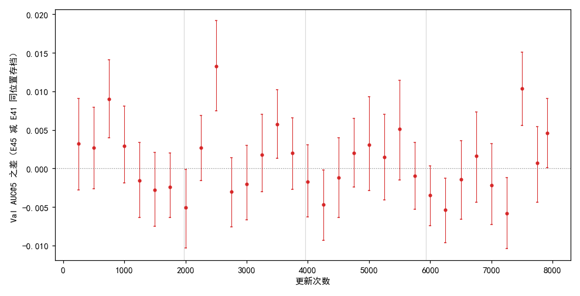
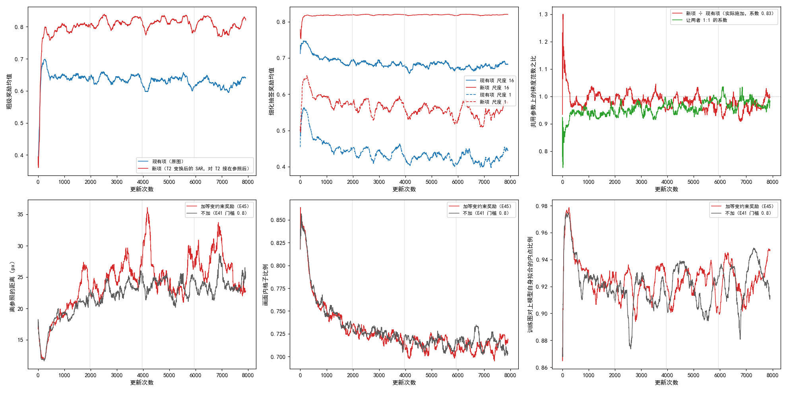
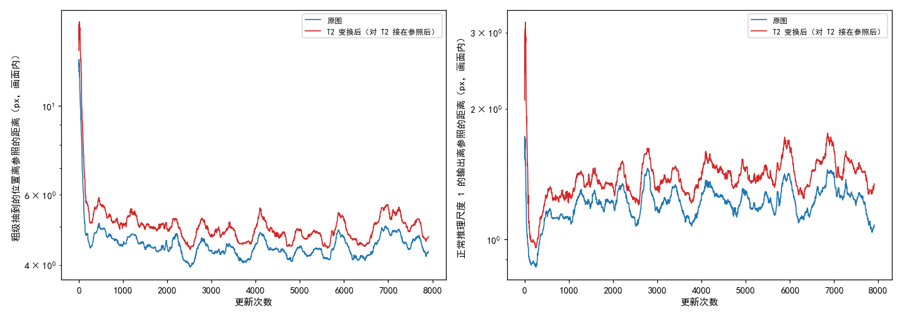
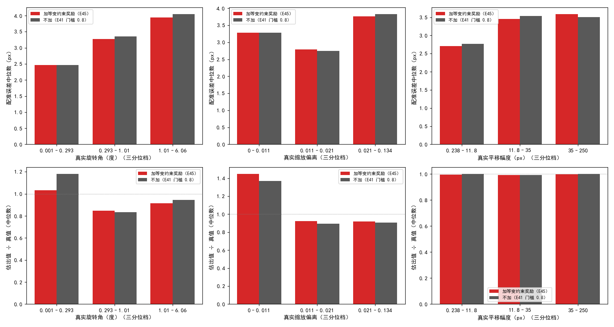

# 加已知扰动等变约束奖励后，Val AUC@5 各段平均与不加相差不到 0.002，最后存档高 0.005

**摘要**

现有的强化学习训练里，奖励看的是模型抽到的对应离参照仿射有多近，参照是模型自己的慢速平均副本推理一次、用 RANSAC 拟合出的仿射。模型和副本一起错时，这个奖励照样高，例如两者都把大的扰动估小。本文在样本筛选门槛 0.8 的配置旁边加一项约束：每步把 SAR 再按一个已知的随机仿射 T2 变换一次，要求模型在变换后的图上抽到的对应贴近“先参照、再 T2”的复合仿射，即输入多变一个已知量，输出也恰好多变这个量。新项系数按前 50 次更新里两项梯度大小之比的中位数定为 0.83。训满 7907 次更新，32 个存档里 15 个的 Val AUC@5 低于不加的同一位置存档；按训练集遍数分四段，各段平均之差在 −0.0001 到 +0.0019 之间。最后存档 0.331 对 0.327，差 +0.0046（95% 区间 +0.0001 到 +0.0091）。训练中，变换后的图上抽到的位置离复合参照的距离始终比原图离参照远 10–20%，这个比例没有随训练缩小。按真实几何差分档，旋转、缩放估小的程度与不加相近。每次更新耗时是不加的 1.4 倍。

**引言**

RoMa 先在粗网格上为光学图的每个格子给出 SAR 图上各位置的概率，训练时从中为每个格子抽一个落点，再逐级细化到原图分辨率。现有的强化学习训练对同一对图抽一组样本，按每个落点离参照仿射映过去的位置有多近给奖励，组内比较好坏后提高好样本的概率。参照来自模型自己的慢速平均副本，所以离参照近只是对的必要条件：如果副本和模型一样把大的旋转、缩放估小，现有奖励看不见。

已知的变换能看见一部分这类错。把 SAR 再旋转、缩放、平移一个已知的量 T2，正确的模型在变换后的图上给出的对应，应当恰好等于原来的对应再接上 T2。若模型往“没有变换”收缩，它在变换后的图上也会少跟一截，偏离“参照再接 T2”。这个目标一半来自外部（T2），一半仍来自模型自己的参照，所以整幅图恒定的偏差（在原图和变换后的图上错得一样）它抓不到。此前多份已知扰动交叉核对参照（E31）能把坍缩的存档和正常存档分开，测试时对多份扰动后的输入推理再平均（E40）则说明模型在多扰动一次的图上更差。本文问的是：把这种已知扰动下的等变要求作为一项约束加在现有奖励旁边，训练出的模型与不加相比如何。

**方法**

*训练设置。* 与样本筛选实验（E41）里参照内点比例门槛 0.8 的那次训练完全相同，只多一项奖励：从原始 RoMa 起训，DINOv2 每块 qkv 加 LoRA（r 8），VGG 放开；细化五级（尺度 16、8、4、2、1）各自在输出周围局部抽签；参照模型的滑动平均系数 τ = 0.996；参照的内点比例低于 0.8 的图对这一步不学、补抽下一对；4 张 V100 数据并行，每次更新每张卡一对图；主学习率 2e-4、LoRA 学习率 4e-4；难版训练扰动（旋转 ±20°、缩放 ±0.2、平移在半径 128 px 的圆盘内）；种子 0；7907 次更新（训练集 4 遍），每 250 次更新存档。对照直接用 E41 门槛 0.8 已有的逐存档结果与训练日志，不重跑，它同样在 4 张 V100 上训练。

*新项。* 每对图照常做扰动、筛选、参照推理和现有项，不改。每步另抽一个随机仿射 T2，幅度取训练扰动的一半：绕中心旋转 ±10°、缩放 ±0.1、平移在半径 64 px 的圆盘内均匀；把已经扰动过的 SAR 按 T2 再变换一次，画面外照现有方式补零。当前模型在（光学图，变换后的 SAR）上照原图同样抽签，粗级一组、细化各级照原图，打分方式与现有项相同，只是参照换成“先参照仿射、再 T2”的复合仿射（下文称复合参照）；按复合参照落到画面外的格子和像素照现有方式置零。总损失为现有项加 0.83 倍的新项。

*系数怎样定。* 从原始 RoMa 起，用同一配置但新项系数为 0（照算新项、量完梯度后不用它更新）训 50 次更新，每次在两项共用的参数上量现有项与新项各自的梯度范数，取“现有项 ÷ 新项”的中位数 0.832（四分位 0.73–0.89，49 次有效），取两位有效数字 0.83，之后全程固定。两项梯度范数的中位数分别为 5.21 与 7.38。

*停止规则与坍缩判据。* 票里规定：训到第 8 个存档（第 2000 次更新）时，若 8 个存档的 Val AUC@5 都低于不加的同一位置，或 8 个差的平均低于 −0.01，就停训。实际 8 个差的平均为 +0.0007，其中 4 个为负，未触发，训满全程。坍缩判据照 E41（离参照的距离超过 100 px 或画面内格子比例低于 0.5），全程未触发。

*评测。* 存档在不加扰动的验证集（652 对有标注）上评测，口径同 E41：配准误差是光学图上的标注点经估计的仿射映射后，到 SAR 图上对应标注点的平均距离；AUC@x 是“误差不超过 t 像素的图对比例”在 t 从 0 到 x 像素上的面积除以 x；SR@x 是误差不超过 x 像素的图对比例。与不加同一存档位置的 AUC@5 之差用配对自助法估 95% 区间：在同一批 652 对上有放回地重抽 2000 次，取差的 2.5% 与 97.5% 分位。本实验的存档都在 V100 上评测；不加的存档有的在 V100、有的在 RTX 3090 上评测。

*误差随真实几何差的变化。* 用两边最后存档在验证集上的输出。每对图用标注点最小二乘拟合出真实仿射，取它的旋转角绝对值、缩放偏离（|√det − 1|）、平移幅度（光学标注点重心被映过去的位移）；每个量按三分位分三档，每档给配准误差中位数，以及估出的仿射同一个量与真值之比的中位数（1 表示估得一样大，小于 1 表示估小）。

**结果**

*Val AUC@5 与不加在同一存档位置的差在 −0.006 到 +0.013 之间来回，各段平均之差不到 0.002。* 图 1、表 1。32 个存档里 15 个低于不加；区间整体在 0 以上的 5 个、整体在 0 以下的 4 个，前后交错，没有集中在某一段。按训练集遍数分四段，各段平均之差为 +0.0016、+0.0019、+0.0004、−0.0001，全部 32 个存档平均 +0.0009。E41 自身相邻存档间的起伏约 0.01，与这些差同一量级或更大。

图 1：各存档位置 Val AUC@5 之差（加新项减不加）在 0 上下来回。竖线为 95% 配对自助区间，灰竖线为训练集遍数的分界。

表 1：按训练集遍数分段的 Val AUC@5 平均。差为加新项减不加；“低于”为差小于 0 的存档数，“区间在 0 以上 / 以下”为 95% 区间整体在 0 以上 / 以下的存档数。

| 段（更新次数） | 存档数 | 加新项（E45） | 不加（E41 门槛 0.8） | 平均差 | 低于 | 区间在 0 以上 / 以下 |
|---|---|---|---|---|---|---|
| 1（250–1750） | 7 | 0.3152 | 0.3136 | +0.0016 | 3 | 1 / 0 |
| 2（2000–3750） | 8 | 0.3278 | 0.3259 | +0.0019 | 3 | 2 / 1 |
| 3（4000–5750） | 8 | 0.3285 | 0.3281 | +0.0004 | 4 | 0 / 1 |
| 4（6000–7907） | 9 | 0.3280 | 0.3282 | −0.0001 | 5 | 2 / 2 |

*最后存档 AUC@5 高 0.005，其余指标相近。* 表 2。第 7907 次更新：AUC@5 0.331 对 0.327，差 +0.0046（+0.0001 到 +0.0091），区间下端贴着 0，换一批验证图差可能缩到接近 0；它前两个存档的差分别为 +0.0104 与 +0.0007。AUC@3 相同，SR@3 低 0.005，SR@5 高 0.012，误差中位数低 0.04 px。

表 2：第 7907 次更新存档的 Val 指标。差为加新项减不加。

| | AUC@5 | AUC@3 | SR@3 | SR@5 | 误差中位数（px） |
|---|---|---|---|---|---|
| 加等变约束（E45） | 0.331 | 0.102 | 0.420 | 0.845 | 3.26 |
| 不加（E41 门槛 0.8） | 0.327 | 0.102 | 0.425 | 0.833 | 3.30 |
| 差 | +0.005 | 0.000 | −0.005 | +0.012 | −0.04 |

*实际施加的新项梯度全程约为现有项的 1 倍；离参照的距离、画面内格子比例与不加走势相近。* 图 2。按 0.83 倍算的“新项 ÷ 现有项”梯度范数比，前 250 次更新的中位数为 1.03，此后各遍为 0.96–0.99；“让两者 1:1 的系数”从开训时的 0.90 缓慢升到 0.98。离参照的距离在第 2000 次更新以后多数时候比不加高几 px，峰值到 36 px（不加约 27 px），离坍缩线 100 px 很远；画面内格子比例、训练图对上模型自身拟合的内点比例与不加交织在一起。图 2 第一、二格里新项的奖励均值高于现有项，是因为新项只在复合参照落在画面内的格子上取平均，现有项的均值含画面外置零的格子，两者不能直接比大小。

图 2：加新项的训练与不加走势相近，两项梯度全程约 1:1。上排：粗级奖励均值、细化尺度 16 与 1 的奖励均值（现有项与新项）、两项在共用参数上的梯度范数之比；下排：离参照的距离、画面内格子比例、训练图对上模型自身拟合的内点比例，红为加新项，灰为不加。均为 200 次更新的滑动中位数。

*变换后的图上抽到的位置离复合参照，比原图离参照远 10–20%，这个比例没有随训练缩小。* 图 3、表 3。只取参照落在画面内的格子：粗级抽到的位置，第 1–250 次更新变换后的图离复合参照 5.56 px、原图离参照 4.63 px，之比 1.20；之后降到 1.10–1.14，最后一遍 1.10。正常推理（不抽签）在尺度 1 的输出，两者之比从 1.11 升到 1.18。两种距离都在开训后 300 次更新内快速下降，之后变化不大。

图 3：变换后的图（红）离复合参照始终比原图（蓝）离参照远。左为粗级抽到的位置，右为正常推理尺度 1 的输出；纵轴为对数；均为 200 次更新的滑动中位数。

表 3：按更新次数分段，变换后的图离复合参照与原图离参照的平均距离（px，只取参照落在画面内的格子）。

| 更新 | 粗级：变换后 | 粗级：原图 | 之比 | 尺度 1：变换后 | 尺度 1：原图 | 之比 |
|---|---|---|---|---|---|---|
| 1–250 | 5.56 | 4.63 | 1.20 | 1.00 | 0.90 | 1.11 |
| 251–500 | 5.66 | 4.95 | 1.14 | 1.22 | 1.12 | 1.09 |
| 501–1000 | 5.16 | 4.62 | 1.12 | 1.26 | 1.12 | 1.12 |
| 1001–1977 | 5.09 | 4.52 | 1.13 | 1.35 | 1.22 | 1.10 |
| 1978–3954 | 4.77 | 4.32 | 1.11 | 1.36 | 1.21 | 1.12 |
| 3955–5931 | 4.86 | 4.40 | 1.10 | 1.45 | 1.25 | 1.17 |
| 5932–7907 | 4.94 | 4.50 | 1.10 | 1.44 | 1.23 | 1.18 |

*按真实几何差分档，两边配准误差和估小的程度相近。* 图 4、表 4。验证集的真实几何差不大：旋转角最大 6.1°，缩放偏离最大 0.13，平移最大 250 px，都在训练扰动的范围以内。旋转最大的一档（1.0°–6.1°），误差中位数 3.95 对 4.05 px，估出的旋转角与真值之比 0.91 对 0.95，加新项估得略小；缩放偏离后两档之比 0.92 对 0.89–0.91；平移各档之比两边都约为 1。旋转、缩放最小的一档，真值接近 0，比值不稳定（1.03–1.45），不宜解读。

图 4：按真实几何差三分位分档，两边的配准误差中位数（上排）和“估出值 ÷ 真值”的中位数（下排）相近。左起为旋转角、缩放偏离、平移幅度。

表 4：最后存档在验证集上按真实几何差分档的结果（每档约 217 对）。

| 量 | 档 | 范围 | 误差中位数 E45 / E41（px） | 估出 ÷ 真值 E45 / E41 |
|---|---|---|---|---|
| 旋转角（°） | 1 | 0.00–0.29 | 2.47 / 2.46 | 1.03 / 1.18 |
| | 2 | 0.29–1.01 | 3.27 / 3.35 | 0.85 / 0.84 |
| | 3 | 1.01–6.06 | 3.95 / 4.05 | 0.91 / 0.95 |
| 缩放偏离 | 1 | 0.000–0.011 | 3.28 / 3.28 | 1.45 / 1.37 |
| | 2 | 0.011–0.021 | 2.79 / 2.75 | 0.92 / 0.89 |
| | 3 | 0.021–0.134 | 3.76 / 3.83 | 0.92 / 0.91 |
| 平移幅度（px） | 1 | 0.2–11.8 | 2.71 / 2.77 | 1.00 / 1.00 |
| | 2 | 11.8–35.0 | 3.46 / 3.54 | 0.99 / 0.99 |
| | 3 | 35.0–249.5 | 3.59 / 3.51 | 1.00 / 1.00 |

*每次更新的耗时是不加的 1.4 倍，峰值显存多 1 GB。* 每次更新耗时中位数 1.68 s 对 1.19 s，其中新项 0.62 s；训练墙钟时间 4.68 h 对 3.35 h；第 1 次更新的峰值显存 12.2 GB 对 11.2 GB。

**讨论**

票里问的是已知扰动下的等变要求作为现有奖励旁边的一项约束时，训练出的模型与不加相比如何。本次的答案是：训满 4 遍，逐存档的 Val AUC@5 与不加的差在 0 上下来回，各段平均之差不到 0.002，比 E41 自身相邻存档间的起伏小；最后存档高 0.005，区间下端贴着 0。新项要补的“大变换估小”，在验证集的小变换范围内没有看到两边的差别。

局限：单种子；对照没有重跑，本实验的存档都在 V100 上评测，对照有的在 RTX 3090 上评测；T2 幅度只取一组；目标一半来自模型自己的参照，整幅图恒定的偏差抓不到；这一项也有数据增强的成分（模型多见了一份再变换过的 SAR），本次没有区分实验；验证集的真实旋转最大约 6°，远小于训练扰动的 ±20°，分档结果只覆盖小变换。

尚未解释的现象。第一，新项的梯度全程与现有项约 1:1，但变换后的图离复合参照比原图离参照远 10–20% 的差距没有随训练缩小，尺度 1 上还略有扩大。可能的原因之一是这部分差距来自补零区和图像边缘（变换后可用的画面更少），新项本来就压不下去（未检验）；可以按格子离画面边缘的远近分开统计两种距离来区分。第二，新项的粗级奖励在第 300 次更新以后基本不变（约 0.80），新项可能主要在起数据增强的作用（未检验），可以用同样的 T2 变换后图对、但参照直接在变换后的图上推理（不用复合参照）训练一次来区分。第三，第 2500 与第 7500 次更新两处的差超过 +0.01，相邻存档又回到 0 附近；这两处不加的训练恰好处于自身的低点（0.319 与 0.320，前后存档约 0.33），加新项在第 2500 次更新则处于自身的高点（0.333，前后为 0.322 与 0.327）；单个存档的差受两边各自起伏的影响都很大。
