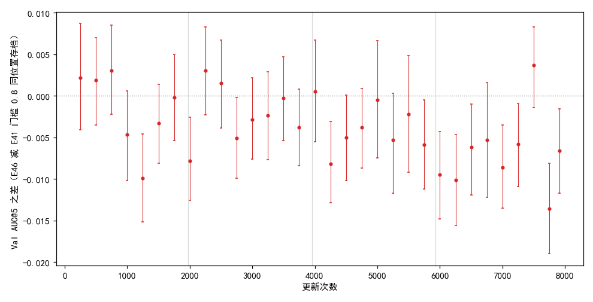
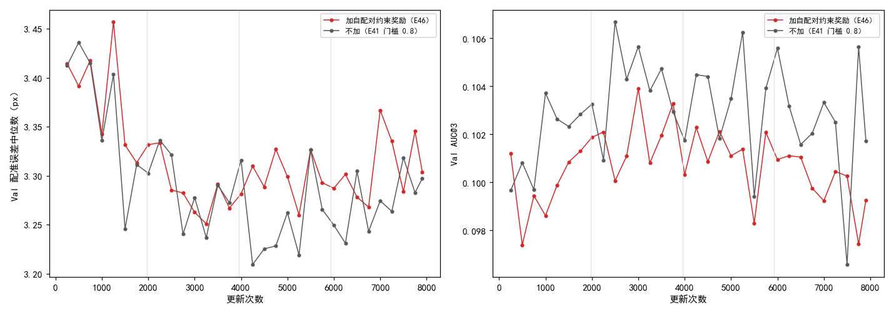
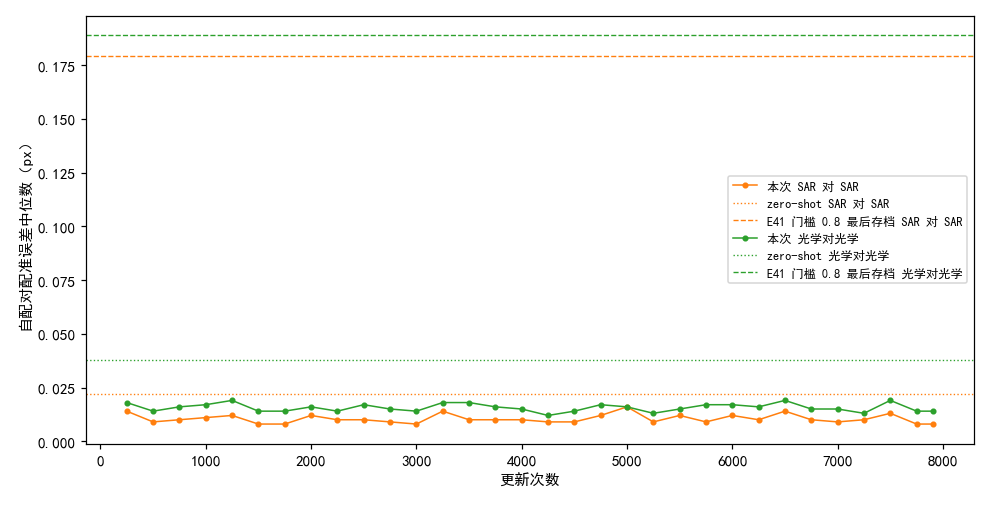
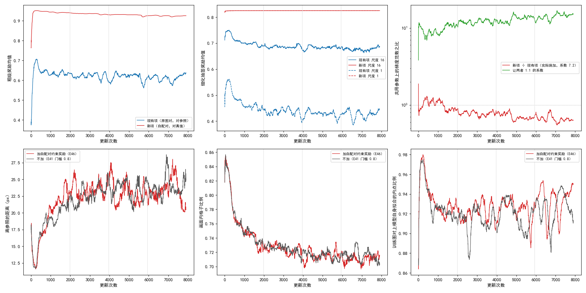

# 加同模态自配对约束奖励后，Val AUC@5 四段平均都比不加低 0.002–0.007，最后存档低 0.007；自配对上的配准误差原始 RoMa 已不到 0.04 px，训练中一直留在 0.02 px 以内

**摘要**

现有奖励看的是抽到的对应离参照仿射有多近，参照来自模型自己的慢速平均副本；它在模型与副本一起错时照样给高分，在细化级上也只能用一个仿射近似局部形变。本文在 E41 门槛 0.8 那次训练旁边加了一项不依赖模型自己参照的奖励：每步另配一对“图和它自己经已知随机仿射变换后的版本”（光学对光学或 SAR 对 SAR），当前模型在这一对上抽到的对应，粗级和细化五级都按这个已知仿射打分，两项损失相加，新项系数 7.2 由只量不学的 50 次更新定出。同一配置、同一种子训满 7907 次更新，与 E41 门槛 0.8 同一存档位置比较：第 1 遍 8 个存档平均低 0.0024，没有触发停止规则；按训练集遍数分四段，平均差依次为 −0.0016、−0.0022、−0.0038、−0.0069，32 个存档里 25 个更低、12 个明显更低、没有一个明显更高；最后存档 0.320 对 0.327，差 −0.0066（95% 区间 −0.0117 到 −0.0016）。在固定的一组自配对上，原始 RoMa 的配准误差中位数已只有 0.02–0.04 px，E41 门槛 0.8 训完后升到 0.18–0.19 px，本次训练全程在 0.008–0.019 px。训练中自配对的粗级奖励组内标准差在 50 次更新后就降到 0.001 以下，比现有项小一个数量级。每次更新耗时是不加的 1.41 倍。

**引言**

这条线用强化学习的方式微调 RoMa 做光学—SAR 月面图像匹配，不用标注。RoMa 先在粗网格上对光学图的每个格子给出 SAR 图上各位置的匹配概率（粗级），再在尺度 16、8、4、2、1 px 上逐级修正位置（细化）。训练时，模型在粗级按概率抽几个候选位置，细化各级也在输出周围抽签；每个抽样按它离“参照仿射”有多近打分，分数高于同组平均的抽样被加强。参照仿射来自模型的慢速平均副本（参数随训练缓慢跟随的一份拷贝）：副本在这对图上推理一次，再用 RANSAC 拟合出一个仿射。

离参照近只是对的必要条件。模型和副本一起整体错时，奖励照样高；细化级上一张图的局部形变也不是一个仿射能表示的，参照在 16 到 1 px 的尺度上未必可靠。此前的遮挡约束奖励（E42、E43）目标仍是模型自己的参照，被判为实质上只是数据增强。缺口在于：一个“正确答案”完全不来自模型自己参照的约束，叠加到现有奖励旁边，Val 上会怎样。

本文用最简单的这类约束来回答：把一张图和它自己经已知仿射 T3 变换后的版本配成一对，每个像素的正确对应都精确已知。代价是训的是同模态匹配，不是光学对 SAR；自配对里只有一个整体仿射，没有局部形变；也不加灰度变化，这一对可能太容易。所以除了 Val，本文还记录自配对上的奖励和组内差异，并在固定的一组自配对上量各模型的同模态准确度。

**方法**

*训练设置。* 与 E41 门槛 0.8 那次训练（E41 的 `main__screen0.8`）完全相同，只多一项奖励：从原始 RoMa 起训，DINOv2 每块 qkv 加 LoRA（r 8），VGG 放开；粗级抽候选、细化五级各自在输出周围抽签；慢速副本更新系数 τ = 0.996；参照内点比例低于 0.8 的图对这一步不学、补抽下一对；4 张卡数据并行，每次更新每张卡一对图；主学习率 2e-4、LoRA 学习率 4e-4；难版训练扰动；种子 0；共 7907 次更新（训练集 4 遍），每 250 次更新存档。坍缩判据照旧（离参照的距离超过 100 px 或画面内格子比例低于 0.5，按 200 次更新的滑动中位数判），本次没有触发。正式训练在一台机器的 4 张 V100 上；对照直接用 E41 门槛 0.8 已有的逐存档结果，不重跑，它也在 4 张 V100 上训练。

*自配对。* 每对图照常做扰动、筛选、参照推理和现有项，不改。然后另造一对自配对：各一半概率取这对图的光学图或扰动之前的 SAR，记为 X；抽一个已知随机仿射 T3，分布与训练扰动相同（旋转 ±20°、缩放 ±20%、平移在半径 128 px 的圆盘内均匀）；自配对是（X，T3 变换后的 X），移出画面的部分补 0。X 只做几何变换，不加灰度变化。训练中实际选到 SAR 的比例为 0.50，自配对上画面内格子比例约 0.79。

*新项。* 当前模型在自配对上照原图的方式抽签（粗级与细化五级），打分方式与现有项相同，只是参照换成 T3；T3 映到画面外的格子和像素照现有项的方式处理。两项损失相加，新项乘系数 7.2。

*系数怎样定。* 照 E42 的做法，另跑一次定系数的训练：同一配置但新项系数为 0（照算新项、量完梯度后撤掉，只按现有项更新），从原始 RoMa 起训 50 次更新，每次在两项共用的参数上量现有项与新项各自的梯度范数，取“现有项 ÷ 新项”的中位数 7.21（四分位 5.58–8.68，49 次有效），取两位有效数字 7.2。两项梯度范数的中位数分别为 5.01 与 0.79。正式训练从第 1 次更新起就用 7.2，而不是在正式训练里先只量不学 50 次；正式训练的前 50 次更新因此和票面写法不同，新项从一开始就参与更新。

*Val 评测。* 每个存档在不加扰动的验证集（652 对有标注）上评测，口径同 E41：配准误差是光学图上的标注点经估计的仿射映射后到 SAR 图上对应标注点的平均距离；AUC@x 是“误差不超过 t 像素的图对比例”在 t 从 0 到 x 像素上的面积除以 x；SR@x 是误差不超过 x 像素的图对比例。与不加同一存档位置的 AUC@5 之差用配对自助法估 95% 区间：在同一批 652 对上有放回地重抽 2000 次，取差的 2.5% 与 97.5% 分位；区间两端都为负称明显更低，都为正称明显更高。存档按训练集遍数分四段，每段 1977 次更新。本文 32 个存档都在 V100 上评测；不加的 32 个里 21 个在 V100、11 个在 RTX 3090 上（第 250、500、750、1000、1250、1500、2750、4000、5250、6500、7750 次更新）。

*自配对准确度。* 验证集 652 对按名字排序后每 3 对取 1 对，共 218 对；每对分别以光学图和 SAR 为 X，T3 的抽法同训练，随机数只由模态和图对决定，各模型用的是完全相同的一组自配对。模型照正式评测的方式推理并拟合仿射，配准误差是 X 上 8×8 个均匀格点经拟合仿射与经 T3 映到的位置之间的平均距离，即把正式评测的标注点换成格点、真值换成 T3。SAR 的输入映射用正式评测的 minmax，训练里用的是 p2p98。评了原始 RoMa、E41 门槛 0.8 的最后存档和本次全部 32 个存档。

**结果**

*停止规则没有触发。* 第 1 遍 8 个存档减不加的 AUC@5 差平均 −0.0024，前 3 个为正、后 5 个为负（表 2），不满足“8 个全低”或“平均低 0.01 以上”，训满 4 遍。

*按段平均，四段都比不加低，差从 −0.002 逐段扩大到 −0.007；明显更低的存档有 12 个，明显更高的没有。* 表 1、表 2、图 1。32 个存档里 25 个低于不加；明显更低的是第 1250、2000、2750、4250、5750、6000、6250、6500、7000、7250、7750、7907 次更新，最后一段 9 个存档里有 7 个。最后存档 0.320 对 0.327，差 −0.0066（−0.0117 到 −0.0016），换一批验证图大概率仍是加自配对的更低。全程最高点 0.327（第 3750 次更新），不加的最高点 0.333（第 4250 次更新）。最后存档的其他指标：AUC@3 0.099 对 0.102，SR@3 0.408 对 0.425，SR@5 0.822 对 0.833，误差中位数都是 3.3 px。

表 1：按训练进度分四段的平均 Val AUC@5。差为加自配对减不加；明显更高 / 更低指 95% 区间两端同号的存档数。

| 段（更新次数） | 存档数 | 加自配对 | 不加 | 差 | 低于不加 | 明显更高 | 明显更低 |
|---|---|---|---|---|---|---|---|
| 1（250–1750） | 7 | 0.312 | 0.314 | −0.0016 | 4 | 0 | 1 |
| 2（2000–3750） | 8 | 0.324 | 0.326 | −0.0022 | 6 | 0 | 2 |
| 3（4000–5750） | 8 | 0.324 | 0.328 | −0.0038 | 7 | 0 | 2 |
| 4（6000–7907） | 9 | 0.321 | 0.328 | −0.0069 | 8 | 0 | 7 |

表 2：第 1 遍 8 个存档与最后几个存档的 Val AUC@5，括号内为加自配对减不加的差与配对自助法 95% 区间。全部 32 个存档见 `extra/data/vs_e41.csv`。

| 更新次数 | 加自配对 | 不加 | 差（95% 区间） |
|---|---|---|---|
| 250 | 0.306 | 0.304 | +0.0022（−0.0041 到 +0.0087） |
| 500 | 0.310 | 0.308 | +0.0019（−0.0035 到 +0.0070） |
| 750 | 0.310 | 0.307 | +0.0030（−0.0022 到 +0.0085） |
| 1000 | 0.309 | 0.314 | −0.0047（−0.0102 到 +0.0006） |
| 1250 | 0.308 | 0.318 | −0.0099（−0.0152 到 −0.0046） |
| 1500 | 0.319 | 0.323 | −0.0033（−0.0081 到 +0.0014） |
| 1750 | 0.322 | 0.322 | −0.0002（−0.0054 到 +0.0050） |
| 2000 | 0.319 | 0.326 | −0.0078（−0.0126 到 −0.0026） |
| 7250 | 0.322 | 0.328 | −0.0058（−0.0109 到 −0.0009） |
| 7500 | 0.323 | 0.320 | +0.0037（−0.0014 到 +0.0083） |
| 7750 | 0.317 | 0.330 | −0.0136（−0.0190 到 −0.0081） |
| 7907 | 0.320 | 0.327 | −0.0066（−0.0117 到 −0.0016） |

图 1：前 3 个存档的差在 0 以上，此后绝大多数在 0 以下，后半程更低。纵轴为加自配对减不加同一存档位置的 Val AUC@5 之差，竖线为配对自助法 95% 区间，灰色竖线把更新次数分成四段。

*和细化关系更近的 AUC@3 四段都比不加低约 0.002；误差中位数前两段与不加相当，后两段高约 0.04 px。* 图 2。AUC@3 四段平均依次为 0.100、0.102、0.101、0.100，不加为 0.102、0.104、0.103、0.103；误差中位数依次为 3.38、3.29、3.30、3.31 px，不加为 3.37、3.29、3.26、3.27 px。

图 2：逐存档的 Val 配准误差中位数（左）与 AUC@3（右），加自配对（红）与不加（灰）。灰色竖线把更新次数分成四段。

*在固定的一组自配对上，原始 RoMa 的配准误差中位数已只有 0.02–0.04 px；E41 门槛 0.8 训完后升到约 0.18 px，本次训练全程在 0.02 px 以内。* 表 3、图 3。218 对、两种模态，所有模型的 SR@3 都是 1，没有拟合失败。原始 RoMa 的误差中位数 SAR 对 SAR 0.022 px、光学对光学 0.038 px；E41 门槛 0.8 最后存档分别为 0.179 与 0.189 px，是原始 RoMa 的 5–8 倍，但仍远小于 1 px；本次 32 个存档 SAR 对 SAR 在 0.008–0.016 px、光学对光学在 0.012–0.019 px，第一个存档（第 250 次更新）就已低于原始 RoMa，之后没有明显的趋势。

表 3：同模态自配对上的准确度（218 对，同一组 T3）。

| 模型 | SAR 对 SAR 误差中位数（px） | 光学对光学误差中位数（px） | SAR 对 SAR AUC@5 | 光学对光学 AUC@5 |
|---|---|---|---|---|
| 原始 RoMa | 0.022 | 0.038 | 0.995 | 0.992 |
| E41 门槛 0.8 最后存档 | 0.179 | 0.189 | 0.959 | 0.959 |
| 本次最后存档 | 0.008 | 0.014 | 0.998 | 0.997 |

图 3：本次各存档在自配对上的误差中位数（实线）全程在原始 RoMa（点线）之下，E41 门槛 0.8 最后存档（虚线）高出约一个数量级。

*训练中自配对的粗级奖励接近满分，组内标准差在 50 次更新后就降到 0.001 以下，比现有项小约一个数量级；细化五级的奖励均值和组内标准差全程不变。* 表 4。粗级奖励是 0 到 1 的分数；组内标准差是同一格子上几份抽样的奖励之间的标准差，它为 0 时这一组的优势全为 0、不产生梯度。自配对的粗级奖励均值从前 50 次的 0.89 升到 0.95，此后缓慢降到 0.92；组内标准差从 0.011 降到 0.0002–0.0012。同期现有项的粗级奖励在 0.52–0.70，组内标准差从 0.052 降到 0.002。粗级抽到的位置离 T3 真值的平均距离先从 3.5 px 降到 2.4 px，此后逐段升到 2.9 px。细化各级上，自配对的抽签奖励在尺度 16 与尺度 1 都是 0.825、组内标准差都是 0.126，从第 1 段到最后一段在小数点后三位上不变；现有项细化奖励的组内标准差在 0.10–0.13。正常推理在尺度 1 的输出离 T3 真值的距离从 0.059 px 降到 0.019 px，同一时刻原图对上尺度 1 的输出离参照的距离从 7.8 px 升到 19.8 px。

表 4：训练中自配对（新项）与原图对（现有项）上的奖励，按更新段取中位数。粗级距离对自配对是离 T3 真值、对原图对是离参照；尺度 1 距离指正常推理在尺度 1 的输出到同样目标的距离。

| 更新次数 | 新项粗级奖励 | 新项组内标准差 | 现有项粗级奖励 | 现有项组内标准差 | 新项粗级距离（px） | 现有项粗级距离（px） | 新项尺度 1 距离（px） | 现有项尺度 1 距离（px） |
|---|---|---|---|---|---|---|---|---|
| 1–50 | 0.888 | 0.0113 | 0.524 | 0.0523 | 3.48 | 14.4 | 0.059 | 7.8 |
| 51–250 | 0.951 | 0.0012 | 0.705 | 0.0123 | 2.42 | 11.8 | 0.051 | 8.3 |
| 251–1000 | 0.946 | 0.0007 | 0.640 | 0.0098 | 2.48 | 17.9 | 0.036 | 14.4 |
| 1001–1977 | 0.941 | 0.0004 | 0.633 | 0.0063 | 2.59 | 22.0 | 0.027 | 17.8 |
| 1978–3954 | 0.935 | 0.0003 | 0.619 | 0.0042 | 2.72 | 23.5 | 0.022 | 19.2 |
| 3955–5931 | 0.930 | 0.0002 | 0.617 | 0.0028 | 2.84 | 22.7 | 0.020 | 19.0 |
| 5932–7907 | 0.925 | 0.0002 | 0.612 | 0.0020 | 2.94 | 23.2 | 0.019 | 19.8 |

*乘系数后新项梯度与现有项梯度之比在前 1977 次更新约为 1，此后降到 0.65；离参照的距离、画面内格子比例和训练图对上的内点比例与不加走势相同。* 图 4。新项梯度乘 7.2 后与现有项梯度之比，按段取中位数依次为 0.99（前 250 次）、0.99、0.78、0.70、0.65；“让两者 1:1 的系数”从 9.6 升到 14.3，都高于定系数时的 7.21。两项梯度范数都随训练下降，现有项从 2.7 降到 1.5，新项从 0.35 降到 0.11。离参照的距离最后一段为 23.2 px 对 23.7 px，画面内格子比例 0.710 对 0.715，训练图对上当前模型自身拟合的内点比例两者都在 0.92–0.97 之间、走势重合。

图 4：训练曲线（200 次更新滑动中位数）。上排：粗级奖励均值、细化尺度 16 与 1 的抽签奖励均值（现有项蓝、新项红）、两项在共用参数上的梯度范数之比；下排（与不加叠画）：离参照的距离、画面内格子比例、训练图对上模型自身拟合的内点比例。灰色竖线把更新次数分成四段。

*每次更新的耗时中位数是不加的 1.41 倍，峰值显存多 1.0 GB。* 表 5。新项每次更新约 0.63 s。

表 5：训练开销（都在 4 张 V100 上）。

| | 每次更新耗时中位数（s） | 其中新项（s） | 第 1 次更新峰值显存（GB） | 训练墙钟时间（h） |
|---|---|---|---|---|
| 加自配对 | 1.68 | 0.63 | 12.2 | 4.68 |
| 不加 | 1.19 | — | 11.2 | 3.35 |

**讨论**

票里的问题是：一项正确答案完全不来自模型自己参照的约束，叠在现有奖励旁边，Val 上会怎样。这一次的答案是：在这个设置下 Val AUC@5 四段都比不加低，差随训练扩大，最后一段 9 个存档里 7 个明显更低；AUC@3 也低。同时，新项要它做的事——同模态自配对上的精确对应——原始 RoMa 已经做到 0.02–0.04 px，本次训练只是把它维持在 0.02 px 以内，而不加新项的 E41 门槛 0.8 让它退到 0.18 px。还没有回答的是：Val 变低和新项本身的哪一部分有关，以及自配对换成更难的版本时是否不同。

局限：单种子，E41 自身相邻存档间起伏约 0.01，同一配置同一种子在 E42 里重训的差也到过 0.006；对照没有重跑，且 11 个对照存档在另一种显卡上评测；训的是同模态，自配对没有局部形变，也不加灰度变化；系数是另跑一次 50 次更新定的，正式训练从第 1 次更新起就带新项；自配对准确度只评了 Val 的三分之一，SAR 的输入映射与训练不同。

尚未解释的现象有四个。其一，自配对的粗级组内标准差在 50 次更新后就小于 0.001，按奖励差异算出的优势几乎为 0，但乘系数后新项梯度与现有项之比仍在 0.65–0.99；这部分梯度可能来自确定性画面掩码的 BCE 项或细化各级，而不是粗级抽签，未检验，可以把新项梯度按粗级抽签、BCE、细化各级分开量来区分。其二，细化五级的自配对奖励全程恒为 0.825、组内标准差恒为 0.126，而正常推理输出离真值的距离在 0.02–0.06 px 之间下降；这可能说明细化奖励在离真值极近时只由抽签本身的散布决定，与模型输出无关，未检验，可以对比抽签散布与奖励形状的宽度。其三，Val 变低时，训练图对上的离参照距离、画面内比例和内点比例都与不加相同，这些量没有显示出差别从何而来。其四，E41 门槛 0.8 的训练让同模态准确度退了约 8 倍而 Val 上升，本次把同模态准确度维持在原始 RoMa 之上而 Val 略低；同模态准确度和跨模态 Val 之间的关系，这两次训练的数据不足以说明。
