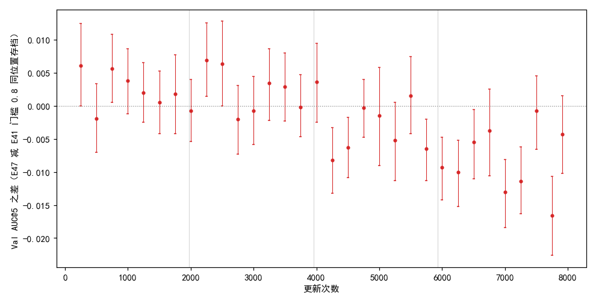
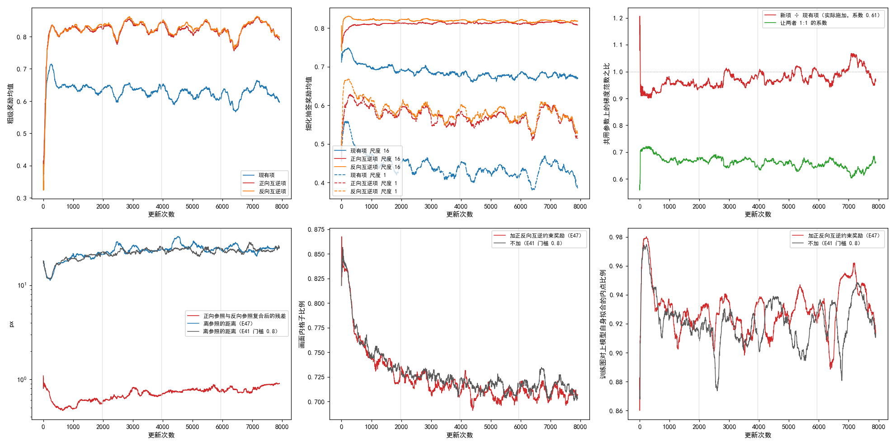
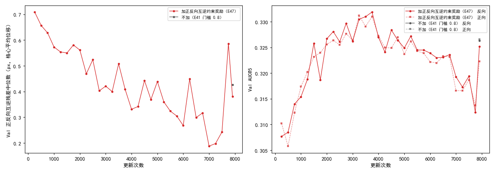

# 加正反向互逆约束奖励后，Val AUC@5 前两段比不加平均高约 0.002，后两段低 0.003 与 0.008；Val 上正反向复合后离原位本来就只有约 0.4 px

**摘要**

现有的强化学习训练只要求模型抽到的对应靠近参照仿射，参照来自模型自己的慢速平均副本，而且只训“从光学图找 SAR 图”一个方向。本文加一项约束奖励，叠加在现有奖励旁：训练中另做一遍反向（SAR 当第一张图、光学当第二张），要求两个方向互为逆，即正向抽到的落点经反向参照映回光学图，应回到出发的格子；反向抽到的落点经正向参照映回 SAR 图同理。新项的系数按开训时 50 次更新里两项梯度大小 1:1 定为 0.61。其余设置与此前样本筛选实验里参照内点比例门槛 0.8 的那次训练（下称不加）完全相同，种子 0，训练 7907 次更新，与不加的已有结果逐存档比较。票里的停止规则没有触发，训满了 4 遍。按训练进度分四段，加互逆奖励的平均 Val AUC@5 减不加依次为 +0.0026、+0.0020、−0.0029、−0.0083；32 个存档里 2 个明显更高、9 个明显更低，明显更低的都在第 4250 次更新及以后；最后一个存档 0.322 对 0.327，差 −0.004（−0.010 到 +0.002）。在 Val 上，每对图分别正向、反向推理并各自拟合仿射，两者复合后离原位的格心平均位移：不加的最后存档中位数 0.43 px，约为配准误差中位数 3.30 px 的八分之一；加互逆奖励的各存档在 0.19–0.71 px 之间，最后存档 0.38 px。反向推理再取逆后的 Val AUC@5，两次训练的每个存档都与正向相差不超过 0.006。每次更新的耗时中位数是不加的 1.84 倍。单种子，对照不重跑。

**引言**

我们在用强化学习、不用标注训练 RoMa 做月球光学图与 SAR 图的配准。模型对一对图输出两图之间的稠密对应，从中按可信度抽一批点对，再用 RANSAC 拟合成一个仿射，把光学图的像素坐标映射到 SAR 图上。训练时每一步，模型的一份慢速平均副本（参数按滑动平均缓慢跟着模型走，下称参照模型）先对这对图正常推理一次、拟合出一个仿射当参照；模型自己的粗匹配和五级细化各自在输出周围抽若干个位置，离参照仿射给出的位置越近得分越高，再按策略梯度更新。这一项下称现有项。

离参照近是对的必要条件，不是充分条件：模型和参照模型一起错时，现有项照样给高分。用户定下的规矩是，补这类盲区的约束，它的“正确答案”不能只来自模型自己的参照。RoMa 本身可以交换两张图的位置推理（第一张图是 SAR、第二张是光学），得到从 SAR 到光学的变换；如果两个方向都对，两个变换应当互为逆。现有训练只训光学找 SAR 一个方向，两个方向不互逆这类错误看不见。“复合后回到原处”这个目标不来自模型；但被复合的两半都来自模型，两个方向一致地错成同一个互逆的错误解，这一项抓不到。此前的测试时检验（E40）把正向和反向的结果取平均，比对照低 0.001，与只换随机种子取平均相同。

本文把互逆这一要求做成训练中的第二项奖励，训一次，看 Val 上和不加这一项的同配置有什么不同，同时量 Val 上两个方向的结果离互逆有多远。

**方法**

*训练设置。* 与此前样本筛选实验（E41）里参照内点比例门槛 0.8 的那次训练完全相同，只多一项奖励：从原始 RoMa 起训，DINOv2 每块 qkv 加 LoRA（r 8），VGG 放开；粗匹配抽锚点，细化五级（尺度 16、8、4、2、1）各自在输出周围局部抽签；参照模型的滑动平均系数 τ = 0.996；参照拟合时内点比例低于 0.8 的图对这一步不学、换下一对（只看正向参照）；4 张卡数据并行，每次更新每张卡一对图；主学习率 2e-4、LoRA 学习率 4e-4，warmup 125 次更新后恒定；难版训练扰动；种子 0；共 7907 次更新（训练集 4 遍），每 250 次更新存档。坍缩判据照旧（离参照的距离或画面内格子比例的滑动中位数越线就停），本次没有触发。对照直接用 E41 门槛 0.8 已有的逐存档结果，不重跑；两次训练都在一台机器的 4 张 V100 上。

*新项。* 每对图照常做扰动、筛选、参照推理和现有项，不改。另做反向一遍：交换两张图（做法同评测里的交换输入），参照模型在反向上推理一次，拟合出从 SAR 到光学的反向参照仿射。正向互逆项：当前模型在正向上另抽一组粗级与细化五级的样本，每个格子（细化为每个像素）抽到的 SAR 落点经反向参照映回光学图，离出发位置的距离按现有项相同的形状打分（粗级高斯、细化 Cauchy），组内留一法求优势，乘在这组样本的对数概率上。反向互逆项：当前模型在反向上照同样方式抽签，落点经正向参照映回 SAR 图打分；反向样本只用这一项打分。总损失为现有项加系数乘以两项互逆项之和。反向参照拟合失败的对只跳过新项；本次训练中没有出现。

*系数怎样定。* 从原始 RoMa 起，用同一配置但新项系数为 0（照算新项、量完梯度后撤掉，只按现有项更新）训 50 次更新，每次在两项共用的参数上量现有项与新项各自的梯度范数，取“现有项 ÷ 新项”的中位数 0.608（四分位 0.51–0.70，49 次有效），取两位有效数字 0.61。两项梯度范数的中位数分别为 5.8 与 10.6。正式训练从原始 RoMa 重新起训、全程用 0.61，前 50 次更新没有再置 0，做法同此前的遮挡约束实验（E42）。

*评测。* 每个存档在不加扰动的验证集（652 对有标注）上评测，口径同 E41：配准误差是光学图上的标注点经估计的仿射映射后到 SAR 图上对应标注点的平均距离；AUC@x 是“误差不超过 t 像素的图对比例”在 t 从 0 到 x 像素上的面积除以 x；SR@x 是误差不超过 x 像素的图对比例。与不加同一存档位置的 AUC@5 之差用配对自助法估 95% 区间：在同一批 652 对上有放回地重抽 2000 次，取差的 2.5% 与 97.5% 分位；区间两端都为正称明显更高，都为负称明显更低。按更新次数把存档分成四段，每段 1977 次更新，即训练集一遍。评测分在 RTX 3090 与 V100 上做（表 2 中标出）。

*Val 上的正反向。* 每个存档另在验证集上做一次反向推理（交换输入，推理前随机种子重置为 0），点对按 SAR → 光学拟合仿射（RANSAC 阈值 3 px，量在光学图上）。反向本身的准确度：把这个仿射求逆成光学 → SAR，按上面的口径算配准误差和 AUC@5。正反向互逆残差：同一存档的正向仿射 A（光学 → SAR）与反向仿射 B（SAR → 光学）复合成 B∘A，在光学图上 32 × 32 个格心（每格 16 px）计算 B∘A 把它们移开的平均距离（px），0 表示严格互逆。不加只剩最后一个存档（其余存档已在清理中删除），只有这一点。标注只用于评测，不参与这两个量之外的任何一步。

**结果**

*停止规则没有触发。* 第 1 遍训练集的 8 个存档，减不加的 AUC@5 差平均 +0.0021，8 个里 2 个为负（第 500、2000 次更新），不满足“8 个全低”或“平均低 0.01 以上”，训满 4 遍。

*按段平均，前两段比不加高约 0.002，后两段低 0.003 与 0.008；明显更低的存档都在第 4250 次更新及以后。* 表 1、表 2、图 1。32 个存档里 2 个明显更高（第 750、2250 次更新），9 个明显更低（第 4250、4500、5750、6000、6250、6500、7000、7250、7750 次更新）；最后一段 9 个存档全部低于不加。最后一个存档 0.322 对 0.327，差 −0.004（−0.010 到 +0.002，换一批验证图多半仍是加互逆奖励的更低，但也可能相等或略高）。全程最高点 0.331（第 3250 次更新），不加的最高点 0.333（第 4250 次更新）。最后一个存档的其他指标：AUC@3 0.097 对 0.102，SR@3 0.410 对 0.425，SR@5 都是 0.833，误差中位数 3.27 px 对 3.30 px。各存档的 AUC@3、SR@3、SR@5、误差中位数见 `extra/data/val.csv`。

表 1：按训练进度分四段的平均 Val AUC@5。差为加互逆奖励减不加；明显更高 / 更低指 95% 区间两端同号的存档数。

| 段 | 存档 | 加互逆奖励 | 不加 | 差 | 低于不加的存档 | 明显更高 | 明显更低 |
|---|---|---|---|---|---|---|---|
| 第 1 段 | 250–1750（7 个） | 0.316 | 0.314 | +0.0026 | 1 | 1 | 0 |
| 第 2 段 | 2000–3750（8 个） | 0.328 | 0.326 | +0.0020 | 4 | 1 | 0 |
| 第 3 段 | 4000–5750（8 个） | 0.325 | 0.328 | −0.0029 | 6 | 0 | 3 |
| 第 4 段 | 6000–7907（9 个） | 0.320 | 0.328 | −0.0083 | 9 | 0 | 6 |

表 2：逐存档的 Val AUC@5，括号内为加互逆奖励减不加的差与配对自助法 95% 区间。带 * 的在 V100 上评测，其余在 RTX 3090 上。

| 更新次数 | 加互逆奖励 | 不加 | 差 [95% 区间] |
|---|---|---|---|
| 250 | 0.310 | 0.304 | +0.006 [−0.000, +0.012] |
| 500 | 0.306 | 0.308 | −0.002 [−0.007, +0.003] |
| 750 | 0.312 | 0.307 | +0.006 [+0.001, +0.011] |
| 1000 | 0.317 | 0.314 | +0.004 [−0.001, +0.009] |
| 1250 | 0.320 | 0.318 | +0.002 [−0.003, +0.007] |
| 1500 | 0.323 | 0.323 | +0.001 [−0.004, +0.005] |
| 1750 | 0.324 | 0.322* | +0.002 [−0.004, +0.008] |
| 2000 | 0.326 | 0.326* | −0.001 [−0.005, +0.004] |
| 2250 | 0.326 | 0.320* | +0.007 [+0.001, +0.013] |
| 2500 | 0.326 | 0.319* | +0.006 [+0.000, +0.013] |
| 2750 | 0.328 | 0.330 | −0.002 [−0.007, +0.003] |
| 3000 | 0.326 | 0.327* | −0.001 [−0.006, +0.004] |
| 3250 | 0.331 | 0.328* | +0.003 [−0.002, +0.009] |
| 3500 | 0.329 | 0.326* | +0.003 [−0.002, +0.008] |
| 3750 | 0.331 | 0.331* | −0.000 [−0.005, +0.005] |
| 4000 | 0.327 | 0.324 | +0.004 [−0.003, +0.009] |
| 4250 | 0.325 | 0.333* | −0.008 [−0.013, −0.003] |
| 4500 | 0.325 | 0.331* | −0.006 [−0.011, −0.002] |
| 4750 | 0.327 | 0.327* | −0.000 [−0.005, +0.004] |
| 5000 | 0.324 | 0.325* | −0.002 [−0.009, +0.006] |
| 5250 | 0.326 | 0.331 | −0.005 [−0.011, +0.001] |
| 5500 | 0.324 | 0.323* | +0.002 [−0.004, +0.007] |
| 5750 | 0.324* | 0.330* | −0.007 [−0.011, −0.002] |
| 6000 | 0.322 | 0.332* | −0.009 [−0.014, −0.005] |
| 6250 | 0.322* | 0.332* | −0.010 [−0.015, −0.005] |
| 6500 | 0.323* | 0.329 | −0.006 [−0.011, −0.001] |
| 6750 | 0.323 | 0.327* | −0.004 [−0.011, +0.003] |
| 7000 | 0.317* | 0.330* | −0.013 [−0.018, −0.008] |
| 7250 | 0.317 | 0.328* | −0.011 [−0.016, −0.006] |
| 7500 | 0.319* | 0.320* | −0.001 [−0.007, +0.005] |
| 7750 | 0.314 | 0.330 | −0.017 [−0.023, −0.011] |
| 7907 | 0.322* | 0.327* | −0.004 [−0.010, +0.002] |

图 1：约第 4000 次更新以前，差在 0 上下；此后多在 0 以下，最后一段全部在 0 以下。纵轴为加互逆奖励减不加同一存档位置的 Val AUC@5 之差，竖线为配对自助法 95% 区间，灰色竖线把更新次数分成四段。

*训练中两项互逆奖励全程在 0.81–0.83 之间，正向参照与反向参照复合后的残差在 0.5–0.8 px；两项梯度的实际比例在 0.92–1.00 之间。* 表 3、图 2。按训练段取中位数，正向与反向互逆项的粗级奖励几乎相同，开训后就在 0.81–0.83，全程没有明显上升；同一时刻现有项的粗级奖励从 0.69 降到 0.62。正向参照与反向参照复合后的格心平均位移，前 1000 次更新从 0.67 px 降到 0.49 px，此后逐段回升到最后一段的 0.81 px。新项梯度乘系数 0.61 后与现有项梯度之比从 0.92 升到 1.00；“让两者 1:1 的系数”从 0.71 降到 0.65。

表 3：训练中各量按更新段的中位数。残差为正向参照与反向参照复合后的格心平均位移（px）。

| 更新次数 | 现有项奖励 | 正向互逆项奖励 | 反向互逆项奖励 | 参照复合残差（px） | 实际梯度比 | 让两者 1:1 的系数 |
|---|---|---|---|---|---|---|
| 1–250 | 0.688 | 0.813 | 0.811 | 0.67 | 0.92 | 0.71 |
| 251–500 | 0.648 | 0.811 | 0.811 | 0.50 | 0.93 | 0.70 |
| 501–1000 | 0.648 | 0.825 | 0.825 | 0.49 | 0.95 | 0.67 |
| 1001–1977 | 0.637 | 0.822 | 0.828 | 0.59 | 0.95 | 0.67 |
| 1978–3954 | 0.634 | 0.830 | 0.834 | 0.68 | 0.96 | 0.67 |
| 3955–5931 | 0.622 | 0.821 | 0.827 | 0.77 | 0.98 | 0.66 |
| 5932–7907 | 0.620 | 0.823 | 0.824 | 0.81 | 1.00 | 0.65 |

*离参照的距离、画面内格子比例和训练图对上自身拟合的内点比例与不加走势相同。* 表 4、图 2。三者每段的中位数与不加相差都不超过 1.7 px、0.008 和 0.013；离参照的距离两者都从约 12 px 升到约 24 px。

表 4：训练中离参照的距离（px）、画面内格子比例与训练图对上模型自身拟合的内点比例，按更新段的中位数，加互逆奖励 / 不加。

| 更新次数 | 离参照的距离 | 画面内格子比例 | 内点比例 |
|---|---|---|---|
| 1–250 | 12.2 / 12.4 | 0.826 / 0.827 | 0.975 / 0.969 |
| 251–1000 | 18.0 / 18.1 | 0.758 / 0.761 | 0.936 / 0.931 |
| 1001–1977 | 20.7 / 20.1 | 0.735 / 0.740 | 0.919 / 0.920 |
| 1978–3954 | 23.8 / 22.7 | 0.718 / 0.725 | 0.926 / 0.915 |
| 3955–5931 | 25.4 / 23.8 | 0.708 / 0.715 | 0.928 / 0.920 |
| 5932–7907 | 24.4 / 23.7 | 0.708 / 0.715 | 0.937 / 0.928 |

图 2：训练曲线（200 次更新滑动中位数）。上排：粗级奖励均值（现有项与两项互逆项）、细化尺度 16 与 1 的抽签奖励均值、两项在共用参数上的梯度范数之比；下排：正向参照与反向参照复合后的残差及离参照的距离（纵轴对数）、画面内格子比例、训练图对上模型自身拟合的内点比例（后两者与不加叠画）。灰色竖线把更新次数分成四段。

*Val 上正反向复合后离原位本来就只有约 0.4 px；加互逆奖励后各存档在 0.19–0.71 px 之间，最后存档 0.38 px。* 表 5、图 3。不加的最后存档，互逆残差中位数 0.43 px、均值 0.69 px，同一存档的配准误差中位数 3.30 px。加互逆奖励的第 250 次更新为 0.71 px，此后大体下降，第 7000、7250 次更新最低（0.19、0.20 px），第 7750 次回到 0.59 px，最后存档 0.38 px、均值 0.68 px。没有一对图在任一方向上拟合失败。

*反向推理再取逆后的 Val AUC@5，每个存档都与正向相差不超过 0.006。* 表 5、图 3。不加的最后存档，反向 0.326、正向 0.327；加互逆奖励的 32 个存档里，反向减正向在 −0.005 到 +0.004 之间，最后存档反向 0.325、正向 0.322。反向的高低随存档起伏，与正向同起同落。

表 5：Val 上的正反向（部分存档；全部见 `extra/data/swap.csv`）。互逆残差为正向仿射与反向仿射复合后的格心平均位移，652 对的中位数。

| 运行 | 更新次数 | 正向 AUC@5 | 反向 AUC@5 | 互逆残差中位数（px） | 互逆残差均值（px） |
|---|---|---|---|---|---|
| 不加 | 7907 | 0.327 | 0.326 | 0.43 | 0.69 |
| 加互逆奖励 | 250 | 0.310 | 0.308 | 0.71 | 1.19 |
| 加互逆奖励 | 2000 | 0.326 | 0.327 | 0.56 | 0.82 |
| 加互逆奖励 | 4000 | 0.327 | 0.327 | 0.33 | 0.65 |
| 加互逆奖励 | 6000 | 0.322 | 0.324 | 0.27 | 0.56 |
| 加互逆奖励 | 7000 | 0.317 | 0.319 | 0.19 | 0.50 |
| 加互逆奖励 | 7750 | 0.314 | 0.312 | 0.59 | 0.81 |
| 加互逆奖励 | 7907 | 0.322 | 0.325 | 0.38 | 0.68 |

图 3：左：Val 上正反向互逆残差中位数随训练的变化；右：正向与反向的 Val AUC@5。不加只有最后一个存档。

*每次更新的耗时中位数是不加的 1.84 倍，峰值显存多 1.2 GB。* 表 6。新项每次更新约 1.36 s，占全部耗时的六成。

表 6：训练开销（都在 4 张 V100 上）。

| | 每次更新耗时中位数（s） | 其中新项（s） | 第 1 次更新峰值显存（GB） | 开训到最后一个存档（h） |
|---|---|---|---|---|
| 加互逆奖励 | 2.20 | 1.36 | 12.4 | 5.78 |
| 不加 | 1.19 | — | 11.2 | 3.35 |

**讨论**

票里的问题是：把“正反向互为逆”做成一项约束奖励叠加在现有奖励旁，Val 上和不加的同配置有什么不同。在这一个种子上，前约 4000 次更新两者交替领先，段平均高约 0.002；此后加互逆奖励的多数低于不加，最后一段 9 个存档全部更低、段平均低 0.008，最后存档低 0.004。E41 自身相邻存档间的起伏约 0.01，此前同配置同种子训两次（E42）同一存档位置相差可达 0.006；最后一段的平均差略大于这些量，但单种子分不开新项与训练随机性各占多少。

另一个问题是这一项补的盲区有多大。在 Val 上，不加的模型正反向复合后离原位的中位数是 0.43 px，约为它离真值的误差中位数的八分之一，反向推理取逆后的准确度也与正向几乎相同；训练中两个参照之间的复合残差同样不到 1 px。也就是说，在这套数据和模型上，两个方向本来就几乎互逆。加互逆奖励后 Val 上的互逆残差在部分存档降到 0.2 px，但这些存档的 AUC@5 并不更高（第 7000、7250 次更新正是明显更低的存档）。

局限有五点。第一，单种子，对照没有重跑。第二，配对自助法只反映换一批验证图带来的波动，不反映训练的随机性；各存档之间也不独立。第三，评测分在 RTX 3090 与 V100 上做，此前核对过换这两种卡评测 Val AUC@5 差约 0.0001（E40），没有在这些存档上逐一核对。第四，不加只剩最后一个存档，Val 上的互逆残差与反向准确度只有这一个对照点。第五，反向此前没训过，新项同时引入了反向训练本身（当前模型在反向上抽签、更新），二者没有另跑实验区分；新项系数只按开训时的梯度定了一次。

还有两点没有解释，各附一个能区分的检查（都未检验）。

一是训练中参照复合残差先降后升，从 0.49 px 升到 0.81 px，而 Val 上的互逆残差总体在下降。两者量的对象不同：训练中是参照模型在扰动后的训练图对上的残差，Val 上是当前模型在未扰动的验证图上的残差。可以在训练图对上不加扰动、用同一存档同时量两者，看差别来自扰动、数据集还是参照模型与当前模型之差。

二是后两段为什么低于不加。可能是新项（或随之引入的反向训练）在后期起反作用，也可能只是这个种子的起伏。区分的办法：换种子重跑加互逆奖励与不加各一次，看后两段的差是否保持同号；或保留反向抽签但把互逆奖励换成反向样本按反向参照打分，看后半程的下降是否与“互逆”这一目标有关。
