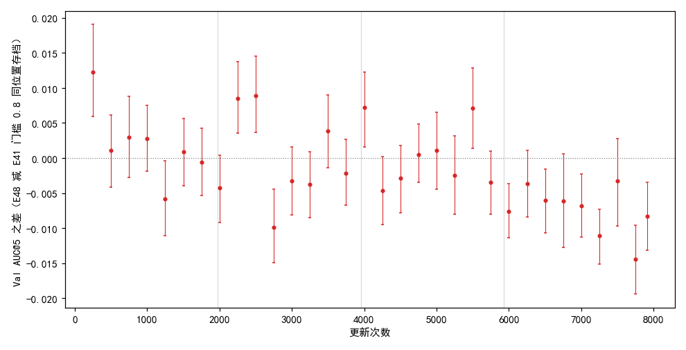
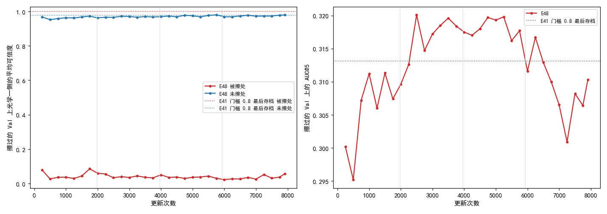
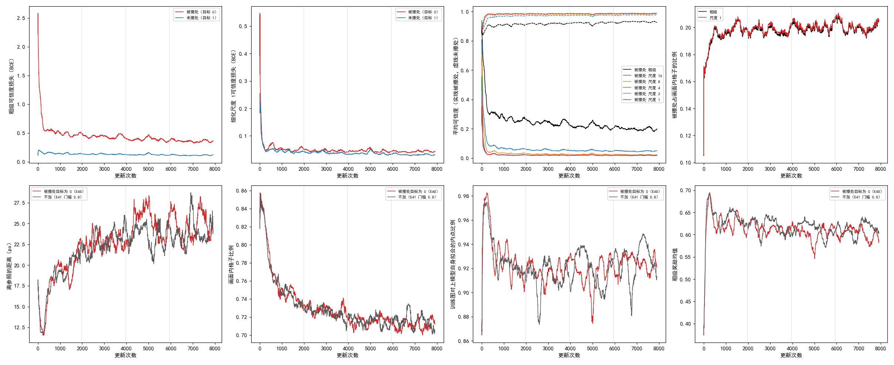

# 让 SAR 被擦处的可信度目标为 0 后，模型在被擦处的可信度从接近 1 降到约 0.04；Val AUC@5 前三段与不加持平，最后一段低 0.0075

**摘要**

现有的强化学习训练只检查模型的对应离参照仿射有多近，从不检查可信度对不对；而最终用 RANSAC 拟合配准时，正是按可信度挑点。训练数据本来就在 SAR 上随机擦掉几块，擦在哪儿是已知的，但现有训练忽略这张掩码：被擦处照常打分，可信度目标照常是 1。本文只改这一处：用参照仿射找出光学图上对到 SAR 被擦处的格子和像素，把那里的可信度目标改为 0，并且不让它们参与奖励打分；其余与 E41 里参照内点比例门槛 0.8 的那次训练完全相同。训练中，被擦处的平均可信度在前 250 次更新里就降下来，粗级到最后一段约 0.20，细化尺度 1 约 0.02，未擦处保持在 0.93 与 0.99。在按训练方式擦过的 Val 上，不加这一项的最后存档在被擦处的平均可信度是 0.999，加了之后各存档在 0.02–0.09 之间。没擦过的 Val 上，按训练集遍数分四段，AUC@5 的段平均与不加相差 +0.002、−0.000、+0.000、−0.0075；最后一段 9 个存档全都低于不加，最后一个存档 0.318 对 0.327，差 −0.008（−0.013 到 −0.004）。擦过的 Val 上，中段（第 2500–5750 次更新）的存档都高于不加的最后存档约 0.005，最后一个存档差 −0.003（−0.009 到 +0.003）。可信度确实学会了在被擦处给低分，但这没有换来没擦过的 Val 上配准的提高，后段反而更低。

**引言**

我们在用强化学习、不用标注训练 RoMa 做月球光学图与 SAR 图的配准。模型对一对图输出两图之间的稠密对应，同时给光学图的每个像素打一个可信度（0 到 1，读作“这里的对应有多可信”）；推理时按可信度从稠密对应里抽一批点对，再用 RANSAC 拟合成一个仿射。训练时每一步，模型的一份慢速平均副本（参数按滑动平均缓慢跟着模型走，下称参照模型）先对这对图正常推理一次、拟合出一个仿射当参照；模型自己的粗匹配和五级细化各自在输出周围抽若干个位置，离参照仿射给出的位置越近得分越高。另有两项小的辅助损失（粗级与细化各一项，权重 0.01）训练可信度：光学像素经参照仿射映到 SAR 画面内的，目标为 1，映到画面外的，目标为 0。

离参照近只是对的必要条件。可信度这一侧的问题更直接：它从没被检查过对错，只被要求“画面内为 1”。训练数据在 SAR 上随机擦掉 1–3 块（共占 10%–25% 面积，填全图均值），被擦处没有真实内容，正确的可信度应当为 0；而现有训练在被擦处照样要求可信度为 1，也照样按离参照的远近打分。擦在哪儿是已知的，不依赖模型自己；只有把 SAR 上的掩码搬到光学图上时要用参照仿射，参照偏了会让擦除块边界附近的目标出错。

本文把被擦处的可信度目标改成 0，并把被擦处从奖励打分里去掉，训一次，看可信度是否学会在被擦处给低分，以及这对 Val 上的配准有什么影响。

**方法**

*训练设置。* 与 E41 门槛 0.8 那次训练完全相同，只多这一项：从原始 RoMa 起训，DINOv2 每块 qkv 加 LoRA（r 8），VGG 放开；粗匹配抽锚点，细化五级（尺度 16、8、4、2、1）各自在输出周围局部抽签；参照模型的滑动平均系数 τ = 0.996；参照内点比例低于 0.8 的图对不学、换下一对；4 张卡数据并行，每次更新每张卡一对图；主学习率 2e-4、LoRA 学习率 4e-4；训练扰动含 SAR 随机擦除；种子 0；共 7907 次更新（训练集 4 遍），每 250 次更新存档。坍缩判据照旧，本次没有触发。对照直接用 E41 门槛 0.8 已有的逐存档结果，不重跑；两次训练都在 4 张 V100 上。

*被擦处怎样处理。* 每对图照常做扰动、擦除、筛选、参照推理。然后把光学图粗级网格和细化各级网格的每个格子（像素）中心经参照仿射映到 SAR 上，落在擦除掩码里的记为被擦处。被擦处从“画面内”掩码里去掉，于是它的可信度目标变为 0，奖励的优势置零，即不参与打分，和现有的画面外格子同样处理。不新增损失项，两项可信度损失的权重仍为 0.01。实现在单独的模块里，现有训练只加了几行挂接；不开这一项时训练与之前逐位相同（有测试核对）。训练中另记（只记录、不参与训练）被擦处与未擦处各自的可信度损失、平均可信度，以及被擦处占画面内格子的比例；未擦处指画面内、没被擦的格子。

*评测。* 每个存档在不加扰动、不擦除的验证集（652 对有标注）上评测，口径同 E41：配准误差是光学图上的标注点经估计的仿射映射后到 SAR 图上对应标注点的平均距离；AUC@x 是“误差不超过 t 像素的图对比例”在 t 从 0 到 x 像素上的面积除以 x；SR@x 是误差不超过 x 像素的图对比例。与不加同一存档位置的 AUC@5 之差用配对自助法估 95% 区间：在同一批 652 对上有放回地重抽 2000 次，取差的 2.5% 与 97.5% 分位；区间两端都为正称明显更高，都为负称明显更低。按训练集遍数把存档分成四段，每段约 1977 次更新。本文 32 个存档中 25 个在 RTX 3090、7 个在 V100 上评测，不加的 32 个里 11 个在 RTX 3090、21 个在 V100 上（逐存档见 `extra/data/vs_e41.csv`）。

*擦过的 Val。* 另把同一批 652 对的 SAR 按训练的擦除方式擦一份，随机数只由图对名决定，所有存档用同一份。每个存档在上面推理一次，算 AUC@5，并算光学一侧可信度在被擦处与未擦处的平均。这里光学像素是否对到被擦处，用标注拟合的真实仿射判断（标注只用于评测）；被擦处平均占画面内像素的 17.6%。对照为不加的最后存档，差与区间同上。

*停止规则。* 票里规定：第 2000 次更新时，若前 8 个存档的 AUC@5 都低于不加的同位置存档，或 8 个差的平均低于 −0.01，就停训。实际 8 个差平均 +0.0012，8 个里 3 个为负，没有触发，训满 4 遍。

**结果**

*被擦处的可信度在训练开始后很快降下来，粗级降得最慢。* 表 1、图 1 上排。前 250 次更新里，被擦处的平均可信度粗级 0.36、细化尺度 16 为 0.12、尺度 1 为 0.03；此后粗级继续缓慢下降，到最后一段为 0.20，细化各级都在 0.05 以下。未擦处的平均可信度粗级从 0.89 升到 0.93，细化尺度 1 在 0.98–0.99。被擦处约占画面内格子的 20%，各级相同。可信度损失在被擦处始终高于未擦处，粗级相差约 3–4 倍，细化尺度 1 只高约 0.01。

表 1：训练中被擦处与未擦处的平均可信度与可信度损失（各段平均）。

| 更新次数 | 被擦处占比 | 粗级 被擦处 | 粗级 未擦处 | 尺度 16 被擦处 | 尺度 1 被擦处 | 尺度 1 未擦处 | 粗级损失 被擦处 / 未擦处 | 尺度 1 损失 被擦处 / 未擦处 |
|---|---|---|---|---|---|---|---|---|
| 1–250 | 0.18 | 0.36 | 0.89 | 0.12 | 0.029 | 0.976 | 0.66 / 0.15 | 0.057 / 0.052 |
| 251–1977 | 0.20 | 0.26–0.31 | 0.90–0.91 | 0.06–0.08 | 0.019–0.028 | 0.981–0.984 | 0.47–0.55 / 0.14–0.16 | 0.048–0.067 / 0.041–0.050 |
| 1978–3954 | 0.20 | 0.24 | 0.92 | 0.053 | 0.019 | 0.984 | 0.44 / 0.13 | 0.045 / 0.038 |
| 3955–5931 | 0.20 | 0.21 | 0.92 | 0.049 | 0.019 | 0.985 | 0.39 / 0.12 | 0.045 / 0.035 |
| 5932–7907 | 0.20 | 0.20 | 0.93 | 0.048 | 0.018 | 0.986 | 0.36 / 0.11 | 0.043 / 0.031 |

*擦过的 Val 上，不加的模型在被擦处的可信度比未擦处还高，加了之后降到 0.02–0.09。* 表 2、图 3 左。不加的最后存档在被擦处平均 0.999、未擦处 0.978；本文各存档在被擦处 0.022–0.085，未擦处 0.952–0.980，后者随训练略升。

*没擦过的 Val 上，前三段与不加持平，最后一段 9 个存档全都低于不加。* 表 3、图 2。四段的平均差依次为 +0.002、−0.000、+0.000、−0.0075。前三段 23 个存档里 5 个明显更高、2 个明显更低；最后一段 9 个存档全部为负，其中 6 个明显更低。最后一个存档 0.318 对 0.327，差 −0.008（−0.013 到 −0.004），换一批验证图大概率仍是本文更低。全程最高点 0.331（第 4000 次更新），不加的最高点 0.333（第 4250 次更新）。最后一个存档的其他指标：AUC@3 0.095 对 0.102，SR@3 0.396 对 0.425，SR@5 0.827 对 0.833，误差中位数都是 3.30 px。各存档的 AUC@3、SR@3、SR@5、误差中位数见 `extra/data/val.csv`。

表 3：按训练进度分四段的平均 Val AUC@5（没擦过的 Val）。差为本文减不加；明显更高 / 更低指 95% 区间两端同号的存档数。

| 段（更新次数） | 存档数 | 本文 | 不加 | 差 | 低于不加的存档数 | 明显更高 | 明显更低 |
|---|---|---|---|---|---|---|---|
| 1（250–1750） | 7 | 0.3156 | 0.3136 | +0.0020 | 2 | 1 | 1 |
| 2（2000–3750） | 8 | 0.3256 | 0.3259 | −0.0003 | 5 | 2 | 1 |
| 3（4000–5750） | 8 | 0.3284 | 0.3281 | +0.0003 | 4 | 2 | 0 |
| 4（6000–7907） | 9 | 0.3207 | 0.3282 | −0.0075 | 9 | 0 | 6 |

图 2：最后一段的差全部在 0 以下，前三段在 0 上下交替。纵轴为本文减不加同一存档位置的 Val AUC@5 之差，竖线为配对自助法 95% 区间，灰色竖线把更新次数分成四段。

*擦过的 Val 上，中段多数存档高于不加的最后存档约 0.005，前段和后段低于它。* 表 2、图 3 右。不加的最后存档在擦过的 Val 上 AUC@5 为 0.313，比它在没擦过的 Val 上（0.327）低 0.014；本文最后存档为 0.310，比没擦过时（0.318）低 0.008。第 2500–5750 次更新的 14 个存档都高于 0.313，差在 +0.002 到 +0.007 之间，其中 4 个明显更高；第 250、500 次更新与第 7250、7750 次更新明显更低。最后一个存档差 −0.003（−0.009 到 +0.003），换一批验证图，两者谁高都有可能。

表 2：擦过的 Val 上的平均可信度与 AUC@5（选列存档，全部见 `extra/data/erased.csv`）。差为本文减不加的最后存档。

| 模型 | 更新次数 | 被擦处可信度 | 未擦处可信度 | AUC@5 | 差（95% 区间） |
|---|---|---|---|---|---|
| 不加 | 7907 | 0.999 | 0.978 | 0.313 | — |
| 本文 | 250 | 0.078 | 0.968 | 0.300 | −0.013（−0.021 到 −0.005） |
| 本文 | 2000 | 0.060 | 0.963 | 0.310 | −0.003（−0.010 到 +0.003） |
| 本文 | 3500 | 0.036 | 0.971 | 0.320 | +0.007（+0.001 到 +0.013） |
| 本文 | 5250 | 0.038 | 0.969 | 0.320 | +0.007（+0.001 到 +0.013） |
| 本文 | 7250 | 0.052 | 0.973 | 0.301 | −0.012（−0.018 到 −0.006） |
| 本文 | 7907 | 0.057 | 0.979 | 0.310 | −0.003（−0.009 到 +0.003） |

图 3：本文在被擦处的可信度全程远低于不加（左，虚线为不加的最后存档）；擦过的 Val 上的 AUC@5 在中段高于不加的最后存档（右）。

*离参照的距离、画面内格子比例、训练图对上自身拟合的内点比例和粗级奖励，都与不加走势相同。* 图 1 下排。四条曲线与不加交织在一起，没有哪一条在某一段持续偏开。

图 1：训练曲线（200 次更新滑动中位数）。上排：粗级与细化尺度 1 的可信度损失（被擦处、未擦处），各级平均可信度（实线被擦处、虚线未擦处），被擦处占画面内格子的比例；下排（与不加叠画）：离参照的距离、画面内格子比例、训练图对上模型自身拟合的内点比例、粗级奖励均值。灰色竖线把更新次数分成四段。

*开销与不加相当。* 每次更新耗时中位数 1.21 s 对 1.19 s，训练墙钟 3.46 h 对 3.35 h，峰值显存都是 11.2 GB（都在 4 张 V100 上，见 `extra/data/cost.csv`）。

**讨论**

票里的问题是：把 SAR 被擦处的可信度目标改为 0、并从奖励打分里去掉，可信度能否学会在被擦处给低分，Val 上的配准有什么变化。第一个问题有了答案：不加时模型在被擦处的可信度接近 1，甚至高于未擦处；加了之后几百次更新内就降到很低，擦过的 Val 上被擦处约 0.04，未擦处基本不变。第二个问题在这一个种子上的答案是：没擦过的 Val 上前三段与不加持平，最后一段 9 个存档全部更低，平均低 0.0075；擦过的 Val 上，被擦处可信度降低后，中段存档比不加的最后存档高约 0.005，但最后一个存档与它相当。

局限有四点。第一，单种子，对照没有重跑；E41 自身相邻存档之间起伏约 0.01，E42 里同配置两次训练逐存档相差可达 0.006。第二，配对自助法只反映换一批验证图带来的波动，不反映训练的随机性；各存档之间也不独立。第三，两次训练的存档在两种卡上评测的比例不同（本文多为 RTX 3090，不加多为 V100）。第四，训练中被擦处是用参照仿射映到光学图上的，擦除块边界附近的目标可能偏；没擦过的 Val 上没有被擦处，可信度的变化只能通过挑点间接影响结果。

还有三点没有解释，各附一个能区分的检查（都未检验）。

一是粗级被擦处的可信度为什么只降到约 0.20，而细化各级降到 0.05 以下。可能是粗级格子大，擦除块边缘的格子一半被擦一半没被擦，目标只按格子中心定；也可能是粗级可信度的表达能力本身有限。区分的办法：只统计离擦除块边界两格以上的粗级格子，看那里的可信度是否也降到 0.05 左右。

二是最后一段为什么低于不加。可能与可信度的改动有关（例如未擦处的可信度在挑点时的相对排序变了），也可能只是这个种子的起伏。区分的办法：换种子重跑本文与不加各一次，看最后一段的差是否保持同号；或在没擦过的 Val 上比较两者最后存档按可信度挑出的点在 RANSAC 后的内点比例与空间分布。

三是擦过的 Val 上，为什么被擦处可信度从 0.999 降到 0.04，配准却只在中段高出约 0.005，到最后与不加相当。可能是 RANSAC 本身已能剔除被擦处的大部分错误点对，可信度挑点带来的收益有限。区分的办法：在擦过的 Val 上统计两者最后存档抽到的点对里落在被擦处的比例，以及这些点对是否被 RANSAC 判为外点。
