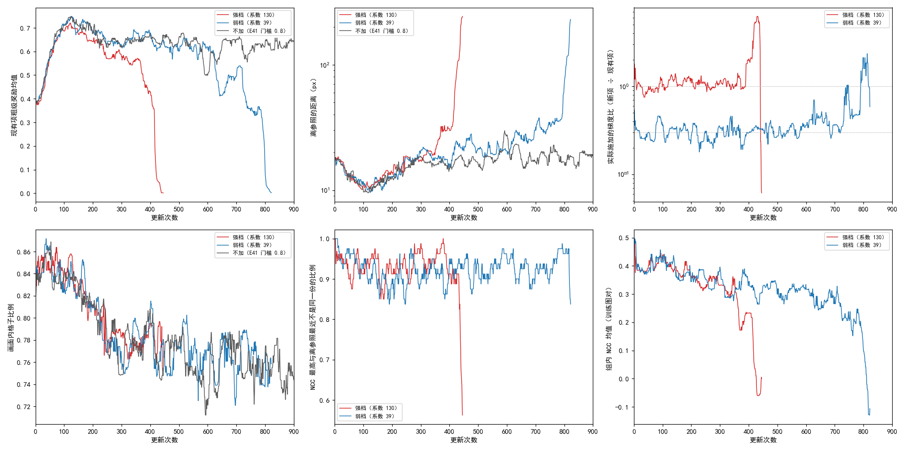

# 按实际施加的梯度比改正系数后，加图像相似度约束的训练仍会崩掉：比例约 1 时停在第 445 次更新，约 0.3 时停在第 822 次更新

**摘要**

现有的强化学习训练里，奖励看的是模型抽到的对应离参照仿射有多近，参照来自模型自己的慢速平均副本；模型和副本一起整体错时，这个奖励看不见。上一次实验（E44）在它旁边加了一项不经过参照的约束：每份粗级样本拟合一个仿射，按它把 SAR 变到光学图上，两图灰度的归一化互相关（NCC）越高奖励越高。那次训练在第 327 次更新崩掉，而实际施加的新项梯度是现有项的 1.2–1.8 倍，比原本想要的 1:1 大，所以说不清崩掉是这项约束本身的问题还是只是太强。本文先补上"两项梯度各自在 4 张卡间平均之后的范数之比"这个量，用 100 次更新把系数重新定准：系数 190 时这个比例的中位数为 1.45，于是强档系数取 130（比例约 1），弱档取 39（约 0.3），其余设置与 E44 相同，各训一次。正式训练中，强档的比例在崩掉前四段（每段 100 次更新）的中位数为 0.93–1.17，弱档在前六段为 0.26–0.33，都接近目标。两次训练仍都被坍缩判据停下：强档在第 445 次更新，弱档在第 822 次更新；连同 E44，系数 190、130、39 依次停在第 327、445、822 次更新。崩掉前，离参照的距离先比不加新项的对照（E41 门槛 0.8）高出几 px 到十几 px，现有项的奖励随后下降，实际比例在这之后才升高。崩掉前的存档 Val AUC@5 与对照同一位置相差 −0.003 到 +0.002，95% 区间都跨过 0。NCC 最高的样本与离参照最近的样本是同一份的步数比例约 5–10%，与 16 份样本里随机挑中同一份的 6% 相近。

**引言**

RoMa 先在粗网格上为光学图的每个格子给出 SAR 图上各位置的概率，训练时从中为每个格子抽一个落点，合起来是一份粗级样本，即一整张对应场；再逐级细化。现有的强化学习训练对同一对图抽一组样本（每组 16 份），按每个落点离参照仿射映过去的位置有多近给奖励，组内比较好坏后提高好样本的概率。参照来自模型自己的慢速平均副本，所以模型和副本一起把整幅图平移、旋转或缩放错同一个量时，现有奖励看不见。

E44 加了一项只用两张图像素的约束：把 SAR 按一份样本拟合的仿射变到光学网格上，算两图灰度的 NCC（重叠区域逐像素灰度的相关系数，−1 到 1，越大越像），作为这份样本的另一项奖励。新项的系数本意是让两项的梯度一样大，但 E44 的系数是在只量不学的 50 次更新里按各卡梯度大小定的，而真正更新参数时用的是 4 张卡梯度的平均；平均后的大小取决于各卡梯度方向是否一致，各卡各自的大小里没有这个信息。结果 E44 实际施加的新项梯度偏大，并在训练中逐渐升高，训练在第 290 次更新前后崩掉。

崩掉可能是这项约束本身把模型推离，也可能只是它太强。本文先补上"4 卡平均后的梯度之比"这个量，按它定系数，让实际比例分别约为 1 和 0.3，各训一次，看训练是否仍会崩掉、崩掉之前与对照相比如何。

**方法**

*训练设置。* 与 E41 里参照内点比例门槛 0.8 的那次训练（下称对照）完全相同，再加 E44 的图像相似度约束，只改新项系数：从原始 RoMa 起训，DINOv2 每块 qkv 加 LoRA（r 8），VGG 放开；粗匹配每组 16 份样本，细化五级各自局部抽签；参照模型的滑动平均系数 τ = 0.996；参照内点比例低于 0.8 的图对不学、补抽下一对；4 张 V100 数据并行，每次更新每张卡一对图；主学习率 2e-4、LoRA 学习率 4e-4；难版训练扰动；种子 0；计划 7907 次更新，每 250 次更新存档。新项的算法同 E44：每份粗级样本用全部格子拟合一个仿射（RANSAC），把 SAR 按它变到光学网格上，在 SAR 非补零区内算灰度 NCC，拟合失败或重叠不足 1000 px 记 −1；每份样本的优势为它的 NCC 减去同组其余 15 份的平均，乘在这份样本粗级的对数概率上，细化各级不加。对照直接用 E41 已有的逐存档结果和训练日志，不重跑。

*实际施加的梯度比。* 在两项共用的参数上，先把现有项梯度、新项梯度各自在 4 张卡之间取平均（与真正更新参数时相同），再算"系数 × 新项平均梯度的范数 ÷ 现有项平均梯度的范数"，每次更新记一个数，下称实际比例。随训练的走势用每 100 次更新内逐步实际比例的中位数表示。

*系数怎样定。* 从原始 RoMa 起，用同一配置、新项系数 190（E44 的值）真正施加，训 100 次更新，逐步记实际比例。97 次有记录的更新上，中位数 1.452（四分位 1.02–1.89），按每 25 次更新分段的中位数依次为 1.29、1.42、1.61、1.64；现有项与新项平均梯度范数的中位数分别为 0.956 与 0.0075。强档系数 = 190 ÷ 1.452，取两位有效数字为 130；弱档 = 0.3 × 130 = 39。作为对照，按 E44 的口径（4 张卡各自比值的平均）算出的中位数为 1.39，各卡梯度范数的中位数为 1.83 与 0.0134，都大于 4 卡平均之后的值。

*坍缩判据与停止规则。* 照 E44：离参照的距离（落点到参照仿射映过去的位置的距离）的 200 条记录滑动中位数超过 100 px，或画面内格子比例的滑动中位数低于 0.5，就停训。票里另有一条按前 8 个存档判断是否停训的规则，两次训练都没到第 8 个存档，未用上。

*评测。* 存档在不加扰动的验证集（652 对有标注）上评测，口径同 E41：配准误差是光学图上的标注点经估计的仿射映射后到 SAR 图上对应标注点的平均距离；AUC@x 是"误差不超过 t 像素的图对比例"在 t 从 0 到 x 像素上的面积除以 x；SR@x 是误差不超过 x 像素的图对比例。与对照同一存档位置的 AUC@5 之差用配对自助法估 95% 区间：在同一批 652 对上有放回地重抽 2000 次，取差的 2.5% 与 97.5% 分位。本文和对照的第 250、500、750 次更新存档都在 RTX 3090 上评测。

*诊断。* 每个训练步记录：NCC 最高的样本与离参照最近的样本不是同一份的比例（每组 16 份，两者毫无关系时是同一份的概率为 1/16 ≈ 0.06）、新项优势的组内标准差、组内 NCC 均值。每 50 次更新在 4 对有标注的验证图上照训练抽 16 份样本，算组内 NCC 与真实配准误差的 Spearman 秩相关（为负表示 NCC 高的样本误差小），只记录、不参与训练。现有项的粗级奖励与对照在同一段更新上的平均比较。

**结果**

*实际比例在崩掉之前接近目标：强档约 1，弱档约 0.3。* 表 1、图 1 右上。强档前四段的中位数为 0.93、1.17、1.06、1.08，崩掉的第 401–445 次更新升到 4.6；弱档前六段为 0.26–0.33，第 601–700 次更新起升到 0.39、0.50，崩掉的第 801–822 次更新为 0.94。逐步的实际比例起伏较大，弱档前 600 次更新的四分位约为 0.15–0.48。

*两次训练都被坍缩判据停下，系数越小停得越晚。* 图 1。强档离参照的距离的滑动中位数在第 445 次更新越过 100 px（104.2 px），弱档在第 822 次更新（102.7 px）。连同 E44，系数 190、130、39 依次停在第 327、445、822 次更新。崩掉的过程与 E44 相同：离参照的距离在几十次更新内升到 100 px 以上，现有项奖励降到接近 0，组内 NCC 均值降到 0 以下，记 −1 的样本比例升高。

图 1：强档（红）和弱档（蓝）都在离开对照（灰）的走势之后崩掉，实际比例在崩掉之前接近各自的目标。上排：现有项的粗级奖励均值、离参照的距离（对数轴）、实际比例（对数轴，虚线为 1 和 0.3）；下排：画面内格子比例、NCC 最高与离参照最近不是同一份的比例、训练图对上的组内 NCC 均值。均为 20 次更新的滑动中位数（比例为滑动平均），横轴到第 900 次更新。

*崩掉之前，离参照的距离先高出对照，现有项奖励随后下降，实际比例在这之后才升高。* 表 1、图 1。强档前 300 次更新的离参照距离中位数与对照相差不到 1 px，第 301–400 次更新为 24.1 px 对 16.2 px；现有项奖励比对照低 0.02–0.04，第 301–400 次更新低 0.15；这一段实际比例仍为 1.08。弱档前 400 次更新的现有项奖励与对照相差 0.01 以内，离参照的距离高 0.5–2.3 px；第 401–500 次更新距离 23.1 px 对 17.2 px、奖励低 0.04；第 601–700 次更新距离 25.9 px 对 18.0 px、奖励低 0.13，实际比例此时才从约 0.3 升到 0.39。两次训练的组内 NCC 均值从开训时约 0.40 一路下降，在崩掉之前已降到强档 0.26、弱档 0.18（对照没有记录这个量）。

表 1：每 100 次更新一段的训练诊断。奖励差与距离均与对照同一段比较；距离为离参照的距离的中位数（px），括号内为对照；"同一份"为 NCC 最高与离参照最近是同一份样本的步数比例。

| 训练 | 更新 | 实际比例（中位数） | 现有项奖励 − 对照 | 距离（对照） | 组内 NCC 均值 | 同一份 | 优势组内标准差 | 秩相关（验证图对） |
|---|---|---|---|---|---|---|---|---|
| 强档 | 1–100 | 0.93 | −0.02 | 13.2（12.6） | 0.41 | 0.07 | 0.011 | −0.65 |
| 强档 | 101–200 | 1.17 | −0.04 | 11.9（11.1） | 0.38 | 0.08 | 0.006 | −0.43 |
| 强档 | 201–300 | 1.06 | −0.04 | 16.8（16.0） | 0.34 | 0.06 | 0.007 | −0.86 |
| 强档 | 301–400 | 1.08 | −0.15 | 24.1（16.2） | 0.26 | 0.06 | 0.012 | −0.05 |
| 强档 | 401–445 | 4.59 | −0.56 | 109.8（17.8） | −0.00 | 0.26 | 0.042 | — |
| 弱档 | 1–100 | 0.29 | −0.01 | 13.1（12.6） | 0.40 | 0.05 | 0.011 | −0.56 |
| 弱档 | 101–200 | 0.32 | −0.01 | 11.6（11.1） | 0.38 | 0.10 | 0.005 | −0.46 |
| 弱档 | 201–300 | 0.26 | +0.01 | 17.1（16.0） | 0.36 | 0.10 | 0.005 | −0.53 |
| 弱档 | 301–400 | 0.29 | +0.01 | 18.5（16.2） | 0.32 | 0.09 | 0.004 | −0.04 |
| 弱档 | 401–500 | 0.33 | −0.04 | 23.1（17.2） | 0.31 | 0.08 | 0.007 | −0.48 |
| 弱档 | 501–600 | 0.31 | +0.01 | 19.8（19.3） | 0.31 | 0.07 | 0.005 | −0.60 |
| 弱档 | 601–700 | 0.39 | −0.13 | 25.9（18.0） | 0.26 | 0.08 | 0.014 | −0.45 |
| 弱档 | 701–800 | 0.50 | −0.27 | 35.7（19.3） | 0.18 | 0.06 | 0.035 | −0.28 |
| 弱档 | 801–822 | 0.94 | −0.58 | 219.7（18.5） | −0.12 | 0.15 | 0.040 | — |

*崩掉前的存档 Val AUC@5 与对照同一位置相差 −0.003 到 +0.002。* 表 2。强档只有第 250 次更新一个存档，0.301 对 0.304，差 −0.003（−0.010 到 +0.004），换一批验证图高低可能反过来。弱档三个存档的差依次为 +0.001（−0.006 到 +0.007）、−0.002（−0.007 到 +0.004）、+0.002（−0.003 到 +0.008），三个都是换一批验证图高低可能反过来；平均差 +0.0005。弱档最后一个存档（第 750 次更新）是在实际比例开始升高、现有项奖励已比对照低约 0.13 的那一段之后存下的，AUC@5 0.309。各存档的 AUC@3、SR@3、SR@5 和误差中位数与对照相差都不超过 0.02 与 0.08 px。

表 2：各存档的 Val 指标，括号内为对照同一存档位置的值；AUC@5 差为本文减对照，后附 95% 区间。

| 训练 | 更新 | AUC@5 | AUC@5 差 | AUC@3 | SR@3 | SR@5 | 误差中位数（px） |
|---|---|---|---|---|---|---|---|
| 强档 | 250 | 0.301（0.304） | −0.003（−0.010 到 +0.004） | 0.100（0.100） | 0.402（0.400） | 0.761（0.770） | 3.47（3.41） |
| 弱档 | 250 | 0.305（0.304） | +0.001（−0.006 到 +0.007） | 0.100（0.100） | 0.396（0.400） | 0.768（0.770） | 3.39（3.41） |
| 弱档 | 500 | 0.306（0.308） | −0.002（−0.007 到 +0.004） | 0.100（0.101） | 0.402（0.413） | 0.768（0.768） | 3.37（3.44） |
| 弱档 | 750 | 0.309（0.307） | +0.002（−0.003 到 +0.008） | 0.103（0.100） | 0.417（0.402） | 0.767（0.775） | 3.37（3.41） |

*NCC 最高的样本与离参照最近的样本，崩掉之前是同一份的步数比例为 5–10%，与随机的 6% 相近。* 表 1。两次训练崩掉之前各段都在 0.05–0.10 之间，崩掉的那一段升到 0.15–0.26。验证图对上组内 NCC 与真实误差的秩相关多在 −0.4 到 −0.9 之间，每段只来自 8 对验证图，两次训练各有一段接近 0。新项优势的组内标准差在崩掉之前为 0.004–0.014，崩掉时升到约 0.04。

*每次更新的耗时是对照的 1.16 倍，峰值显存相同。* 弱档第 101–822 次更新每次更新耗时中位数 2.08 s，对照同一段 1.79 s，其中新项 1.00 s；三次训练峰值显存都是 11.2 GB。强档开训到最后一个存档 0.81 小时，弱档 1.05 小时。

**讨论**

票里问的是：系数改到实际比例约 1 或约 0.3 时，训练是否仍会崩掉，崩掉之前与对照相比如何。两次训练都崩了，比例越小崩得越晚；崩掉之前的 4 个存档与对照的差都在 ±0.003 以内，区间都跨过 0，看不出这一项在崩掉之前帮了忙还是拖了后腿。训满之后会怎样、后面的存档与对照相比如何，这次没有数据。

局限：单种子，对照没有重跑，崩掉的时刻在不同种子下可能不同；系数全程固定；定系数只覆盖前 100 次更新；E41 自身相邻存档间起伏约 0.01，而本文最多只有 3 个存档；秩相关每段只来自 8 对验证图；新项只作用在粗级。

尚未解释的现象。第一，偏离从哪里开始：两次训练里离参照的距离和现有项奖励都先于实际比例偏离对照，实际比例在偏离已经开始之后才升高。这可能意味着推离模型的不是新项梯度变大，而是新项方向上持续的小推动在积累（未检验）；能区分的检查是在偏离开始前的存档（强档第 250 次更新）上分别只用现有项、只用新项更新若干步，看哪一项使离参照的距离增大。第二，组内 NCC 均值在两次训练中从开训起一路下降，弱档在实际比例只有 0.3 的前 600 次更新里也从 0.40 降到 0.31；对照没有记录 NCC，不知道不加新项时它是否同样下降（未检验）；在对照的存档上补算训练图对的组内 NCC 即可比较。第三，NCC 最高与离参照最近的样本是同一份的比例与随机相近，而验证图对上 NCC 与真实误差的秩相关多为明显的负值；两项奖励在组内给出的次序可能差别很大（未检验），可以在同一批训练图对上直接量两者的组内秩相关。
