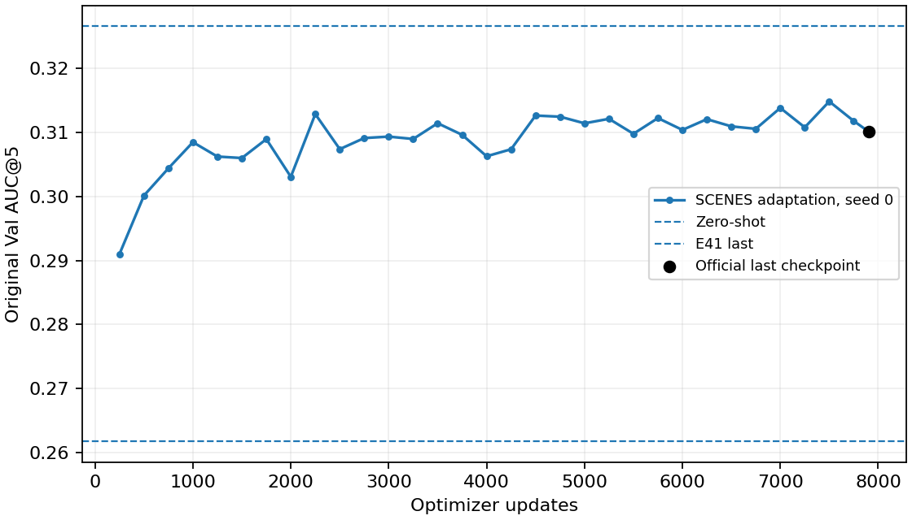

# 固定伪仿射适配的 Test AUC@5 为 0.2854，相对 E41 最后存档变化 -0.0168

**摘要**

本实验为月球光学–SAR 仿射配准增加 SCENES bootstrapping 的 RoMa／仿射任务适配对照。只用发布起点在无标注 Train 上生成一次伪仿射，再从同一起点训练 VGG 和完整 decoder；不使用目标域标注，也不混入有标注源域数据。固定种子 0 完成 7907 次有效更新，最后存档在原始 Val/Test 的 AUC@5 分别为 0.3101/0.2854。Test 相对 E41 最后存档的 AUC@5 差为 -0.0168，按 patch 对配对重抽的 95% 区间为 [-0.0235, -0.0100]。全部逐存档 Val 读数与最后存档 Test 已保存，比较的是完整训练配方，不能单独归因于损失形式。

**引言**

RoMa 先用图像特征给出粗对应位置，再用多级细化逐步调整位置和匹配置信度。SCENES bootstrapping 用起点模型的匹配估计几何关系，再以这一固定几何为监督微调模型。本任务要估计光学到 SAR 的仿射，因此以每个 patch 对一个伪仿射代替极线几何，并保留 RoMa 原生的锚点分类、鲁棒位置回归和 certainty 损失。这里检验这套适配在既定比较预算下的结果，不把它称作原始极线损失的严格复现。

**方法**

*来源与适配。* [SCENES §3.4、§4](https://arxiv.org/html/2401.10886v1#S3.SS4) 给出 bootstrapping 和论文的 100 匹配／20 内点门槛；[官方骨架 a6962bef](https://github.com/dakloepfer/scenes-finetuning/tree/a6962befb169dc5a2f06ca8fee075b1ea289ea30) 没有完整训练配置。本实验按 [AnyMatch 公开训练入口 259ad343](https://github.com/MnYangs/AnyMatch/blob/259ad343ffa9ca0703965f56880b3b5d2ecbc9e1/third_party/RoMa_AnyMatch/train_roma_outdoor.py) 设定底模范围、优化器和共同增强。公开脚本不等于发布权重实际使用命令已被确认。更换模型及几何/损失、不混有标注 MegaDepth、缩短训练预算并映射学习率下降点，均属于本次适配和比较协议。

*数据与固定几何。* 起点为 B0m/anymatch_roma__minmax 的发布权重 anymatch/RoMa_AnyMatch.pth，不接 E41 或其他已微调模型。光学 div255、SAR 逐 patch minmax；统一推理为长边 640、粗级 560、上采样 864、双向预测、threshold_balanced 采样 10000 点，种子 0 逐对重置。全部 7907 个 Train patch 对的原始点对保存在 raw/teacher_*/train.npz，推理实际参数、权重 SHA256 和环境在各 train.meta.json 及 [标签身份记录](extra/labels_meta.json)。以原始 512 网格 RANSAC 3 px 拟合仿射；阈值是本任务口径，不是 SCENES 的 F 矩阵阈值。只要求拟合成功、匹配至少 100、内点至少 20。固定伪仿射见 [逐对标签](extra/labels.jsonl)，名单见 [保留名单](extra/kept.json)。不做前一半筛选、内点率阈值、加权或训练中重估。

| Train 总数 | 保留数 | 内点数最小值／25%／中位数／75%／最大值 |
|---:|---:|---|
| 7907 | 7907 | 333 / 1341.5 / 3308 / 5682.5 / 10000 |

表 1：只按预定的匹配数和内点数门槛确定训练集合，分位数按全部 Train 统计。

*训练配方。* VGG 和完整 decoder（粗级及五级细化）参与训练，BN 沿用上游训练模式；DINOv2 按上游冻结提特征，无 LoRA。训练输入 560；两图共同做 x/y 各 [-32,32] 整数平移，在 ImageNet 归一化后补零，再以 0.5 概率共同水平翻转。固定仿射精确变为 G A G⁻¹，查询和目标两侧的补零区都纳入有效区计算。保留最近锚点分类 CE、多尺度鲁棒回归、certainty BCE，ce_weight=0.01、alpha=0.5、c=1e-4、local_dist={1:4,2:4,4:8,8:8}、local_largest_scale=8 和上游尺度权重；不带入软锚点、残差剔除、额外容差、稠密老师或可匹配检查。

*优化与预算。* AdamW，默认 betas=(0.9,0.999)、eps=1e-8，weight decay=0.01；单卡 batch=4，无累积。VGG lr=2.5e-6、decoder 各部分 lr=5e-5；梯度范数裁剪 0.01，无 warmup。MultiStepLR 在完成第 7116 次更新后乘 0.1，即第 7117 次更新起使用衰减学习率。AMP GradScaler 的增长间隔与公开脚本一致为 1000000；溢出被跳过的尝试不计入有效更新预算，记录 2 次。实际完成 7907 次更新、31628 个参与更新的 patch 对次；筛选后的集合按种子 0 重复打乱遍历。每 250 次存档，另存最后 7907。每 500 次更新退出训练子进程、释放 GPU，再恢复模型、优化器、缩放器、数据顺序和全部随机流；不根据 Val 早停。训练进程累计 5.19 小时（包含已结束的失败尝试）；伪标签匹配进程累计 2.36 小时（含模型加载、I/O 及已结束的失败尝试），拟合 248.3 秒，二者分开记录。未确认结束的尝试数：训练 0、匹配 0，若非零则这些尝试的完整耗时未知。

*评价与统计。* 原始 Val 652 对，原始 Test 953 对。每个存档都评 Val，正式结果固定取最后 7907；Test 只评这一存档。仿射按统一 RANSAC 3 px 拟合，逐 patch 对误差为光学检查点经预测仿射到 SAR 检查点的平均距离，失败记 ∞，全部 patch 对等权。AUC@T 是 [0,T] 误差累积曲线的归一化面积；SR@T 是误差不超过 T 的比例，主要比较 AUC@5。配对比较按同一 patch 对的全精度误差做 2000 次重抽、种子 0，给差值的 95% 区间。区间只反映该数据集按 patch 对重抽的波动，不是训练种子波动。

全部 32 份 Val 和最后存档 Test 均逐份校验了完整且唯一的 pair 覆盖、匹配及预测完成记录，以及正常匹配点对的 NPZ 落盘情况。续评不把半份 JSONL 当作已完成存档，真实逐对推理错误仍按失败保留；服务器上的三项针对性检查覆盖了完整到半份、点对未落盘和真实逐对错误三种情况。

资源允许时，不同存档的 Val 评测并行；空闲卡不足时用可用空卡继续。每个 patch 对仍独立按相同参数推理，全部 Val 结束后才汇总和评最后存档 Test。每份完整预测的实际主机、GPU 和环境版本均保存在原始匹配 meta，并汇入 summary.json 的 evaluation_environments；曲线包含的 GPU 型号为 NVIDIA GeForce RTX 3090、Tesla V100-SXM2-32GB，最后存档 Test 使用 Tesla V100-SXM2-32GB。调度没有修改单对推理参数，但跨 GPU 的浮点结果不保证逐位相同。

*历史对照身份。* T13 的训练记录写明学生 init 为空、使用 anymatch/RoMa_AnyMatch.pth，输入为光学 div255、SAR minmax；这里按这一记录比较，不将图中的 M15 关系解释为学生从 M15 权重续训。历史记录未含发布权重 SHA256，因此只能核对发布权重路径和输入配置，不能逐字节确认历史权重与本实验相同。

**结果**

*最后存档与起点、既有自训练和 E41 的指标已按同一原始 split 口径列出。* 表 2 均用已有最后存档或 zero-shot。T13/main__step8000 是已有自训练的最后存档；E41/main__screen0.8 的 Val/Test 都是最后 7907，不将历史 Val 峰值的缺失存档当作 Test 对照。AUC 在 [0,1]，SR 和失败率为百分比，误差中位数单位为原始网格 px。

| 方法（选取规则） | split | AUC@3 | AUC@5 | AUC@10 | AUC@20 | SR@3 | SR@5 | SR@10 | SR@20 | 失败率 | 中位误差 |
|---|---|---:|---:|---:|---:|---:|---:|---:|---:|---:|---:|
| B0m/anymatch_roma__minmax（zero-shot） | val | 0.0824 | 0.2617 | 0.5410 | 0.7402 | 33.3% | 67.6% | 90.0% | 95.7% | 0.00% | 3.750 |
| T13/main__step8000（最后8000） | val | 0.1067 | 0.3225 | 0.6261 | 0.8098 | 42.3% | 81.9% | 98.0% | 100.0% | 0.00% | 3.326 |
| E41/main__screen0.8（最后7907） | val | 0.1017 | 0.3266 | 0.6352 | 0.8158 | 42.5% | 83.3% | 99.1% | 100.0% | 0.00% | 3.297 |
| E50/main（最后7907） | val | 0.1036 | 0.3101 | 0.6037 | 0.7909 | 41.6% | 77.0% | 95.6% | 99.1% | 0.00% | 3.363 |
| B0m/anymatch_roma__minmax（zero-shot） | test | 0.0848 | 0.2430 | 0.5024 | 0.6949 | 34.0% | 60.9% | 84.7% | 91.0% | 0.00% | 4.126 |
| T13/main__step8000（最后8000） | test | 0.0996 | 0.2962 | 0.5990 | 0.7922 | 39.3% | 74.6% | 96.7% | 99.3% | 0.00% | 3.456 |
| E41/main__screen0.8（最后7907） | test | 0.1041 | 0.3023 | 0.6117 | 0.8017 | 38.0% | 77.2% | 97.9% | 99.7% | 0.00% | 3.476 |
| E50/main（最后7907） | test | 0.0993 | 0.2854 | 0.5681 | 0.7590 | 38.0% | 70.0% | 92.1% | 96.3% | 0.00% | 3.542 |

表 2：所有正式比较均以最后存档或发布起点为依据，失败不从分母剔除。

*完整 Val 曲线的最高读数出现在第 7500 次更新，AUC@5 为 0.3148。* 这项补充读数不替换正式最后存档，也未用该存档补评 Test。全部 32 个存档的数值见 [Val 曲线数据](extra/data/val_curve.csv)。

图 1：固定种子 0 的全部 Val 存档读数；黑点是正式结果采用的最后存档，水平虚线是发布起点和 E41 最后存档。

*同一 patch 对上的 AUC@5 差及重抽区间见表 3。* 差值定义为本实验最后存档减参考方法，失败也保留在配对样本中。

| 参考方法 | split | ΔAUC@5 | 配对 bootstrap 95% 区间 |
|---|---|---:|---|
| B0m/anymatch_roma__minmax | val | +0.0484 | [+0.0396, +0.0581] |
| T13/main__step8000 | val | -0.0125 | [-0.0181, -0.0066] |
| E41/main__screen0.8 | val | -0.0165 | [-0.0246, -0.0080] |
| B0m/anymatch_roma__minmax | test | +0.0425 | [+0.0353, +0.0498] |
| T13/main__step8000 | test | -0.0108 | [-0.0164, -0.0056] |
| E41/main__screen0.8 | test | -0.0168 | [-0.0235, -0.0100] |

表 3：每行 2000 次按 patch 对配对重抽，不代表跨训练种子的稳定性。

真实模型检查核对了共同增强的图像接线、双侧有效区、原生 BN 统计更新、VGG/粗级/细化梯度路径和参数组；同一真实输出上的原生损失数值及输出梯度与固定上游版本对照，详细值见 [诊断记录](extra/probe.json)。首轮诊断观测到默认初始 AMP 缩放下粗级溢出，后续诊断验证自动降低缩放后梯度有限；正式预算按成功更新计数。实现测试及启动依据见 launch/ 和 PR。

启动前的代码洁净检查曾因共享盘 Git status 超过 120 秒而退出，当时没有生成伪标签或开始训练；随后显式将 Git 等待预算设为 600 秒，仍逐项检查代码洁净，不使用 dirty 放行。原始错误见 [启动前错误记录](extra/startup_failure.txt)。这一处理只改变等待时限，不改变训练或评价配方。

训练完成后的 Val 评测中，已完成 16 个存档时检测到两张卡出现额外 CUDA 进程，按共享用卡规则撤下了本方两个评测进程。一次单卡恢复又遇到同卡任务，再次撤下本方进程；随后迁至 150 的空闲 RTX 3090，补齐四份 Val。第 20 份完整落盘后，160 的两张 V100 已重新持续空闲，因此停止刚开始的下一份评测并迁回双卡，以缩短等待。始终保留训练和完整 Val 记录，重算中断的存档，没有重新训练或重估伪仿射。中断和恢复均保留在 main、pipeline 与 pipeline_resume 的启动记录中，两次单卡阶段日志另存 extra/eval_resume_interrupted_160.txt 与 extra/eval_resume_migration_150.txt。

全部预测和汇总生成后，恢复入口额外调用工作台评价时未传 MOON_DATA，导致该收尾命令退出。随后修正入口并由独立 finalize 启动记录完成 CPU 汇总、评价和检查，复用原有完整预测，不重新训练或推理；原始失败保留在 pipeline_resume 记录与 extra/finalize_missing_data.txt。

**讨论**

本实验补齐了预定预算下 SCENES bootstrapping 的 RoMa／仿射任务适配读数，完整数值与配对区间见 [汇总数据](extra/data/summary.json)。它与 E41 的可训练范围、BN 模式、扰动和优化配方不同，因此差异属于整套训练配方的比较，不能单独归因于 RL 或伪标签损失。目标域训练不使用标注，不否认起点含有预训练监督；没有源域混训和缩短预算也限制了对原论文的外推。

只运行种子 0，不能据此判断训练随机性下的稳定性；按 patch 对重抽的区间也未处理同 ROI 内的相关性。固定伪仿射本身可能有误，本实验没有用目标域标注改写它。曲线和分布提供了观察依据，未进一步检验产生差异的原因。没有重训 E41，也没有为缺失的 E41 峰值存档补训练。
