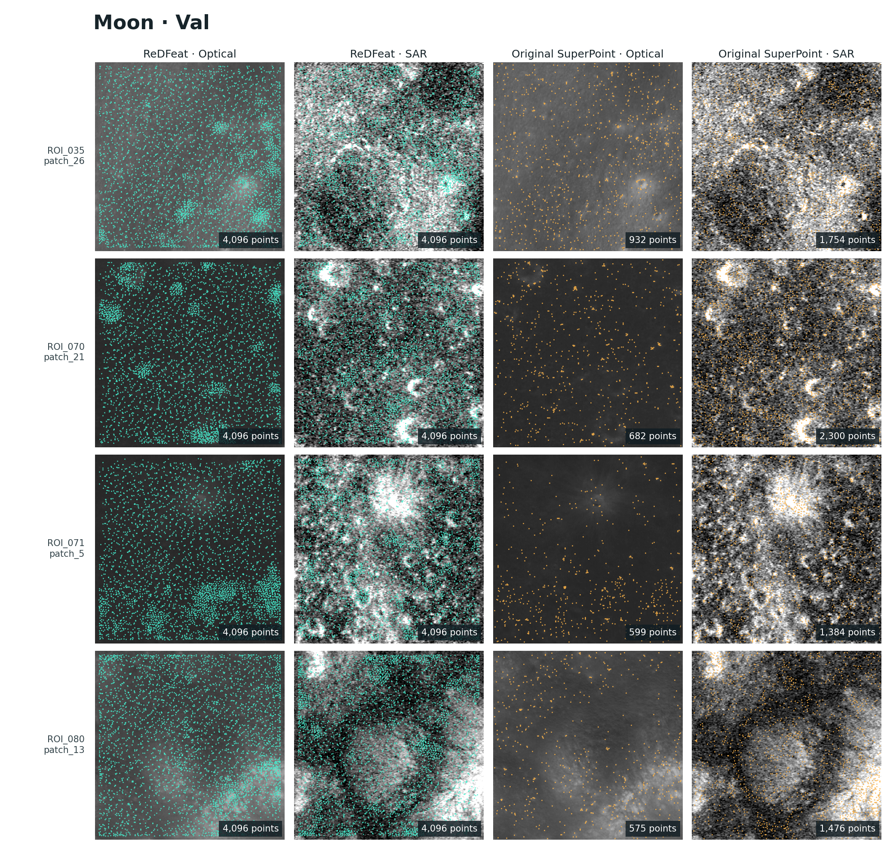
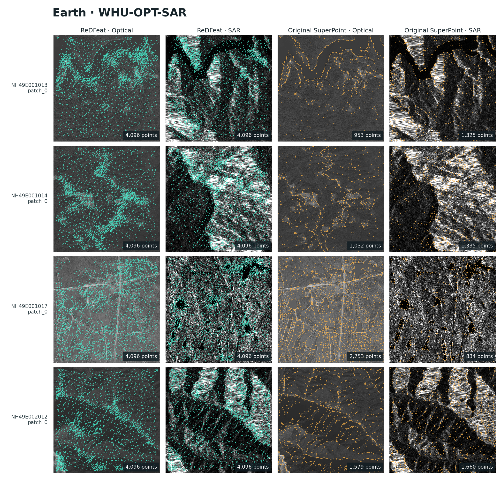

# 地球与月球首批 64 张图均已导出 ReDFeat 和原版 SuperPoint 检测点

**摘要**

为地球与月球的光学–SAR 检测对照准备逐图数据。WHU-OPT-SAR 与月球 Val 各选 16 对 patch，ReDFeat 和原版 SuperPoint 均在同一批 64 张图上导出了匹配前坐标和分数，执行失败为 0。ReDFeat 每张均达到 4096 点的输出上限。原版 SuperPoint 使用 B0 已核验的 `superpoint_v1.pth`。WHU 首批四景的 8 个源文件已下载和校验。

**引言**

B0 记录了 ReDFeat 在月球上的匹配输出。ReDFeat 先从光学和 SAR 各自的图像中检测候选点，再按描述子筛选对应关系。为独立检查检测阶段，这批记录保留每张图在筛选对应关系前的坐标和重复性分数。 [B0 Notes](../B0/notes.md)

**方法**

*固定地球清单。* 作者发布的两个 Google Drive 目录各有 100 个同名 TIFF。按共同文件名升序取前四景，共下载 8 个文件、308,996,058 字节。经本机下载并通过 SFTP 续传到 gpfs 的 `/remote-home/xufang/YGC/dataset/WHU-OPT-SAR`，8 个 SHA-256 与本机副本一致。8 张源图均为 5556×3704，未写入 CRS、地理变换、GCP、RPC 或 NoData。按作者提供的同名配对，在光学与 SAR 使用相同的原始像素窗口。每景以宽、高的 1/4 和 3/4 位置组合为中心各取 512×512 窗口，16 对窗口的两侧均通过掩膜和有限值检查。 [作者发布页](https://github.com/AmberHen/WHU-OPT-SAR-dataset) · [下载清单与 SHA-256](extra/data/whu_download_manifest.json) · [源 TIFF 元数据](extra/data/whu_source_metadata.json) · [地球样本清单](extra/data/whu_manifest.json)

*固定月球清单。* 从 gpfs 的 `/remote-home/xufang/YGC/dataset/Moon` 读取既有 Val 光学–SAR patch，包含有标注和无标注的同名双图。对配对后的 ROI 按名称升序排列，沿索引范围均匀取 4 个 ROI，本次为 035、070、071、080。每个 ROI 内按数字 patch ID 排序，取零基索引 `floor(n/8)`、`floor(3n/8)`、`floor(5n/8)`、`floor(7n/8)`。每张图读取整个 512×512 patch。清单在检测前确定，保留源路径和窗口。 [月球样本清单](extra/data/moon_manifest.json)

*检测器和输入。* 使用官方 `Pretrained/VIS_SAR.pth`，gpfs 权重位于 `/remote-home/xufang/YGC/weights/official/redfeat/VIS_SAR.pth`，SHA-256 为 `6294dcbd7b116c02bba4b7704ed8495ead1666a81494b14630945014ffaeea24`。月球光学除以 255，SAR 前两波段之和转 dB，以 −25 dB 为下限，再按各 patch 的 2% 和 98% 分位拉伸到 [0, 1]。光学走 `forward1`，SAR 走 `forward2`。模型按 B0 对输入做逐通道标准化，在 512、431、362、304、256 五个尺度检测，3×3 NMS、重复性阈值 0.4、每层边界 10 像素，按分数稳定排序保留至多 4096 点。 [ReDFeat 官方代码](https://github.com/ACuOoOoO/ReDFeat/tree/66df80027dcb649118259a91cadbff4b50adc880) · [启动记录与配置](launch/main.json)

*验收。* 在 160 的 V100 上用清单首尾各一对小跑，通过后运行全部 16 对，推理代码提交为 `30f70be4cf1b51c207726f51a3f67ec8b556d0fb`。正式归档的键形如 `ROI_035__patch_26__optical`，每个键对应一张图的 `N×3 float32` 数组，列为 `x, y, score`，整数坐标表示输入 patch 中的像素中心，左上像素中心为 (0, 0)。零检测时数组为 `0×3`，执行失败在逐图记录中单列。 [正式关键点 NPZ](extra/data/moon_redfeat.npz) · [逐图点数和状态](extra/data/moon_redfeat_counts.json) · [小跑点数和状态](extra/data/smoke/moon_redfeat_counts.json) · [小跑关键点 NPZ](extra/data/smoke/moon_redfeat.npz)

*地球输入。* 光学 TIFF 有四个 uint8 波段，取标记为红、绿、蓝的前三个波段，按 0.299、0.587、0.114 加权并除以 255。SAR 为单波段 uint8，在每个 patch 上按原始强度的 2% 和 98% 分位拉伸到 [0, 1]，实际上下限逐图登记。两域共用 ReDFeat 的权重、尺度、阈值及分支。地球启动记录的 `config` 保存 B0 参数快照，地球实际输入映射记录在地球清单。 [地球样本清单](extra/data/whu_manifest.json) · [地球启动记录](launch/whu_redfeat.json)

*原版 SuperPoint。* 沿用 B0 配置中的官方 `SuperPoint().extract()` 入口，源码固定在 `edb2b838efb2ecfe3f88097c5fad9887d95aedad`。直接使用服务器上的 `/remote-home/xufang/YGC/weights/official/superpoint/superpoint_v1.pth` 及 B0 的 Torch Hub 缓存，两份 SHA-256 均为 `52b6708629640ca883673b5d5c097c4ddad37d8048b33f09c8ca0d69db12c40e`。沿用两域各自的 ReDFeat 输入清单和映射。两种模态使用同一个检测器，长边缩放至 1024，NMS 半径 4，边界 4，分数阈值 0.0005，不设每图点数上限。坐标由官方入口映回输入 patch。最终小跑与正式批次均在 150 的 RTX 3090 上完成，启动记录保留了 160 首次正式批次的 gpfs 写入失败。 [固定源码](https://github.com/cvg/LightGlue/blob/edb2b838efb2ecfe3f88097c5fad9887d95aedad/lightglue/superpoint.py) · [SuperPoint 启动记录](launch/superpoint_original.json)

**结果**

*月球两种模态均导出了全部预定图像。* 16 对样本对应 32 个不同的归档键，所有数组可读、数值有限，坐标实测范围为 10 至 501 像素，分数均达到阈值并按降序排列。小跑和正式批次的同图数组逐值一致。正式 NPZ 的 SHA-256 为 `756ae903fccb2946f5a61c3c62af618ee0497254711a07109223f2a38133b20b`。

| 模态 | 图像 | 执行失败 | 零检测 | 每图输出点数 | 总输出点数 |
|---|---:|---:|---:|---:|---:|
| 光学 | 16 | 0 | 0 | 4096 | 65,536 |
| SAR | 16 | 0 | 0 | 4096 | 65,536 |

表 1。月球 Val 首批逐图导出覆盖量，两种模态的每张图均达到 B0 的输出上限。

*地球两种模态均导出了全部预定图像。* 在 160 的 V100 上先跑清单首尾各一对，随后跑全批 16 对。光学和 SAR 各 16 张，各导出 65,536 点，两种模态的每张图均达到 4096 点上限，失败和零检测均为 0。正式归档包含 32 个不同的键，坐标范围为 10 至 501 像素，坐标和分数格式与月球归档一致。小跑 4 张图的数组与正式批次逐值一致。正式 NPZ 的 SHA-256 为 `934c244d73895708f4823ec5cad03a8085b5b3d61daea9bfd3abc80558aa04c0`。 [地球关键点 NPZ](extra/data/whu_redfeat.npz) · [逐图点数和状态](extra/data/whu_redfeat_counts.json) · [小跑点数和状态](extra/data/smoke/whu_redfeat_counts.json) · [小跑关键点 NPZ](extra/data/smoke/whu_redfeat.npz)

*原版 SuperPoint 完整覆盖两域的固定清单。* 每域 32 个归档键分别与 ReDFeat 的样本和模态一一对应。全部图像均有检测点，坐标、分数及数组读回校验通过。每域小跑的 4 张图与正式批次逐值一致。 [月球 SuperPoint NPZ](extra/data/moon_superpoint_original.npz) · [月球逐图点数](extra/data/moon_superpoint_original_counts.json) · [地球 SuperPoint NPZ](extra/data/whu_superpoint_original.npz) · [地球逐图点数](extra/data/whu_superpoint_original_counts.json)

| 域 | 模态 | 图像数 | 每图中位点数 | 每图点数范围 | 总点数 |
|---|---|---:|---:|---:|---:|
| 月球 Val | 光学 | 16 | 831 | 293–1161 | 12,423 |
| 月球 Val | SAR | 16 | 1666 | 762–3858 | 29,277 |
| WHU-OPT-SAR | 光学 | 16 | 1266 | 808–3891 | 26,618 |
| WHU-OPT-SAR | SAR | 16 | 1129.5 | 317–1857 | 18,391 |

表 2。原版 SuperPoint 在同一批 64 张图上的逐图点数。四组的执行失败和零检测均为 0。

**检测点可视化**

从固定清单的每个月球 ROI 和每个 WHU 场景各取第一对 patch。每行是一对，同一模态的两种方法使用相同的灰度底图。叠图显示归档中的全部检测点，青色为 ReDFeat，橙色为原版 SuperPoint，右下角是该图的点数。

图 1。月球 Val 四个 ROI 的光学与 SAR 检测点。 [查看月球大图](extra/moon_detections.png)

图 2。WHU-OPT-SAR 四个场景的光学与 SAR 检测点。 [查看地球大图](extra/whu_detections.png)

**讨论**

两域首批样本均已有两个检测器的结果。ReDFeat 逐图点数受 4096 点上限约束，原版 SuperPoint 使用其自身的阈值和点数设置。表中只量化实际导出的点。地球源 TIFF 缺少空间参考，裁切坐标表示各图的像素位置。

跨模态微调版本仍待可核验权重。HSPN 的配置使用光学与 SAR 联合训练，作者仓库、提交历史和发布页均未找到公开 checkpoint。NRD-SLAM 的 NR-SP 使用配对近红外与 RGB 微调，论文未提供可获取的权重。MINIMA 和 MIFNet 的训练均冻结 SuperPoint。 [HSPN 作者仓库](https://github.com/zhgx-ch/Heterogeneous-self-supervised-intersest-point-matching-for-multi-modal-image-registration) · [NRD-SLAM 论文](https://doi.org/10.1109/TII.2026.3707939) · [MINIMA 附录 B](https://openaccess.thecvf.com/content/CVPR2025/supplemental/Ren_MINIMA_Modality_Invariant_CVPR_2025_supplemental.pdf) · [MIFNet 训练配置](https://github.com/lyp-deeplearning/MIFNet/blob/main/training/configs/sp_remote_homography.yaml)
