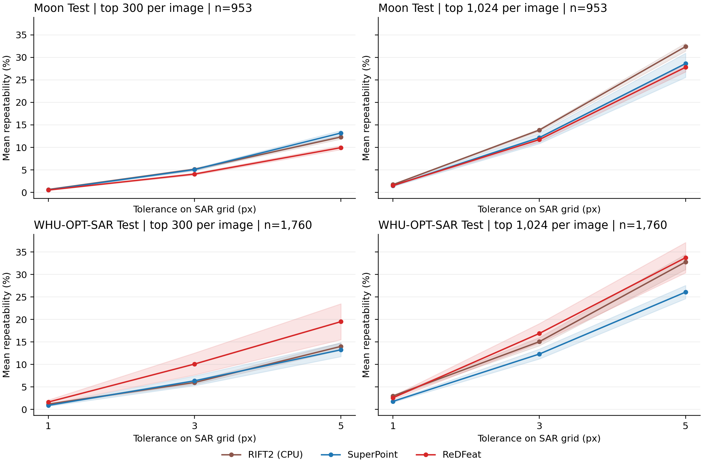
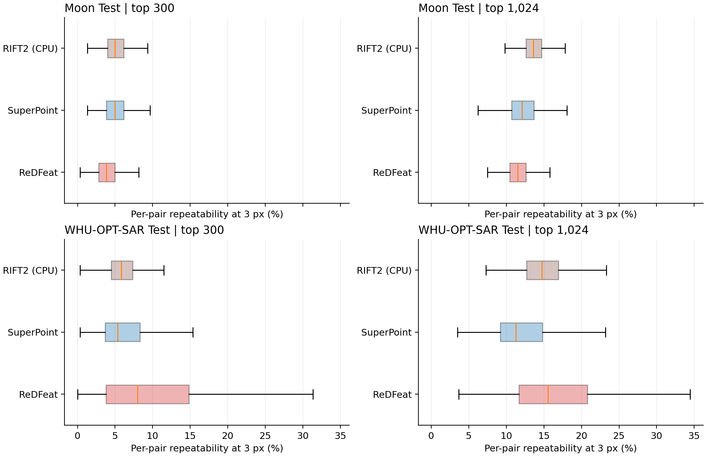
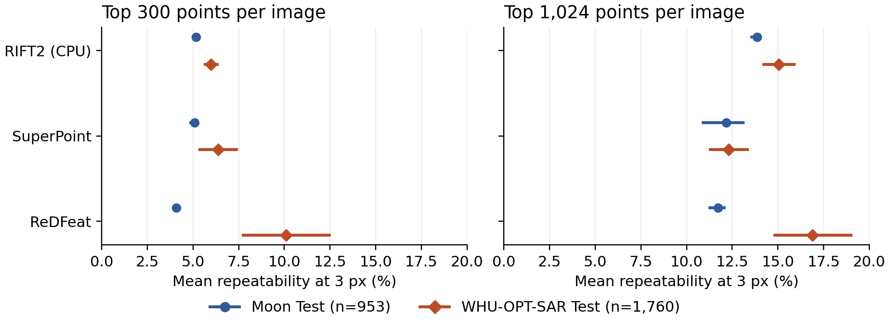

# 月球光学–SAR 上的 SuperPoint 检测可重复性

复用 [E51 月球关键点叠图](../E51/extra/moon_detections.png) 的 4 对 Val patch 及其原版 SuperPoint 检测坐标。图中 3 对有人工评测真值点，`ROI_080/patch_13` 缺少评测真值点。E51 的检测配置为长边 1024、NMS 半径 4、分数阈值 0.0005，与论文 SuperPoint+SuperGlue 基线的检测配置有差异。

## 评测口径

沿用 SuperPoint 附录 A 的点级可重复率。用每对 patch 的评测真值点最小二乘拟合光学到 SAR 的参考仿射。检测点两侧均加 0.5，与人工点统一为像素角点坐标。先按参考仿射及其逆变换筛出共同视野中的检测点，再在两侧分别按分数取前 300 点，并统一在 SAR 的 512 × 512 patch 坐标中计算欧氏距离。一个点在另一侧任意点的容差内即记为命中，两侧命中数之和除以两侧点数之和。主读数为 3 px，同时报告 1 px 和 5 px。 [SuperPoint 原文附录 A](https://openaccess.thecvf.com/content_cvpr_2018_workshops/papers/w9/DeTone_SuperPoint_Self-Supervised_Interest_CVPR_2018_paper.pdf) · [HPatches 复现代码](https://github.com/rpautrat/SuperPoint/blob/master/superpoint/evaluations/detector_evaluation.py)

## 试跑结果

| Val patch 对 | 1 px | 3 px | 5 px | 参考仿射留一平均误差 |
| --- | ---: | ---: | ---: | ---: |
| `ROI_035/patch_26` | 0.0% | 4.7% | 13.5% | 7.30 px |
| `ROI_070/patch_21` | 1.0% | 4.0% | 13.5% | 2.06 px |
| `ROI_071/patch_5` | 0.7% | 5.2% | 12.0% | 3.92 px |
| 三对平均 | 0.6% | 4.6% | 13.0% | |

3 px 下每侧 300 点中，光学有 13–17 个点命中，SAR 有 11–14 个点命中。这些是点级命中数，同一个点可以命中另一侧的多个点。参考仿射留一误差是逐个留出人工点评估所得，包含标注误差和仿射近似误差。三对的留一平均误差为 2.06–7.30 px，其中两对超过 3 px 容差。因此这些分数反映检测点在当前参考几何下的位置重合程度，单凭这次试跑还无法确定检测器本身的可重复性或原因。

从 `moon-exp` 根目录复现 `python -m runs.E52.code.repeatability ../moon-dataset/data/ground-truth`。 [逐对结果与留一误差](extra/repeatability.json) · [计算脚本](code/repeatability.py)

## 均匀随机点对照

对这三对 patch 分别在参考仿射确定的共同视野中独立均匀抽样，两侧各 300 点，在 SAR 坐标中沿用同一可重复率公式。对每对进行 5,000 次模拟，固定随机种子为 `20261119`。每次先计算各对可重复率，再取三对平均，形成随机点的对照分布。

| 容差 | SuperPoint 三对平均 | 随机点三对平均 | 随机试验中间 95% 范围 |
| --- | ---: | ---: | ---: |
| 1 px | 0.56% | 0.37% | 0.00%–0.78% |
| 3 px | 4.61% | 3.25% | 2.17%–4.44% |
| 5 px | 13.00% | 8.76% | 7.00%–10.61% |

3 px 下，逐对的 SuperPoint 读数均处于各自随机试验的中间 95% 范围内。三对平均比随机均值高 1.36 个百分点，5,000 次模拟中有 70 次达到或超过 4.61%。5 px 下，这批样例比随机均值高 4.24 个百分点。模拟范围只描述固定三对、固定参考仿射下的随机波动。随机点均匀分布，未保留真实检测点在纹理区域的空间聚集，参考仿射误差也会影响对真实检测点的评价。

在 `moon-exp` 根目录运行 `python -m runs.E52.code.random_baseline`。 [逐对随机对照](extra/random_baseline.json) · [模拟脚本](code/random_baseline.py)

## E51 地球与月球样例对照

计算了 E51 归档的 32 对 WHU-OPT-SAR patch 和 16 对月球 patch 中带评测真值点的 10 对，同时读取叠图中的原版 SuperPoint 和 ReDFeat 两组检测结果。沿用共同可见区内每侧取至多 300 点、1/3/5 px 的几何可重复率。随机点按各方法实际评测点数抽样，每种采样几何和点数配置模拟 5,000 次。地球两侧用发布数据的同像素坐标作为参考，WHU-OPT-SAR 原文 §2.1.1 描述了逐像素对齐；这些裁块没有独立同名点用于复核局部残差。月球仍按各 patch 的评测真值点拟合参考仿射。 [WHU-OPT-SAR 原文](https://www.sciencedirect.com/science/article/pii/S0303243421003457)

| 样例组 | 可计算对数 | SuperPoint @3 px | ReDFeat @3 px | 随机均值 @3 px |
| --- | ---: | ---: | ---: | ---: |
| 月球 Val | 10 / 16 | 4.74% | 3.82% | 3.28% / 3.29% |
| 地球 WHU 首批 | 16 / 16 | 4.65% | 8.26% | 3.16% |
| 地球 WHU 城市候选 | 16 / 16 | 6.26% | 12.17% | 3.16% |

月球的两项随机均值分别对应 SuperPoint 和 ReDFeat。`ROI_071/patch_15` 的 SuperPoint 光学侧在共同视野内少于 300 点。城市候选是按建筑区域选的样例，地球首批与月球 Val 也各是 E51 固定的一小批。

| E51 主叠图中的 patch 对 | SuperPoint @3 px | ReDFeat @3 px | 随机均值 @3 px |
| --- | ---: | ---: | ---: |
| 月球 `ROI_035/patch_26` | 4.67% | 7.50% | 3.22% |
| 月球 `ROI_070/patch_21` | 4.00% | 1.67% | 3.25% |
| 月球 `ROI_071/patch_5` | 5.17% | 4.17% | 3.31% |
| 月球 `ROI_080/patch_13` | — | — | 3.16%（按整幅 patch） |
| 地球 `NH49E001013/patch_0` | 6.50% | 10.17% | 3.16% |
| 地球 `NH49E001014/patch_0` | 2.17% | 1.33% | 3.16% |
| 地球 `NH49E001017/patch_0` | 8.33% | 25.67% | 3.16% |
| 地球 `NH49E002012/patch_0` | 3.00% | 3.50% | 3.16% |

六对月球 patch 缺少评测真值点，仅有按整幅 512 × 512 patch 抽样的随机参照。地球全部 32 对均用整幅 patch、每侧 300 点，因而共用一个随机均值。月球和地球参考几何的精度依据不同，当前差距按样例和当前评测几何解释。

在 `moon-exp` 根目录运行 `python -m runs.E52.code.compare_e51 ../moon-dataset/data/ground-truth`。 [全部逐对结果与三个容差](extra/e51_comparison.json) · [E51 月球叠图](../E51/extra/moon_detections.png) · [E51 地球首批叠图](../E51/extra/whu_detections.png)

## 地球 ReDFeat 的点数和对齐检查

地球两组沿用同一批 E51 坐标和发布像素网格，只改变每侧所取的最高分点数。用相同图幅和点数为每个预算重复抽取 1,000 组均匀随机点。原叠图所列四对地球样例中的 ReDFeat 最高值为 25.67%（300 点、3 px）。首批 16 对的最高值为 35.83%，出现在同景的 `NH49E001017/patch_2`。

| 每侧点数 | 地球首批 @3 px | 地球城市 @3 px | 均匀随机 @3 px |
| ---: | ---: | ---: | ---: |
| 300 | 8.26% | 12.17% | 3.19% |
| 1024 | 14.27% | 21.88% | 10.41% |
| 2048 | 22.85% | 30.65% | 19.73% |
| 4096 | 38.59% | 46.20% | 35.55% |

1024 点、5 px 时首批为 29.10%，城市为 43.63%，均匀随机为 26.26%。ReDFeat 原文图 5 在另一套 424 对 VIS–SAR 测试图上用每图 1024 点，图读约为 21% @3 px 和 43% @5 px，与这批城市样例的量级接近。原文对预配准数据施加已知随机单应变换，并独立报告描述子正确匹配和配准成功率。ReDFeat 的配准表现还取决于描述子能否选出足够多且有良好空间分布的正确对应。 [ReDFeat，§IV、图 5–9](https://arxiv.org/html/2205.07439#S4)

另对每对地球 patch 将检测点按左右半区分开，在一半搜索横纵各 ±8 px 的整数平移，在另一半验证，然后交换。以 top 300 和 3 px 计算，两组在留出半区的平均值分别从 8.14% 变为 8.50%、从 11.48% 变为 10.47%。这次检查未显示单个小幅平移能普遍解释低读数。它只能检验可在左右半区间复现的平移，无法核验局部形变或模态相关定位偏差。E51 地球裁块仍缺独立同名点。

在 `moon-exp` 根目录运行 `python -m runs.E52.code.check_earth`。 [逐对点数和对齐诊断](extra/e51_earth_checks.json)

## 月球与地球 ReDFeat 1024 点统一对照

沿用 E51 的检测坐标和各域的参考几何，在共同可见区内每侧取分数最高的 1024 点。对月球有评测真值点的 10 对、WHU-OPT-SAR 首批 16 对和城市 16 对，按 1、3、5 px 计算可重复率。各参考几何下每侧随机抽取 1024 点，模拟 5,000 次。 [逐图结果表](extra/redfeat_1024.md) · [原始结果](extra/e51_comparison_redfeat_1024.json)

3 px 下三组均值依次为 11.09%、14.27%、21.88%，对应随机均值为 10.77%、10.39%、10.39%。5 px 下月球为 26.22%，对应随机均值为 27.06%。这批月球样例的参考仿射来自人工点拟合，地球样例使用发布像素网格，且城市候选经过场景挑选。

从 `moon-exp` 根目录复现 `python -m runs.E52.code.compare_e51 ../moon-dataset/data/ground-truth --detector redfeat --top-k 1024`。

## 扩大月球样本并对照地球城市（300 点）

在 6 个 Val ROI 中筛查 642 对带人工评测真值点的月球 patch，排除 E51 已归档的 patch。对光学影像先按 `/255` 归一化，用 σ=2 px 的高斯滤波减弱细小噪声，再计算梯度幅值。取各 32 × 32 小块内的平均梯度幅值，再取整幅 patch 的块中位数，描述典型局部起伏强度。每个 ROI 分别从该分数的最低和最高四分位各等距取 4 对，得到 24 对低纹理和 24 对较高纹理。选样独立于检测和匹配结果。两组光学纹理分数的中位数分别为 0.00142 和 0.00254。 [样例清单](extra/texture_comparison/selection.json)

对新月球样例用 E51 的原版 SuperPoint 和 ReDFeat 权重、输入映射与检测参数重新提取点。共同可见区内每侧最多取 300 点，按 1、3、5 px 统计点级可重复率。月球用人工点拟合参考仿射，WHU 城市样例用发布像素网格。城市组使用 E51 A1–D4 的 16 对归档检测坐标重新计算，逐对结果与原 E52 一致。随机对照使用各自区域和实际点数，每种配置模拟 5,000 次。 [推理配置与权重校验](extra/texture_comparison/provenance.json) · [WHU 数据说明](https://www.sciencedirect.com/science/article/pii/S0303243421003457)

| 样例组 | 对数 | SuperPoint @3 px | ReDFeat @3 px | 随机 @3 px |
| --- | ---: | ---: | ---: | ---: |
| 月球低纹理 | 24 | 5.56% | 3.93% | 3.40% |
| 月球较高纹理 | 24 | 4.15% | 3.51% | 3.48% |
| 地球 WHU 城市 | 16 | 6.26% | 12.17% | 3.16% |

两种检测器在 64 对样例的两侧均能保留 300 点。月球两组的 ReDFeat 读数接近随机，低纹理组的均值略高于较高纹理组。两组参考仿射留一平均误差的中位数分别为 3.34 和 3.88 px。此次分层依据是光学梯度，跨组参考几何、地形和成像条件并未控制，读数不足以将月球与地球城市之间的差异归因于纹理。 [逐图结果表](extra/texture_comparison/per_patch.md)

可视化每个 ROI 在入选样例中的最低分和最高分 patch，共用光学显示灰度范围。低纹理检测叠图只画实际进入几何评测的点。 [月球纹理对照](extra/texture_comparison/moon_texture_examples.jpg) · [月球低纹理检测叠图](extra/texture_comparison/moon_low_texture_detections.jpg) · [高于随机的逐对分布](extra/texture_comparison/texture_repeatability.png) · [E51 地球城市叠图](../E51/notes.md)

复现代码按顺序为 `runs.E52.code.texture_sample`、`runs.E52.code.texture_detect`、`runs.E52.code.texture_evaluate` 和 `runs.E52.code.texture_plots`，各模块通过 `--help` 列出输入参数。 [原始逐对结果](extra/texture_comparison/texture_evaluation.json)

## RIFT2、SuperPoint 和 ReDFeat 在完整测试集上的可重复率

**方法**

*测试集。* 月球使用官方 Test 的 7 个 ROI、1,130 对 patch，其中 953 对有人工评测真值点。WHU-OPT-SAR 使用作者发布的 20 景 Test。两种模态共 40 个 TIFF（1,528,152,296 字节），已按同名配对入库并校验。每景在原始像素网格上以 512 像素为边长和步长切片，最后一列与一行贴到图像边缘。边缘窗口与相邻窗口部分重叠，每景固定 88 对，共 1,760 对，保留全部像素。 [WHU 官方划分](https://github.com/AmberHen/WHU-OPT-SAR-dataset/blob/main/The%20division%20of%20the%20dataset.txt) · [下载与校验清单](extra/whu_test_download.json)

*检测配置。* 取各流程在匹配前输出的单图关键点。SuperPoint 使用 B0 中原版 LightGlue 流程的检测配置。ReDFeat 使用 VIS-SAR 权重。RIFT2 使用 CPU 实现，从原始相位一致性最大矩图上用浮点 FAST-9 检测并按响应排序。MATLAB 会话用于 HiMO，RIFT2 的两个后端尚未交叉验证。输入映射与前面的 E52 对照一致。 [检测代码](code/full_detect.py) · [RIFT2 CPU 实现](code/rift2_portable.py)

*几何与统计。* 月球用每对人工点拟合光学到 SAR 的参考仿射，另存留一误差。没有人工真值的 177 对执行检测并记录点数。WHU 用发布影像的同像素位置作参考。两侧先筛共同可见区，再独立保留至多 300 或 1,024 个点。沿用 E52 的双向最近邻命中占比，在 SAR 网格上计算 1、3、5 px 容差，两侧都无点时计为 0。同一数据集各方法用同一批可评分样本。均值以 patch 对为单位，95% 区间用 ROI 或场景为单位做 5,000 次 bootstrap 重采样。 [评测代码](code/full_report.py)

**结果**

*每侧最多 1,024 点时，月球和 WHU-OPT-SAR 的最高均值来自不同的检测配置。* 在 3 px 容差下，月球的 RIFT2 CPU 实现为 13.85%（95% 区间 13.48%–14.11%），WHU-OPT-SAR 的 ReDFeat 为 16.89%（14.75%–19.08%）。缩到每侧 300 点后，月球的 RIFT2 与原版 SuperPoint 都在 5% 左右。WHU 的 ReDFeat 仍有最高均值，为 10.10%。

| 检测配置 | 月球 300 点 | 月球 1,024 点 | WHU 300 点 | WHU 1,024 点 |
| --- | ---: | ---: | ---: | ---: |
| 原版 SuperPoint | 5.08% | 12.17% | 6.37% | 12.31% |
| ReDFeat | 4.08% | 11.74% | 10.10% | 16.89% |
| RIFT2（CPU 实现） | 5.16% | 13.85% | 5.99% | 15.06% |

表 1。3 px 容差下的逐对可重复率均值。三种配置均完成月球 1,130 对和 WHU 1,760 对的检测，用于评分的样本数分别为 953 和 1,760。 [完整汇总表](extra/full_test/summary.csv) · [逐对结果](extra/full_test/per_pair.csv)

图 1。阴影表示按月球 ROI 或 WHU 场景重采样得到的 95% bootstrap 区间。 [PDF](extra/full_test/repeatability_curves.pdf)

图 2。箱线图显示中位数、四分位数和 1.5 倍四分位距内的范围。全部样本均可在逐对表中查到。 [PDF](extra/full_test/repeatability_distributions.pdf)

同一检测器在月球和 WHU 上的差距可直接从图 3 读取。3 px 容差下，两种点数上限中 ReDFeat 的跨测试集均值差都最大，WHU 分别高出 6.02 和 5.15 个百分点。

图 3。点表示 3 px 容差下的逐对均值，横线表示 95% bootstrap 区间。 [PDF](extra/full_test/moon_whu_comparison.pdf)

**讨论**

1,024 点是检测点上限。原版 SuperPoint 的月球光学侧中位数实际为 839 点，WHU 的 SAR 侧中位数为 818 点。RIFT2 和 ReDFeat 在两个数据集的两侧中位数都达到上限。完整汇总表保留了实际点数，可与可重复率读数一起看。

月球参考仿射的逐对留一平均误差中位数为 4.12 px，四分位范围为 2.84–6.09 px，676 对的留一平均误差高于 3 px。WHU 使用发布像素网格，局部残差缺少独立同名点核验。两个数据集的严格容差读数都受参考几何精度影响。
