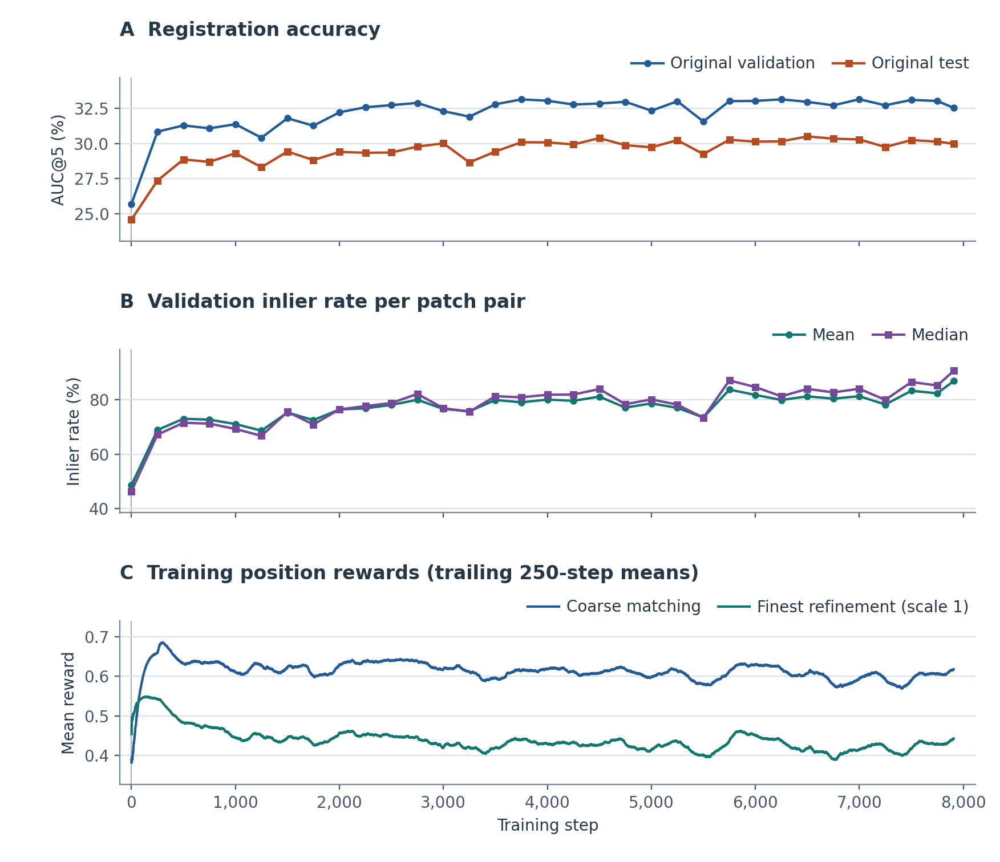

# 前 500 步获得大部分配准增益，末步验证集内点率最高

**摘要**

我们沿论文完整方法的一次训练回看配准精度和匹配点的仿射一致性。固定原验证集和原测试集，评测初始化、每 250 步和训练末步，共 33 个点。第 500 步已获得两套数据上约八成的末步 AUC@5 增益。第 3,500 步起，两套精度曲线在各自的窄区间波动。同期验证集内点率仍有起伏，均值和中位数都在末步达到最高值，而配准精度的峰值出现在更早的存档。

**引言**

完整方法用模型从图像中拟合的仿射作为训练参照，对粗匹配和五级细化采样的位置给出奖励。匹配点与同一仿射越一致，拟合的内点率就越高。与之不同，配准精度由人工标注检查点测量。这次沿同一条训练轨迹同时量这两项，观察精度增益在何时出现，以及后续内点率变化是否伴随精度提升。

**方法**

*模型与步数*　使用 E55 的 `k5_no_bce`，种子 0。粗匹配与五级细化的置信度 BCE 权重均为零，保留各级位置奖励、EMA 参照（0.996）、DINOv2 LoRA（秩 8）和训练样本筛选（0.8）。第 0 步用这次训练的 AnyMatch RoMa 公开初始化权重，随后取 250 至 7,750 步间每隔 250 步和第 7,907 步的存档。横轴采用日志和存档的名义步数。训练记录中末步累计成功更新 7,899 次。[E55 训练记录](../E55/launch/k5_no_bce.json) · [E58 正式评测](../E58/notes.md)

*配准精度与内点率*　固定原验证集的 652 个和原测试集的 953 个有标注 patch 对。光学输入除以 255，SAR 采用 minmax。沿用 AnyMatch RoMa 正常的双向 560/864 推理和默认匹配点采样，输出在原图网格上用 RANSAC（阈值 3 px）拟合仿射。逐对误差是仿射映射的光学检查点与 SAR 标注位置之间的平均距离，AUC@5 为误差累积分布在 0–5 px 的归一化面积，拟合失败的图对记零贡献。同一批验证集图对逐对计算拟合内点数除以投入拟合的匹配点数，零匹配记 0，再取 652 对的等权均值和中位数。

*结果与日志来源*　核对了全部权重的 SHA-256、推理配置与实现、拟合口径和逐对 ID。复用 E55 的 32 份验证集预测和 6 份测试集预测，补测其余 26 份测试集预测。初始化两份预测均用现行流程重跑，旧初始化记录缺解析后的推理参数，验证集拟合记录还带有 dirty 标记。33 个点均覆盖两个完整标注清单，无缺失存档、重复图对、配准失败或验证集零匹配。图中训练曲线取原日志的粗匹配位置奖励与最细一级（尺度 1）的位置奖励，均画最近至多 250 步的滑动均值，从第 1 步开始。每步原始数据随附。

**结果**

*两套精度在前 500 步已拿到大部分末步增益*　相对初始化，第 500 步原验证集和原测试集 AUC@5 分别提高 5.58 和 4.28 个百分点，分别为各自末步增益的 82% 和 79%。第 3,500 步及以后，验证集 AUC@5 介于 31.57%–33.15%，测试集介于 29.24%–30.50%，两个峰值相隔 500 步。末步的两套精度都处在各自后期的波动区间内。

*验证集内点率在末步达到最高，精度峰值更早*　从第 250 步起的 31 次相邻存档变化中，验证集 AUC@5 的变化与内点率均值、中位数的变化呈正相关（Pearson r 分别为 0.68 和 0.69）。从验证集精度最高的第 7,000 步到末步，逐对内点率的均值和中位数分别净增 5.56 和 6.61 个百分点，同一批图对的 AUC@5 回落 0.61 个百分点。训练日志中，两种位置奖励的末 250 步平均值也都低于最初 250 步（粗匹配 0.659 → 0.618，尺度 1 为 0.542 → 0.443）。

图 1　共用训练步数横轴。A 为按原 split 分开计分的 AUC@5，B 为原验证集逐对内点率，C 为 E55 训练日志的两项位置奖励。第 0 步只有初始化评估。

| 训练步 | 原验证集 AUC@5 (%) | 原测试集 AUC@5 (%) | 验证集内点率均值 (%) | 验证集内点率中位数 (%) |
|---:|---:|---:|---:|---:|
| 0 | 25.70 | 24.58 | 48.59 | 46.35 |
| 250 | 30.84 | 27.36 | 68.90 | 67.18 |
| 500 | 31.28 | 28.87 | 73.04 | 71.55 |
| 3,500 | 32.79 | 29.43 | 79.96 | 81.35 |
| 6,500 | 32.96 | **30.50** | 81.29 | 84.04 |
| 7,000 | **33.15** | 30.29 | 81.36 | 84.10 |
| 7,907 | 32.54 | 29.98 | **86.92** | **90.70** |

表 1　代表性存档的精度与内点率。粗体为各列在 33 点中的最大值。全表的精度与内点率均以 0–1 小数保存。[逐步汇总 CSV](extra/checkpoint_metrics.csv) · [逐步训练日志 CSV](extra/training_scalars.csv) · [结果来源、权重哈希与覆盖](extra/evaluation_sources.json)

**讨论**

这条轨迹前 500 步获得大部分精度增益。内点率与精度在相邻存档间经常同向变化，后段两者的峰值错开。验证集末步的匹配点最能一致地支持拟合仿射，而标注衡量的精度仍在后期波动区间内。观察来自一个种子，复用评测和补测使用了不同 GPU 型号，来源表逐点记录了运行环境。论文正式成绩采用 E58 的末步并集协议，原验证集与原测试集共 1,605 个标注对，完整方法的 AUC@5 为 31.02%。
