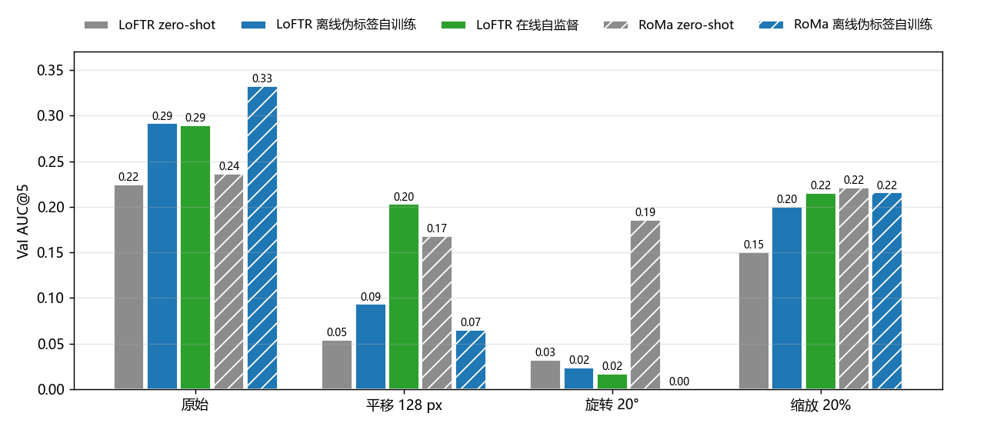

# 几何扰动拉开了方法间的差距：平移轴上排序改变，旋转和缩放超出原数据范围后，训练过的模型失去优势

**摘要**

在原始 Val 上，5 个方法的 AUC@5 排序是 RoMa 离线伪标签自训练 > LoFTR 两种无标注训练 > RoMa zero-shot > LoFTR zero-shot，但差距不大：最高与最低相差 0.108，LoFTR 两种无标注训练只差 0.002。我们在 SAR 一侧叠加已知的平移、旋转或缩放，各三档，只推理、重新评测，看差距能否拉开。两类扰动的性质不同。原数据本身就带有不小的平移（Val 中有一成 pair 的偏移超过 73 px），平移 64 / 128 px 仍在原数据的范围内，主要考的是偏差变大以后谁还配得准：128 px 时最高与最低相差 0.149，LoFTR 在线自监督（0.203）比 LoFTR 离线伪标签自训练（0.093）高 0.110；RoMa 离线伪标签自训练在 64 px 时已跌到 0.148，低于 RoMa zero-shot。原数据几乎没有旋转和缩放（Val 中 90% 的 pair 旋转不超过 2.5°、缩放不超过 4.6%），旋转 20° 和缩放 20% 超出了原数据的范围，这里训练过的模型都失去了相对 RoMa zero-shot 的优势：旋转 20° 时只有 RoMa zero-shot 保持 0.186，其余都不超过 0.04；缩放 20% 时 4 个模型挤在 0.20–0.22。前者里 LoFTR zero-shot 同样失效，说明失效既有训练带来的过拟合，也有骨干本身的限制。Test 上结论相同。

**引言**

两条无标注路线（离线伪标签、在线自监督）和 RoMa 的自训练都已停在相近的水平：在原始 Val 上，LoFTR 的两种无标注训练 AUC@5 都约 0.29，差 0.002，统计上分不开。原始数据的 patch 对在构建时已粗对齐到同一区域，评测只考残余的偏差，方法之间的差别被压缩了。

我们关心两件事。第一，加大两图之间的几何差异以后，方法之间的区分度是否变高，原来的排序是否保持。第二，现有模型都在这批数据上训练，训练数据里的几何差异以小平移为主，模型是否因此对这类数据过拟合，遇到训练数据之外的几何变化时掉得比 zero-shot 快。

我们在 SAR 一侧叠加已知的几何扰动，真值随之精确变换，在扰动后的 Val / Test 上重测主要方法。原始协议与选模不变，本文的结果只供研究者自己参考。

**方法**

*扰动。* 每对图只在 SAR 一侧施加一个已知仿射 T，SAR 影像按 T 重采样（双线性，画面外补 0），真值仿射随之精确变为 T∘A。三个轴各自单独扰动，不组合：平移 12 / 64 / 128 px（幅度固定，方向随机），绕 patch 中心旋转 3° / 10° / 20°（正负随机），绕中心各向同性缩放 3% / 10% / 20%（放大或缩小随机）。随机量只由轴、split 和 pair 决定，同一轴的三档共用一个方向或符号，只差幅度。T 在评测前一次生成，每对的 T 随实验记录保存；重采样与训练时的已知扰动完全同一口径（先做输入映射，再重采样）。

*原数据本身的几何差异。* 为判断各档是否落在原数据的范围内，我们把每对图用标注点最小二乘拟合出的真值仿射分解为 patch 中心的位移、旋转角和各向同性缩放（表 1）。原数据的平移不小，平移 64 px 在 Val 的 90% 分位以内，128 px 在 99% 分位以内；旋转与缩放都很小，旋转 10° / 20° 和缩放 20% 超出了全部或几乎全部 pair。叠加的扰动与原有偏差方向独立，实际总偏差是两者的合成。

表 1：原数据中光学与 SAR 之间的几何差异（由标注点拟合的仿射分解；附件 `extra/data/gt_dist.csv`）。

| | 平移（px） | 旋转（°） | 缩放（%） |
|---|---|---|---|
| Val 中位 / 90% / 99% / 最大 | 21 / 73 / 145 / 247 | 0.6 / 2.5 / 4.2 / 6.1 | 1.6 / 4.6 / 8.2 / 13.5 |
| Test 中位 / 90% / 99% / 最大 | 28 / 123 / 230 / 276 | 0.6 / 2.8 / 7.3 / 8.8 | 1.8 / 5.2 / 10.9 / 16.2 |

*评测。* 评价协议不变：检查点误差、RANSAC 3 px 估计仿射、失败记 ∞、全部 pair 等权。误差先把预测的仿射换回原 SAR 坐标系（T⁻¹∘A）再量，单位仍是原始像素，所以缩放档的误差与原协议的阈值可比。扰动后落到 SAR 画面外的检查点照样计入：误差在原 SAR 坐标系里量，真值精确已知，这些点只是要求仿射外推到扰动后看不见的区域，而重叠区变小本身就是难度的一部分。每一档与原始档用同一批检查点；落到画面外的检查点从旋转 3° 的 32 个（Val）到平移 128 px 的 1503 个（Val，占 28%）、1986 个（Test）。Val 652 对、Test 953 对，结果两者一致，下文和图只用 Val。差值的 95% 区间是按 pair 配对重采样 1000 次的百分位区间。AUC@5 与 SR@10 给出的排序几乎相同，下文只报 AUC@5，SR 见附件 `extra/data/summary.csv`。

*模型。* 5 个方法都沿用各自原来按 Val AUC@5 选好的权重和原来的推理设置，只推理不训练：

- LoFTR zero-shot：AnyMatch 发布的 LoFTR 权重。
- LoFTR 离线伪标签自训练：迭代自训练，第四轮伪标签取内点前 50%，学生一侧加已知几何扰动（±12 px、±3°、±3%）和光度扰动，第 7000 步。
- LoFTR 在线自监督：每一步用当前模型的 RANSAC 结果作参照，粗级 ±1 闭式期望、外点扣 0.25、负样本对，不加几何扰动，第 1500 步。
- RoMa zero-shot：AnyMatch 发布的 RoMa 权重。
- RoMa 离线伪标签自训练：第二轮伪标签，SAR 一侧加已知几何扰动（±12 px、±3°、±3%）并随机擦除 10–25% 面积，第 7000 步。

另有三个模型只列在表 2 中作参照，不进图：在 Val+Test 标注上过拟合的 LoFTR（学习率 5e-5，第 14000 步）和 RoMa（解冻 VGG，第 16000 步），它们见过这些标注；在线自监督之后再用随机 reward 训细级的对照（第 4000 步），它是在线这条线上原始 Val AUC@5 最高的模型，但不是方法本身，各档都与 LoFTR 在线自监督相差不超过 0.007。另有一个复合自检：把用标注点最小二乘拟合出的仿射照样复合上 T，它在每一档的 AUC@5 都与原始相同（Val 0.453，Test 0.454），说明 T 的保存、复合和评测口径一致。

*硬件。* 同一个 RoMa 权重在 V100 与 RTX 3090 上推理，仿射可相差约 3 px，所以 RoMa 的全部推理放在 V100 上，LoFTR 放在 RTX 3090 上；每个模型的原始档也在同一种卡上重跑，比较时都用本实验内的原始档。抽查的三个 LoFTR 模型中，标注过拟合模型（原记录也在 RTX 3090 上）的重跑与原记录逐对完全一致，另两个（zero-shot 与离线伪标签自训练）的 Val / Test AUC@5 与原记录相差不超过 0.005，少数 pair 的 RANSAC 结果翻转。

**结果**

图 1：三个轴上 5 个方法的 Val AUC@5 随扰动档位的变化（0 为原始）。颜色表示路线（灰为 zero-shot，蓝为离线伪标签自训练，绿为在线自监督），实线圆点为 LoFTR，虚线方块为 RoMa；灰底为原数据 90% 的 pair 所在的范围（表 1）。

图 2：原始与三个轴最重一档的 Val AUC@5。原始档 5 个方法在 0.22–0.33 之间；平移 128 px 时排序大变；旋转 20° 和缩放 20% 时训练过的模型不再领先 RoMa zero-shot。

*原始档：排序清楚，差距小。* 原始 Val 上的排序是 RoMa 离线伪标签自训练（0.332）> LoFTR 离线伪标签自训练（0.291）≈ LoFTR 在线自监督（0.289）> RoMa zero-shot（0.236）> LoFTR zero-shot（0.225），最高与最低相差 0.108。三个轴的轻档（平移 12 px、旋转 3°、缩放 3%）都在两种离线伪标签自训练的训练扰动范围内，排序不变，最高与最低相差 0.14–0.16。

*平移：仍在原数据范围内，差距拉开，排序改变。* 平移 64 px 时，LoFTR 两种无标注训练和 RoMa zero-shot 比原始低 0.01–0.05（LoFTR 在线自监督 0.250、离线伪标签自训练 0.237、RoMa zero-shot 0.223），RoMa 离线伪标签自训练却从 0.332 跌到 0.148，与 LoFTR zero-shot（0.149）相当，比 RoMa zero-shot 还低 0.075。平移 128 px 时，最高与最低相差 0.149：LoFTR 在线自监督为 0.203，比原始低 0.086，仍是最高；RoMa zero-shot 0.168；LoFTR 离线伪标签自训练 0.093；RoMa 离线伪标签自训练 0.065；LoFTR zero-shot 0.054。原始档分不开的 LoFTR 两种无标注训练在这里相差 0.110（95% 区间 0.095–0.125，Test 0.095）。RoMa 离线伪标签自训练在 64 px 就崩，而这个偏移量在原数据中并不罕见；一个可能的原因是伪标签只保留内点数前 50% 的 pair，大偏移的 pair 多半在筛选时被去掉，训练集实际偏向小偏移，本文没有检验。

*旋转和缩放：超出原数据范围，训练过的模型失去优势。* 旋转 10° 和缩放 10% 时排序与原始相同，RoMa 离线伪标签自训练仍最高（0.306、0.321）。到最重一档，情况变了。旋转 20° 时，RoMa zero-shot 保持 0.186，其余 4 个模型都不超过 0.04，RoMa 离线伪标签自训练为 0.000；LoFTR zero-shot 也只有 0.032，可见 LoFTR 一族的失效主要来自骨干本身，而 RoMa 离线伪标签自训练的失效来自训练，它失去了 RoMa zero-shot 原有的旋转容忍度。缩放 20% 时，RoMa zero-shot 几乎不变（0.221），RoMa 离线伪标签自训练从 0.332 跌到 0.216，LoFTR 两种无标注训练跌到 0.200 和 0.215，4 个模型挤在 0.20–0.22，训练带来的领先全部消失。作参照的两个标注过拟合模型在这两个轴上掉得最快（表 2）：LoFTR 的在旋转 10° 时已只有 0.021，缩放 20% 时 0.003。

表 2：各档的 Val AUC@5（完整的 Val / Test、AUC 与 SR 各档见附件 `extra/data/summary.csv`）。

| 模型 | 原始 | 平移 12 | 平移 64 | 平移 128 | 旋转 10° | 旋转 20° | 缩放 10% | 缩放 20% |
|---|---|---|---|---|---|---|---|---|
| LoFTR zero-shot | 0.225 | 0.175 | 0.149 | 0.054 | 0.143 | 0.032 | 0.182 | 0.150 |
| LoFTR 离线伪标签自训练 | 0.291 | 0.273 | 0.237 | 0.093 | 0.249 | 0.024 | 0.272 | 0.200 |
| LoFTR 在线自监督 | 0.289 | 0.254 | 0.250 | 0.203 | 0.234 | 0.017 | 0.254 | 0.215 |
| RoMa zero-shot | 0.236 | 0.235 | 0.223 | 0.168 | 0.230 | 0.186 | 0.236 | 0.221 |
| RoMa 离线伪标签自训练 | 0.332 | 0.331 | 0.148 | 0.065 | 0.306 | 0.000 | 0.321 | 0.216 |
| *参照：* | | | | | | | | |
| LoFTR 在线自监督 + 细级随机 reward | 0.296 | 0.255 | 0.246 | 0.202 | 0.237 | 0.016 | 0.251 | 0.214 |
| LoFTR 标注过拟合 | 0.305 | 0.216 | 0.081 | 0.028 | 0.021 | 0.000 | 0.116 | 0.003 |
| RoMa 标注过拟合 | 0.345 | 0.334 | 0.179 | 0.071 | 0.134 | 0.000 | 0.275 | 0.156 |

*失效的模型并没有停在原位置。* 我们比较同一模型在扰动前后的仿射：扰动后的仿射离 A₀（该模型在原始影像上的仿射）的 patch 四角平均位移小于 5 px 记为停在原位。所有模型和档位上，这个比例都不超过 1%；失效时模型给出的是与 T∘A₀ 和 A₀ 都不相近的错误仿射。

**讨论**

难版评测提高了区分度，但两类扰动拉开差距的原因不同。平移仍在原数据的范围内，它拉开的差距反映方法在偏差较大的 pair 上的配准能力：原始档分不开的 LoFTR 两种无标注训练在 128 px 时相差 0.110，原始档领先的 RoMa 离线伪标签自训练在 64 px 时落到 RoMa zero-shot 之下。旋转和缩放的重档超出了原数据的范围，这里的差距混有两个因素：一是训练让模型贴合了这批数据的几何，失去了 zero-shot 原有的容忍度（RoMa 离线伪标签自训练在旋转 20° 时从 RoMa zero-shot 的 0.186 降到 0.000，两个标注过拟合模型掉得最快）；二是骨干本身的限制（LoFTR zero-shot 在旋转 20° 时也只有 0.032）。

局限有三点。第一，扰动是合成的：SAR 只被重采样，没有改变成像几何，画面边缘补 0 的区域也是真实数据里没有的。第二，每个方法只有一个按原始 Val 选出的模型、一个随机种子；各模型的训练步数、学习率不同，差别不能只归因于训练信号的类型。第三，两种离线伪标签自训练训练时用过 ±12 px、±3°、±3% 的扰动，轻档对它们有主场优势。

对后续研究，有两点值得检验。一是 RoMa 离线伪标签自训练为什么在原数据范围内的平移上就崩：可以按原始偏移大小分组比较它与 RoMa zero-shot 的逐对误差，或者看伪标签筛选后留下的 pair 的偏移分布。二是训练能否保住 zero-shot 的旋转与缩放容忍度：可以把训练扰动的范围加大，或者比较同一路线不同步数的模型。如果难版以后升为评判标准之一，选模也应把它纳入，否则按原始 Val 选出的模型可能恰好是稳健性最差的。
