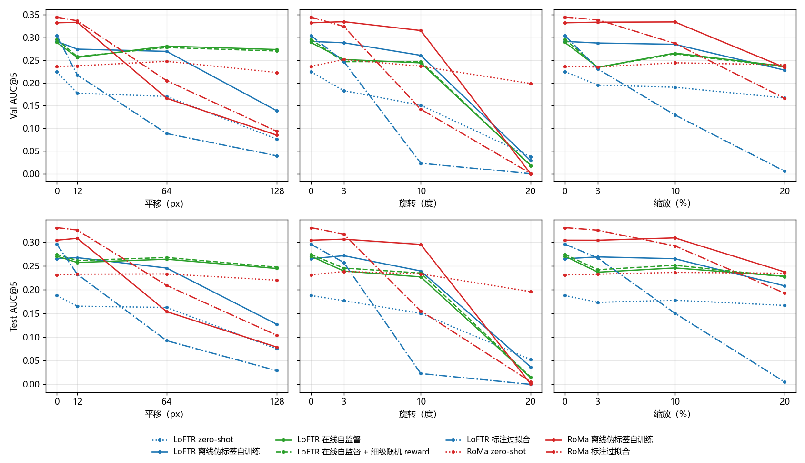
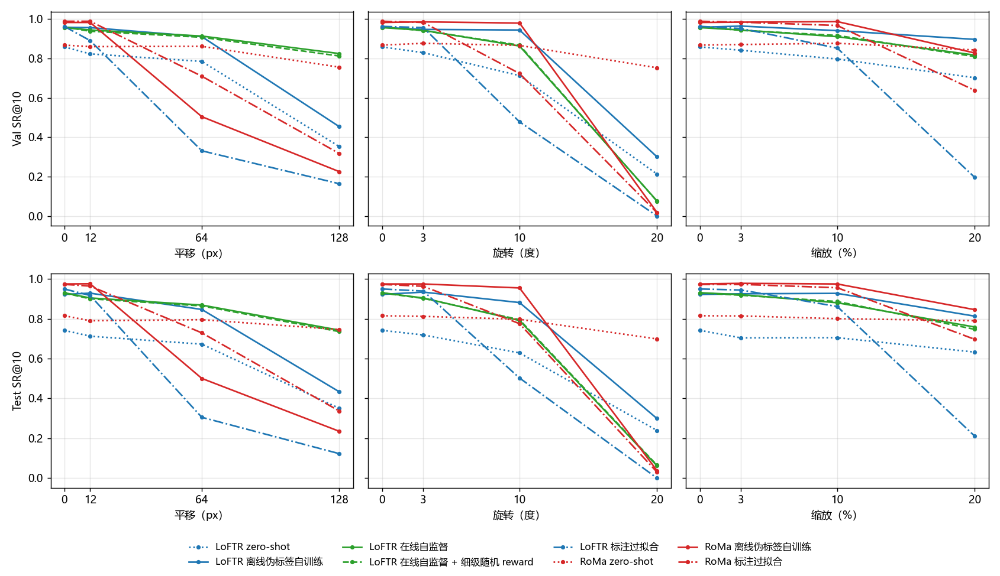

# 几何扰动拉开了方法差距：训练过的模型在训练范围之外大多失去 zero-shot 的稳健性，只有 LoFTR 在线自监督在大平移下保住

**摘要**

在原始 Val / Test 上，各方法的 AUC@5 挤在约 0.29–0.33 之间，看不出无标注训练路线之间的高下。我们在 SAR 一侧叠加已知的平移、旋转或缩放，各三档，对 8 个现成模型只推理、重新评测。差距确实拉开了，而且排序随扰动方向改变。轻档（训练扰动的范围内）几乎不改变结果。平移到 64 px 以上时，RoMa 离线伪标签自训练从全场最好跌到 Val AUC@5 0.17（128 px 时 0.09），LoFTR 离线伪标签自训练在 128 px 时跌到 0.14；LoFTR 在线自监督在 128 px 时仍有 0.27，比后者高 0.135。旋转 20° 时，所有训练过的模型都接近 0，只有 RoMa zero-shot 保持 0.20。LoFTR 标注过拟合掉得最快，平移 64 px 就跌到 0.09。可见本数据集上的训练让模型学会了「两图已大致对齐」这一前提，代价是失去 zero-shot 对较大几何差异的稳健性；难版评测能把这种代价暴露出来，原始评测看不到。

**引言**

两条无标注路线（离线伪标签、在线自监督）和 RoMa 的自训练都已停在相近的水平：在原始 Val 上，LoFTR 的两种无标注训练 AUC@5 都约 0.29，差 0.002，统计上分不开。原始数据的 patch 对在构建时已粗对齐到同一区域，评测只考残余的小偏差，方法之间的差别被压缩了。

实际应用里，两张图之间的初始偏差往往更大，以平移为主。一种方法若只在「已粗对齐」的条件下好用，它在原始评测上与别的方法分不开，到了偏差更大的情形却可能差很多。原始评测回答不了这个问题。

我们在 SAR 一侧叠加已知的几何扰动，真值随之精确变换，在扰动后的 Val / Test 上重测主要方法，看差距能否拉开、谁掉得慢。原始协议与选模不变，本文的结果只供研究者自己参考。

**方法**

*扰动。* 每对图只在 SAR 一侧施加一个已知仿射 T，SAR 影像按 T 重采样（双线性，画面外补 0），真值仿射随之精确变为 T∘A。三个轴各自单独扰动，不组合：平移 12 / 64 / 128 px（幅度固定，方向随机），绕 patch 中心旋转 3° / 10° / 20°（正负随机），绕中心各向同性缩放 3% / 10% / 20%（放大或缩小随机）。随机量只由轴、split 和 pair 决定，同一轴的三档共用一个方向或符号，只差幅度。T 在评测前一次生成，每对的 T 随实验记录保存；重采样与训练时的已知扰动完全同一口径（先做输入映射，再重采样）。

*评测。* 评价协议不变：检查点误差、RANSAC 3 px 估计仿射、失败记 ∞、全部 pair 等权。误差先把预测的仿射换回原 SAR 坐标系（T⁻¹∘A）再量，单位仍是原始像素，所以缩放档的误差与原协议的阈值可比。扰动后落到 SAR 画面外的检查点不计；一个都不剩的 pair 整对不计。各档没有整对被剔除，被剔除的检查点从旋转 3° 的 32 个（Val）到平移 128 px 的 1503 个（Val）、1986 个（Test）。Val 652 对、Test 953 对，结果两者一致，下文以 Val 为主。差值的 95% 区间是按 pair 配对重采样 1000 次的百分位区间。

*模型。* 8 个模型都沿用各自原来按 Val AUC@5 选好的权重和原来的推理设置，只推理不训练：

- LoFTR zero-shot：AnyMatch 发布的 LoFTR 权重。
- LoFTR 离线伪标签自训练：迭代自训练，第四轮伪标签取内点前 50%，学生一侧加已知几何扰动（±12 px、±3°、±3%）和光度扰动，第 7000 步。
- LoFTR 在线自监督：每一步用当前模型的 RANSAC 结果作参照，粗级 ±1 闭式期望、外点扣 0.25、负样本对，不加几何扰动，第 1500 步。
- LoFTR 在线自监督 + 细级随机 reward：在线自监督之后再训细级整对强化学习，reward 换成随机数，作对照，第 4000 步。它是在线这条线上原始 Val AUC@5 最高的模型，所以一并列入。
- LoFTR 标注过拟合：用 Val+Test 的标注训练（学习率 5e-5），第 14000 步。
- RoMa zero-shot：AnyMatch 发布的 RoMa 权重。
- RoMa 离线伪标签自训练：第二轮伪标签，SAR 一侧加已知几何扰动（±12 px、±3°、±3%）并随机擦除 10–25% 面积，第 7000 步。
- RoMa 标注过拟合：用 Val+Test 的标注训练，解冻 VGG，第 16000 步。

标注过拟合的两个模型在原始 Val / Test 上见过这些标注，只作参照。另有一个复合自检：把用标注点最小二乘拟合出的仿射照样复合上 T，它在每一档的 AUC@5 都与原始相同（Val 0.452–0.455，原始 0.453），说明 T 的保存、复合和评测口径一致。

*硬件。* 同一个 RoMa 权重在 V100 与 RTX 3090 上推理，仿射可相差约 3 px，所以 RoMa 的全部推理放在 V100 上，LoFTR 放在 RTX 3090 上；每个模型的原始档也在同一种卡上重跑，比较时都用本实验内的原始档。抽查的三个 LoFTR 模型中，标注过拟合模型（原记录也在 RTX 3090 上）的重跑与原记录逐对完全一致，另两个（zero-shot 与离线伪标签自训练）的 Val / Test AUC@5 与原记录相差不超过 0.005，少数 pair 的 RANSAC 结果翻转。

*是否跟上 T。* 为区分「找到了正确对应」与「停在原位置」，我们比较同一模型在扰动前后的仿射：扰动后的仿射离 T∘A₀ 的 patch 四角平均位移小于 5 px 记为跟上，离 A₀ 小于 5 px 记为停在原位，A₀ 是该模型在原始影像上的仿射。

**结果**

*轻档几乎不改变结果，训练扰动范围内各模型都稳。* 平移 12 px、旋转 3°、缩放 3% 都在两种离线伪标签自训练的扰动范围内。这一档上 RoMa 离线伪标签自训练的 Val AUC@5 为 0.334 / 0.335 / 0.334，原始 0.332；LoFTR 离线伪标签自训练为 0.274 / 0.288 / 0.288，原始 0.291。LoFTR 在线自监督反而在轻档掉得比中档多（平移 12 px 0.256，64 px 0.281；缩放 3% 0.234，10% 0.266），掉的是精度而不是粗配准：它在平移 12 px 时跟上 T 的比例（77%）高于 64 px（70%），SR@10 也随档位单调下降。

图 1：差距随扰动加大而拉开，排序随扰动方向改变。横轴为档位（0 为原始），上排 Val、下排 Test；蓝色为 LoFTR，绿色为 LoFTR 在线自监督，红色为 RoMa；点线为 zero-shot，实线为无标注训练，点划线为标注过拟合。

*大平移下，LoFTR 在线自监督保住了精度，两种离线伪标签自训练都失去了。* 平移 128 px 时，LoFTR 在线自监督的 Val AUC@5 为 0.274，几乎与原始（0.289）相同；LoFTR 离线伪标签自训练跌到 0.139，两者相差 0.135（95% 区间 0.117–0.153，Test 0.118）。在原始数据上，这两个模型相差 0.002，分不开。RoMa 离线伪标签自训练掉得更早：平移 64 px 时已从 0.332 跌到 0.166，SR@10 从 0.98 跌到 0.51；它在原始数据上比 LoFTR 在线自监督高 0.043，到 64 px 时低 0.115（区间 0.096–0.135），128 px 时低 0.189。加上细级随机 reward 的模型在各档都与 LoFTR 在线自监督几乎重合（差值不超过 0.008）。

表 1：大平移和大旋转颠倒了原始评测的排序（Val AUC@5；完整的 Val / Test、AUC 与 SR 各档见附件 `extra/data/summary.csv`）。

| 模型 | 原始 | 平移 12 | 平移 64 | 平移 128 | 旋转 10° | 旋转 20° | 缩放 20% |
|---|---|---|---|---|---|---|---|
| LoFTR zero-shot | 0.225 | 0.177 | 0.170 | 0.077 | 0.151 | 0.038 | 0.167 |
| LoFTR 离线伪标签自训练 | 0.291 | 0.274 | 0.270 | 0.139 | 0.261 | 0.029 | 0.228 |
| LoFTR 在线自监督 | 0.289 | 0.256 | 0.281 | 0.274 | 0.244 | 0.019 | 0.237 |
| LoFTR 在线自监督 + 细级随机 reward | 0.296 | 0.258 | 0.278 | 0.270 | 0.247 | 0.018 | 0.235 |
| LoFTR 标注过拟合 | 0.305 | 0.217 | 0.088 | 0.040 | 0.023 | 0.000 | 0.006 |
| RoMa zero-shot | 0.236 | 0.238 | 0.248 | 0.223 | 0.237 | 0.199 | 0.240 |
| RoMa 离线伪标签自训练 | 0.332 | 0.334 | 0.166 | 0.085 | 0.315 | 0.000 | 0.234 |
| RoMa 标注过拟合 | 0.345 | 0.337 | 0.205 | 0.094 | 0.142 | 0.001 | 0.166 |

*RoMa zero-shot 对三种扰动都稳，训练过的模型在旋转 20° 时全部失效。* RoMa zero-shot 在全部 9 档上的 Val AUC@5 都在 0.199–0.252 之间，SR@10 不低于 0.75。旋转 20° 时，其余 7 个模型的 AUC@5 都不超过 0.04：两个训练过的 RoMa 模型为 0.000 和 0.001，跟上 T 的比例不到 1%；LoFTR 一族连 zero-shot 也只有 0.038。旋转 10° 时，RoMa 离线伪标签自训练仍有 0.315，标注过拟合的 RoMa 已降到 0.142。这一档 RoMa zero-shot 比 RoMa 离线伪标签自训练高 0.199（区间 0.181–0.215）。

图 2：失效是粗配准层面的，不只是精度下降。纵轴为 SR@10（误差不超过 10 px 的 pair 比例），画法同图 1。

*标注过拟合在旋转和缩放上掉得最快。* LoFTR 标注过拟合在原始 Val 上是 LoFTR 中最高的（0.305），平移 64 px 时跌到 0.088，旋转 10° 时 0.023，缩放 20% 时 0.006，三个轴上都掉得最快。RoMa 标注过拟合在旋转 10°（0.142）和缩放 20%（0.166）时掉得比 RoMa 离线伪标签自训练（0.315、0.234）快；平移时两者相近，64 px 时它反而高一些（0.205 对 0.166）。

*失效的模型并没有停在原位置。* 在所有模型和档位上，扰动后的仿射停在原位置（离 A₀ 小于 5 px）的比例都不超过 1%。失效时，模型给出的是与 T∘A₀ 和 A₀ 都不相近的错误仿射。

**讨论**

原始评测分不开的方法，在难版上分开了。在原始 Val 上，LoFTR 的两条无标注路线相差 0.002；平移 128 px 时相差 0.135。RoMa 离线伪标签自训练在原始评测上领先，在平移 64 px 以上和旋转 20° 时却落到 RoMa zero-shot 之下。难版评测因此能补上原始评测看不到的一面：训练是否以牺牲对较大初始偏差的稳健性为代价。

局限有三点。第一，扰动是合成的：SAR 只被重采样，没有改变成像几何，画面边缘补 0 的区域也是真实数据里没有的；重采样会轻微平滑 SAR，这可能是轻档上 LoFTR 在线自监督精度下降的原因之一，本文没有检验。第二，每个方法只有一个按原始 Val 选出的模型、一个随机种子；各模型的训练步数、学习率不同，稳健性的差别不能只归因于训练信号的类型。第三，两种离线伪标签自训练训练时用过 ±12 px、±3°、±3% 的扰动，轻档对它们有主场优势；中、重两档在所有模型的训练范围之外。

对后续研究，最值得检验的是失去稳健性的原因。两种离线伪标签自训练的训练目标都落在「已粗对齐 ±12 px」之内，标注过拟合则直接记住了这些 pair 的几何；LoFTR 在线自监督没用任何几何扰动，训练步数也最少，却保住了大平移下的精度。由此推测，训练让模型学会了「对应点离原位置不远」的先验，训练越久、越贴近这批数据的几何，先验越强。可以检验的做法有：把训练扰动的范围加大到中档；比较同一路线不同步数的模型在难版上的曲线；在 RoMa 的自训练里加入负样本对。如果难版以后升为主要评判标准，选模也应把难版纳入，否则会继续选出稳健性最差的模型。
