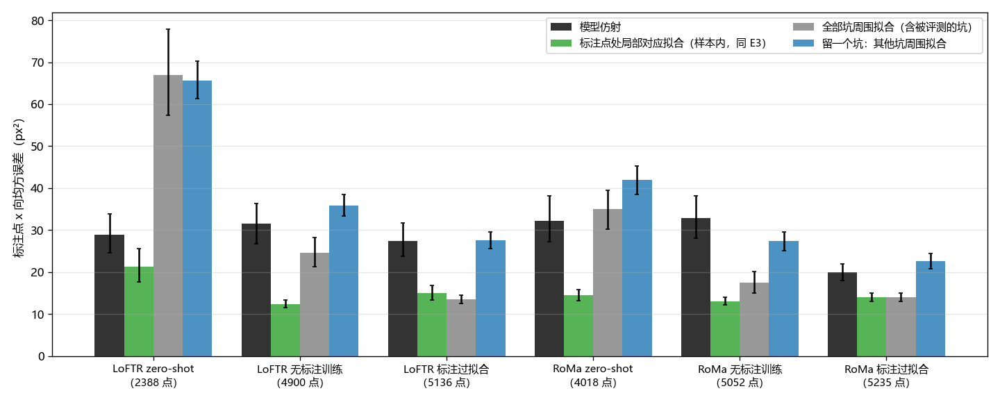

# 局部对应拟合仿射的优势是样本内效果

**摘要**

此前的误差分解发现，把仿射改在陨石坑标注点处、用模型自己在那里的对应拟合，标注点的 x 向均方误差能降一半以上；在坑旁 32 px 以内拟合也接近这一水平。但这两次拟合用的都是被评测的那批坑：形变不是严格的仿射，在评测点上或其旁边拟合，误差本来就会变小。本实验在 Val 的 652 对上、对 6 个 LoFTR 和 RoMa 模型做留一检验：拟合时不用被评测的坑，只用其他坑 16 px 以内的全部对应，再只在被留下的坑上量误差。结果，留一拟合的误差回到模型仿射的水平：训练过的四个模型为 22.6–35.8 px²，模型仿射为 19.9–32.9 px²，只有 RoMa 无标注训练低 5.5 px²；同样的候选对应只要加上被评测坑的周围，误差就低 8.6–14.1 px²。因此，「改在陨石坑处拟合，误差降一半以上」主要是样本内效果，不能说明模型在陨石坑处的对应能拟合出更准的仿射。

**引言**

LoFTR 和 RoMa 在本数据集上的误差，大头是整对仿射在标注点处的偏差。此前的误差分解中，同一个模型若改在标注点处、用它自己在那里给出的局部对应拟合仿射，x 向均方误差降 55–66%。由此得出的解释是：两张图之间的形变不是严格的仿射，模型的仿射由全图的对应决定，到了陨石坑处就会偏；只要改用陨石坑处的对应拟合，仿射就能更准。随后的分圈实验从离坑由近到远的距离圈里取对应拟合，发现三个训练过的模型在坑旁 32 px 以内拟合，误差接近在坑上拟合，比模型仿射低 33–49%，似乎支持这一解释。

这两次检验有一个共同的缺口：拟合用的点和评测用的点是同一批陨石坑，或就在它们旁边。形变不是严格的仿射时，任何在评测点处拟合的仿射都会在这些点上显得更准，换一批点评测，优势可能就没有了。此前试过只用坑上的点做留一，每对只有 4–9 个点，拟合噪声太大，下不了结论。

本实验把留一的单位从「点」换成「坑的周围」：拟合用其他坑 16 px 以内的全部对应，点数足以压低拟合噪声，同时拟合与评测不再用同一个坑。如果优势来自陨石坑处的对应本身更适合拟合仿射，留一拟合应仍明显好于模型仿射；如果是样本内效果，它会回到模型仿射的水平。

**方法**

*模型与数据。* 6 个模型与此前的误差分解相同，LoFTR 和 RoMa 各三个：AnyMatch 发布的权重（下称 zero-shot）；在其上不用标注训练得最好的模型（下称无标注训练）；用 Val+Test 标注训练的模型（下称标注过拟合，只作参照）。所有统计都在 Val 中 652 个有标注的对上做，只推理、不训练。全图的对应沿用分圈实验的推理结果：LoFTR 取它输出的全部匹配（RANSAC 之前），RoMa 取光学图上每个像素中心的稠密对应。

*留一个坑。* 对一对图上的每个陨石坑标注 k，候选对应是光学侧离其他任一坑不到 16 px、且离坑 k 不少于 16 px 的全部对应。离坑 k 太近的对应即使也在别的坑旁边，同样不用，因为它们就在被评测的坑旁。至少要有 3 个其他坑各贡献至少 3 个候选，否则这个坑不计；实际每个坑中位有 7 个其他坑参与（LoFTR zero-shot 为 5 个），候选中位数 LoFTR 约 120 个（zero-shot 48 个），RoMa 约 5600 个。全部候选直接用普通最小二乘拟合仿射，不做 RANSAC，与分圈实验相同；再只在坑 k 上量误差，即光学标注经仿射映射后与 SAR 标注之差。误差某一轴超过 20 px 的记为拟合粗错，不计入误差，单独报告比例。

*对照。* 在同一批点上比较四种仿射。模型仿射是评测所用的仿射。样本内局部拟合的做法同此前的误差分解：在每个标注点处取模型自己的局部对应（LoFTR 为标注点 12 px 内匹配位移的中位数，至少 3 个；RoMa 为稠密对应在标注点处的值），离标注 20 px 以上的不用，至少 4 点，用普通最小二乘在这一对的全部标注点上拟合。全部坑周围拟合用离任一坑不到 16 px 的全部候选，包括被评测的坑，每对拟合一次；它与留一拟合的候选来源、点数和外点都相近，只差有没有用到被评测坑的周围。

*误差与统计。* 主指标是 x 向均方误差，即各标注点 x 向误差平方的平均；同时报告 x 向误差绝对值的中位数。模型仿射失败或平均偏移超过 20 px 的对整对不计。每个模型用自己四种仿射都可用的点（2388–5235 个点，350–651 对）；另在 6 个模型都可用的 2042 个点（321 对）上重算一遍作为副口径。95% 区间由按对的自助抽样（1000 次）得到，差值也在同一批对上自助抽样。

*逐对可视化。* 每个模型写一个方法：样本内局部拟合的仿射，逐对写进 `preds/`，局部对应作为点对一并写入；参考方法设为该模型原来的预测，在节点页上用卷帘并排看。每个模型用自己能取到局部对应的全部点，不够 4 个点的对记为失败（LoFTR zero-shot 276 对、RoMa zero-shot 69 对，其余 0–10 对）。这些仿射是照着标注点挑选和拟合的，页面上的指标偏乐观，不能与其他方法比较。

**结果**

***留一个坑之后，误差回到模型仿射的水平。*** 训练过的四个模型上，留一拟合的 x 向均方误差为 22.6–35.8 px²，模型仿射为 19.9–32.9 px²（表 1）。与模型仿射之差：LoFTR 标注过拟合为 +0.2 px²（区间 −3.7 到 +3.3），LoFTR 无标注训练 +4.3（−0.3 到 +8.7），RoMa 标注过拟合 +2.7（+1.3 到 +4.0），RoMa 无标注训练 −5.5（−10.1 到 −1.1）。样本内局部拟合在同一批点上为 12.4–14.9 px²，比模型仿射低 30–61%。x 向中位数给出同样的排序：这四个模型的留一拟合为 2.6–3.2 px，模型仿射与样本内拟合都约 2.1 px，所以留一更差不是少数大误差造成的。

图 1：留一个坑之后，局部对应拟合的优势消失。每组柱是一个模型，从左到右为模型仿射、样本内局部拟合、全部坑周围拟合（含被评测的坑）、留一个坑；误差线为按对自助抽样的 95% 区间。括号里是参与比较的标注点数。

| 模型 | 点数 | 模型仿射 | 样本内局部拟合 | 全部坑周围拟合 | 留一个坑 | 留一的拟合粗错 |
|---|---|---|---|---|---|---|
| LoFTR zero-shot | 2388 | 28.9 | 21.3 | 66.9 | 65.6 | 36% |
| LoFTR 无标注训练 | 4900 | 31.5 | 12.4 | 24.6 | 35.8 | 6% |
| LoFTR 标注过拟合 | 5136 | 27.4 | 14.9 | 13.5 | 27.6 | 2% |
| RoMa zero-shot | 4018 | 32.2 | 14.5 | 35.0 | 42.0 | 18% |
| RoMa 无标注训练 | 5052 | 32.9 | 13.0 | 17.4 | 27.4 | 3% |
| RoMa 标注过拟合 | 5235 | 19.9 | 14.0 | 14.0 | 22.6 | 1% |

表 1：留一拟合的误差与模型仿射相当，远高于样本内拟合。数值为标注点的 x 向均方误差（px²）。粗错为留一拟合在被评测坑上某一轴误差超过 20 px 的比例，这些点不计入误差，计入只会让留一更差。

***优势来自用到了被评测的坑。*** 全部坑周围拟合与留一拟合用同样来源的候选对应，外点也一样，区别只在是否包括被评测坑 16 px 以内的对应。训练过的四个模型上，前者比后者低 8.6–14.1 px²，区间都不含 0；两个标注过拟合的模型，全部坑周围拟合（13.5、14.0 px²）与样本内拟合相当。也就是说，坑旁 16 px 以内的对应拟合出的仿射，只在这个坑上准；拿去预测别的坑，就不比模型仿射好。

***副口径给出同样的结论。*** 在 6 个模型都可用的 2042 个点上，训练过的四个模型的留一拟合与模型仿射之差为 −0.8 到 +4.5 px²，RoMa 无标注训练的区间（−4.3 到 +2.0）包含 0；样本内拟合仍比模型仿射低 15–49%。

***两个 zero-shot 模型的留一拟合受外点拖累。*** LoFTR zero-shot 的留一拟合为 65.6 px²，粗错 36%；RoMa zero-shot 为 42.0 px²，粗错 18%。全部坑周围拟合同样很差（66.9、35.0 px²），与分圈实验中「zero-shot 模型在任何位置直接最小二乘都不如模型仿射」一致。这两个模型的比较受外点主导，对样本内效果说明不了什么。

**讨论**

本实验回答了此前误差分解留下的缺口：「改在陨石坑处用局部对应拟合，误差降一半以上」主要是样本内效果。拟合不用被评测的坑后，局部对应拟合的仿射在训练过的模型上回到模型仿射的水平；同样的候选只要包括被评测坑的周围，误差就大幅下降。对分圈实验也是同样的解释：它在坑旁 32 px 以内拟合、在同一批坑上评测，误差接近样本内拟合，原因也是用到了被评测的坑，而不是坑旁的对应更适合拟合仿射。此前「标注点处的误差大头来自仿射在别处拟合」的说法应改为：任何仿射都去不掉的形变在不同陨石坑之间差别很大，在一个坑处拟合只对这个坑有效。

结论有三点局限。第一，RoMa 无标注训练在各模型自己的点上仍比模型仿射低 5.5 px²，区间不含 0；在 6 个模型共有的点上这一优势不显著，是否有小幅真实优势，本实验定不下来。第二，留一拟合用最小二乘、不去外点，而模型仿射经过 RANSAC；对 zero-shot 模型，比较主要反映外点，对训练过的模型影响较小（粗错 1–6%）。第三，样本内局部拟合筛选对应时用到了标注（离标注 20 px 以上不用），留一拟合没有这一步，两者的外点水平并不完全相同。

对后续研究，这一结果意味着「不用标注、让仿射更多依赖陨石坑一带的对应」不太可能明显提高其他陨石坑处的精度，也不能据此认定评测协议中的全局仿射在压低精度。陨石坑之间不能被同一个仿射描述的形变，才是标注点处误差的主要来源；要降低它，需要不受单一全局仿射限制的输出方式，或者在评测时承认这一部分误差是任何仿射都去不掉的。
