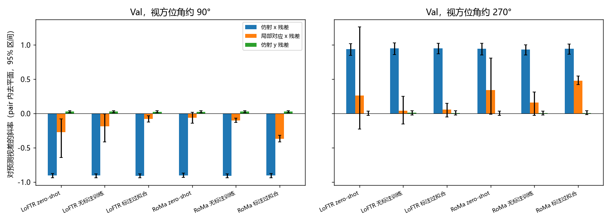
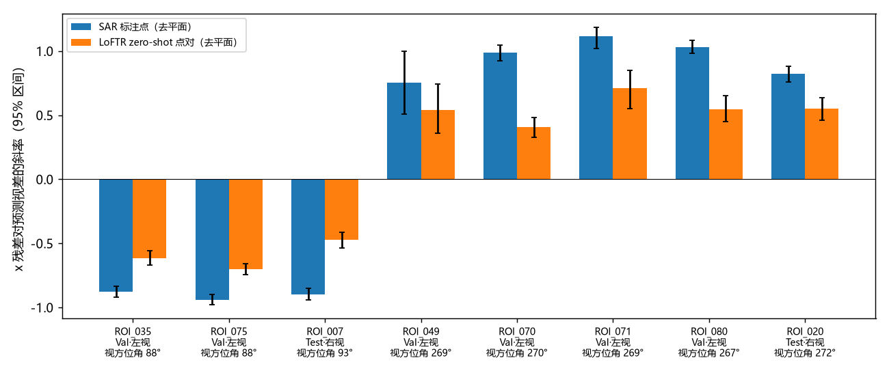
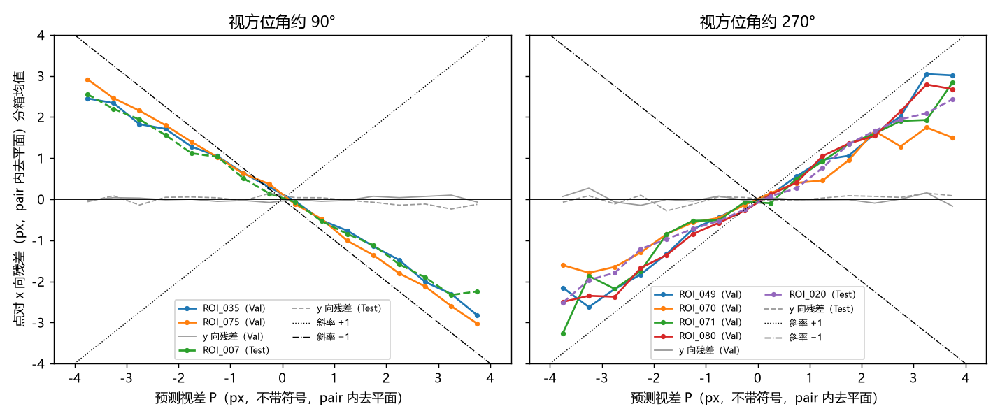
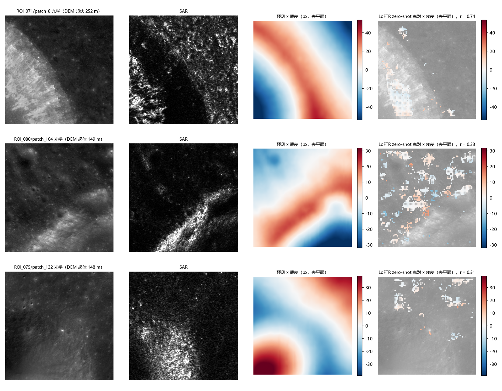

# SAR 标注点里仿射去不掉的 x 误差，约四分之三是没有校正的地形视差

**摘要**

前面的误差分析发现，标注点处的误差几乎都在 x 向，其中有一部分任何仿射都去不掉。x 向大致是 SAR 的距离向。如果 Mini-RF 产品没有按真实地形校正，高处的地物就会沿距离向移动，移动量约为相对高程乘以入射角的余切。我们用 SLDEM2015（约 59 m）在每个标注点上预测这一视差，在 Val 6 个 ROI 和 Test 2 个右视 ROI 上与实测残差对照。在标注点上，仿射去不掉的 x 误差与预测视差的回归斜率是 ±0.9，Val 的 r² 为 0.67–0.77；直接按物理斜率 ±1 减去预测视差，能去掉这部分误差的 61–77%。换算成模型的全部 x 均方误差，视差占 11–24%，用标注过拟合的 RoMa 占 35–38%。y 向看不到这个效应。斜率的正负号在 8 个 ROI 上都由视方位角决定，与左视、右视无关。尺度在 560 m 以上的低频视差同样完整地留在 SAR 里，说明 Ortho 处理没有用真实地形去校正。匹配器的局部对应大体跟上了视差，模型输出的仿射跟不上。因此，评测里单一仿射去不掉的误差主要来自地形视差。它沿 x 向，方向由视方位角决定，大小正比于高程，可以作为方法和评测都要面对的数据特性。

**引言**

误差分析的几个实验把标注点处的 x 向误差拆成了三部分（「误差的性质」实验）：模型仿射在别处拟合带来的偏差、局部对应本身不准，以及任何仿射都去不掉的部分，最后一部分约占 x 向均方误差的 22–34%。留一个坑的检验进一步表明，在一个坑处拟合的仿射只对这个坑有效，各坑之间存在仿射表达不了的形变。

这种形变从哪里来，此前没有直接证据。文献调研给出了一个具体的猜测。CE-2 的 DOM 已经正射校正，Mini-RF 的 Level 2 产品却未经正射（Kirk 等 2010 称之为「unrectified」）；侧视成像下，高处的地物沿距离向朝雷达一侧移动，移动量约为相对高程 × cot 入射角。67 条 Mini-RF 条带的处理参数都写着 `dem_used: 1`，但所用 DEM 的网格约为 560 m × 200 m，数值没有存档，不知道是不是真实地形。数据集构建时没有用 DEM，每个 ROI 只用一个全局仿射对齐，patch 只做整数平移，所以这部分视差如果存在，就原样留在了 patch 对里。

本文检验这一猜测。我们用 DEM 在每个标注点上预测 x 向视差，回答三个问题：预测与实测相关多大、能解释多少 x 向误差，y 向是否没有这个效应；视差的正负号是否随成像几何翻转；Ortho 处理有没有用真实 DEM 去掉 km 级的地形视差。DEM 只用于这次诊断，不进方法。

**方法**

*模型与数据。* 6 个模型与「误差的性质」实验相同：LoFTR 和 RoMa 各三个，分别是 AnyMatch 发布的权重（下称 zero-shot）、不用标注训练得最好的模型（下称无标注训练）和用 Val+Test 标注训练的模型（下称标注过拟合）。标注点的局部对应在 Val 上直接沿用该实验的结果：标注点 12 px 内匹配点位移的中位数。样本是 Val 的 6 个 ROI（652 对有标注）和 Test 里两个右视 ROI（ROI_007、ROI_020，共 377 对）；RoMa zero-shot 没有 Test 预测，只参与 Val。粗错的对（标注点上的平均偏移超过 20 px）和标注点少于 4 个的对不参与统计，余下 Val 605 对、4908 个点，Test 291 对、2357 个点。

*预测视差。* DEM 用 SLDEM2015（LOLA 与 SELENE TC 合成，512 像元/度，约 59 m）。每个 patch 都带地理参考，光学与 SAR 已重采样到同一张 7.5 m 网格；我们把 DEM 按光学 patch 的地理参考三次样条重采样到这张网格上。在光学标注点 o 处，预测视差 P = (h(o) − 基准) × cot θ ÷ g：h 是高程，θ 是该条带的入射角（49°–54°），g 是东西向一个像元的地面宽度（6.7–8.1 m）。P 的单位是 px，不带正负号；正负号由数据决定，物理上应取决于雷达朝哪边看。基准有两种：一是 patch 内平均高程；二是在比较时去掉 pair 内的平面趋势，原因见下一段。入射角和视方位角取自 PDS 标签。视方位角分两组：约 90°（ROI_035、075、007）和约 270°（ROI_049、070、071、080、020）。

*实测残差与比较方式。* 仿射残差是 SAR 标注点减去光学标注点经模型仿射映射后的点，局部对应残差是 SAR 标注点减去局部对应点，各分 x、y 两个分量。视差场里随位置线性变化的部分可以被仿射吸收，所以主要比较方式是先在每对内对残差和 P 都去掉对标注坐标 [1, x, y] 的最小二乘拟合，再把各对合并，做过原点回归 残差 ≈ s × P。去平面后，仿射残差里模型仿射本身的贡献完全消失，剩下的是任何仿射都去不掉的部分，下称**非仿射误差**（等于用标注点自拟合仿射后的残差），因此 6 个模型在这一口径下结果几乎相同。我们报告斜率 s、它去掉的均方比例 r² 以及按 pair 自助重采样 1000 次的 95% 区间；s 接近 ±1 表示 SAR 里的位移与物理预测一致。直接相关（不去平面，以 patch 均值为基准）也一并报告。视差占模型全部 x 均方误差的比例按正交分解计算：s² × 非仿射部分里 P 的均方 ÷ 仿射残差的 x 均方误差。

*全部点对。* LoFTR zero-shot 在每对上有约 1000 个匹配点（RANSAC 之前），覆盖整个 patch。点对残差是 SAR 侧匹配点减去光学侧匹配点经该对仿射映射后的点。残差超过 15 px 的点算作外点去掉。在先试的两个 ROI（ROI_035、049）上，阈值为 6、15、30 px 时，斜率绝对值分别约为 0.40、0.54–0.61、0.52–0.56：阈值太小会把大视差的点当外点去掉，压低斜率。其余做法同标注点。

*Ortho 处理是否用过真实 DEM。* 把去平面后的预测视差拆成两部分：一部分是用 560 m × 200 m 方框平滑过的高程算出的低频视差，另一部分是剩下的高频视差。网格的朝向不知道，所以两种朝向都算了，结果相同。随后对两者做联合回归。如果 Ortho 用真实 DEM 在这个网格上校正过，低频视差已经被去掉，它的斜率应接近 0。

**结果**

*标注点处残留的地形视差有数个像素。* 以 patch 平均高程为基准，8 个 ROI 标注点上预测视差的均方根是 6.7–15.6 px。去掉仿射能吸收的平面部分后还剩 3.8–6.2 px，第 95 百分位为 5–13 px。各 ROI 中 patch 内去平面后高程标准差的中位数是 10–46 m。

*非仿射误差的四分之三可由地形视差解释，y 向没有这个效应。* 在 Val 上（图 1），非仿射误差对预测视差的斜率，视方位角约 90° 的一组为 −0.91（95% 区间 −0.94 到 −0.88，r² 0.77），约 270° 的一组为 +0.94（0.85 到 1.02，r² 0.67）；Test 的两个右视 ROI 分别为 −0.90（r² 0.73）和 +0.82（r² 0.64）。逐个 ROI 看，斜率的绝对值为 0.75–1.13，r² 为 0.49–0.81（见图 2）。y 向的斜率绝对值在 0.05 左右以内，r² 不超过 0.03。不拟合斜率、直接减去 ±1 × P，Val 上能去掉非仿射误差的 66–77%，Test 上为 61–72%。由于模型仿射本身的误差更大，视差只占模型全部 x 均方误差的一部分：在 Val 上，四个 zero-shot 和无标注训练的模型为 11–24%，LoFTR 标注过拟合为 20–24%，RoMa 标注过拟合为 35–38%。直接相关（不去平面）把这个信号淹没在模型仿射的误差里：斜率绝对值为 0.10–0.26，r² 为 0.02–0.21。

图 1：在 Val 上，仿射残差的 x 分量随预测视差变化，斜率约为 ±0.9；局部对应残差和 y 分量基本不随它变化。去平面后仿射残差与模型无关，所以 6 个模型的蓝色柱相同。

*正负号由视方位角决定，8 个 ROI 全部一致。* 视方位角约 90° 的 3 个 ROI 斜率都为负，约 270° 的 5 个都为正（图 2），而且点对的斜率也在所有 ROI 上同号。这正是高处朝雷达一侧移动的方向：视方位角约 90° 时雷达在西、向东看，高处在 SAR 里向西（−x）移动。左视或右视本身决定不了方向。Test 中右视的 ROI_007（视方位角 93°）与左视的 ROI_035、075（88°）同号，右视的 ROI_020（272°）与左视的 ROI_049、070、071、080 同号。原先的假设是「右视应与左视相反」，这个假设不成立；起作用的是雷达的朝向。

图 2：8 个 ROI 上，SAR 标注点和点对的 x 残差都随预测视差变化，正负号只取决于视方位角。

*Ortho 处理没有去掉 km 级的地形视差。* 在标注点上，联合回归中低频视差（尺度 560 m 以上）的斜率，在 Val 上为 −0.92 到 −0.93 和 +0.94 到 +0.96，在 Test 上为 −0.93 到 −0.94 和 +0.86 到 +0.87，都接近 ±1。全部点对上为 −0.69、+0.54（Val）和 −0.49、+0.58（Test），同样远离 0。高频视差的斜率区间很宽，各组之间连正负号都不一致：SLDEM 的 59 m 网格分辨不出几百米以下的起伏，这部分无从判断。如果 Ortho 用真实 DEM 在 560 m × 200 m 网格上校正过，低频视差应该已经消失。因此 `dem_used: 1` 所用的高程面在 km 尺度上不是真实地形，多半是平面或参考球面（推断）。图 4 是起伏最大的几个 patch，其中第一行是一个 km 级大坑的坑壁：预测视差在 patch 内变化 ±40 px，点对残差的空间格局与它一致，r = 0.74。

*匹配器的局部对应大体跟上了视差，仿射跟不上。* 局部对应残差（SAR 标注点减局部对应点）若对视差的斜率为 0，说明局部对应与标注点一起移动了。在 Val 上，除 RoMa 标注过拟合外的五个模型，这一斜率为 −0.28 到 +0.34，r² 都不超过 0.04。RoMa 标注过拟合为 −0.37 和 +0.48（r² 0.26–0.30），它的局部对应只跟上了一半多的视差；推测是拿标注训练把局部对应拉向了平滑的形变。全部点对逐 ROI 只跟上了预测视差的 41–71%（图 2、图 3），比标注点上的 0.9 低。在最陡的坑壁上，点对残差的幅度明显小于预测。

图 3：在全部 8 个 ROI 上，LoFTR zero-shot 点对的 x 残差都随预测视差近似线性变化，斜率约 ±0.6；y 残差不随它变化。曲线是每 0.5 px 分箱的均值。

图 4：在起伏最大的 patch 上，点对残差的空间格局与预测视差一致。各列依次为光学图、SAR 图、带符号的预测视差和点对 x 残差（都在 pair 内去平面），后两列的颜色范围相同。每个 ROI 至多取一对，只取点对不少于 300 的对。

**讨论**

此前的误差分析发现了一部分任何仿射都去不掉的 x 向误差，但不知道它从哪里来。本文表明，这部分误差的大约四分之三是 Mini-RF 产品里没有校正的地形视差。它只沿 x 向，正负号由视方位角决定，大小约为相对高程 × cot θ ÷ 像元宽度；km 级地形也没有被 Ortho 处理去掉。「误差的性质」实验里「标注处的局部对应比仿射准」，以及留一个坑实验里「在一个坑处拟合只对这个坑有效」，都可以由此得到解释：每个坑都按自己的高程沿 x 移动了，匹配器的局部对应跟着它移动，单一仿射却只能取一个平均。

这项诊断有几处局限。SLDEM2015 的 59 m 网格分辨不出标注的小陨石坑本身，所以预测的是坑所在位置的大尺度高程，而不是坑心本身的视差。人眼在两种模态里估计坑心的方式可能不同，这一点无法分开。斜率略小于 1（0.75–1.13），可能来自 DEM 平滑、坑心定义的差别，或者 Ortho 确实做过一部分校正，这三者现在区分不开。高频视差（560 m 以下）有没有被校正，需要分辨率 10 m 级的 DEM（例如 Kaguya TC 的 DTM）才能判断。全部点对的结果只看了 LoFTR zero-shot，并且对外点阈值敏感。

这一结论有两方面的影响。在评测上，标注点本身带有视差，「用一个仿射对齐全部标注点」在物理上不可能完全成立；视差在模型全部 x 均方误差中占一到两成，在标注过拟合的 RoMa 上占到三成多，是一个评价协议需要正视的下限。在方法上，「全局仿射 + 沿 x 的一维视差场」有了直接依据：残差只有一维，方向已知，幅度随高程变化。方法不用 DEM，但可以把这一结构作为先验。值得检验的问题有两个：一是用无标注训练让输出带上这样一个一维视差场，能否把 SR@3 推过仿射的上限；二是匹配器的对应为什么只跟上了一半多的视差，这部分缺口是否就是 LoFTR 无标注训练改进局部匹配、却传不到仿射上的原因。
