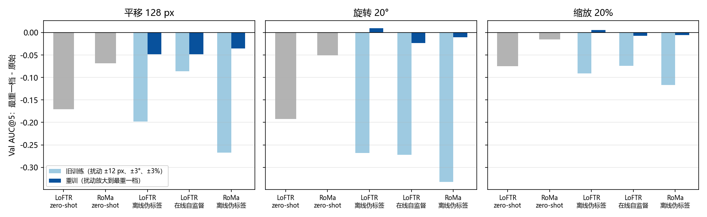

# 加大几何扰动后，无标注训练与 zero-shot 的差距明显拉开，三种无标注训练之间的差距基本不变

**摘要**

在原始验证集上，几种配准方法的 AUC@5 挤在 0.22–0.33 之间，看不出谁更好。此前我们在 SAR 一侧叠加已知的平移、旋转或缩放来加大样本难度，想看方法之间的差距能否拉开，但训练过的模型在大扰动下全面失效：它们训练时只见过 ±12 px、±3°、±3% 的扰动，旋转 20° 时只剩 0.00–0.02，比 zero-shot 还低。这些模型反映的是训练扰动太小，看不出训练方法本身的强弱。我们把训练扰动放大到测试的最重一档（平移半径 128 px、旋转 ±20°、缩放 ±20%），其余配方基本不变，重训三种无标注训练方法：LoFTR 和 RoMa 的离线伪标签自训练，以及 LoFTR 的在线自监督。重训后，三种方法在旋转和缩放的各档上几乎不掉分，在平移 128 px 时只掉 0.035–0.049，原始档上仍比同骨干的 zero-shot 高 0.045（LoFTR）和 0.092（RoMa）。在此前提下，样本越难，训练带来的领先越大：到最重一档，LoFTR 的领先扩大到 0.11–0.25，RoMa 扩大到 0.10–0.13，五个模型的最高与最低之差从原始档的 0.103 扩大到 0.17–0.29。三种无标注训练之间则没有明显拉开：各档排序不变，RoMa 比 LoFTR 高 0.04–0.08，LoFTR 的两种训练至多相差约 0.03。加大难度能区分训练与不训练，但区分不了这三种无标注训练。

**引言**

我们研究月球光学影像与 SAR 影像之间的仿射配准，并比较几种不需要标注的训练方法。在原始验证集上，这些方法的差距很小：RoMa 离线伪标签自训练的 AUC@5 为 0.332，LoFTR 的两种无标注训练都约 0.29，两个 zero-shot 模型在 0.22–0.24。原始数据的影像对在构建时已粗对齐，评测只考察残余的偏差，方法之间的差别因此被压缩。

为了拉开差距，此前我们在 SAR 一侧叠加已知的几何扰动，构造了更难的测试集。但训练过的模型在重档上全面失效。旋转 20° 时，LoFTR 离线伪标签自训练只剩 0.024，LoFTR 在线自监督 0.017，RoMa 离线伪标签自训练 0.000，而 RoMa zero-shot 还有 0.186。这些模型训练时的几何扰动只有 ±12 px、±3°、±3%（在线那条线完全不加），只见过原数据中以小平移为主的几何差异。它们在重档上的分数反映的是训练扰动太小，而不是训练方法本身的强弱，所以难度加大以后方法间差距是否拉开，此前没能回答。

本文先把训练扰动放大到测试的最重一档，重训三种无标注训练方法，确认它们在难测试集上不再失效；再在原始档和难测试集各档上比较这三个模型与两个 zero-shot 模型，看样本变难后方法之间的差距是否拉开。

**方法**

*难测试集。* 每对影像只在 SAR 一侧施加一个已知仿射 T，SAR 影像按 T 重采样（画面外补 0），真值仿射随之精确变为 T∘A。三个轴各自单独扰动，各三档：平移 12 / 64 / 128 px（幅度固定，方向随机），绕中心旋转 3° / 10° / 20°（正负随机），绕中心缩放 3% / 10% / 20%（放大或缩小随机）。每对影像的 T 只由轴、数据划分和影像对决定，所有模型用同一份 T。评测协议与原始档相同：用匹配点经 RANSAC（3 px）估计仿射，计算检查点误差，失败记为无穷大，所有影像对等权。误差先把预测的仿射换回原 SAR 坐标系再量，单位是原始像素。扰动后落到 SAR 画面外的检查点也计入：真值精确已知，这些点只要求仿射外推到看不见的区域，重叠区变小本身就是难度的一部分。因此每一档与原始档用的是同一批检查点。Val 有 652 对，Test 有 953 对。下文主要报 Val AUC@5，Test 与之一致的地方只简单提及。

*训练扰动。* 训练时同样只扰动 SAR 一侧，伪标签随之精确变为 T∘A。平移在半径 128 px 的圆盘内按面积均匀采样，旋转在 ±20° 内均匀采样，缩放在 1 ± 0.2 内均匀采样，三项组合进同一个 T，各自独立采样。T 把 SAR 移出画面后会补 0，所以我们另加一条规则：在原 SAR 画面外的伪标签点不参与监督，以免模型学着把光学边缘匹配到补零区。除扰动外，各方法的步数、学习率、光度扰动、擦除和负样本都沿用原配方。

*三种无标注训练方法。*

- LoFTR 离线伪标签自训练：按 noisy student 的做法（Xie 等，arXiv 1911.04252）多轮进行。每轮用上一轮选出的模型，在不加扰动的训练集上打伪标签（RANSAC 3 px，匹配点不少于 100、内点不少于 20，取内点最多的前 50%）；学生每轮都从 zero-shot 权重重训，训练时加几何和光度扰动。第一轮用 zero-shot 模型打标签。每轮学习率 1e-5，训练 8000 步。从第二轮起，若本轮的原始 Val AUC@5 不高于上一轮就停止，最多 4 轮。实际 4 轮都在上升（0.260、0.265、0.268、0.270），用第 4 轮的模型。
- RoMa 离线伪标签自训练：同样的 noisy student 流程，训练 VGG 部分和 DINOv2 的低秩适配器，学习率 3e-5，每轮 8000 步，加几何扰动和随机擦除，共 2 轮（0.320、0.328），用第 2 轮的模型。
- LoFTR 在线自监督：不使用预先打好的伪标签，每一步用当前模型自己的 RANSAC 内点作为监督信号，并加入不重叠的负样本对，训练 4000 步。此前这条线不加几何扰动，这次加上，不加光度扰动。

三种方法每轮都按原始 Val AUC@5 选最好的存档。用作对照的两个 zero-shot 模型是 AnyMatch 发布的 LoFTR 和 RoMa 权重。此前训练的三个旧模型只在图 1 中作对照。

*硬件。* 同一个 RoMa 权重在不同型号的显卡上推理，仿射可相差约 3 px，所以难测试集上 RoMa 都在 V100 上推理，LoFTR 都在 RTX 3090 上推理。重训模型的原始档由训练流程在 V100 上评测，抽查的 LoFTR 模型跨卡相差不超过 0.005。

**结果**

*放大训练扰动后，三种无标注训练在旋转和缩放上不再掉分，在大平移上只小幅下降。* 我们先比较每个模型最重一档与原始档的差（图 1）。旧模型在旋转 20° 时掉 0.27–0.33，比两个 zero-shot（0.19、0.05）掉得还多。重训的模型在旋转 20° 和缩放 20% 上的变化都在 −0.023 到 +0.010 之间。在平移 128 px 上，重训模型仍会下降：两个 LoFTR 模型各掉 0.048 和 0.049，RoMa 掉 0.035。但旧模型掉 0.09–0.27，LoFTR zero-shot 掉 0.170，RoMa zero-shot 掉 0.069，重训模型掉得都比它们少。Test 上规律相同。

图 1：放大训练扰动后，三种无标注训练在旋转和缩放上不再掉分，在大平移上只小幅下降。纵轴为三个轴最重一档的 Val AUC@5 减去原始档；浅色为扰动只有 ±12 px、±3°、±3% 时训练的旧模型，深色为重训的模型，灰色为 zero-shot。

*重训的三个模型在原始档上仍明显高于同骨干的 zero-shot。* 放大扰动的代价因骨干而异。重训的 RoMa 为 0.328，与旧模型（0.332）相当，比 RoMa zero-shot（0.236）高 0.092。重训的两个 LoFTR 模型为 0.270 和 0.271，比旧模型低约 0.02，但仍比 LoFTR zero-shot（0.225）高 0.045。在 Test 上，三个重训模型同样高于各自的 zero-shot（RoMa 0.301 对 0.231，LoFTR 0.233 和 0.241 对 0.187）。

*样本越难，训练带来的领先越大。* 原始档上，五个模型的最高与最低之差为 0.103。到三个轴的最重一档，这个差扩大到 0.172（缩放 20%）、0.238（平移 128 px）和 0.285（旋转 20°）（图 2）。差距拉开主要是因为 zero-shot 下降而重训模型基本持平。LoFTR 的情况最明显：原始档上，两种训练比 zero-shot 高 0.045；到最重一档，领先扩大到 0.11–0.13（缩放 20%）、0.17（平移 128 px）和 0.22–0.25（旋转 20°）。RoMa 的领先从原始档的 0.092 扩大到 0.10–0.13，扩大的幅度较小，因为 RoMa zero-shot 本身就比较能承受扰动（旋转 20° 时仍有 0.186）。

图 2：样本越难，无标注训练与 zero-shot 的差距越大，三种无标注训练之间的差距基本不变。三个轴上五个模型的 Val AUC@5 随扰动档位的变化（0 为原始）；灰色虚线为 zero-shot，彩色实线为重训的模型，圆点为 LoFTR，方块为 RoMa。

*三种无标注训练之间的差距没有随难度拉开。* 在 Val 的全部 10 档上，五个模型的排序都相同：RoMa 离线伪标签自训练最高，LoFTR 的两种训练其次，RoMa zero-shot 再次，LoFTR zero-shot 最低（表 1）。RoMa 与较好的 LoFTR 模型之差在原始档为 0.057，在各最重一档为 0.04–0.07，没有扩大。LoFTR 的两种训练在原始档几乎相同（0.270 对 0.271）。到重档，离线伪标签自训练在 Val 上略高，差距最大的是旋转 20°（0.279 对 0.247，相差 0.032）；但这一差距在 Test 上只有 0.014，Test 各档两者之差都在 −0.008 到 +0.014 之间，互有高低。Test 上，RoMa zero-shot 在原始档和平移 12 px 时与 LoFTR 的两个重训模型几乎持平（相差不超过 0.010），其余各档的排序与 Val 相同。

表 1：Val AUC@5，原始档与三个轴的最重一档（各档 Val / Test 的完整数据见附件 `extra/data/auc5.csv`）。

| 模型 | 原始 | 平移 128 px | 旋转 20° | 缩放 20% |
|---|---|---|---|---|
| RoMa 离线伪标签自训练（重训） | 0.328 | 0.292 | 0.317 | 0.323 |
| LoFTR 离线伪标签自训练（重训） | 0.270 | 0.222 | 0.279 | 0.275 |
| LoFTR 在线自监督（重训） | 0.271 | 0.222 | 0.247 | 0.263 |
| RoMa zero-shot | 0.236 | 0.168 | 0.186 | 0.221 |
| LoFTR zero-shot | 0.225 | 0.054 | 0.032 | 0.150 |

**讨论**

此前难度加大以后，训练过的模型全面失效，看不出方法之间的差距是否拉开。把训练扰动放大到测试范围以后，三种无标注训练在难测试集上基本不再失效，这个问题才能回答。答案分两层。第一，加大难度明显拉开了训练与不训练的差距，LoFTR 尤其如此：原始档上只领先 0.045，到旋转 20° 时领先超过 0.2。第二，加大难度没有拉开三种无标注训练之间的差距：它们的排序在各档都不变，RoMa 与 LoFTR 之间的差距大致恒定，LoFTR 的两种训练至多相差约 0.03，而且在 Test 上没有重现。所以，难测试集适合检验一种训练方法是否稳健，但用它来区分这三种无标注训练方法，效果并不比原始测试集好。

局限有四点。第一，重训模型训练时见过与测试同样范围的扰动，zero-shot 模型没有见过，所以训练与不训练之间拉开的差距里，有一部分来自重训模型的这一优势；难测试集的各档都在训练范围之内，本文没有测试训练范围之外的扰动。第二，扰动是合成的：SAR 只被重采样，没有改变成像几何，画面边缘补 0 的区域在真实数据中也不存在。第三，LoFTR 离线伪标签自训练这次改为与 RoMa 同样的多轮 noisy student 流程，与旧模型的训练流程不同，所以两者之间的差别不能全部归因于扰动。第四，每个方法只训练了一个模型、一个随机种子，0.03 以内的差距可能落在训练的随机波动之内。

对后续研究有两点启示。一是若要区分不同的无标注训练方法，加大几何难度不是有效的手段，需要找其他能拉开它们的测试条件。二是放大训练扰动让 RoMa 的原始档几乎不变，却让 LoFTR 的原始档低了约 0.02；如果难测试集以后成为评判标准之一，训练扰动的范围需要在原始档与难测试集之间权衡，这值得单独检验。
