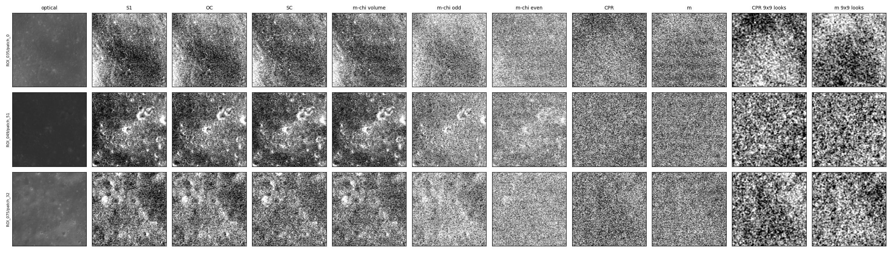
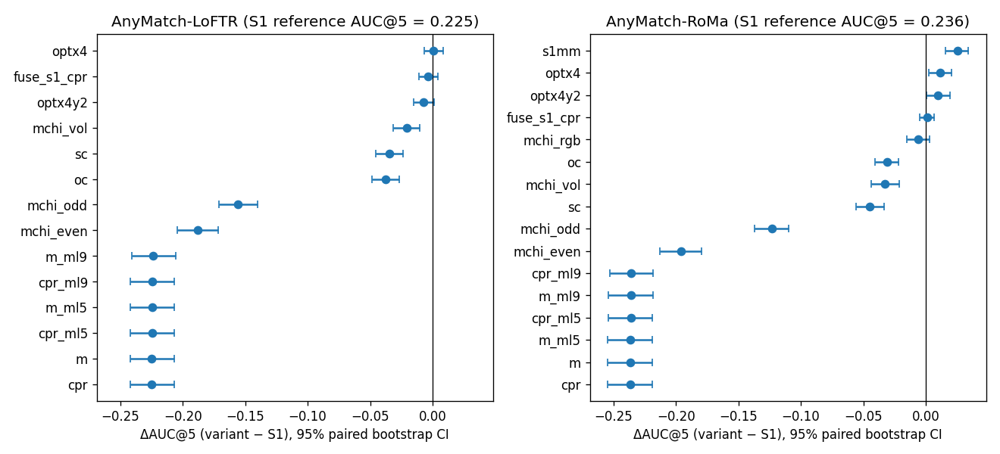

# 零样本下 S1 已是最好的 SAR 输入，换极化量或模糊光学都改不掉误差

**摘要**

通用匹配器在月球光学-SAR 上的失效清单里，有一条是 SAR 一侧的信号差异：我们只喂 S1（两路接收功率之和），没用与照射方向几乎无关的圆极化比 CPR 和 m-χ 分解，SAR 的距离向分辨率（约 30 m）也比光学粗。但这些差异会不会损害匹配，此前没有测过。本实验对 AnyMatch-LoFTR 和 AnyMatch-RoMa 做零样本推理，在 Val 的 652 对上换了 14–16 种输入，每种都与同一批卡上重跑的 S1 逐对比较。结果，没有一种极化量比 S1 好：SC、OC、m-χ 体散射的 AUC@5 低 0.02–0.05，m-χ 奇次和偶次低 0.12–0.20，CPR 和极化度 m 完全配不上（AUC@5 ≤ 0.001），先做 9×9 多视也救不回来；S1 与 CPR 的点对合并、RoMa 的 m-χ 三通道输入都与 S1 持平。把光学模糊到 SAR 的分辨率，LoFTR 不变，RoMa 提高 0.010–0.012，只沿 x 模糊与 x、y 一起模糊效果相同。所有变体的 x 向残差都约为 y 向的 3 倍。因此，SAR 信号差异不是零样本匹配的主要失效来源：可匹配的结构来自 S1 里随地形起伏变化的亮度，比值类极化量恰好把它消掉了；x 向的系统误差也不来自输入。

**引言**

多模态匹配器在本数据集上零样本可用，但精度不够：AnyMatch-LoFTR 和 AnyMatch-RoMa 的 Val AUC@5 只有 0.22–0.26，误差以沿 x 的整体偏移为主。为了找针对数据特性的改进，此前整理了通用方法在月面可能失效的地方，其中一条是 SAR 一侧的信号差异。匹配器的训练数据里没有 SAR：Mini-RF 是混合极化雷达，我们只用了 S1，没用圆极化比 CPR；CPR 主要反映表面粗糙度，被认为几乎不随照射方向变化，而照射方向不同正是光学与 SAR 外观差异的来源之一。此外，SAR 的距离向（约为 x）分辨率约 30 m、方位向约 15 m，光学是 7 m，分辨率不一致也可能让细节对不上。

这些推测都还没有用数据检验过。如果换一种 SAR 输入或把两侧分辨率拉平就能明显提高零样本精度，「输入表示」就是一个值得做的方向；如果都不行，信号差异就可以从失效清单里降级。

本实验只推理、不训练，逐个替换 SAR 输入，并把光学模糊到 SAR 的分辨率，看零样本精度怎样变化。

**方法**

*模型与数据。* 两个匹配器用 AnyMatch 发布的权重，推理配置与 zero-shot 基线相同（长边 640，LoFTR 粗级阈值 0.1，RoMa 采样 10000 个对应）。只用 Val 中 652 个有标注的对。仿射由 RANSAC（3 px）估计，误差与指标按工作台的评价协议计算。

*SAR 输入。* 数据集的 SAR 有 4 个原始波段：两路接收功率 ⟨|E_H|²⟩、⟨|E_V|²⟩，以及它们互相关的实部和虚部。由此求 Stokes 参数 S1–S4，再求同向与反向圆极化功率 SC = (S1 − S4)/2、OC = (S1 + S4)/2，圆极化比 CPR = SC/OC，极化度 m = √(S2² + S3² + S4²)/S1，以及 m-χ 分解的三个分量：奇次散射 (m S1 + S4)/2、偶次散射 (m S1 − S4)/2、体散射 S1(1 − m)（Raney et al. 2012，doi:10.1029/2011JE003986）。抽样核对过符号：奇次大于偶次的像素占 88–96%，CPR 中位为 0.40–0.56，与月面典型值相符。功率量取 dB，m 保持线性，再按每个 patch 的 2% 和 98% 分位数拉伸到 [0, 1]，与基线的 S1 做法相同。逐像素的 CPR 和 m 是两个带噪功率之比，几乎全是斑点（图 1），所以另加先对 4 个波段做 5×5、9×9 均值（多视）再求 CPR 和 m 的版本。LoFTR 只接受单通道，m-χ 的三个分量分别输入；RoMa 另试了把三个分量当 RGB 输入（R 偶次、G 体散射、B 奇次）。S1 + CPR 用后期融合：两种输入各自推理，把点对合并后再估仿射。

图 1：Val 的三对图在各输入下的样子。S1、OC、SC、体散射看得出陨石坑和地形；逐像素的 CPR 和 m 几乎全是斑点，9×9 多视后斑点变弱，但仍看不出与光学对应的结构。

*光学模糊。* patch 的像元为 7.5 m。对光学做高斯模糊：只沿 x，半高全宽 4 px（约 30 m）；沿 x 4 px、沿 y 2 px（约 15 m）。SAR 保持 S1。

*参照与比较。* 每个模型都把 S1 输入在同一批卡上重跑一遍，作为参照（RoMa 的结果随显卡型号变，所以 RoMa 全在 V100 上跑）。重跑的 S1 与 zero-shot 基线一致：RoMa 0.236，与基线相同；LoFTR 0.225，基线为 0.220。RoMa 另跑了 B0m 中最好的 min–max 拉伸作为第二个参照。每个变体与同模型的 S1 逐对比较：ΔAUC@5 为变体减参照，95% 区间由按对的自助抽样（2000 次，两方法用同一组下标）得到；变好、变差为对的误差减小、增大超过 1 px 的对数。x、y 残差为检查点经估计的仿射映射后与 SAR 检查点之差，先在对内取均值，再报绝对值的中位数（失败的对不计）。

*梯度一致性。* 为了不依赖匹配器、直接看各输入的结构与光学是否一致，按标注拟合的仿射把各 SAR 输入重采样到光学网格，两图都做 σ = 2 px 高斯平滑后取 Sobel 梯度幅值，在重叠区域内算 Pearson 相关，报 652 对的中位数。

**结果**

*没有一种极化量比 S1 好，比值量完全配不上。* 两个模型的排序相同（表 1，图 2）。SC、OC、m-χ 体散射比 S1 低 0.02–0.05，区间都不含 0；m-χ 奇次、偶次低 0.12–0.20。CPR 和 m 的 AUC@5 为 0.000，约 630 对变差，SR@10 不到 1%。RoMa 的 m-χ 三通道输入为 −0.006，区间跨 0。S1 与 CPR 的点对合并也与 S1 持平：CPR 的点对几乎全是外点，RANSAC 把它们滤掉了。

表 1：各输入相对 S1 的 ΔAUC@5（Val，652 对），方括号内为 95% 配对区间。S1 参照的 AUC@5：LoFTR 0.225，RoMa 0.236。

| 输入 | AnyMatch-LoFTR | AnyMatch-RoMa |
|---|---|---|
| SC | −0.035 [−0.045, −0.023] | −0.045 [−0.056, −0.034] |
| OC | −0.037 [−0.048, −0.027] | −0.031 [−0.041, −0.022] |
| m-χ 体散射 | −0.021 [−0.032, −0.010] | −0.033 [−0.044, −0.021] |
| m-χ 奇次 | −0.156 [−0.171, −0.140] | −0.123 [−0.137, −0.110] |
| m-χ 偶次 | −0.188 [−0.204, −0.171] | −0.196 [−0.213, −0.180] |
| m-χ 三通道 RGB | — | −0.006 [−0.015, +0.003] |
| CPR | −0.225（AUC@5 0.000） | −0.236（0.000） |
| m | −0.225（0.000） | −0.236（0.000） |
| S1 + CPR 点对合并 | −0.004 [−0.011, +0.004] | +0.001 [−0.005, +0.007] |
| 光学 x 向模糊 | +0.001 [−0.007, +0.009] | +0.012 [+0.003, +0.021] |
| 光学 x、y 模糊 | −0.007 [−0.015, +0.001] | +0.010 [+0.000, +0.019] |
| S1，min–max 拉伸 | — | +0.025 [+0.016, +0.034] |

图 2：各输入相对 S1 的 ΔAUC@5 与 95% 配对区间；只有 RoMa 的光学模糊和 min–max 拉伸高于 S1。图中 cpr_ml5、m_ml9 等为多视后的 CPR 与 m。

*多视救不回 CPR 和 m。* 先做 9×9 多视后，斑点明显减少（图 1），但 CPR 和 m 的 AUC@5 仍只有 0.000–0.001，SR@10 为 1.5–3.7%。5×5 多视同样如此。所以比值量配不上，主要原因不是斑点。

*比值量的结构与光学不一致。* 不经过匹配器，直接比较梯度：平滑后各输入与光学的梯度幅值相关，S1 最高（中位 0.165），体散射、SC、OC 为 0.12–0.13，奇次 0.055、偶次 0.030，CPR 和 m 只有 0.012 和 0.007；9×9 多视后的 CPR 与 m 也只有 0.029 和 0.026。这个排序与匹配精度的排序相同。我们的解释（推断，未单独检验）是：比值把两路功率共有的部分约掉了，而随地形坡度变化的亮度正是这一共有部分。光学的明暗主要来自坡度，S1 的亮暗也主要来自坡度对局部入射角的调制，CPR 和 m 反映的则是表面粗糙度和石块。各功率分量里，S1 是两路之和，等效视数最多、噪声最小，所以它的梯度与光学最一致。

*把光学模糊到 SAR 的分辨率只给 RoMa 小幅提高，且不是 x 向特有的。* 只沿 x 模糊时 RoMa 提高 0.012，x、y 一起模糊时提高 0.010，两者在区间内相同；LoFTR 都没有变化。这一增益比把 RoMa 的 SAR 拉伸从 2%–98% 分位数换成 min–max 带来的 +0.025 还小。

*x 向误差不随输入变化。* 所有能配上的输入，x 向残差中位数都约为 y 向的 3 倍：S1 参照下 LoFTR 为 1.75 px 对 0.63 px，RoMa 为 1.68 px 对 0.49 px；光学 x 向模糊后为 1.74 / 0.67 和 1.57 / 0.50；RoMa 用 min–max 拉伸为 1.51 / 0.44。换 SAR 通道和模糊光学都没有让 x 向残差明显下降。

**讨论**

本实验回答了失效清单里「SAR 信号差异」这一条：零样本下，S1 已是最好的 SAR 输入。CPR 被期望与照射方向无关，但正因为它约掉了随地形变化的亮度，也就失去了与光学共有的结构；匹配器靠的正是这部分结构。分辨率不一致只是小因素，而且 x 向模糊并不比各向同性模糊更有效，所以「距离向分辨率粗」不足以解释 x 向的系统误差。x 向误差在所有输入下都保持约 3 倍于 y 向，说明它不来自 SAR 的信号表示，更可能来自几何（如地形视差）或标注，留给地形视差的检验。

局限有三点。第一，这是零样本检验：匹配器从没见过 CPR 这类图像，训练后它也许能把 CPR 当作 S1 之外的辅助通道利用；本实验只说明它不能替代 S1。第二，极化量的拉伸沿用 S1 的 2%–98% 分位数，没有为每种量调；但 CPR 和 m 的 AUC@5 为 0，任何拉伸都不太可能把它们拉回 S1 的水平。第三，RIFT2 关掉旋转归一化的检验没有做：它只能在装有 MATLAB 的服务器上跑，那台服务器这段时间连不上。

对后续工作，有两点值得记下。一是改进输入表示的空间有限：最大的单项增益来自 SAR 的拉伸方式（RoMa +0.025），而不是换物理量。二是 RoMa 对光学模糊的小幅正响应提示，压低光学一侧 SAR 看不到的高频细节有一点帮助，训练时可以把它当作一种简单的数据增强来试。
