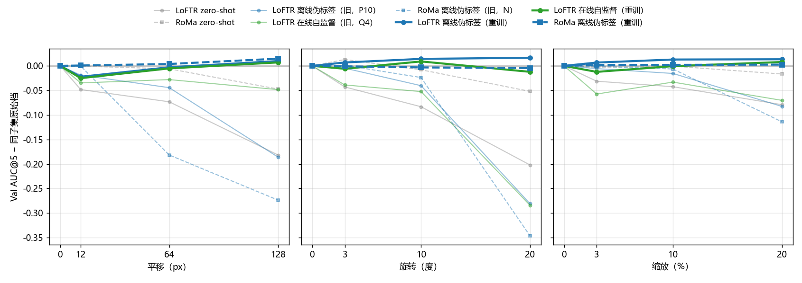
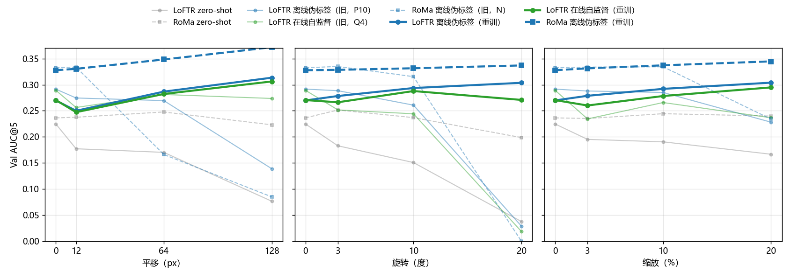

# 训练扰动放大到难版范围以后，三种无标注训练在难版各档上都不再退化，仍高于同骨干的 zero-shot

**摘要**

E7 发现，训练过的模型在难版评测的重档上失去了 zero-shot 的稳健性：旧的训练只在 SAR 一侧加 ±12 px、±3°、±3% 的已知扰动，或者不加扰动，模型对小范围平移过拟合。我们把训练扰动放大到难版的最重一档（平移半径 128 px、旋转 ±20°、缩放 ±20%，三项组合），其余配方不变，重训三种无标注训练方法：LoFTR 与 RoMa 的离线伪标签 noisy student，以及 LoFTR 的在线自监督。难版会剔除扰动后落到画面外的检查点，这本身会抬高重档的分数，所以我们以「同一检查点子集上的原始档」为基准衡量每档的变化。按这个口径，三个重训模型在 9 个档位上的变化都在 −0.025 到 +0.016 之间（Val AUC@5），旧模型在旋转 20° 上掉 0.28–0.35。原始档上，重训的 RoMa 为 0.328，与旧模型（0.332）相当；两个重训的 LoFTR 模型为 0.270 与 0.271，比旧模型低约 0.02，仍比 LoFTR zero-shot 高 0.045。三种无标注训练去掉对小平移的过拟合以后仍然有效。

**引言**

E7 在 SAR 一侧叠加已知的平移、旋转或缩放（各三档），重测了主要方法。旧的训练过的模型在原数据范围内的轻档上领先，到重档就掉到 zero-shot 以下：旋转 20° 时，LoFTR 离线伪标签自训练（P10）和在线自监督（Q4）只剩 0.029 和 0.019，RoMa 离线伪标签自训练（N）为 0.000，而 RoMa zero-shot 仍有 0.199。旧训练的几何扰动只有 ±12 px、±3°、±3%（离线两条线），在线那条线不加扰动，训练只见过原数据里以小平移为主的几何差异。

这引出一个问题：这些无标注训练方法的收益，是不是只来自对小平移的过拟合？如果训练时让模型见到和难版一样大的几何差异，这些方法还能不能胜过 zero-shot？本文把训练扰动放大到难版最重一档的范围，其余配方尽量不变，重训三种方法，再在原始与难版各档上评测。

**方法**

*训练扰动。* 只在 SAR 一侧施加已知仿射 T，伪标签随之精确变为 T∘A。平移在半径 128 px 的圆盘内按面积均匀采样（与难版「固定半径、方向随机」同一度量），旋转在 ±20° 内均匀，缩放在 1 ± 0.2 内均匀，三项组合进同一个 T、各自独立采样。T 把 SAR 移出画面后补 0，原来的标签检查只看 T∘A 的落点是否在新画面内，会让光学边缘一些点去匹配补零区；我们另加一条检查：经 A 落到原 SAR 画面外的点不监督（`[pseudo] mask_fill`）。这条检查在 ±12 px 时几乎不起作用，在 ±128 px 时影响大。

*三种方法。* 除扰动外都沿用原配方。

- LoFTR 离线伪标签 noisy student：每轮用上一轮的 Val 峰值在干净 Train 上打伪标签（RANSAC 3 px，匹配 ≥ 100、内点 ≥ 20，取内点最多的前 50%），学生每轮都从 zero-shot 重训，第 1 轮用 zero-shot 打的标签。每轮配方取 P10 的单轮配方：lr 1e-5、8000 步、warmup 500 + cosine，几何 + 光度扰动。这条线不再沿用 P10 原来「S1 → P2 → P6」的链，改成与 RoMa 同构的纯 noisy student，所以它与 P10 只作并列比较，不是 P10 的重训。轮数：从第 2 轮起，本轮峰值不高于上一轮就停，最多 4 轮。
- RoMa 离线伪标签 noisy student：N 的配方（训 VGG、DINOv2 qkv 加 LoRA r 8、lr 3e-5、8000 步，几何 + 擦除，内点前 50%），2 轮，与 N 相同。
- LoFTR 在线自监督：Q4 的配方（粗级 ±1 闭式期望、外点扣 0.25、负样本对、4000 步），打开几何扰动，不加光度。它的 reward 只看当前模型的 RANSAC 内点，不用参考仿射，T 只作数据扰动。

*选模与评测。* 每轮、每个方法都按原始 Val AUC@5 取峰值（原协议）。难版评测与 E7 相同：同一份逐对 T（复用 E7 的扰动文件），误差换回原 SAR 坐标系量，落到 SAR 画面外的检查点不计。硬件口径同 E7：难版各档 LoFTR 在 RTX 3090、RoMa 在 V100 上推理；原始档是训练驱动在 V100 上评的，E7 抽查过同一 LoFTR 权重跨卡相差不超过 0.005。另外对每个最终模型的每个存档也在 9 档上评了 Val，报告按「原始 + 9 档平均」选模会选到哪一步。

*同子集基准。* 难版剔除的检查点多在画面边缘，那里仿射外推的误差大，剔除以后分数会自然升高：平移 128 px 剔除了 Val 约 28% 的检查点。为分开「子集变了」和「模型变差了」，我们对每个模型和档位，用它原始档的预测、只在该档留下的检查点上按原协议算 AUC@5，记为同子集原始档；各档的「变化」都相对它来算（`code/subset.py`）。

**结果**

*重档的分数高于原始档，主要是剔除边缘检查点造成的。* 三个重训模型在多个重档上的 AUC@5 高于各自的原始档，例如 LoFTR 离线 noisy student 在平移 128 px 为 0.313，原始档为 0.270。只看同一批检查点时，它原始档的预测本身就有 0.304，所以扰动只带来 +0.010。E7 的旧模型同样受这个效应影响：P10 原始档的预测在平移 128 px 的子集上是 0.325，实测 0.139，退化幅度是 0.186，而不是 E7 按全集原始档算的 0.152。下文的变化都按同子集原始档计。

表 1：Val AUC@5，原始档（全集）与四个代表档的实测值，括号内为相对同子集原始档的变化（附件 `extra/data/summary.csv`、`extra/data/subset.csv`）。

| 模型 | 原始 | 平移 12 px | 平移 128 px | 旋转 20° | 缩放 20% |
|---|---|---|---|---|---|
| LoFTR zero-shot | 0.225 | 0.177（−0.048） | 0.077（−0.182） | 0.038（−0.202） | 0.167（−0.079） |
| LoFTR 离线伪标签（旧，P10） | 0.291 | 0.275（−0.019） | 0.139（−0.186） | 0.029（−0.281） | 0.228（−0.083） |
| LoFTR 离线伪标签 noisy student（重训，第 4 轮） | 0.270 | 0.250（−0.022） | 0.313（+0.010） | 0.304（+0.016） | 0.304（+0.013） |
| LoFTR 在线自监督（旧，Q4） | 0.289 | 0.256（−0.035） | 0.274（−0.048） | 0.019（−0.284） | 0.237（−0.070） |
| LoFTR 在线自监督（重训） | 0.271 | 0.247（−0.025） | 0.306（+0.007） | 0.271（−0.012） | 0.295（+0.008） |
| RoMa zero-shot | 0.236 | 0.238（−0.001） | 0.223（−0.047） | 0.199（−0.052） | 0.240（−0.017） |
| RoMa 离线伪标签（旧，N） | 0.332 | 0.334（−0.001） | 0.085（−0.273） | 0.000（−0.346） | 0.234（−0.114） |
| RoMa 离线伪标签 noisy student（重训，第 2 轮） | 0.328 | 0.330（+0.001） | 0.372（+0.015） | 0.337（−0.005） | 0.345（+0.003） |

图 1：三个轴上各档实测 Val AUC@5 减去同子集原始档（0 为扰动后没有变差）。粗线为重训的模型，淡色细线为 E7 的旧模型；颜色表示路线（灰为 zero-shot，蓝为离线伪标签，绿为在线自监督），实线圆点为 LoFTR，虚线方块为 RoMa。

*放大训练扰动以后，三个重训模型在难版各档上都不再退化。* 9 档上的变化，RoMa 离线 noisy student 在 −0.005 到 +0.015 之间，LoFTR 离线 noisy student 在 −0.022 到 +0.016 之间，LoFTR 在线自监督在 −0.025 到 +0.009 之间；旧模型在旋转 20° 上掉 0.28–0.35，两个 zero-shot 也分别掉 0.20（LoFTR）和 0.05（RoMa）（图 1）。Test 上规律相同：三个重训模型在 9 档上最多掉 0.008，旧模型最多掉 0.24–0.31（附件 `extra/data/subset.csv`）。唯一一致变差的是 LoFTR 在平移 12 px 上：所有 LoFTR 模型都掉 0.02–0.05，RoMa 模型都不掉；重训没有消除它，原因本文没有检验。

*三种无标注训练在难版各档上都高于同骨干的 zero-shot。* 原始档上，重训的 RoMa 为 0.328，RoMa zero-shot 为 0.236；两个重训的 LoFTR 模型为 0.270 与 0.271，LoFTR zero-shot 为 0.225。到旋转 20°，RoMa 是 0.337 对 0.199，LoFTR 是 0.304 与 0.271 对 0.038（图 2）。也就是说，去掉对小平移的过拟合以后，这三种训练方法仍然有效。重训的 RoMa 在平移 64 px、旋转 10°、缩放 10% 及更重的 6 档上是所有模型中最高的；在原始档和三个轻档上，旧 N 比它高 0.003–0.007。

图 2：三个轴上各模型的 Val AUC@5 随扰动档位的变化（0 为原始）。图例同图 1。

*原始档上 RoMa 几乎不变，LoFTR 低约 0.02。* 原始 Val AUC@5 上，重训的 RoMa 0.328 比 N 低 0.004（Test 0.301 对 0.304）；LoFTR 离线 noisy student 0.270 比 P10 低 0.021，在线自监督 0.271 比 Q4 低 0.018（Test 0.233 对 0.265、0.241 对 0.270）。两条离线线的收益都随轮数上升：RoMa 第 1、2 轮为 0.320、0.328（Test 0.297、0.301）；LoFTR 第 1 至 4 轮为 0.260、0.265、0.268、0.270（Test 0.212、0.230、0.232、0.233），每轮都高于上一轮，到上限 4 轮为止，第 4 轮的峰值落在最后一个存档（第 8000 步）。重打的标签几乎全部过门槛：RoMa 两轮都是 7907 对全过，LoFTR 第 2 至 4 轮依次 7772、7861、7850 对（zero-shot 标签为 7880 对）。

*在线自监督在大扰动下后期变差，按难版选模会换存档。* 在线这条线的原始 Val AUC@5 在第 500 步达到峰值 0.270，第 750 步以后匹配数从每对约 1200 个塌到约 100 个，原始档掉到 0.20–0.25；同一时期它在难版 9 档的平均却一直在 0.28–0.29。按「原始 + 9 档平均」选模，在线这条线会选第 2000 步（10 档平均 0.290，原始档 0.255）而不是第 500 步（0.276）；LoFTR 离线 noisy student 两种选法都选第 8000 步（附件 `extra/data/select.csv`）。旧 Q6（扰动 ±24 px、±5°）在原始 Val 上也有类似的后期变差（`runs/Q/notes.md`）。RoMa 的逐存档难版评测还没跑完，选模对照待补。

**讨论**

E7 留下的问题是：无标注训练的收益是不是只来自对小平移的过拟合。对三种训练，答案都是否定的：把训练扰动放大到难版范围以后，它们在原始档仍明显高于同骨干的 zero-shot（RoMa 高 0.092，LoFTR 高约 0.045），在难版各档上不再退化，在旋转 20° 这类原数据中没有的几何差异上也保持住了。放大扰动的代价因骨干而异：RoMa 的原始档几乎不变，LoFTR 低约 0.02，说明旧 LoFTR 模型原始档的领先里有一部分来自贴合原数据的几何分布。

局限有四点。第一，扰动是合成的，补零区和重采样都不是真实数据里的情况；LoFTR 在平移 12 px 上的一致下降可能与此有关，本文没有检验。第二，训练扰动覆盖到难版最重一档，难版各档都在训练范围内，本文没有测训练范围之外的外推。第三，LoFTR 离线这条线换成了纯 noisy student，与 P10 的迭代链不同，两者的差别不全来自扰动；每个方法只有一个随机种子。第四，同子集基准修正了检查点子集的影响，但 E7 与本文的难版表都按全集原始档报告，读表时要注意重档的数字偏高。

对后续研究，有三点值得做。一是以后报告难版结果时，把同子集原始档作为基准，否则训练扰动大的模型会显得「越扰越好」。二是在线自监督在大扰动下后期变差，与旧 Q6 相同，选模若纳入难版，会换到更晚的存档；如果难版升为评判标准，选模规则需要一起定。三是 LoFTR 在平移 12 px 上的一致下降值得单独查。
